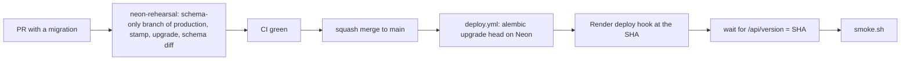

# .github/workflows

| File | Runs | What it does |
|---|---|---|
| `ci.yml` | every PR and push to `main` | `backend` (an aggregate of `backend-tests` and `backend-migrations`, which run in parallel), `frontend`, `e2e`, `e2e-admin`, and `neon-rehearsal` |
| `deploy.yml` | push to `main` (after cutover), or by hand | push only: wait for that commit's `backend` and `frontend` CI jobs (`scripts/wait-for-ci.sh`); then migrate Neon, deploy the API, wait, smoke. A manual run skips the wait |
| `update-visual-baselines.yml` | by hand (`workflow_dispatch`) | regenerate the visual baselines on ubuntu and commit them to the branch it ran on; the only workflow with `contents: write`, and it refuses `main` |
| `pr-closed.yml` | a PR closes | delete the PR's Neon rehearsal branch |
| `nightly.yml` | 00:17 UTC | the data refreshes and the snapshot deploy (see its header) |

## Visual baselines

`ci.yml`'s `e2e` job compares screenshots (`npm run e2e:visual`) with the PNGs
in `frontend/e2e/visual-baselines/`. They must come from the runner, so after
an intended visual change run `gh workflow run update-visual-baselines.yml
--ref <branch>`, then push an empty commit (a `GITHUB_TOKEN` commit does not
trigger CI). Diff policy and the artifact route: `frontend/README.md` -> Browser
tests -> Visual baselines.

## Migrations and deploys (the whole path)

Why it is shaped this way: Render's `preDeployCommand` and preview environments
are paid, a migration in `buildCommand` runs on every rebuild with no gate, and
the old hand step ("apply, then merge") gets skipped. A failed migration here
stops before any new code is live. It is safe because migrations are additive
(`backend/migrations/README.md`): for the minutes the schema is ahead of the
live code, the old API still boots.

## Settings these need

| Name | Kind | Used by | Value |
|---|---|---|---|
| `NEON_PROJECT_ID` | variable | `neon-rehearsal`, `pr-closed.yml` | `damp-hall-89096472`; unset = both skip |
| `NEON_API_KEY` | secret | same | Neon console -> Account settings -> API keys |
| `DATABASE_URL_DIRECT` | secret | `deploy.yml` | Neon's **direct** (unpooled) URL, as in `backend/.env` |
| `RENDER_API_DEPLOY_HOOK_URL` | secret | `deploy.yml` | the **API** service's deploy hook (Render -> `joey-haas-dev-api` -> Settings -> Deploy Hook). The URL must contain `srv-da3u2m8ae00c73983rsg`; `deploy.yml` refuses any other |
| `RENDER_DEPLOY_HOOK_URL` | secret | `nightly.yml` | existing; the static site's snapshot deploy |
| `API_DEPLOY_FROM_ACTIONS` | variable | `deploy.yml` | `"true"` at cutover; unset = push runs skip (manual runs still work) |

## Cutover and rollback

Cutover is two settings, made together: set `API_DEPLOY_FROM_ACTIONS=true`, and
set `autoDeployTrigger: off` on the API service in `render.yaml` (otherwise
Render deploys it too). Prove it first with a manual run of `deploy.yml`.

Rollback of the **code**, fast: Actions -> Deploy API -> Run workflow with
`commit` set to an earlier commit of main (it must contain `GET /api/version`,
317b574 or later). It runs no migrations, redeploys that commit through the hook
and waits for `/api/version` to report it. The schema stays where it is, which is
safe because migrations are additive. Then revert the bad change with a PR.

Rollback of the **cutover**: set `autoDeployTrigger: commit` again and clear the
variable. Migrations stay (additive).

## Gotchas

- `deploy.yml`'s `wait-for-ci` job holds a push's deploy until CI has passed on that
  commit (about 5 more minutes before a deploy starts), and fails the run if CI is
  red or does not finish in 30 minutes, so a red `main` never deploys. `ci.yml`
  groups a push's run by commit SHA and never cancels it, so each main commit has a
  run to wait for. To deploy past a red CI, use Run workflow (it skips the wait).

- `deploy.yml` waits on `GET /api/version`, which reports Render's
  `RENDER_GIT_COMMIT`. If that shows `unknown`, the wait can never succeed:
  `scripts/smoke.sh` flags it.
- Fork PRs get no secrets, so the rehearsal skips them.
- A schema-only Neon branch is a root branch and a free project allows three
  roots (production is one), so only two migration PRs can rehearse at once. The
  branch expires after seven days as a net.
- Proven on a real branch (PR #254, closed unmerged): create, stamp at the base
  head (`stamp_revision -> 0019`), apply only the PR's revisions, the schema-diff
  comment, and `pr-closed.yml` deleting the branch.
