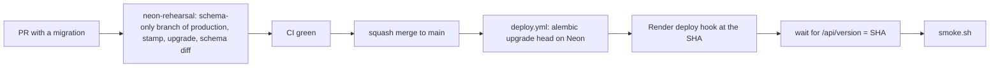

# .github/workflows

| File | Runs | What it does |
|---|---|---|
| `ci.yml` | every PR and push to `main` | `backend`, `frontend`, `e2e`, `e2e-admin`, and `neon-rehearsal` |
| `deploy.yml` | push to `main` (after cutover), or by hand | migrate Neon, deploy the API, wait, smoke |
| `pr-closed.yml` | a PR closes | delete the PR's Neon rehearsal branch |
| `nightly.yml` | 00:17 UTC | the data refreshes and the snapshot deploy (see its header) |

## Migrations and deploys (the whole path)

Why it is shaped this way: Render's `preDeployCommand` and preview environments
are paid, a migration in `buildCommand` runs on every rebuild with no gate, and
the old hand step ("apply, then merge") gets skipped. A failed migration here
stops before any new code is live. It is safe because migrations are additive
(`backend/migrations/README.md`): for the minutes the schema is ahead of the
live code, the old API still boots.

## Settings these need

| Name | Kind | Used by | Value |
|---|---|---|---|
| `NEON_PROJECT_ID` | variable | `neon-rehearsal`, `pr-closed.yml` | `damp-hall-89096472`; unset = both skip |
| `NEON_API_KEY` | secret | same | Neon console -> Account settings -> API keys |
| `DATABASE_URL_DIRECT` | secret | `deploy.yml` | Neon's **direct** (unpooled) URL, as in `backend/.env` |
| `RENDER_API_DEPLOY_HOOK_URL` | secret | `deploy.yml` | the **API** service's deploy hook (Render -> service -> Settings) |
| `RENDER_DEPLOY_HOOK_URL` | secret | `nightly.yml` | existing; the static site's snapshot deploy |
| `API_DEPLOY_FROM_ACTIONS` | variable | `deploy.yml` | `"true"` at cutover; unset = push runs skip (manual runs still work) |

## Cutover and rollback

Cutover is two settings, made together: set `API_DEPLOY_FROM_ACTIONS=true`, and
set `autoDeployTrigger: off` on the API service in `render.yaml` (otherwise
Render deploys it too). Prove it first with a manual run of `deploy.yml`.

Rollback: set `autoDeployTrigger: commit` again and clear the variable. A bad
deploy is reverted with a PR as before; migrations stay (additive).

## Gotchas

- `deploy.yml` waits on `GET /api/version`, which reports Render's
  `RENDER_GIT_COMMIT`. If that shows `unknown`, the wait can never succeed:
  `scripts/smoke.sh` flags it.
- Fork PRs get no secrets, so the rehearsal skips them.
- A free Neon project holds ten branches in all; the rehearsal uses one per
  open migration PR and expires it after seven days.
