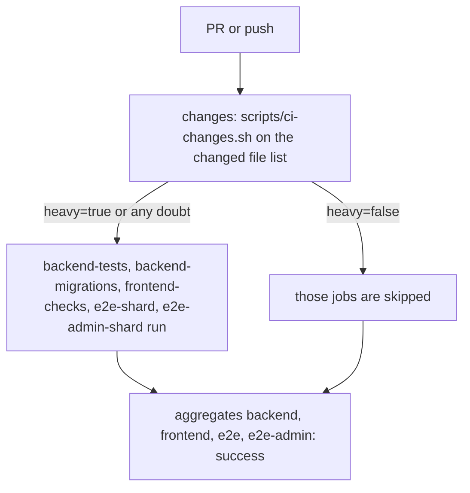
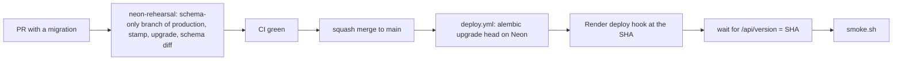

# .github/workflows

| File | Runs | What it does |
|---|---|---|
| `ci.yml` | every PR and push to `main` | `changes` (docs-only detection, below), `backend` (an aggregate of `backend-tests` and `backend-migrations`, which run in parallel), `frontend` (an aggregate of `frontend-checks`), `scripts` (the shell helpers' tests; not required), `e2e` and `e2e-admin` (aggregates of sharded jobs, below), and `neon-rehearsal` |
| `deploy.yml` | push to `main` (after cutover), or by hand | push only: wait for that commit's `backend` and `frontend` CI jobs (`scripts/wait-for-ci.sh`); then migrate Neon, deploy the API, wait, smoke. A manual run skips the wait |
| `update-visual-baselines.yml` | by hand (`workflow_dispatch`) | regenerate the visual baselines on ubuntu and commit them to the branch it ran on; the only workflow with `contents: write`, and it refuses `main` |
| `pr-closed.yml` | a PR closes | delete the PR's Neon rehearsal branch |
| `nightly.yml` | 00:17 UTC | the data refreshes and the snapshot deploy (see its header) |

## Docs-only changes skip the heavy jobs

The `changes` job lists the changed files (a PR: `origin/<base>...HEAD`; a push:
`<before>..<sha>`) and `scripts/ci-changes.sh` prints `heavy=true|false`.
Docs-only is every file under `docs/`, a root `*.md`, or under
`.github/ISSUE_TEMPLATE/`; the definition lives in that script alone. Anything
else is heavy, including `frontend/**.md` (`prettier --check .` and the
changelog parser read them), `.github/workflows/**` and `render.yaml`. The job
fails open: an empty list, a push with no usable `before` sha or a git error
prints `heavy=true`.

`backend-tests`, `backend-migrations`, `frontend-checks`, `e2e-shard` and
`e2e-admin-shard` take `needs: changes` and run only when `heavy` is `true`.
The four aggregates (`backend`, `frontend`, `e2e`, `e2e-admin`) pass when their
parts are `success`, **or** when their parts are `skipped` **and** `changes`
succeeded **and** `heavy` is `false`. A skipped part beside a failed, cancelled
or skipped `changes` fails the aggregate, so the gate cannot open by accident.
`scripts` and `neon-rehearsal` are not gated.

- **Why not `paths-ignore`**: a workflow that does not run reports no checks, and
  a required check that never reports stays pending forever, blocking the merge.
  Skipping jobs inside a run keeps every check name reporting.
- **Why the aggregates, not the parts, report**: branch protection and
  `scripts/wait-for-ci.sh` read `backend` and `frontend` by name. A job that
  ends `skipped` is not `success`: `wait-for-ci.sh` counts only `success`, so a
  skipped `backend` would make a docs-only merge to `main` wait 30 minutes and
  then refuse to deploy. An aggregate that runs and passes ends `success`.
- **`frontend` is an aggregate now**: its steps moved to `frontend-checks`, and
  the name `frontend` stays on the aggregate alone, like `backend`.
- **Widening or narrowing**: edit `scripts/ci-changes.sh` and its test.

## The sharded browser jobs

`e2e` and `e2e-admin` are each an aggregate (like `backend`): a tiny job that
`needs:` a matrix and passes only when every shard did. The shards are
`e2e-shard (<name>)` and `e2e-admin-shard (<name>)`; each is its own runner
(admin shards each have their own Postgres service), builds the site itself,
and runs Playwright with `--fully-parallel`. Nothing else reads these names:
`scripts/wait-for-ci.sh` waits only for `backend` and `frontend`, and neither
`e2e` job is a required check.

| Job | Shard | Runs |
|---|---|---|
| `e2e` | `add-1`, `add-2`, `add-3` | `admin-add.spec.js`: its 60 slow `focus rings paint` tests (desktop) cut in thirds by `--shard`; `add-1` also runs the rest of the file as a second step and `add-3` the phone `focus rings paint` tests (retune if the slow tests change) |
| `e2e` | `rest` | every other spec, then the visual tests (`e2e:visual`) |
| `e2e-admin` | `cd-1`, `cd-2`, `cd-3` | the Closet and Denver site specs, cut three ways by `--shard` (plus the sign-in setup test, which runs in every shard) |
| `e2e-admin` | `rest` | every other admin spec |

Why files and not plain `--shard=i/N` over the suite: Playwright cuts the test
list into equal counts, and one file (`admin-add.spec.js`, 192 slow tests) made
a shard take 15 minutes while others took 1. `rest` runs everything the others
do not through `E2E_SKIP_FILES` (read by both Playwright configs), so a new
spec file lands in `rest` by default; if it is heavy, give it its own shard. The
Closet, Denver and data specs route their API answers in the page and write
nothing, which is what makes `--fully-parallel` safe for them.

- **Read the aggregate**: `e2e` or `e2e-admin` red means a shard is red or
  cancelled; open the run and look for the red `... (<name>)` job. Its failure
  report is the artifact `playwright-report-<name>` (admin:
  `playwright-report-admin-<name>`).
- **Rerun one shard**: in the run, "Re-run failed jobs" (or `gh run rerun <run-id>
  --failed`) reruns only the red shards, and the aggregate job with them.
- **Counts**: each shard prints its own `N passed, M skipped`; the sum across
  shards equals the old single job's numbers (admin: plus two extra passes of the
  sign-in setup test).
- **Add a shard**: add an entry to the matrix in `ci.yml` (`name`, `args`, `skip`).

## Visual baselines

`ci.yml`'s `e2e` job (its `rest` shard) compares screenshots (`npm run e2e:visual`) with the PNGs
in `frontend/e2e/visual-baselines/`. They must come from the runner, so after
an intended visual change run `gh workflow run update-visual-baselines.yml
--ref <branch>`, then push an empty commit (a `GITHUB_TOKEN` commit does not
trigger CI). Diff policy and the artifact route: `frontend/README.md` -> Browser
tests -> Visual baselines.

## Migrations and deploys (the whole path)

Why it is shaped this way: Render's `preDeployCommand` and preview environments
are paid, a migration in `buildCommand` runs on every rebuild with no gate, and
the old hand step ("apply, then merge") gets skipped. A failed migration here
stops before any new code is live. It is safe because migrations are additive
(`backend/migrations/README.md`): for the minutes the schema is ahead of the
live code, the old API still boots.

## Settings these need

| Name | Kind | Used by | Value |
|---|---|---|---|
| `NEON_PROJECT_ID` | variable | `neon-rehearsal`, `pr-closed.yml` | `damp-hall-89096472`; unset = both skip |
| `NEON_API_KEY` | secret | same | Neon console -> Account settings -> API keys |
| `DATABASE_URL_DIRECT` | secret | `deploy.yml` | Neon's **direct** (unpooled) URL, as in `backend/.env` |
| `RENDER_API_DEPLOY_HOOK_URL` | secret | `deploy.yml` | the **API** service's deploy hook (Render -> `joey-haas-dev-api` -> Settings -> Deploy Hook). The URL must contain `srv-da3u2m8ae00c73983rsg`; `deploy.yml` refuses any other |
| `RENDER_DEPLOY_HOOK_URL` | secret | `nightly.yml` | existing; the static site's snapshot deploy |
| `API_DEPLOY_FROM_ACTIONS` | variable | `deploy.yml` | `"true"` at cutover; unset = push runs skip (manual runs still work) |

## Cutover and rollback

Cutover is two settings, made together: set `API_DEPLOY_FROM_ACTIONS=true`, and
set `autoDeployTrigger: off` on the API service in `render.yaml` (otherwise
Render deploys it too). Prove it first with a manual run of `deploy.yml`.

Rollback of the **code**, fast: Actions -> Deploy API -> Run workflow with
`commit` set to an earlier commit of main (it must contain `GET /api/version`,
317b574 or later). It runs no migrations, redeploys that commit through the hook
and waits for `/api/version` to report it. The schema stays where it is, which is
safe because migrations are additive. Then revert the bad change with a PR.

Rollback of the **cutover**: set `autoDeployTrigger: commit` again and clear the
variable. Migrations stay (additive).

## Gotchas

- The browser shards install Chromium with `scripts/install-chromium.sh`: `playwright install --with-deps` is about 20 s, but a throttled apt mirror made one shard in most runs take 2 to 4 minutes (the browser download is 4 s; the apt step is the slow part). The script caps each attempt at 75 s and retries, the last uncapped. A "Chromium install attempt N did not finish" line in a log is that working, not a failure.

- `deploy.yml`'s `wait-for-ci` job holds a push's deploy until CI has passed on that
  commit (about 5 more minutes before a deploy starts), and fails the run if CI is
  red or does not finish in 30 minutes, so a red `main` never deploys. `ci.yml`
  groups a push's run by commit SHA and never cancels it, so each main commit has a
  run to wait for. To deploy past a red CI, use Run workflow (it skips the wait).

- `deploy.yml` waits on `GET /api/version`, which reports Render's
  `RENDER_GIT_COMMIT`. If that shows `unknown`, the wait can never succeed:
  `scripts/smoke.sh` flags it.
- Fork PRs get no secrets, so the rehearsal skips them.
- A schema-only Neon branch is a root branch and a free project allows three
  roots (production is one), so only two migration PRs can rehearse at once. The
  branch expires after seven days as a net.
- Proven on a real branch (PR #254, closed unmerged): create, stamp at the base
  head (`stamp_revision -> 0019`), apply only the PR's revisions, the schema-diff
  comment, and `pr-closed.yml` deleting the branch.
