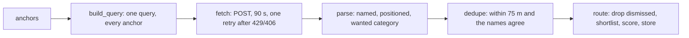

# spot_sources

Where the spot finder's places come from. It has one source, OpenStreetMap
through the public Overpass API. The finder is admin only:
`POST /api/spots/candidates/refresh` in `spots_candidates_routes.py`,
which the nightly job also calls. Scoring is `candidates.py` (pure). Spec: `docs/planning/2026-11-08-denver-spots-design.md`.

| Module | What it does | Pure? |
|---|---|---|
| `limits.py` | The URL, radius, timeouts, backoff and dedupe thresholds | yes |
| `overpass.py` | `build_query`, `parse` (pure) and `fetch` (the one network call) | `fetch` takes the caller's client |
| `dedupe.py` | Removes one place mapped twice, and places already on the list | yes |

`tests/test_physical_imports.py` keeps all three modules free of FastAPI,
SQLAlchemy and the models. The database work belongs to the route.

## One run

- **One request per run.** Each anchor gets an `around:` block for each
  tag in the query. Overpass unions the blocks, so a place inside two
  anchors' radii comes back once.
- **Fair use.** Requests carry the catalogue's identifying `USER_AGENT`.
  The finder sends one query a week, never two at once, and waits 30 s
  after a 429 or 406. A second refusal fails the run, and the old
  candidates stay where they are.
- **A 200 can still be a failure.** A query that runs out of time comes
  back with status 200 and a `remark` saying "runtime error". `fetch`
  raises on that remark.
- **Odd rows are skipped, never fatal.** `parse` silently drops elements
  that are unnamed, `disused:`/`abandoned:`, or have no position.
- **Ids are OSM's own** (`node/123`, `way/45`). A node and a way that
  share a number stay distinct. A dismissal is keyed on the same id.

## Fixture

`tests/fixtures/overpass_candidates.json` is a real answer recorded by
`scripts/record_spot_fixtures.py`, using the finder's own query around
Union Station at a 600 m radius. Re-record it when `TAG_SET` or the query
changes. Never edit it by hand. Some tests depend on specific ids in it
(the duplicates `test_spot_dedupe.py` expects), so update those tests in
the same commit as a new recording.

OSM data is © OpenStreetMap contributors, under the ODbL.

## Nominatim

Intake's place search (story #340) calls Nominatim, OpenStreetMap's public
geocoder, at `https://nominatim.openstreetmap.org/search`. Policy read in full
on 2026-11-17 at https://operations.osmfoundation.org/policies/nominatim/.
The rules that bind this use:

| Rule | Policy, verbatim | What we do |
|---|---|---|
| Rate | "No heavy uses (an absolute maximum of 1 request per second)." | One search per submit, by one person. The recorder waits 1.1 s between calls. |
| Client name | "Provide a valid HTTP Referer or User-Agent identifying the application (stock User-Agents as set by http libraries will not do)." | `NOMINATIM_USER_AGENT` in `limits.py`: `joey-haas.dev tracker (+https://joey-haas.dev)`. It names the app and a contact page and carries no email address on purpose. It is not the catalogue's `USER_AGENT` (`physical_sources/limits.py`), which has an email, and must never be sent to Nominatim. |
| No autocomplete | "Auto-complete search This is not yet supported by Nominatim and you must not implement such a service on the client side using the API." | Search runs on submit only, never per keystroke. |
| Caching | "Results must be cached on your side. Clients sending repeatedly the same query may be classified as faulty and blocked." (listed under Bulk Geocoding) | See the decision below. |
| Attribution | "Clearly display attribution as suitable for your medium." Data is under the ODbL. | Show "OpenStreetMap contributors" beside Nominatim results. Same as the finder's. |
| Bulk | "periodic requests from apps are considered bulk geocoding and as such are strongly discouraged"; scripts run at regular intervals "are restricted to 4 requests per minute". | Does not apply: see below. |
| Forbidden | "Systematic queries", automatic scraping of the details page, autocomplete. | None of these are done. |

The bulk and caching rules do not apply here. This tool is single-owner: one
person types one search and submits it, so traffic is user-triggered, not
periodic, and far under 1 request per second. Nothing runs on a schedule.

**Decision: no cache beyond the request.** The policy's caching sentence sits
under bulk geocoding. A single owner submitting one search at a time does not
send repeated identical queries in a way worth storing, and a cache adds state
for no gain. Revisit if searches ever run unattended or in bursts.

### Ids match the finder's

Nominatim's `osm_type` is `"node"`, `"way"` or `"relation"` and `osm_id` is a
number. The finder stores `source_id` as `f"{kind}/{number}"`
(`overpass.py`). So `f"{osm_type}/{osm_id}"` gives the same form. Checked
against the recorded fixtures: `nominatim_one.json` returns `osm_type` "way",
`osm_id` 229359697 (an int), which converts to `way/229359697`;
`nominatim_several.json` returns five `node` results, e.g. `node/13954249024`.
The shape matches `overpass_candidates.json` (`type` "node", `id` 366394521
int, giving `node/366394521`). This shows the format is the same; the
fixtures do not contain a place present in both sources, so a real id
collision between a Nominatim result and a stored finder row is not shown
here. Dedupe can key on the shared id and keep name-and-distance
(`SAME_PLACE_METRES`, `SAME_NAME_RATIO`) as the fallback for rows without one.

### Fixtures

`tests/fixtures/nominatim_one.json`, `nominatim_several.json` and
`nominatim_none.json` are real answers recorded 2026-11-17 by
`scripts/record_spot_fixtures.py --nominatim` (queries "Red Rocks Amphitheatre
Morrison", "Starbucks Denver", "zzqxv nonexistent place"; `format=jsonv2`,
`addressdetails=1`, `limit=5`, `countrycodes=us`). Each wraps the response as
`results` with the `query`, `params` and `recorded` date. Never edit by hand.
