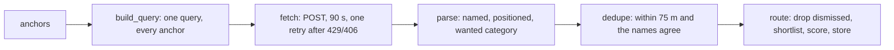

# spot_sources

Where the spot finder's places come from. It has one source, OpenStreetMap
through the public Overpass API. The finder is admin only:
`POST /api/spots/candidates/refresh` in `spots_candidates_routes.py`,
which the nightly job also calls. Scoring is `candidates.py` (pure). Spec: `docs/planning/2026-11-08-denver-spots-design.md`.

| Module | What it does | Pure? |
|---|---|---|
| `limits.py` | The URL, radius, timeouts, backoff and dedupe thresholds | yes |
| `overpass.py` | `build_query`, `parse` (pure) and `fetch` (the one network call) | `fetch` takes the caller's client |
| `dedupe.py` | Removes one place mapped twice, and places already on the list | yes |

`tests/test_physical_imports.py` keeps all three modules free of FastAPI,
SQLAlchemy and the models. The database work belongs to the route.

## One run



- **One request per run.** Each anchor gets an `around:` block for each
  tag in the query. Overpass unions the blocks, so a place inside two
  anchors' radii comes back once.
- **Fair use.** Requests carry the catalogue's identifying `USER_AGENT`.
  The finder sends one query a week, never two at once, and waits 30 s
  after a 429 or 406. A second refusal fails the run, and the old
  candidates stay where they are.
- **A 200 can still be a failure.** A query that runs out of time comes
  back with status 200 and a `remark` saying "runtime error". `fetch`
  raises on that remark.
- **Odd rows are skipped, never fatal.** `parse` silently drops elements
  that are unnamed, `disused:`/`abandoned:`, or have no position.
- **Ids are OSM's own** (`node/123`, `way/45`). A node and a way that
  share a number stay distinct. A dismissal is keyed on the same id.

## Fixture

`tests/fixtures/overpass_candidates.json` is a real answer recorded by
`scripts/record_spot_fixtures.py`, using the finder's own query around
Union Station at a 600 m radius. Re-record it when `TAG_SET` or the query
changes. Never edit it by hand. Some tests depend on specific ids in it
(the duplicates `test_spot_dedupe.py` expects), so update those tests in
the same commit as a new recording.

OSM data is © OpenStreetMap contributors, under the ODbL.

## Nominatim

Intake's place search (story #340) calls Nominatim, OpenStreetMap's public
geocoder, at `https://nominatim.openstreetmap.org/search`, from
`nominatim.py`. The place kind (`intake/place_kind.py`) is its only caller.
Policy read in full on 2026-11-17 at
https://operations.osmfoundation.org/policies/nominatim/. The rules that bind
this use:

| Rule | Policy, verbatim | What we do |
|---|---|---|
| Rate | "No heavy uses (an absolute maximum of 1 request per second)." | One search per submit, by one person. The client waits 1.1 s between requests (`_throttle`, below). |
| Client name | "Provide a valid HTTP Referer or User-Agent identifying the application (stock User-Agents as set by http libraries will not do)." | `NOMINATIM_USER_AGENT` in `limits.py`: `joey-haas.dev tracker (+https://joey-haas.dev)`. See "Client name" below. |
| No autocomplete | "Auto-complete search This is not yet supported by Nominatim and you must not implement such a service on the client side using the API." | Search runs on submit only, never per keystroke. |
| Caching | "Results must be cached on your side. Clients sending repeatedly the same query may be classified as faulty and blocked." (listed under Bulk Geocoding) | See the decision below. |
| Attribution | "Clearly display attribution as suitable for your medium." Data is under the ODbL. | The page shows "OpenStreetMap contributors" beside Nominatim results, and each search row carries `attribution`. Same as the finder's. |
| Periodic requests | "Note: periodic requests from apps are considered bulk geocoding and as such are strongly discouraged. It may be okay if your app has very few users and applies appropriate caching of results." Scripts run at regular intervals "are restricted to 4 requests per minute". | Nothing here runs on a schedule. See the decision below. |
| Forbidden | "Systematic queries", automatic scraping of the details page, autocomplete. | None of these are done. |

**Decision: no cache beyond the request.** The policy's sentence about
periodic requests says they are "strongly discouraged" and that an app "may be
okay if your app has very few users and applies appropriate caching of
results". We have one user (the owner), and every request is triggered by that
person submitting a search, so none is periodic. That is the whole basis for
leaving the cache out, and it is a judgment against a sentence that asks for
caching, not an exemption: the bulk rules are met by being a single-owner tool,
not by not applying. A cache would also add state and could hide a changed OSM
record. Revisit if searches ever run unattended, in bursts, or for more than
the owner.

### The client

`search(client, query)` takes the caller's `httpx2.AsyncClient` (the module
never builds one) and returns `SearchOk(hits)` or `SearchFailure(reason,
message)`. It never raises for a network or HTTP problem. An empty query makes
no request.

- **Throttle.** `_throttle = Throttle(1.1)` (`sources/base.py`), a module-level
  object, so the spacing is per process. One API instance and one owner make
  that enough. Concurrent searches queue behind it.
- **Deadline.** `TOTAL_TIMEOUT_SECONDS = 7.0` covers the throttle wait and the
  request together (`asyncio.timeout`). The HTTP call has its own
  `REQUEST_TIMEOUT_SECONDS = 6.0`, but httpx applies a timeout per phase, not
  to the whole call, so alone it does not bound a search. 7 s sits just under
  intake's 8 s `SEARCH_TIMEOUT` (`intake/search.py`): a search queued behind
  others comes back as the typed `timeout` failure instead of being cancelled
  from outside and shown as "busy".
- **Parameters.** `format=jsonv2`, `addressdetails=1`, `limit=5`,
  `countrycodes=us`, and `viewbox` set to Denver as a boost only (never
  `bounded`), so a name outside Denver still resolves.
- **Failures.** `FailureReason` is `timeout`, `http_error`, `bad_response` or
  `empty_query`; `message` is fit to show. A non-200 answer, a body that is not
  a JSON list, and a network error each become a failure with a warning in the
  log. A row without lat, lon, `osm_type` or `osm_id` is skipped.

### Client name

`NOMINATIM_USER_AGENT` names the app and a contact page and carries no email
address, on purpose. It is not the catalogue's `USER_AGENT`
(`physical_sources/limits.py`), which identifies the owner by email address;
Overpass and the store hosts already receive that one, and Nominatim gets a
separate name so the address goes to no more hosts. The policy accepts a
User-Agent that identifies the application. A test asserts the constant is
what is sent and that no `@` appears in the header. Do not send the
catalogue's header to Nominatim.

### Ids match the finder's

Nominatim's `osm_type` is `"node"`, `"way"` or `"relation"` and `osm_id` is a
number. The finder stores `source_id` as `f"{kind}/{number}"`
(`overpass.py`). So `f"{osm_type}/{osm_id}"` gives the same form. Checked
against the recorded fixtures: `nominatim_one.json` returns `osm_type` "way",
`osm_id` 229359697 (an int), which converts to `way/229359697`;
`nominatim_several.json` returns five `node` results, e.g. `node/13954249024`.
The shape matches `overpass_candidates.json` (`type` "node", `id` 366394521
int, giving `node/366394521`).

The decision made from this: a Nominatim hit is owned when its `source_id`
equals a spot's `source_id` with `source` osm; otherwise it is owned when a
spot of the same name lies within `SAME_PLACE_METRES` (75 m, `dedupe.same_place`,
with `SAME_NAME_RATIO`). The saved spot stores `source = osm` and that id, the
same shape the finder writes. The limit: the fixtures share no common place, so
a real collision of a Nominatim id and an Overpass id is not shown. The id rule
is tested on synthetic spots; the name-and-distance rule is what catches a
place whose ids disagree.

### Fixtures

`tests/fixtures/nominatim_one.json`, `nominatim_several.json` and
`nominatim_none.json` are real answers recorded 2026-11-17 (queries "Red Rocks
Amphitheatre Morrison", "Starbucks Denver", "zzqxv nonexistent place"; the
search parameters above). Each wraps the response as `results` with the
`query`, `params` and `recorded` date. Never edit by hand.

To re-record, from `backend/` in any checkout or worktree:

```bash
./.venv/bin/python scripts/record_spot_fixtures.py --nominatim
```

It makes three requests, one per case, at least 1.1 s apart, sending
`NOMINATIM_USER_AGENT`. It needs the network and nothing else. Re-record when
the search parameters change or Nominatim's answer shape does, then run
`./.venv/bin/pytest tests/test_nominatim.py`.
