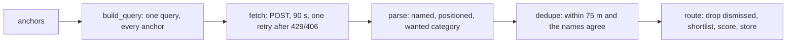

# spot_sources

Where the spot finder's places come from. It has one source, OpenStreetMap
through the public Overpass API. The finder is admin only:
`POST /api/spots/candidates/refresh` in `spots_candidates_routes.py`,
which the nightly job also calls. Scoring is `candidates.py` (pure). Spec: `docs/planning/2026-11-08-denver-spots-design.md`.

| Module | What it does | Pure? |
|---|---|---|
| `limits.py` | The URL, radius, timeouts, backoff and dedupe thresholds | yes |
| `overpass.py` | `build_query`, `parse` (pure) and `fetch` (the one network call) | `fetch` takes the caller's client |
| `dedupe.py` | Removes one place mapped twice, and places already on the list | yes |

`tests/test_physical_imports.py` keeps all three modules free of FastAPI,
SQLAlchemy and the models. The database work belongs to the route.

## One run

- **One request per run.** Each anchor gets an `around:` block for each
  tag in the query. Overpass unions the blocks, so a place inside two
  anchors' radii comes back once.
- **Fair use.** Requests carry the catalogue's identifying `USER_AGENT`.
  The finder sends one query a week, never two at once, and waits 30 s
  after a 429 or 406. A second refusal fails the run, and the old
  candidates stay where they are.
- **A 200 can still be a failure.** A query that runs out of time comes
  back with status 200 and a `remark` saying "runtime error". `fetch`
  raises on that remark.
- **Odd rows are skipped, never fatal.** `parse` silently drops elements
  that are unnamed, `disused:`/`abandoned:`, or have no position.
- **Ids are OSM's own** (`node/123`, `way/45`). A node and a way that
  share a number stay distinct. A dismissal is keyed on the same id.

## Fixture

`tests/fixtures/overpass_candidates.json` is a real answer recorded by
`scripts/record_spot_fixtures.py`, using the finder's own query around
Union Station at a 600 m radius. Re-record it when `TAG_SET` or the query
changes. Never edit it by hand. Some tests depend on specific ids in it
(the duplicates `test_spot_dedupe.py` expects), so update those tests in
the same commit as a new recording.

OSM data is © OpenStreetMap contributors, under the ODbL.
