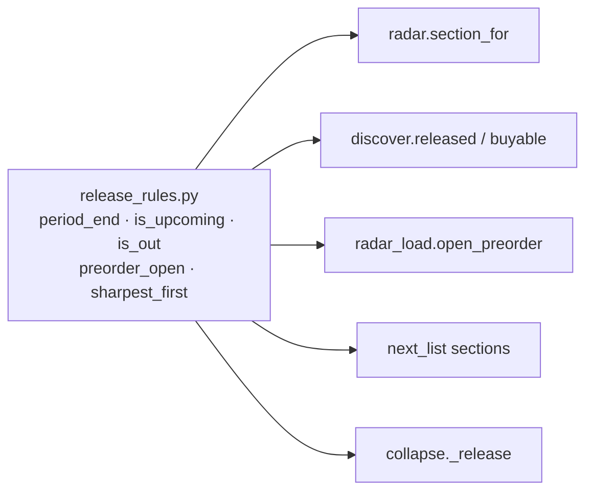

# Review follow-ups: a stack of six PRs

Spec and plan in one document. Source: the 2026-10-18 code review and
competitor brainstorm (four read-only reviewers: frontend, backend core,
tracker logic, design research). Joey's instruction: do all of it as a PR
stack, worked one at a time, stopping only where he is needed.

## Problem

The review found no auth bypass and no public data leak; both suites are
green. What it did find:

1. **A live tracker bug.** A month, quarter or year release is stored as the
   period's first day, and Radar, Discover and the pre-order rules compared
   that date with today. A "Q4 2026" game left Radar on 1 October and became
   eligible for Discover. Only `next_list.period_end` knew better.
2. **A fragile SPA shell.** Scroll carries over between routes, focus is not
   moved or announced, there is no error boundary, and every visitor downloads
   the admin UI.
3. **Invisible to crawlers and link previews.** Every URL serves the same
   `<title>` and OG card.
4. **Backend hardening.** Bulk create can crash or drop `platform` on mixed
   rows; LLM timeouts are not retried; an IGDB outage parks keys for a human.
5. **The site does not feel current**, and **Spine has no history over time**,
   which is what Letterboxd, Backloggd, Trakt and StoryGraph are built around.

## Scope

In, as stacked PRs (each branch on the previous one):

| PR | Branch | Contents |
|---|---|---|
| 1 | `fix/release-rules` | `physical_sources/release_rules.py`; collapse precision; resolve stops on an IGDB outage; 409 on a duplicate answer; Discover top-up; this doc |
| 2 | `feat/spa-shell` | scroll restore, focus and announce on route change, skip link, error boundary, lazy admin routes, reduced motion, `role="alert"`, admin load ordering, `key={id}` on the admin item, cover fixes, month bars by keyboard, dev-only deps moved |
| 3 | `feat/prerender-meta` | build-time per-route HTML with title, description, canonical and OG; `robots.txt`; `sitemap.xml`; `noindex` on admin; RSS descriptions |
| 4 | `fix/backend-hardening` | bulk-create common key set; per-photo upload cap and honest docs; LA cart check on platform change; LLM timeout retry and non-JSON guard; JSON 500s keep CORS; boot schema check retries connection errors |
| 5 | `feat/feels-current` | `/now` from the snapshot; shelf search; Spine RSS; colophon |
| 6 | `feat/spine-year` | Year in Review and a finishes diary, from fields already public |

Out, or held for Joey (carve-outs, see Milestones):

- Session re-check against the allowlist, and an Origin check on mutating
  admin routes (auth patterns).
- `healthCheckPath` in `render.yaml` (deploy path).
- A play-session journal (needs a migration Joey applies to Neon).
- Analytics (a third-party script on public pages is Joey's call), Lighthouse
  or axe in CI (CI change), a notes/TIL stream and `/uses` (need Joey's own
  writing; no placeholder content is published).

## Proposed solution

- **PR 1**: one pure module owns every "is it out yet" rule.
  `IgdbSource` raises `SourceUnavailable` (a `SourceError`) for transport
  errors and 5xx, and `resolve_batch` stops on it.
- **PR 3**: a post-build script writes `dist/<route>/index.html` for every
  public route, from the same `index.html` with its head rewritten. Render's
  static site serves a real file before applying the SPA rewrite, so no
  `render.yaml` change. Spine items come from the build-time snapshot only,
  so nothing private can be prerendered.
- **PR 5 and 6** read only static files (`/snapshot/items.json`), keeping
  "public pages make no API calls" outside `/spine*`.

## Key decisions and tradeoffs

- **The shared module lives in `physical_sources/`**, which already holds the
  pure catalogue rules and is imported by Radar, Discover and next_list. A
  test holds that package to no FastAPI or SQLAlchemy.
- **A month-dated game counts as upcoming for the whole month.** This is
  conservative: a game that actually shipped on the 5th stays on Radar until
  the month ends. The alternative, calling it out on the 1st, is the bug.
- **Resolve stops on an outage rather than skipping the key.** Keys stay
  pending and the next press or night picks them up; a 4xx still parks the key
  for a human, as the README intends.
- **Sibling rows are not auto-answered** when one game is wanted from two
  rows; the second gets a 409 and leaves at the next generation. Answering
  them in bulk would touch the frozen public batch (S9).
- **Prerender is head-only.** The body stays the SPA shell; crawlers that run
  JavaScript get the page and the rest get the right title, description and
  card. Full SSR would mean a server for a static site.

## Docs alignment

- `CLAUDE.md` (Radar, Discover, `next_list.py`): "Everything dated after
  today belongs to Radar" is kept, and now defined by period.
- `backend/physical_sources/README.md`: module table gains `release_rules.py`.
- `backend/sources/README.md`: error table gains `SourceUnavailable`.
- Render static sites serve existing files before rewrite rules
  (https://render.com/docs/redirects-rewrites); checked again in PR 3.

## Open questions

- Should Year in Review be public from launch, or behind a flag until there are
  more finish dates? Built public with a minimum count; Joey can hide it.

## Smoke test strategy

- Backend: `cd backend && ./.venv/bin/pytest` (local Postgres).
- Frontend: `cd frontend && npm test && npm run build`.
- After deploy: `./scripts/smoke.sh https://joey-haas.dev https://api.joey-haas.dev`.
- PR 1: after deploy, press Generate on `/admin/radar`; a quarter- or
  year-dated game in its current period is back under Dated later.
- PR 3: `curl -s https://joey-haas.dev/blog/<slug> | grep og:title` shows the
  post's title.

---

## Plan

### Milestone 1 (auto): PRs 1–6

Each PR: implement, run the tests and `ruff`/`eslint`/`prettier`, commit,
then a single-reviewer finish gate on that PR's diff, push, and open the PR
against the previous branch.

**PR 1, `fix/release-rules`** (backend)
1. `release_rules.py` with tests; Radar, Discover, `open_preorder`,
   next_list and collapse use it. AC: a quarter-dated game in its current
   quarter is `dated_later` in Radar and not `released` in Discover.
2. `SourceUnavailable`; resolve stops on it. AC: an outage parks no key.
3. 409 on IntegrityError in `_add_item`; `discover.top_up`. AC: tests for both.

**PR 2, `feat/spa-shell`** (frontend)
1. `ScrollToTop` and route-change focus in `RootLayout`; skip link. Tests.
2. `RouteErrorBoundary` around `<Outlet>`; live bodies shape-checked. Tests.
3. `React.lazy` for `admin/*`. AC: the build emits admin chunks.
4. Admin load ordering, `key={id}`, CoverImage `priority` and reset,
   `role="alert"`, reduced motion, month bars focusable, dim art only, move
   build-only deps to `devDependencies`.

**PR 3, `feat/prerender-meta`** (frontend build)
1. `scripts/prerender.mjs` after `vite build`; per-route head. Tests on the
   pure head rewrite.
2. `robots.txt`, `sitemap.xml`, admin `noindex`, RSS `<description>`.

**PR 4, `fix/backend-hardening`** (backend)
1. Bulk create pads rows to one key set. Test with mixed rows.
2. Per-photo size cap; docs say "not kept beyond the request".
3. LA check on platform change. Test.
4. LLM: retry a timeout like an overload, non-JSON as `LLMError`, close the
   Anthropic client. Tests.
5. A JSON exception handler (CORS kept); `schema_check` retries connection
   errors only.

**PR 5, `feat/feels-current`** (frontend)
1. `/now` from the snapshot: playing, up next, recently finished.
2. Shelf search over the loaded items.
3. `spine.xml` RSS of finishes at build.
4. `/colophon` from the repo's own facts.

**PR 6, `feat/spine-year`** (frontend)
1. `/spine/year/:year`: finishes, hours, top genres, rating spread,
   favourites, from snapshot fields. A diary list of finishes by month.

### STOP: carve-out review

Session re-check and Origin middleware (auth), `healthCheckPath`
(`render.yaml`), and the play-session journal (migration). Presented to Joey
with the stack; each needs his go.

### Environment tests

`./scripts/smoke.sh https://joey-haas.dev https://api.joey-haas.dev` after
each merge, plus the PR-specific checks above. Nothing deployed yet: green
local suites are done for this stack.
