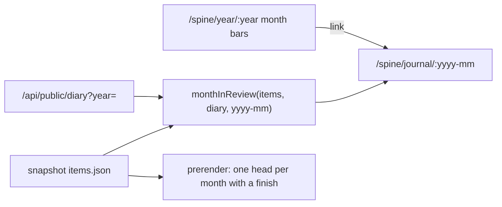

# Shareable Spine: copy pass, month pages, link previews

Spec and plan in one document. Source: the open items after the 2026-10-18
follow-ups shipped (#53–#64), plus issue #39. Joey's choices (2026-10-19):
Claude drafts the #39 copy and Joey edits it in the PR; the month view is a
public page at `/spine/journal/:yyyy-mm`; #13 gets its own spec later (see
Open questions: most of it already shipped as E8b Discover).

## Problem

- **Shared links show a generic preview.** `prerender.mjs` already writes
  `dist/spine/<id>/index.html` and `dist/spine/year/<y>/index.html` with the
  right head (`frontend/scripts/prerender-lib.mjs:169-200`), but Render serves
  `dist/x/index.html` only at `/x/`, and the URLs people share have no
  trailing slash. They hit the `/*` catch-all and get the home page's head
  (`render.yaml:7-17`, CLAUDE.md "Link previews").
- **The journal has no public view of its own.** Play sessions (migration
  0007) only surface as the "Days played" count and the "Played" section of
  Year in review (`pages/YearInReview.jsx:143, 255-265`).
- **Spine copy is still placeholder.** #39: strings on `/spine`,
  `/spine/next` and `/admin/store-list` were written to get the pages
  working, and some are still hard-coded outside `content/spine.js`.

## Scope

**In**
- #39 in full: strings moved into `content/spine.js`, a drafted copy pass,
  tests that pin copy updated.
- `/spine/journal/:yyyy-mm`: that month's finishes and play sessions, with
  previous/next month links and a link back to the year. Year in review's
  month bars link to it.
- Link previews for item, year and month pages, by redirecting the
  slashless URL to the slash URL that already has a prerendered file.

**Out**
- #13 recommendations (own spec; see Open questions).
- Calling the deploy hook from the backend when an item goes public. The
  nightly compare already redeploys within a day (`nightly.yml:158-245`).
- Backend-served OG HTML. Render's static rules can't branch on User-Agent,
  so every human visit would wait on the free tier's cold start before
  anything painted, losing the snapshot-first paint `/spine*` relies on.
- A public diary in the build snapshot. The month page reads the diary live,
  the same way Year in review does.

## Proposed solution

### 1. Copy pass (#39)

Move the hard-coded strings into `content/spine.js`:
- the IGDB attribution in `pages/Next.jsx`
- `FORMAT_WORDS`, "Digital only" and "Format unknown" in `components/NextRow.jsx`
- the "Other" group label in `lib/next.js`

Then redraft every `spine.next.*` and `spine.tabs` string, plus "What the
public sees" in `posts/how-spine-works.md`. The voice is drawn from Joey's
published post and the resume copy: first person, plain, specific, dry. The PR
lists every old → new string in a table so Joey can edit in review.

### 2. Month pages



- **Pure function.** `lib/monthInReview.js` filters `finishes` by
  `finished_at` month and the diary by `played_on` month. It reuses the
  helpers in `lib/yearInReview.js` rather than duplicating them.
- **Page.** `pages/MonthInReview.jsx` has:
  - a heading such as "October 2026"
  - finishes as poster cards
  - a "Played" list grouped by day, with minutes when they're set
  - previous and next links, limited to months that have data
  - a link back to `/spine/year/:year`

  An invalid `:yyyy-mm` renders the app's not-found page.
- **Data.** Items use `useSnapshotThenLive('items')` and the diary uses
  `usePublicDiary(year)`, exactly as Year in review does. A failed diary
  fetch reads as no sessions; it doesn't show an error.
- **Prerender.** `publicRoutes()` gains `/spine/journal/<yyyy-mm>` for every
  month that has a finish in the snapshot, with a title and description that
  count that month. Months that only have sessions fall back to the SPA head,
  because the snapshot has no diary.
- **Route.** `spine/journal/:month` in `App.jsx` is covered by the existing
  `/spine` `WIDE_ROUTES` entry.

### 3. Link previews (carve-out: deploy path)

Add one `type: redirect` (301) per pattern to `render.yaml`. They go after
the per-page rewrites and before `/*`:

| Source | Destination |
|---|---|
| `/spine/year/:year` | `/spine/year/:year/` |
| `/spine/journal/:month` | `/spine/journal/:month/` |
| `/spine/:id` | `/spine/:id/` |

How a request resolves:
- `/spine/<id>` → 301 → `/spine/<id>/`.
- If the file exists, Render serves it, because rules don't apply when a
  resource exists at the path. The page has the item's own head.
- If it doesn't exist (an item newer than the last build), the request falls
  through to `/*` and the SPA renders as it does today.

To keep crawlers consistent:
- canonical, `og:url` and sitemap `<loc>` for these three route kinds switch
  to the slash form (`prerender-lib.mjs:206, 325`)
- in-app links to them use the slash form too (PosterCard, YearInReview,
  month pages)

**Unknown that the plan tests first:** Render's docs don't say whether
`:id` can match `abc/`. If it can, `/spine/abc/` would redirect to
`/spine/abc//` and loop. Task 7 probes this on production before anything
else ships, and the rollback is to delete the three rules.

**Task 7 result (2026-10-19): failed, rules removed.** Render matches
`/spine/abc/` against `/spine/:id` and redirects it to itself, so any path
without a prerendered file loops (`/spine/<zero-uuid>`, `/spine/year`,
`/spine/journal/2026-10` all hit `--max-redirs 3`). Paths with a file were
fine (`/spine/<real-id>` → 1 hop → the item's title). The three rules were
live for a few minutes, then deleted; smoke was 67/67 afterwards. Redirects
can't express "add a slash" on Render, so PR C needs a different mechanism
before Tasks 8–10 go ahead.

## Key decisions and tradeoffs

| Decision | Why | Cost |
|---|---|---|
| Redirect to the slash URL rather than add placeholder rewrites | A rewrite to a missing file returns an empty 200, seen on 2026-10-19. A redirect to a missing file falls through to the SPA. | An extra 301 hop on first load, and the canonical URLs change form. |
| Canonical URLs get the trailing slash for item, year and month pages | The canonical has to match what the 301 lands on, or crawlers see a conflict | They differ from the static pages' slashless canonicals. Documented in CLAUDE.md. |
| Month page reads the diary live, not from the snapshot | Same pattern as Year in review; there's no new snapshot file or build step | Sessions show up only once the API is awake. Finishes are instant. |
| Month heads only for months with a finish | That's all the snapshot can know about | Months with only sessions share the SPA head. |
| The copy is drafted rather than left blank | Joey's call. A full draft is faster to edit than to write. | Joey's review time on the PR. |

## Docs alignment

- Render redirects are 301s. "Render does not apply redirect or rewrite rules
  to a path if a resource exists at that path." Source:
  <https://render.com/docs/redirects-rewrites>. **Aligns.**
- Render doesn't document whether `:name` can match a trailing slash or an
  empty segment. **Gap.** Covered by the Task 7 probe.
- Repo conventions:
  - CLAUDE.md "Link previews", and `/spine*` painting the snapshot first
  - `render.yaml:7-17`, which records what was observed
  - `docs/planning/2026-10-18-review-followups-design.md`, which put the
    journal page out of scope then and now brings it in

## Open questions

1. **#13 is already retired.**
   - CLAUDE.md's checklist says "E6 is retired in favour of [E8b Discover]",
     and `docs/planning/2026-09-22-tracker-enhancement-design.md:12`
     supersedes requirements §3. Discover and Radar shipped as migration 0006
     and `/admin/discover`. They are games only.
   - The issue was simply never closed.
   - What #13 still asks for that doesn't exist: films via TMDB
     `/movie/{id}/recommendations`, and comics via the LLM checked against
     ComicVine.
   - The live collection is 70 games and no public films or comics.
   - Proposal: close #13 with a comment pointing at E8b, and open a narrower
     "Discover for films" issue only if films start being tracked. So the
     planned #13 spec isn't needed. Joey decides.
2. **Month page title format:** "October 2026" or "Played in October 2026"?
   I'll draft the first; it's an easy change in review.

## Smoke test strategy

- `scripts/smoke.sh` gains these checks:
  - `/spine/<zero-uuid>` returns a 301 to `/spine/<zero-uuid>/`, which then
    serves the SPA with a 200 in at most two hops (`curl -L --max-redirs 3`)
  - a real item from `/snapshot/items.json` at `/spine/<id>` lands on a page
    whose `<title>` is that item's
  - the same for `/spine/year/<y>` and one `/spine/journal/<yyyy-mm>`
  - `/spine/year` with no year still returns 200
  - `/spine/feed.xml` is still XML, not redirected
- Run after each deploy:
  `./scripts/smoke.sh https://joey-haas.dev https://api.joey-haas.dev`

---

# Plan

Three PRs, stacked in order, each passing CI before the next starts.
Frontend checks: `npm test`, `npm run lint`, `npm run format:check`,
`npm run build` in `frontend/`.

## Milestones

```
Milestone 1 (auto): tasks 1–6 → PR A (#39 copy), PR B (month pages)
STOP — carve-out review: render.yaml redirects (deploy path)
Milestone 2 (auto after go): tasks 7–10 → PR C (link previews)
Finish gate → PRs open; Joey merges
```

No migrations, CI workflow changes or auth changes. render.yaml is the only
carve-out.

## PR A: copy pass (#39), branch `feat/shareable-spine` (also carries this doc)

**Task 1: move the hard-coded strings into `content/spine.js`.**
- Files: `content/spine.js`, `pages/Next.jsx`, `components/NextRow.jsx`,
  `lib/next.js`.
- AC: no user-facing literal on the three pages lives outside
  `content/spine.js` (grep shows none). Rendered output is unchanged.
- Tests: the existing suite passes unchanged. This is a pure move.

**Task 2: draft the copy.**
- Files: `content/spine.js`, `posts/how-spine-works.md`.
- AC: every `spine.next.*` and `spine.tabs` string is redrafted. The PR body
  has an old → new table.
- Tests: update the pinned strings in `Next.test.jsx`,
  `NextBand.test.jsx`, `SpineHeader.test.jsx` and `AdminStoreList.test.jsx`.
  Where a test only needs to find an element, assert through the content
  module rather than a literal.
- Closes #39 when merged.

## PR B: month pages, branch `feat/journal-month`

**Task 3: `monthInReview`.**
- Files: `lib/monthInReview.js` (new), `lib/yearInReview.js` (export any
  shared helper).
- AC:
  - returns finishes and sessions for one month
  - returns the previous and next months that have data
  - returns null for an invalid month
- Tests: `lib/monthInReview.test.js`, written first. Cases: empty month,
  year boundaries (Dec → Jan), an invalid month string, sessions with and
  without minutes.

**Task 4: the page and route.**
- Files: `pages/MonthInReview.jsx` (new), `App.jsx`, `content/spine.js`.
- AC:
  - the page renders finishes, the "Played" list grouped by day, and
    previous/next/year links
  - an invalid month shows not-found
  - a failed diary fetch shows finishes only
- Tests: `pages/MonthInReview.test.jsx`, with the diary mocked as empty,
  failing and populated.

**Task 5: link the month bars.**
- Files: `pages/YearInReview.jsx`.
- AC: each month bar with data is a link to its month page; months with no
  data stay plain. Not hover-only, per the accessibility conventions.
- Tests: extend `YearInReview.test.jsx`.

**Task 6: prerender month heads.**
- Files: `scripts/prerender-lib.mjs`, `scripts/prerender-lib.test.mjs`.
- AC:
  - `publicRoutes()` includes `/spine/journal/<yyyy-mm>` for each month with
    a finish, with title and description
  - the sitemap lists them
  - the rewrite test stays green: month routes are snapshot-derived like
    items, so they're excluded from rewrites the same way
- Tests: extend the year-route cases at `prerender-lib.test.mjs:216-236`.

**STOP: carve-out review.** Joey approves the render.yaml change before
Task 7.

## PR C: link previews, branch `fix/slash-redirects`

**Task 7: production probe, before any code.**
- Add the three redirect rules in the Render dashboard on the static site,
  with Joey watching or Joey doing it. Then curl:
  - `/spine/<real-id>`
  - `/spine/<real-id>/`
  - `/spine/<zero-uuid>`
  - `/spine/year`
  - `/spine/year/2026`
  - `/spine/feed.xml`
- AC: no redirect loop, real pages serve their own `<title>`, and the zero
  uuid falls through to the SPA with a 200.
- If any check fails: delete the rules in the dashboard, record the result in
  the `render.yaml` comment, and stop to replan.

**Task 8: `render.yaml` and the rule test.**
- Files: `render.yaml`, `scripts/prerender-lib.test.mjs`, `scripts/README.md`.
- AC:
  - render.yaml matches what was probed
  - the test asserts the three redirects sit after the rewrites and before
    `/*`
  - the `render.yaml:7-17` comment is updated with the probe's results
- Tests: the updated rule-order test.

**Task 9: slash canonicals and links.**
- Files: `scripts/prerender-lib.mjs` and its test, `components/PosterCard.jsx`,
  `pages/YearInReview.jsx`, `pages/MonthInReview.jsx`.
- AC:
  - canonical, `og:url` and sitemap `<loc>` use the slash form for item, year
    and month routes, and only those
  - in-app links match
- Tests: the canonical and sitemap cases in `prerender-lib.test.mjs`, and the
  link `href` assertions in the page tests.

**Task 10: smoke and docs.**
- Files: `scripts/smoke.sh`, `CLAUDE.md` (the "Link previews" bullet and
  the roadmap checklist).
- AC:
  - the smoke checks from the strategy above are in place and pass against
    production after deploy
  - CLAUDE.md describes the slash rule

## Environment test section

- **Local:** the full frontend check suite on each PR. The backend is
  untouched, so pytest is only needed if something unexpected comes up.
- **Production, after each merge:** `smoke.sh` against
  `https://joey-haas.dev`. For PR C, also paste one item URL into a link
  preview checker, or into Slack, to see the card.
- **Render Blueprint sync:** after PR C merges, check in the dashboard that
  the rules match `render.yaml` exactly. Last time, the sync added rules
  rather than replacing them.

## Parallel safety

None. PR B builds on PR A's `content/spine.js`, and PR C's links touch PR B's
page. Work them in order.

## Issues

#39 is closed by PR A. No new issues are needed. #13 follows Open question 1.
