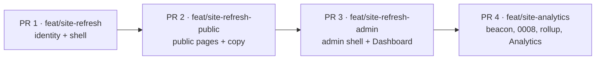

# Site refresh: new visual identity, admin shell, analytics

Design doc (Cowork, 2026-10-19). Baseline is `main` at `dd77ca7` (#69).
Joey's choices are recorded in "Key decisions"; the mockups are linked
under "Design". Code writes the plan against the real codebase; this doc
has no tasks or file lists on purpose.

## Problem

- **Every page is the same narrow column.** `RootLayout` wraps everything in
  `.page` (45rem) with the résumé masthead above; Home, About, Projects and
  Blog differ only in their copy. The site reads as a personal blog rather
  than a senior engineer's site. The Spine pages (72rem, compact masthead)
  are the only ones with a layout of their own.
- **Admin is a list of links.** `/admin` renders six bare `<p><Link>` rows,
  a "Signed in as" line and a Sign out button (`pages/Admin.jsx`). Each tool
  page is an island with its own header pattern: Catalogue has stat tiles
  and a source table, Radar and Discover have a generate toolbar, Import is
  a file input and a button, Play Next has chips, Store list is phone-first.
  There is no shared admin chrome, no grouping, and no way to tell at a
  glance whether the nightly ran or what needs attention.
- **No analytics of any kind.** Nothing in the frontend, the API or the
  Render config counts visitors. Joey's guess is zero; there is no way to
  check.

## Scope

**In**

- A new visual identity for the whole site: tokens, type, masthead, footer,
  page widths, cards and tables, in light and dark. Public pages Home,
  About, Projects, Blog, BlogPost, Now, Colophon, NotFound get new layouts.
- The Spine public pages (`/spine`, `/spine/:id`, `/spine/next`,
  `/spine/year/*`, `/spine/journal/*`) are re-skinned by the new tokens and
  the new masthead. Their structure and components (PosterGrid, PosterCard,
  FilterChips, ShelfToolbar, NextBand, PlayJournal, Year in review) do not
  change in this phase.
- An admin shell: grouped sidebar on desktop, bottom tab bar on a phone, a
  Dashboard landing at `/admin`, and every existing admin page moved inside
  the shell with a consistent page header.
- First-party analytics: a beacon from public pages, storage and daily
  rollups in Postgres, `/admin/analytics`, and a 7-day figure on the
  Dashboard.
- The copy changes in `2026-10-19-copy-review.md`, applied as the pages
  they belong to are rebuilt (see "Copy" under Design).

**Out (explicitly)**

- Redrawing the shelf components or changing any Spine interaction.
- Any third-party analytics script, cookies, or IP geolocation.
- New admin features beyond the Dashboard and Analytics pages (no new
  catalogue or recommendation behaviour).
- Copy edits beyond the review: no new sections, no new posts. Joey
  finesses the proposed lines in the PR; the review gives the intent and
  a draft, not final wording.
- The resume PDF, OG card image, and prerender/snapshot pipeline (they keep
  working; `og-card.png` can be regenerated in a follow-up to match).

## Design

Chosen direction: **A · Ledger**, with B's serif display headline on the
two page-opening titles (Home hero, About). Mockup: `chosen.html` in the
mockups folder. `a-ledger.html`, `b-editorial.html` and `c-console.html`
are the rejected directions, kept for the record; `index.html` links all
four. Each mockup's top bar switches light/dark and 1280/400.

### Identity

- **Palette.** One neutral scale and one cool accent. Light: page
  `#fcfcfb`, surface `#ffffff`, sunken `#f3f3f0`, line `#e4e4df`, text
  `#15171a` / `#4a4f57` / `#7a808a`, accent `#1f5fbf` on white. Dark: page
  `#0f1114`, surface `#15181c`, sunken `#1b1f24`, line `#262b32`, text
  `#eceef1` / `#aeb4bd` / `#7d848e`, accent `#6ea0ef` on `#0f1114`. Status
  colours: ok green, warn amber, one chart blue plus its soft tint. The
  mockup values are a starting point: Code re-measures every text/background
  pair to AA (4.5:1) and every non-text mark to 3:1, the way `index.css`
  documents today, and records the measurements in the same style.
- **Type.** Three faces, all self-hosted via `@fontsource` like today
  (Newsreader and Public Sans are removed). Sans for everything: Inter.
  Mono for labels, dates, counts: JetBrains Mono. Serif display for exactly
  two headlines, the Home hero and the About title: Source Serif 4, with an
  italic cut for the accent phrase. Static cuts, latin only, same reasoning
  as the comment in `main.jsx`. If a package is unavailable, Code picks the
  nearest fontsource face and notes it in the plan.
- **Texture.** Hairline rules and 1px borders, 6–8px radii, no shadows on
  public pages. Mono uppercase "kicker" labels (`SENIOR SOFTWARE ENGINEER ·
  DENVER, CO`, `PROJECT · LIVE`) carry metadata everywhere.
- **Theme.** Dark stays the brand default; the toggle, the pre-paint script
  in `index.html` and the stored preference keep their behaviour. Both
  themes ship for every screen.

### Masthead and footer (all routes)

- 60px bar with a hairline below: a square monogram mark (`JH`, filled
  with `--text`) and the name, the nav as text links with a 2px underline
  on the active item, and on the right "Resume ↓" and the theme toggle.
  On a phone: monogram, name, toggle, and a Menu button that opens the nav
  as a sheet.
- No photo in the masthead. The photo moves to About (optional, as the
  aside's first element) and is dropped from Home.
- `COMPACT_ROUTES` goes away: one masthead everywhere. `WIDE_ROUTES`
  remains the mechanism for page width, with the new limits below.
- Footer: a single rule, then two lines on a phone / two ends on desktop:
  `© 2026 Joey Haas · Source · Now · Colophon` and `email · GitHub ·
  LinkedIn · Sign in/Admin`. Same links and sign-in behaviour as today.

### Page widths

- Prose pages (Blog, BlogPost, Now, Colophon, NotFound): 45rem column as
  today.
- Home, About, Projects: 1040px content width (`.wrap`), 24px gutters,
  16px at phone width.
- Spine public pages: unchanged 72rem.
- Admin: full width inside the shell; the main pane has 32px padding
  (16px on a phone).

### Home

- Hero in two columns on desktop (1.4fr / 0.8fr): kicker, the serif
  headline with the accent phrase in italic, a lede, and three actions —
  primary "About me", secondary "See Spine", ghost "GitHub ↗". To the right
  a **facts table**: Now, Focus, Stack, Last shipped, Playing. Now/Focus/
  Stack come from `profile.js`; "Last shipped" is the newest post or a
  static line in content; "Playing" comes from the build-time snapshot's
  playing item and is omitted when there is none.
- "Work" section: three equal cards — Spine (with the favourite covers
  strip, as today), This site, latest post. Cards are links; card text is
  never accent-coloured.
- "Experience" section: three rows (mono date, title, one line) from
  `experience.js`, grouped as the mockup shows (the three pre-Guild roles
  collapse to one row on Home; About lists all).
- On a phone the hero stacks, the facts table follows the actions, cards
  stack.

### About

- Two columns on desktop (280px / 1fr), a sticky aside: serif "About",
  kicker location, then a key/value list (Role, Company, Engineering,
  Product, Resume PDF). The photo may sit above the title.
- Body: mono-uppercase section labels (Summary, Experience, Areas of
  expertise, Toolbox). Experience is a timeline with a hairline rail and a
  dot per role; the current role's dot is the accent. Toolbox is mono
  chips. Content comes from `profile.js` and `experience.js` unchanged;
  `education.js` renders under Experience as today.
- On a phone the aside is not sticky and precedes the body.

### Projects, Blog, Now, Colophon, NotFound

- Projects: the same card language as Home's Work section, one card per
  project at full width, cover strip and tech chips kept.
- Blog index: list rows (mono date, title, one line). BlogPost: the 45rem
  column with the new type; code blocks keep `--code-bg` re-measured.
- Now, Colophon, NotFound: the prose column with the new type.

### Admin shell

- Desktop: 232px sidebar (surface colour, hairline right) with the
  monogram and "Admin", then four groups with mono-uppercase labels:

  | Group | Items | Route today |
  |---|---|---|
  | Overview | Dashboard, Analytics | `/admin` (new content), `/admin/analytics` (new) |
  | Collection | Shelf, Import photos | `/admin/collection`, `/admin/import` |
  | Recommend | Play Next, Discover, Radar | `/admin/play-next`, `/admin/discover`, `/admin/radar` |
  | Catalogue | Sources, Store list | `/admin/catalogue`, `/admin/store-list` |

  Shelf shows the owned count beside it. The sidebar foot shows the
  signed-in email, "View site ↗" and "Sign out". Existing routes keep their
  URLs; only the labels change ("Collection" → "Shelf", "Catalogue" →
  "Sources" in the nav; page titles follow).
- Phone: no sidebar; a five-item bottom tab bar — Home, Shelf, Picks,
  Stores, More. Picks opens a sheet with Play Next / Discover / Radar;
  Stores with Sources / Store list; More with Analytics, Import, View site,
  Sign out. Store list stays phone-first as designed.
- Every admin page gets the same header: title (24px), optional one-line
  description, and a right-aligned status or control area (the existing
  Generate toolbars, Refresh buttons and the Shelf/List toggle move here).
  Stat tiles (Catalogue's counts, Shelf's owned/finished) use one tile
  component.
- The public masthead and footer do not render on `/admin*`; the shell
  replaces them. The sign-in and error states of `/admin` (checking, waking
  the server, denied, signed out, sign-out failed) render inside a plain
  centred panel without the sidebar, with the same copy as today.

### Dashboard (`/admin`)

- Header status: API awake · nightly ok with the latest time, from the
  same sources `LastNightly` reads (`/api/physical/status` and the store
  list summary).
- Four tiles: Owned (public · hidden), Finished in the current year (all
  time · average), Needs attention (catalogue rows needing a match),
  Views · 7 days (visitors).
- Nightly jobs panel: one row per job — catalogue refresh, Radar, Discover,
  public snapshot — with time, a one-line summary and ok/stale/failed. "Run
  now" links to the existing manual triggers where they exist.
- Quick actions: Import photos, Store list, Add a game (opens the Shelf's
  add form), Rate a few (links to Discover's table with the count).
- Recent changes: the last few item edits and nightly outcomes (see Open
  questions: there is no change log today).

### Analytics (`/admin/analytics`)

- Range control: 7d · 30d · 90d · All (30d default).
- Four tiles: Page views, Visitors, Views per visitor, Best day (date and a
  note if a referrer dominated).
- Views per day bar chart; the highest day in the accent, the rest in the
  soft tint; UTC day boundaries labelled.
- Three lists with proportional bars: Pages (views), Referrers (visitors,
  by hostname, "Direct / none" first), Devices (desktop / phone / tablet
  from a coarse UA class).
- A footnote explaining what is counted and the sleeping-API caveat.
- Empty state (the launch state): the tiles show 0, the chart area reads
  "No views yet. The beacon is live; check back tomorrow." with the time
  the beacon went live.

### Beacon (public pages)

- On every public route change, `navigator.sendBeacon` posts path,
  referrer hostname, a coarse device class and a screen-width bucket to the
  API; the body carries no identifier. Nothing is sent on `/admin*` or
  when a session exists (the `signedIn` outlet context), so Joey's own
  visits are excluded. `Do Not Track`/`Sec-GPC` is honoured by not sending.
- Visitor counting is a daily-salted hash of IP + UA computed on the server
  and never stored raw; the salt rotates at UTC midnight so a visitor is
  unique per day and cannot be joined across days.
- Rows are raw per view; a nightly rollup writes per-day/per-page/per-
  referrer/per-device counts, and raw rows older than 90 days are deleted.

### Copy

`docs/planning/2026-10-19-copy-review.md` is part of this handoff. It
gives, per page, the current line, a proposed line and the reason. Two
site-wide decisions are taken here so every edit is written the same way;
Joey can override either in the PR.

- **Contractions everywhere** ("I'm", "what's", "they're"). The site
  greets people with "I'm Joey"; `spine.js`, the Next page, Now, Colophon,
  NotFound and the post are brought in line.
- **American spelling in user-facing copy**: Favorites, Catalog,
  normalized, colors. Routes (`/admin/catalogue`), module names and API
  fields are not renamed; only labels, titles and prose move. Record the
  decision in a comment in `spine.js`.

What the review changes, by page, and where it lands in the refresh:

- **Shared strings** (review 1.3, 1.4): one "waking the server" line and
  one error line in a content module imported by Collection, Item, Next
  and the admin pages; one page-title pattern, enforced by
  `AdminPageHeader` and `usePageTitle`.
- **Home** (2): the current intro sentence becomes the hero lede; the
  hero headline is the only place "correctness and money are the same
  problem" appears; "Last shipped" in the facts table is derived or
  dropped.
- **About** (3): the bio and the experience summaries are rewritten with
  the Guild jargon key applied (`claude/resume-guild-jargon-key.md` in the
  project; the review quotes the proposals). Toolbox chips trimmed.
- **Projects** (4): "This Website" → "This site"; the Spine card uses
  `spine.projectLine`; the Play Next highlight is split into two sentences.
- **Spine public pages** (5): the Next lede, two empty states, and the
  freshness fragments made parallel.
- **Now, Colophon, NotFound** (6): Colophon rewritten for the new fonts
  and the beacon; NotFound gets two links out; the Shiki sentence untangled.
- **Post** (7): spelling and contractions only, plus an optional
  two-sentence summary under the title.

### Responsive and theme behaviour

- Breakpoint at 700px for the public pages and the shell (the mockups use
  container queries; the real site uses a media query at the same width).
- Dark and light for every screen above; the admin shell's sidebar is the
  surface colour in both.
- Mono labels are 12px uppercase with 0.02em tracking; body 15px; hero
  headline 56px desktop / 38px phone.

### Accessibility

- Every text/background pair clears AA; non-text marks (status dots, chart
  bars against the surface) clear 3:1; measurements recorded in the CSS as
  today.
- The nav keeps the skip link and `useRouteFocus`; the sidebar is a `<nav
  aria-label="Admin">`; the phone tab bar is a `<nav>` with
  `aria-current="page"`; sheets trap focus and close on Escape.
- Status is never colour alone: dots carry a text label (ok / stale /
  failed).
- The chart has a visually hidden table equivalent; bars have
  `aria-label`s with the value.
- The serif headline's italic accent phrase is decorative; screen readers
  read the sentence once.

## Key decisions

1. **New identity rather than a polish** (Joey, 2026-10-19). The warm
   palette and Newsreader read as a blog to him; the point of the exercise
   is to read as a senior engineer's site. Cost accepted: every contrast
   measurement is redone and the shelf is re-skinned.
2. **A · Ledger wins**, with B's headline. Reasons: it makes the admin look
   like real tooling without turning the public site into a SaaS landing
   page, and its rules-and-borders language sits well under the shelf's
   cover grids.
   - *B · Editorial* lost because an all-rules, no-cards system fights the
     shelf (covers already supply the texture), and its section-bar admin
     is the least app-like of the three. Its headline treatment survives.
   - *C · Console* lost because the tinted background, shadows and pill nav
     make the public pages read as a product marketing page; the admin was
     strong but the identity has to serve both sides.
3. **Admin IA held constant** across directions (Overview · Collection ·
   Recommend · Catalogue) and chosen on how the tools are used: Collection
   is what is owned, Recommend is what to play or buy, Catalogue is what
   exists in the world. Analytics sits under Overview because it is about
   the site, not the collection.
4. **First-party, cookie-free analytics** over GoatCounter/Cloudflare.
   Consistent with self-hosting fonts to keep visitor IPs off third
   parties, and a real demo of the stack. Accepted: undercounting while the
   free API sleeps; `sendBeacon` queues past unload but a cold start can
   still drop the first hit of the day.
5. **Admin built to be seen** but not public: no read-only demo mode. A
   screenshot of the Dashboard is the showcase.
6. **Spine components unchanged** this phase. They were polished in
   #33–#69 and carry their own measured status tokens; re-skin via tokens
   only, and open a separate design pass if the new identity exposes
   problems on the shelf.

## Component inventory

**Tokens (replace the current set in `index.css`)**: `--bg`, `--surface`,
`--sunken`, `--line`, `--line-strong`, `--text`, `--text-2`, `--text-3`,
`--accent`, `--accent-ink`, `--accent-soft`, `--ok`, `--warn`, `--chart`,
`--chart-2`, `--code-bg`, `--font-sans`, `--font-mono`, `--font-display`,
`--radius`. The shelf's `--status-*`, `--rating`, `--overlay`, `--skeleton`
and `--grid-gap` stay, re-measured against the new surfaces.

**New components**: `SiteMast` (replaces the `SiteHeader` photo/name
header and `SpineHeader`'s compact variant), `MobileNavSheet`, `Kicker`
(mono uppercase label), `FactsTable` (Home), `AdminShell` (sidebar + tab
bar + page header slot), `AdminPageHeader`, `StatTile`, `Panel`,
`JobStatusRow`, `BarList` (label · bar · number), `DayBars` (the views
chart), `RangeControl`, `AnalyticsBeacon` (a hook mounted in `RootLayout`).

**Existing, re-skinned only**: PosterCard, PosterGrid, FilterChips,
SortControl, ShelfToolbar, Stars, QuickRate, ShelfCardActions, CoverImage,
CoverStrip, ItemForm, MetadataPicker, RecommendationCard, RateAFew,
NextBand, NextRow, PlayJournal, SpineTabs, LastNightly (its data loading
feeds the Dashboard header and jobs panel), RouteErrorBoundary.

**Removed**: `SiteHeader`'s home/compact modes, `COMPACT_ROUTES`, the
Newsreader and Public Sans fontsource imports.

## Acceptance criteria

- Home at 1280px and 400px, light and dark, matches `chosen.html` screens
  1 (hero layout, facts table, three cards, experience rows).
- About at 1280px and 400px matches `chosen.html` screen 2 (sticky aside on
  desktop, timeline, chips).
- `/admin` signed in matches screen 3: sidebar groups and labels as listed,
  four tiles, nightly jobs, quick actions, recent changes; at 400px the
  sidebar is replaced by the five-item tab bar.
- `/admin/analytics` matches screen 4, and renders the empty state with all
  zeros and the launch note when no views exist.
- Every existing admin page renders inside the shell with the shared page
  header and its controls in the header's right slot; no admin page shows
  the public masthead or footer.
- All existing admin and Spine routes keep their URLs; `/collection*`
  redirects still work; prerendered heads for the public routes are
  unchanged.
- Visiting any public page as a signed-out visitor produces exactly one
  beacon request per route change; visiting while signed in, on `/admin*`,
  or with `Sec-GPC: 1` produces none.
- Two page loads from the same client on the same UTC day count as one
  visitor and two views; the same client the next day is a new visitor.
- The beacon body and the stored row contain no raw IP and no UA string.
- Raw rows older than 90 days are gone after the nightly rollup; the
  rollup totals for a day equal the raw counts for that day before
  deletion.
- Every text/background pair in both themes measures ≥ 4.5:1 and every
  status mark and chart bar ≥ 3:1 against its surface; measurements are
  recorded in `index.css` comments.
- Lighthouse accessibility on `/`, `/about`, `/admin` (signed in) and
  `/admin/analytics` shows no contrast or name/label failures.
- Keyboard: Tab reaches the skip link, the nav, the theme toggle, every
  sidebar item and tab-bar item in order; the mobile nav sheet closes on
  Escape and returns focus to the Menu button.
- Copy: no user-facing string contains "learner", "spend-writing",
  "funding context", "squad" or "employer partner"; `grep -ri` over
  `frontend/src` and `frontend/posts` for "favourite", "catalogue",
  "normalis" finds only route paths, module names and API fields; exactly
  one "waking the server" string and one load-error string exist in
  `frontend/src`; "correctness and money are the same problem" appears on
  one page.
- The Colophon names the fonts actually shipped and describes the
  beacon.
- `npm test`, `npm run lint`, `pytest` and `ruff` pass; `scripts/smoke.sh`
  passes after deploy.

## Open questions for Code

- **Beacon endpoint and storage.** Proposed: `POST /api/track` on the
  public router, body `{path, ref, device, width}`, 204 always (never an
  error to the browser). Tables: `page_views(id, day, path, referrer_host,
  device, visitor_hash, created_at)` and `daily_stats(day, path,
  referrer_host, device, views, visitors)`. Additive migration `0008`. Is
  the hash salt stored in the DB (one row per day) or derived from a secret
  plus the date? Derived is simpler and needs no table.
- **Rate limiting and abuse.** A beacon endpoint with no auth can be
  spammed. Is a per-IP token bucket in memory enough on a single free
  dyno, or should the rollup cap any visitor at N views per day?
- **Read endpoint.** `GET /api/analytics?range=30d` under `require_admin`
  returning the tiles, the day series and the three lists in one response,
  so the page is one request after the session check. Cache 60 s.
- **Rollup scheduling.** The existing nightly workflow (job token, "Spine
  Next spec K1") can call a `POST /api/analytics/rollup`; or the rollup
  runs lazily on the first admin read of the day. Preference: the nightly,
  so the 90-day deletion does not depend on Joey opening the page.
- **Recent changes on the Dashboard.** There is no change log. Options:
  derive from `items.updated_at` plus `pick_events` and the nightly status,
  or add a small `events` table written by the admin routes. The first is
  enough for v1 if the row says only what changed and when.
- **"Playing" on Home.** The build-time snapshot includes status; confirm
  it exposes the playing item so Home needs no API call.
- **Fonts.** Confirm `@fontsource/inter`, `@fontsource/jetbrains-mono` and
  `@fontsource/source-serif-4` exist at the versions you install; static
  cuts needed: Inter 400/500/600/700, JetBrains Mono 400/500, Source Serif
  4 500 + 400 italic. Watch the bundle: the current fonts total ~70 kB.
- **Mobile nav sheet.** Native `<dialog>` with `showModal()` is enough and
  gives focus trapping for free; confirm no polyfill is wanted.
- **Performance.** The admin chunk grows with the shell; keep the
  Dashboard's data to the two existing status calls plus the analytics
  read, all behind the single `/api/auth/me` check in `RootLayout`.
- **Prerender.** `prerender.mjs` writes heads for public routes; the new
  masthead changes markup, not heads, but confirm the OG description still
  matches the new Home lede.
- **Copy in the plan.** The About bio and experience rewrites are the
  recruiter path and can ship in the first PR with the public pages; the
  shared waking/error module is a natural first commit. Joey edits the
  proposed lines in the PR rather than before it.
- **`docs/planning/mockups/`** is not in `.gitignore`; add it when picking
  this up, before the folder lands in a commit.

---

# Plan (Code, 2026-10-19)

Written against `feat/site-refresh` at `dd77ca7`. Paths are relative to the
repo root; `fe/` means `frontend/src/`.

## Answers to "Open questions for Code"

| Question | Decision | Why |
|---|---|---|
| Endpoint | `POST /api/track` in a new `backend/analytics_routes.py` (its own unauthenticated router, not `public.py`, which is the read-only `is_public` surface its leak tests walk). Always 204. The body is read with `await request.body()` and parsed by hand: `sendBeacon` sends a `text/plain` string, which keeps it a CORS simple request (no preflight) and which FastAPI would not parse as a JSON model. | `origin_check.py:30` passes a POST whose `Origin` is `FRONTEND_URL`, so a beacon from `https://joey-haas.dev` is accepted with no change |
| Body | `{path, ref, device}`. **`width` is dropped**: neither proposed table stores it, and no screen shows it | Don't collect what isn't shown |
| Client IP | `CF-Connecting-IP`, then `True-Client-IP`, then `request.client.host` (local dev). Never the leftmost `X-Forwarded-For`: Render's proxy appends to it, so a caller controls its first entry ([Render, PocketBase article](https://render.com/articles/host-pocketbase-on-render); [community thread](https://community.render.com/t/accessing-client-ips-in-a-node-express-app/36282)). Uvicorn's `--proxy-headers` is not turned on | Cloudflare overwrites `CF-Connecting-IP` on every request to a public Render service |
| Salt | **Derived**, no table and no new env var: `salt = HMAC-SHA256(SESSION_SECRET, "analytics-salt:" + utc_date)`, `visitor_hash = HMAC-SHA256(salt, ip + "\n" + ua)[:32 hex]`. Neither the IP nor the UA is stored or logged | Simplest; the salt changes at UTC midnight. Rotating `SESSION_SECRET` mid-day splits one day's visitors, which is acceptable |
| Abuse | Three layers: (1) the server validates and normalises every field. `path` must match a public route pattern (the `publicRoutes` list plus `/spine/<id>/`, `/spine/year/<y>/`, `/spine/journal/<m>/`, `/blog/<slug>`), is ≤ 200 chars, and drops any query string. `ref` must be a hostname ≤ 100 chars or empty; `device` must be in `{desktop, phone, tablet}`. Anything else is dropped (still 204). (2) An in-memory per-`visitor_hash` daily cap of 100 accepted views, reset at UTC midnight and bounded to 10,000 keys. (3) The body is capped at 1 KB | A free dyno has one process, so memory is enough; the cap also bounds what one bot can add to a day |
| Tables | `page_views(id bigserial, day date, path text, referrer_host text NULL, device text, visitor_hash text, created_at timestamptz default now())`, indexed on `(day)`. **`daily_stats` deviates** from the proposed shape: it is `(day date, dimension text, value text, views int, visitors int, PK(day, dimension, value))` with `dimension ∈ {total, path, referrer, device}`. With the proposed one-row-per-(path, ref, device) shape, distinct visitors are not additive across rows, so a day's visitor total could not be read back from the rollup | Needed so the AC "the rollup totals for a day equal the raw counts" holds for visitors as well as views |
| Rollup | `POST /api/analytics/rollup`, admin or job token (added to `items.JOB_ROUTES` and `test_job_token.py`'s `EXPECTED`). For every day before today that has raw rows, it recomputes that day's `daily_stats` (delete, then insert in one transaction), then deletes raw rows older than 90 days. This makes it idempotent, so a missed night is caught up by the next run. Called by `nightly.yml` as the step after `discover` | Matches the nightly preference; the 90-day deletion doesn't depend on Joey opening the page |
| Read | `GET /api/analytics?range=7d|30d|90d|all` under `require_admin`, returning one body: tiles, day series, the three lists, `live_since`. It reads `daily_stats` for past days and aggregates today's raw rows live. A 60 s cache keyed on `(range, monotonic() // 60)`, following `PublicNextCache`'s lock and double-check shape | One request after the session check |
| `live_since` | `ANALYTICS_LIVE_SINCE` constant in `analytics.py`, set to the merge date in the PR | The empty state needs a date, and a table for one timestamp isn't worth it |
| Recent changes | v1 is derived, with no new table: the five newest `items.updated_at` from `GET /api/items` (title, "edited", relative time) merged with the nightly outcomes from `/api/physical/status` and the generate times. Item rows say only that something changed and when | The spec allows this; an `events` table can come later |
| Dashboard counts | Computed client-side from `GET /api/items` (the Shelf already loads it): owned, public/hidden, finished this year, all-time finished, average rating. Needs attention = `totals.pending_keys` from `/api/physical/status`. **This deviates from the Performance note**, which allowed only the two status calls plus the analytics read. Accepted: a single cached read of the full list is cheap for a collection this size, and no admin counts endpoint exists | Avoids a backend endpoint for numbers the client already gets |
| Snapshot row | There is no snapshot timestamp today. `fetch-snapshot.mjs` writes an optional `/snapshot/meta.json` `{fetched_at}`, and `snapshot.js` `SHAPES` gains `meta`. The Dashboard reads it from the site's own origin. When it is absent, the row reads "unknown" rather than failing. This is the only change to the snapshot pipeline | The Dashboard's jobs panel needs a time for the snapshot |
| Playing on Home | Yes: snapshot items carry `status`, and "Playing" is `status === 'active'` (`lib/shelf.js:16`). Home reuses `Now.jsx`'s `nowLists()` filter (lifted to `lib/`); the row is omitted when nothing is active | No API call |
| Fonts | `@fontsource/inter@5.3.0`, `@fontsource/jetbrains-mono@5.3.0`, `@fontsource/source-serif-4@5.3.0`. Source Serif's 5.3.1 is 8 days old, so it is pinned to 5.3.0. All the needed `latin-<w>[-italic].css` entry points exist. Latin woff2 total: **181 kB vs 130 kB today (+39%)**, 8 cuts vs 7. Mono loads only where a mono label renders, and the serif only on Home and About | Spec asked for this to be watched; it is flagged in the PR |
| Mobile sheet | Native `<dialog>` + `showModal()`, with no polyfill (supported in every evergreen browser since 2022). `cancel` closes it, and focus goes back to the Menu button explicitly, since jsdom doesn't implement `showModal`: tests stub `HTMLDialogElement.prototype.showModal`/`close` | Focus trap and inert background come with it |
| Prerender | Heads are unchanged. `SITE_DESCRIPTION` (`scripts/prerender-lib.mjs:18`) is hard-coded and is reworded only if Joey's final Home lede changes the claim | Spec AC: heads unchanged |
| Copy | Defaults below apply; Joey finesses the wording in each PR | |

**Copy defaults** (from the review's open questions; Joey overrides in the
PR): contractions everywhere; American spelling in UI copy, with the note in
`spine.js`; "Last shipped" = the newest post, with the row omitted when
there is none; the toolbox testing chips fold into one "Testing" chip; MJ
Freeway's domain is named as the review drafts it; the post's "boring parts"
clause is checked against the post and cut if nothing pays it off.

## Delivery shape

Four stacked PRs, each in its own worktree and branched from the one below.
This follows the #53–#58 stack precedent. Each one is reviewable on its own
and leaves `main` deployable.



PR 1–3 are frontend only, apart from `fetch-snapshot.mjs`. PR 4 holds every
carve-out: the migration, the CI workflow, the job-token whitelist, and an
unauthenticated write route.

## Tasks

ACs refer to the spec's Acceptance criteria where they apply. Every task ends
with `npm test` + `npm run lint` green (and `pytest` + `ruff` for backend
tasks) before its commit.

### PR 1 — identity and site chrome (`feat/site-refresh`)

**T1. Fonts.** Swap the fontsource packages and imports; set `--font-sans`,
`--font-mono` and `--font-display`; update the static-cuts comment in
`main.jsx`.
- Files: `frontend/package.json`, lockfile, `fe/main.jsx`, `fe/index.css` (font tokens)
- AC: no Newsreader or Public Sans import is left; every weight the CSS uses has a matching import (grep `font-weight` against the imports); the build passes
- Tests: build; grep check recorded in the commit message

**T2. Tokens and contrast.** Replace the token set with the spec's
inventory in both theme blocks (dark on `:root`, light under
`[data-theme='light']`), and alias or rename every old token across
`index.css`: `--border`→`--line`, `--text-body`→`--text-2`,
`--text-muted`→`--text-3`, `--surface-raised`→`--sunken`; the
`--tag-*`/`--nav-*` tokens fold into the new ones. Measure every
text/background pair to 4.5:1 and every non-text mark (the `--status-*`
set, `--rating`, chart bars, the backlog status on `--line`) to 3:1 with a
scratch WCAG script, adjust the mockup values where they fail, and record
the ratios in comments in the existing style. Re-measure `--code-bg`
against both Shiki themes.
- Files: `fe/index.css`
- AC: spec contrast AC; no raw hex outside the two token blocks (grep); the shelf renders without a visual regression (manual, both themes)
- Tests: existing suite; contrast script output pasted into the PR

**T3. Shared strings.** Add `fe/content/status.js` with one waking line
and one load-error line (review 1.3), and import it everywhere the survey
found waking and "Could not reach the API" copy: Collection, Item, Next via
`spine.js`, YearInReview, MonthInReview, and the admin pages. Action-specific
"Could not …" messages stay.
- Files: `fe/content/status.js`, `fe/content/spine.js`, about 12 pages
- AC: spec copy AC (exactly one waking string and one load-error string in `fe/`)
- Tests: update the assertions on the old strings; a test that grep-counts the strings

**T4. SiteMast + MobileNavSheet + footer.** Add `SiteMast` (monogram, name,
NavLinks with an active underline, "Resume ↓" to `/resume.pdf`, theme
toggle; on a phone, a Menu button opening `MobileNavSheet`, a `<dialog>`).
Extract the footer into a `SiteFooter` component with the same links. In
`RootLayout`, remove `COMPACT_ROUTES` and render the same masthead
everywhere; delete `SiteHeader` and its scroll-reveal logic. `SpineHeader`
keeps its Spine title, lede and tabs, but loses its compact-masthead role.
`Kicker` is added here.
- Files: `fe/components/{SiteMast,MobileNavSheet,SiteFooter,Kicker}.jsx` (+ tests), `fe/layouts/RootLayout.jsx`, delete `SiteHeader.jsx`/`.test.jsx`, `fe/index.css`
- AC: the masthead matches `chosen.html` at 1280 and 400; the keyboard AC (Escape closes the sheet and focus returns to Menu); the skip link and `useRouteFocus` still work; the toggle and `localStorage('theme')` behave as before
- Tests: SiteMast (active link, toggle label, Menu opens and closes the sheet, Escape returns focus); SiteFooter (signed in/out); RootLayout tests updated (drop "masthead density", keep theme, wide, outlet, footer)

**T5. Page widths.** Add a `.wrap` (1040px, 24px/16px gutters) for Home,
About and Projects, via a `CONTENT_ROUTES` list beside `WIDE_ROUTES` in
`RootLayout`; prose stays 45rem and Spine stays 72rem.
- Files: `fe/layouts/RootLayout.jsx`, `fe/index.css`
- Tests: RootLayout width tests for each class

PR 1 also re-skins the Spine public pages through the tokens alone, with a
manual pass at 1280/400 in both themes.

### PR 2 — public pages and copy (`feat/site-refresh-public`)

**T6. Home.** A two-column hero with the serif headline (italic accent
phrase `aria-hidden` on a duplicate visual span; the sentence is read once),
the lede, three actions, and a `FactsTable` (Now/Focus/Stack from
`profile.js`, Last shipped from posts, Playing from the snapshot via the
lifted `lib/nowLists.js`). Then the Work cards (Spine with `CoverStrip`,
This site, latest post) and the Experience rows (the three pre-Guild roles
grouped). Copy review §2.
- Files: `fe/pages/Home.jsx`, `fe/components/FactsTable.jsx`, `fe/lib/nowLists.js` (moved from `Now.jsx`), `fe/content/profile.js`, `fe/index.css`
- AC: spec Home AC; "correctness and money are the same problem" appears in exactly one place
- Tests: Home (facts rows, Playing omitted when there's no active item, cards link, no accent on card text by class); nowLists unit tests moved

**T7. About.** A sticky aside (photo, serif title, kicker, key/value
list), labelled sections, the experience timeline with an accent dot on the
current role, education under Experience, and toolbox chips. Copy §3.1–3.4
(the bio and experience rewrites are drafts for Joey).
- Files: `fe/pages/About.jsx`, `fe/content/{profile,experience,education}.js`, `fe/index.css`
- AC: spec About AC; the copy AC's banned-word grep is clean
- Tests: About (all roles listed, current role marked, resume link present)

**T8. Projects, Blog, BlogPost, Now, Colophon, NotFound.** Projects uses the
card language and `spine.projectLine` ("This site"). Blog becomes list
rows. The prose pages get the new type. NotFound gets two links out.
Colophon names Inter, JetBrains Mono and Source Serif 4; **its analytics
line lands in PR 4**, where the beacon ships. Copy §4–§7, plus the
American-spelling pass (§1.2) over `fe/` and `frontend/posts/`, with the
decision recorded in `spine.js`.
- Files: those pages, `fe/content/{projects,spine}.js`, `frontend/posts/*.md`, `fe/index.css`
- AC: spec copy AC (spelling grep finds only routes, module names and API fields)
- Tests: update the existing page tests; a Colophon font-names test

### PR 3 — admin shell and Dashboard (`feat/site-refresh-admin`)

**T9. Shell primitives.** `AdminShell` (232px `<nav aria-label="Admin">`
sidebar with the four groups, the Shelf owned count, and a foot with email,
View site and Sign out; under 700px a five-item bottom tab bar with
`aria-current` and `<dialog>` sheets for Picks, Stores and More),
`AdminPageHeader` (title, description, right slot; calls `usePageTitle` with
`<Page> · Admin · Joey Haas` per review 1.4), `StatTile`, and `Panel`. Shell
navigation reads `useMediaQuery('(max-width: 700px)')`.
- Files: `fe/components/{AdminShell,AdminPageHeader,StatTile,Panel}.jsx` (+ tests), `fe/index.css`
- Tests: groups and labels as in the spec table; tab bar under the stubbed media query; sheets open and close on Escape; `aria-current`

**T10. Route the shell.** In `App.jsx`, nest the admin routes under an
`AdminLayout` route that renders `AdminShell` once signed in, and the plain
centred panel (with today's copy) for checking, waking, denied, signed out
and sign-out failed. `RootLayout` renders no masthead or footer on
`/admin*`, but keeps the theme state and outlet context, and drops the admin
entries from `WIDE_ROUTES`. Sign-out moves from `Admin.jsx` into the
shell.
- Files: `fe/App.jsx`, `fe/layouts/{RootLayout,AdminLayout}.jsx`, `fe/pages/Admin.jsx`
- AC: no admin page shows the public chrome; every admin URL is unchanged; the admin chunk is still lazy (build output)
- Tests: RootLayout (no chrome on `/admin*`); AdminLayout state tests carried over from `Admin.test.jsx`; App route test that every admin path resolves

**T11. Move the pages into the header.** Each admin page swaps its `<h1>`
block for `AdminPageHeader`, and its controls move to the right slot:
Collection (title "Shelf"; publish/hide/refresh and the Shelf/List toggle;
`HeroNumbers` → `StatTile`s), Import, Play Next, Discover and Radar
(the Generate toolbar), Catalogue (title "Sources"; refresh buttons;
`catalogue-totals` → `StatTile`s), Store list, and the Item page (back link
as the description). The repeated per-state `<h1>`s collapse into the one
header.
- Files: the nine admin pages, their tests, `fe/index.css` (old header CSS removed)
- AC: every admin page renders inside the shell with the shared header (spec AC)
- Tests: update the existing 191 admin tests; heading queries stay role-based

**T12. Dashboard.** `/admin` content: the header status (API awake ·
nightly), four `StatTile`s (Views · 7 days shows "—" until PR 4), a nightly
jobs `Panel` of `JobStatusRow`s (catalogue, Radar, Discover, snapshot;
ok/stale/failed as text and dot; "Run now" links to Catalogue, Radar and
Discover), quick actions, and Recent changes. The data comes from
`lib/nightly.js` (extended to one row per job), `/api/items`, and
`/snapshot/meta.json` (with `fetch-snapshot.mjs` writing it and `SHAPES`
gaining `meta`). `LastNightly` is retired into the panel.
- Files: `fe/pages/Admin.jsx`, `fe/components/JobStatusRow.jsx`, `fe/lib/{nightly,dashboard,snapshot}.js`, `frontend/scripts/fetch-snapshot.mjs`, `scripts/README.md`
- AC: spec Dashboard AC; status is never colour alone
- Tests: `dashboard.js` counts (owned, public/hidden, finished this year, average); job rows (ok, stale after 36h, failed); a missing `meta.json` reads "unknown"; fetch-snapshot writes `meta.json`

### PR 4 — analytics (`feat/site-analytics`) — carve-out

**T13. Migration `0008` + models.** Add `page_views` and `daily_stats` as
above, additive only, with models matching exactly (`test_migrations.py`
diffs them).
- Files: `backend/migrations/versions/0008_add_analytics.py`, `backend/models.py`, `backend/migrations/README.md` (revision list)
- Tests: `test_migrations.py` (the up/down cycle and model diff)

**T14. Pure analytics core.** `backend/analytics.py`, with no FastAPI or
SQLAlchemy: `client_ip(headers, fallback)`, `daily_salt(secret, day)`,
`visitor_hash`, `normalise(body) -> Event | None` (the path patterns,
hostname, device enum), `DailyCap`, `summarise(rows, range)` (tiles, Best
day with the dominant-referrer note when one referrer has >50% of the
views, series, lists), and `ANALYTICS_LIVE_SINCE`.
- Tests: `test_analytics.py`. Same IP+UA on the same day gives the same hash, and the next day a different one; the hash never contains the IP; `CF-Connecting-IP` wins over a spoofed `X-Forwarded-For`; bad paths, refs and devices are dropped; the cap blocks the 101st view and resets the next day; a summary over an empty range is all zeros

**T15. Routes.** `analytics_routes.py`: `create_track_router` (`POST
/api/track`, 204 always, body ≤ 1 KB, skips when `Sec-GPC: 1` or `DNT: 1`)
and `create_analytics_router` (`GET /api/analytics`, `POST
/api/analytics/rollup`, `require_admin`). Register both in `main.py`, and
update the "one unauthenticated router" comment. Add the rollup to
`JOB_ROUTES`, `test_job_token.py`'s `EXPECTED`, and `_real_app()`.
- Files: `backend/analytics_routes.py`, `backend/main.py`, `backend/items.py`, `backend/tests/{test_analytics_routes,test_job_token}.py`
- AC: the spec's beacon ACs: two posts from one client on one day give one visitor and two views; the next day is a new visitor; the stored row has no IP or UA; rows older than 90 days are gone after the rollup; the rollup totals equal the raw counts, views *and* visitors; the read is 401 without a session, and the track route needs none; a `text/plain` body is accepted, and a foreign `Origin` is refused by `origin_check`
- Tests: as the AC, against the real test DB

**T16. Beacon.** `useAnalyticsBeacon(pathname, signedIn)` mounted in
`RootLayout`. It sends one `navigator.sendBeacon(API_URL + '/api/track',
JSON.stringify(body))` per pathname change, only once `signedIn === false`
(it waits while the session check is pending, and treats a failed check as
signed out). It never sends on `/admin*`, when
`navigator.globalPrivacyControl` is set or `navigator.doNotTrack === '1'`,
or when `sendBeacon` is missing. `ref` is the `document.referrer`
hostname on the first hit only, and empty when it is the site's own host.
`device` comes from `(pointer: coarse)` plus width, read through
`useMediaQuery`.
- Files: `fe/lib/useAnalyticsBeacon.js` (+ test), `fe/layouts/RootLayout.jsx`
- AC: spec beacon AC: exactly one beacon per route change, and none when signed in, on admin, or with GPC
- Tests: a stubbed `sendBeacon` counts calls across three navigations; none signed in, on `/admin`, with GPC or with DNT; nothing before the session resolves; the body has exactly `{path, ref, device}`

**T17. Analytics page + Dashboard tile.** `/admin/analytics` with
`RangeControl`, four `StatTile`s, `DayBars` (accent on the highest day, the
soft tint on the rest, UTC labels, a visually hidden table, `aria-label` on
each bar), three `BarList`s, the footnote, and the empty state with
`live_since`. The Dashboard's "Views · 7 days" reads `?range=7d`. The
sidebar's Analytics item goes live, and Colophon gains its analytics line.
- Files: `fe/pages/AdminAnalytics.jsx`, `fe/components/{RangeControl,DayBars,BarList}.jsx` (+ tests), `fe/App.jsx`, `fe/pages/{Admin,Colophon}.jsx`
- AC: spec Analytics AC, including the empty state
- Tests: empty state; range switch refetches; the highest bar is marked; the hidden table has the values

**T18. Nightly + smoke.** Add `call rollup 120 /api/analytics/rollup` after
`discover` in `nightly.yml`. Add smoke checks to `scripts/smoke.sh`: `POST
/api/track` with a `text/plain` body returns 204, and `GET /api/analytics`
without a session returns 401. Update the README's admin and nightly
sections and the root `CLAUDE.md` (beacon, `0008`, the rollup in the
nightly order).
- Files: `.github/workflows/nightly.yml`, `scripts/smoke.sh`, `README.md`, `CLAUDE.md`

## Parallel-safe flags

Run everything sequentially. PR 4's backend tasks (T13–T15) touch no
frontend file and *could* run in parallel with PR 2–3; they are kept
sequential because the backend suite shares one test database (see the
repo `CLAUDE.md`), and the plan doesn't need the speed.

## Milestones

```
Milestone 1 (auto): T1–T12 — PRs 1, 2, 3 opened as a stack
STOP — carve-out review: migration 0008, an unauthenticated write route,
       JOB_ROUTES change, nightly.yml change
Milestone 2 (auto after "go"): T13–T18 — PR 4 opened
Deploy (Joey asks): apply 0008 to Neon from PR 4's worktree
       (migrate_neon.py current → upgrade), then merge 1→2→3→4 in order
```

## Environment test section

- **Local, per PR:** `npm test`, `npm run lint`, `npm run build`. For PR 4,
  also `./.venv/bin/pytest` (one run at a time) and `ruff check`.
- **Browser, per PR:** run the dev servers, then check each changed screen
  at 1280 and 400 in both themes against `chosen.html`; tab through the
  keyboard AC; check the shelf and Next pages for regressions.
- **Lighthouse (PR 3, PR 4):** accessibility on `/`, `/about`, `/admin`,
  and `/admin/analytics`, with no contrast or name/label failures.
- **Beacon (PR 4, local):** in the network panel, one `track` request per
  navigation as a signed-out visitor; none signed in, on `/admin`, or with
  GPC turned on in the browser. Then `psql` shows rows with no IP or UA,
  and a manual rollup run matches the raw counts.
- **Post-deploy:** `./scripts/smoke.sh https://joey-haas.dev
  https://api.joey-haas.dev` after each merge. After PR 4, check one real
  view landed via `/admin/analytics`. After the next nightly, check the
  rollup step logged ok and the Dashboard jobs panel shows all four rows.

## Risks

- **T2 is the biggest diff**: 3,352 lines of CSS on renamed tokens. Aliasing
  the old names for one commit and then removing them keeps each commit
  reviewable.
- **T11 touches 191 admin tests.** Heading queries are role-based, so most
  should survive; the controls moving into the header slot change DOM
  order, not roles.
- **Sleeping API**: beacons sent during a cold start can be lost (accepted
  in Key decision 4); the Analytics footnote says so.
