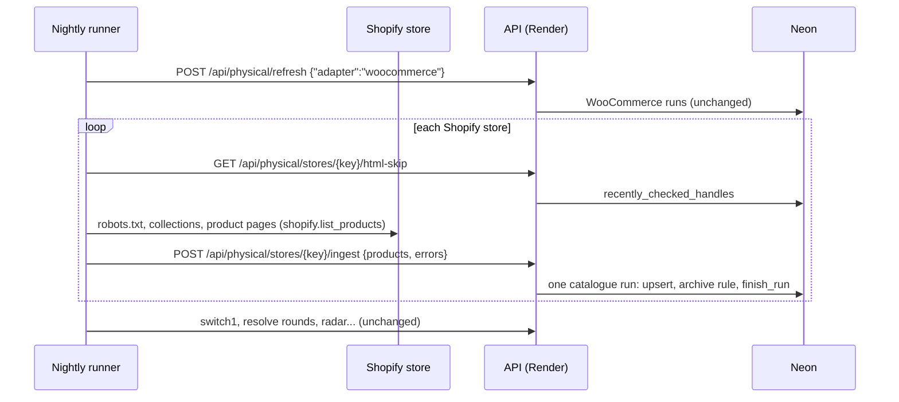

# Shopify walk on the nightly runner — design

Date: 2026-10-22. Follows #76 (429 diagnostics) and #77 (wait out a 60s
Retry-After).

## Problem

Every Shopify store answers the catalogue's refresh from Render with HTTP 429.
#77 assumed a limit Shopify would lift after its `Retry-After: 60` and waited
it out; production showed retries after 30s and after 60s refused just the
same. The limit is on Render's shared outbound IP, whose allowance other
tenants use up around the clock, so no backoff on our side recovers it. The
three WooCommerce stores are unaffected.

## Evidence (spike, never merged)

Branch `spike/shopify-from-actions`, workflow `spike-shopify.yml`: from a
GitHub-hosted runner, with the tracker's User-Agent, `robots.txt` and page 1
of every collection the refresh reads, for all nine Shopify stores, three
rounds back to back at 2 requests a second per host. Run 39732326160:
**123 of 123 requests answered 200**, no `Retry-After` anywhere. The same
requests from Render the same evening: 429 on nearly all of them, again
after 60s.

## Decision

The nightly runner walks the Shopify stores; Render only writes what it
read.

- **Pure walk, reused as is.** `shopify.list_products` and `robots_for` run
  unchanged on the runner. Their import graph is stdlib plus `httpx2`
  (checked in a venv holding only `httpx2`), so the runner installs one
  package, pinned by `requirements.txt`'s line.
- **`physical_sources/wire.py`** (pure): `StoreProduct` and
  `PhysicalSourceError` to and from JSON. Dates as ISO strings, the price as
  a decimal string, `collections_seen` as a list; reading back is strict
  (exact key set, exact types) and raises `ValueError`.
- **Two job routes**, added to `items.JOB_ROUTES` and pinned by
  `tests/test_job_token.py`:
  - `GET /api/physical/stores/{key}/html-skip`: the handles whose Limited
    Run page was read within 7 days, so the runner skips them as Render did.
  - `POST /api/physical/stores/{key}/ingest`: one store's run. Under the
    catalogue write lock (409 when busy) and through `guarded`, so it is one
    `catalogue_runs` row recorded exactly as a Render walk records it. The
    database half of `refresh_store` becomes `record_store`, shared by both,
    so the archive rule (something seen, not short, no errors) cannot drift.
    Then `release_listed_ignores`, logged on failure, as `/refresh` does.
- **Ingest validation (422):** a known Shopify store; every row's `store` is
  the path's key and its URL is https on the store's host (or its `www.`
  twin); enums are the database's; strings within the columns' lengths;
  at most 20,000 rows and 200 errors. Database constraints remain the last
  word.
- **`RefreshIn.adapter`:** `/refresh` takes `{"adapter": "woocommerce"}`, so
  the nightly names no store keys. `stores` still wins when given.
- **`backend/scripts/walk_stores.py`:** for each Shopify store, html-skip,
  walk, ingest. A walk that raises posts one `internal` error so the run is
  still recorded as failed. Exit 0 when every run is ok, 1 when any failed,
  2 on a 401 (configuration, which fails the nightly as a 401 does now).
- **nightly.yml:** checkout + `setup-python` 3.12 + `pip install httpx2`
  before the refresh step; `call stores` becomes the WooCommerce-only call
  (900s), then the script, whose exit code feeds `ok` / `failed` /
  `unauthorized` as `shopify-stores`. Order is unchanged: stores before
  Switch 1 and resolve.

## Tradeoffs and non-goals

- **The JOB_TOKEN can now write store listings,** not just trigger reads.
  Before, a leaked token could only make Render re-read the real stores.
  Bounded by the validation above (own stores' hosts, real enums, caps), and
  the catalogue is admin-facing: public rows still take titles from IGDB and
  dates from the registry only. Accepted; the token is already a GitHub
  secret guarding writes of similar weight (generates, resolve).
- **A run's `started_at` is when the ingest arrived,** not when the walk
  began. The status page's times shift by the walk's minutes. Accepted.
- **The admin "Refresh stores" button still walks every store from Render,**
  so a manual press keeps 429ing on Shopify until Render's IP recovers.
  Moving the button would mean dispatching a workflow from the API; not
  now.
- **GitHub's runner IPs are shared too.** The spike is one evening. If they
  start 429ing, the #77 backoff still applies on the runner (same code).
- WooCommerce stays on Render: it works there, and moving it buys nothing.

## Smoke

Not testable end to end before deploy: the ingest route exists only on the
new API. After merge: `workflow_dispatch` Nightly, then the run log shows
`shopify-stores: ok` and each store's line; `/admin/catalogue` shows nine
Shopify runs green with today's time and non-zero rows; Render logs show
`job token accepted: POST /api/physical/stores/{key}/ingest` and no 500.
