# Play states: replays, paused games, and what Play Next sees (design)

Date: 2026-11-03 · Repo: joey-haas.dev · Builds on
`2026-10-30-tonight-picks-design.md` (recency in the scorer, the last finish,
Change of pace) and the Play Next scorer in `backend/picker.py`. The Ledger
tokens from `2026-10-19-site-refresh-design.md` still apply; the mockups use
them. Status labels follow the copy pass (`2026-10-22-copy-pass-design.md`).

## Problem

Two things the status model cannot say today:

1. **A replay is invisible.** `statusTransition.js` on Playing → Finished
   keeps the first `finished_at` (`item.finished_at ?? today`) and bumps
   `times_completed`. One item has one finish date, so a second playthrough
   has nowhere to put its own. Dredge, replayed and finished in October 2026,
   still carries its 2024 finish: the Tonight-picks recency curve
   (`recency_bonus`, 30-day half-life on `finished_at`) sees a stale finish,
   Change of pace's "last finish" is wrong, the public Now page and the RSS
   feed do not show it, and the Played tile says "Finished 2 times" with no
   dates.
2. **"Put down, coming back" has no state.** `active` means both "what I am
   playing tonight" and "what I parked in August". The Now page lists every
   `active` game as Playing, the shelf's Playing chip counts them, and the
   only way out is `abandoned`, which is a *negative* taste reference
   (`BASE_WEIGHTS.abandoned = -0.5`) and pushes similar games away. The
   picker already half-handles the parked case (candidates are
   `backlog` + `active`; the "Pick it back up" slot fires for an `active`
   game with no event in 30 days), but it cannot tell parked from playing.

What the better trackers do, for comparison: Backloggd keeps a game-level
shelf (Played / Playing / Backlog / Wishlist) and makes every *log* "a single
playthrough" with its own outcome (Played / Completed / Abandoned / Retired /
Shelved), dates and rating; a replay is "Create new log"
(https://backloggd.com/about). StoryGraph's Paused (Dec 2024) is a sub-state
of Currently Reading: paused books move to a collapsed section, paused time
is excluded from pace stats, a pause can be backdated, and resuming is one
toggle back (https://roadmap.thestorygraph.com/changelog/mark-books-as-paused-);
the request behind it was that DNF "gives the impression I disliked the book"
(https://roadmap.thestorygraph.com/requests-ideas/posts/book-status-of-paused).
From `2026-09-22-tracker-design-research.md` (not re-fetched): HowLongToBeat
counts Playing / Backlog / Replays / Retired / Completed; Backloggery keeps
outcome (Unfinished / Beaten / Completed / Mastered / Null) orthogonal to a
Now Playing flag. The common shape: **one simple status the owner touches,
per-playthrough history underneath.**

## Scope

In:

- A `paused` status, labelled **Paused**, between Playing and Finished.
- A `playthroughs` record per run of a game, opened and closed by status
  changes. `started_at`, `finished_at` and `times_completed` on items become
  derived from it (first start, last finish, count of finished runs).
- The picker reads the last finish; Paused games stay candidates with the
  Pick it back up reason and carry no taste weight.
- The admin card/list status control, the item edit page (dates), the public
  shelf (mark, chip), the item page (status line, Played tile, playthrough
  table when signed in), Now (Paused list; "again" on a replayed finish), the
  How-it-works stop that describes statuses, and the public snapshot /
  RSS where they read `finished_at`.
- Backfill of existing rows.

Out, explicitly:

- Per-playthrough ratings or reviews (Backloggd's model). One rating per
  game stays.
- Linking `play_sessions` rows to a playthrough by foreign key. Journal days
  are attributed by date range (see Open questions).
- A Replays chip on the public shelf or a Replays section in Year in review.
  The data will support both; neither ships here.
- Renaming Abandoned. "Dropped" was considered and left for the copy pass.
- Mastered / Completed-100% outcomes. Finished is the only positive outcome.
- Films, comics and board games: they keep the same enum and get Paused for
  free, but nothing here designs for them.

## Design

Direction: **chosen.html** — A's shelf, item page and Now, with B's idea
that the move out of the current state is named as a verb.

### States and transitions

```mermaid
stateDiagram-v2
    [*] --> Backlog
    Backlog --> Playing : Start (opens playthrough n+1)
    Playing --> Finished : Finish (closes it, finished_on = today)
    Playing --> Paused : Pause (playthrough stays open)
    Playing --> Abandoned : Abandon (closes it, outcome abandoned)
    Paused --> Playing : Resume (same playthrough)
    Paused --> Abandoned : Abandon
    Finished --> Playing : Replay (opens playthrough n+1)
    Abandoned --> Playing : Try again (opens playthrough n+1)
    Finished --> Backlog : (edit page only; corrects a mistake)
```



Status order everywhere (chips, charts, menus):
`backlog · active · paused · finished · abandoned`. Labels: Backlog ·
Playing · Paused · Finished · Abandoned.

Semantics:

- **Playing** means playing now. The Now page's Playing list and the
  Tonight "Pick it back up" stall check both assume it.
- **Paused** means set aside, intend to return. It is not an opinion about
  the game. A Paused game keeps its open playthrough and its `started_on`.
- **Finished** closes the open playthrough with today's date (local date,
  as `localToday` already does). A game with no open playthrough (Backlog →
  Finished on the edit page, say) gets one created with no start date.
- **Abandoned** closes the open playthrough with outcome `abandoned` and
  today's date.
- Moving to Playing from Finished or Abandoned opens a new playthrough
  numbered one higher. Moving to Playing from Paused reopens nothing: the
  same playthrough continues. Moving to Playing from Backlog opens
  playthrough 1 (or the next number if dateless backfilled runs exist).

### Admin: the status control

Shelf card, list view and the edit page all use the same control. It is
the menu that exists today with two changes (chosen.html, surface 1):

- Paused is in it.
- The move out of the current state is named as a verb, with a one-line
  muted hint saying what it records: from Finished the Playing entry reads
  **Replay** · "starts playthrough 3"; from Paused it reads **Resume** ·
  "since Aug 2026"; from Abandoned, **Try again**; Playing → Finished reads
  **Finish** · "dated today"; Playing → Paused reads **Pause** · "keeps the
  date". Entries that are not a move out of the current state keep the
  plain label. The selected entry is the current state.
- Nothing asks for confirmation. Choosing Replay on a finished game is the
  whole gesture; a wrong click is undone by choosing Finished again, which
  deletes the just-opened playthrough rather than closing it (an open
  playthrough with no sessions and a `started_on` of today, closed the same
  day, is treated as a misclick and removed — Code decides the exact rule).

The edit page (`/admin/collection/:id`) gains a **Playthroughs** table under
the status: number, started, finished, outcome. Dates are editable there,
which replaces editing `started_at` / `finished_at` directly. A row can be
deleted. New rows are not added here (the status control is the writer);
if a past run needs recording, add a row with dates and outcome Finished
through a small "Add a past playthrough" link at the table's foot. Both
of these are the only hand edits to the table.

The touch "…" sheet on the admin card lists the same entries with the
same verb labels.

### Public shelf

- **Status mark** (card corner): Paused is a hollow square in
  `--status-active`'s colour with a 2px stroke and the existing 1px
  `--surface` halo, so it reads as "Playing, but not filled in". Playing
  stays the filled square. `aria-label` "Paused". Contrast of the stroke
  against covers is what the existing marks already rely on (the halo).
- **Replay mark**: a small `×2` (`×n`) at the poster's bottom-left in the
  overlay style the format mark uses at the bottom-right, mono numeral,
  `aria-label` "Finished 2 times". Shown only when `times_completed > 1`.
  Nothing new below the poster.
- **Status chips** gain Paused with its count, hidden at zero like the rest.
- **Dim finished** keeps dimming finished and abandoned only. Paused is not
  dimmed: it is unfinished business, which is what the owner's view is for.
- Sort "Recently finished" reads the new `finished_at` (last finish), so a
  replay rises to the top. Hero number "finished this year" counts finished
  playthroughs in the year, not items, so a replay in October counts for
  2026 (see Open questions for the stats query).

### Item page

- Status line in the hero: "Finished twice · last Oct 2026" for a replayed
  game; "Finished · Oct 2026" for one finish; "Paused · since Aug 2026";
  "Playing · since 24 Oct 2026". Relative phrasing matches
  `2026-10-30-tonight-picks-design.md` ("this week", "last week", "in
  October").
- **Played tile**: figure "Finished 2 times", muted line "Last 19 Oct 2026 ·
  first Mar 2024". With one finish: "Finished once", "19 Oct 2026". With an
  open playthrough and prior finishes: "Finished 2 times", "Playing again
  since 3 Oct 2026".
- Signed in: a **Playthroughs** table below the tiles (number · started ·
  finished · outcome · journal, where journal is "6 days · 11 h" summed
  from `play_sessions` inside the run's date range). Read-only here; the
  edit page is where dates change. A note under it says so.

### Now and the snapshot

- **Playing** lists `active` games only.
- **Paused** is a new list under Playing, same row style, "since Aug 2026 ·
  41 h in" (hours from the journal when any; omit otherwise). Hidden when
  empty. On the phone it is the same list, not collapsed; the list is
  short.
- **Just finished** reads last finishes. A replayed finish carries a small
  "again" tag after the title and "second time" / "third time" after the
  date.
- Home's facts table ("Playing · Hades II") reads the Playing list and is
  unchanged in shape.
- The finished-games RSS feed emits one entry per finished playthrough,
  dated by `finished_on`, so a replay is a new entry.

### Play Next (picker)

- `PickerItem.finished_at` is the last finish. `recency_bonus` is
  unchanged in shape; a replay is a fresh finish and counts like one. No
  extra weight for being a replay.
- `candidates()` admits `backlog`, `active` and `paused`.
- A `paused` candidate's "Pick it back up" slot uses the pause date, not
  the 30-day stall check: any Paused game qualifies; prefer the one with
  the most journal hours (sunk cost is the honest reason) and name it:
  "41 h in, paused since August". The stall check for `active` games
  stays, since it catches the game that should have been paused.
- `_is_reference`: Paused games are not references (no weight either way).
  A paused game's genres do not pull picks toward or away from it.
- Reasons that name the recent finish ("…which I finished last week") are
  correct for free once `finished_at` is the last finish. A replay reason
  may say "which I finished again last week"; the public rule (only when
  that game is public) is unchanged.

### Stats, Month and Year in review

- The stacked status bar gains a Paused segment between Playing and
  Finished, in the Paused mark's colour at the same fill as Playing (the
  bar has no hollow option; the legend carries the name).
- The twelve-month finishes strip and "finished this year" count finished
  playthroughs by `finished_on`.
- Month in review's finished list includes replays with the "again" tag.
  Nothing else changes here.

### Responsive and theme

Nothing in this design introduces a new layout. The hollow Paused mark and
the ×n badge use existing tokens and work in both themes (mockups show
both). The verb-and-hint menu rows wrap on a phone (hint drops under the
verb), as the mockup's popover shows at 400px.

### Accessibility

- Every mark has an `aria-label` ("Paused", "Finished 2 times"); nothing
  is colour-only, since the hollow-vs-filled distinction is also a shape
  difference and the chips and status line say it in words.
- Menu entries are the verb plus the hint as one accessible name ("Replay,
  starts playthrough 3").
- The playthrough tables are real tables with header cells.

## Key decisions

- **Playthroughs table, not `last_finished_at`.** One column fixes Dredge
  today, but the journal has nothing to hang off, Replays never show in a
  review, and the third time this comes up the table gets built anyway.
  The table is the shape Backloggd, HLTB and Backloggery all landed on. The
  cost is a migration and a backfill.
- **The status control stays the only writer.** Backloggd makes the user
  manage logs by hand; that is the part to leave behind. Playthroughs are a
  consequence of changing status, and the only hand edits are dates and
  adding a past run on the edit page.
- **Paused, not Shelved or Set aside.** Backloggd's "Shelved" collides with
  a tracker called My Shelf. "Paused" is one word, pairs with Playing, has
  StoryGraph precedent, and reads as neutral: pausing is not an opinion.
- **Paused carries no taste weight.** Abandoned is -0.5 and Finished is
  +0.3 because they say what the owner thought. A pause says nothing yet.
- **Replay recency equals first-finish recency.** A replay is arguably a
  stronger signal, but there is no evidence for a multiplier and it adds a
  knob. Revisit if picks feel off.
- **Rejected: B's lanes.** Playing and Paused as sections above the grid
  (StoryGraph's collapsed Paused) duplicate the chips, push the grid down
  on a phone, and break the research rule that status is a corner mark, not
  text. Now already is the "what am I playing" list; the shelf does not
  need to be one too.
- **Rejected: B's action-only control.** Listing verbs instead of states
  (Finish · Pause · Abandon) hides where you are and what the other states
  are, and the list view's `<select>` cannot do it. The verb *labels* were
  worth keeping, so chosen.html names the move and keeps the menu.
- **Rejected: A's plain menu.** Adding Paused to today's menu works but
  leaves "Playing" on a finished game meaning something the label does not
  say.

## Component inventory

Existing, changed:

- `StatusMenu` / the card `<select>` and the "…" sheet (`AdminCollection`,
  `PosterCard` shelf actions): Paused entry, verb labels, hints.
- `PosterCard`: Paused mark, replay badge; `STATUS_ORDER` / `STATUS_LABEL`
  in `lib/shelf.js`; `statusTransition.js` becomes a thin call to the API's
  status route (the transition logic moves server-side, see Open
  questions).
- `FilterChips` status row: Paused.
- `Item` page `Tiles` Played tile and hero status line; new read-only
  `Playthroughs` table (signed in).
- `AdminItem` edit page: Playthroughs table with editable dates, delete
  row, "Add a past playthrough".
- `Now` page and `nowLists.js`: Paused list, "again" tag.
- Stats status bar, finishes strip, hero numbers; Month in review finished
  list.
- `HowItWorks` stop that describes statuses.

New:

- `PlaythroughTable` (shared between the public item page, read-only, and
  the edit page, editable).
- `ReplayMark` (or an extension of the existing mark/format-mark pattern).

Tokens: `--status-active` reused for Paused's stroke (no new colour);
`--overlay`, `--text` for the ×n badge; `--text-3` for hints. No new
tokens.

## Acceptance criteria

- [ ] Marking a Finished game Playing opens a new playthrough; marking it
      Finished again sets `finished_at` to today and `times_completed` to
      the count of finished playthroughs. Dredge-style: a 2024 finish and
      an October 2026 finish both exist as rows.
- [ ] Playing → Paused → Playing leaves exactly one open playthrough with
      the original `started_on`.
- [ ] Paused games appear in Play Next candidates, never as references, and
      can fill Pick it back up with the pause date in the reason.
- [ ] `recency_bonus` for a replayed game uses the latest finish; a pure
      unit test covers first-finish-old / last-finish-recent.
- [ ] Now lists Paused games under a Paused heading and marks a replayed
      finish "again"; the Playing list contains only `active` games.
- [ ] The RSS feed has one entry per finished playthrough.
- [ ] Backfill: every existing item with `started_at`, `finished_at` or
      `times_completed > 0` has playthrough rows that reproduce those three
      values exactly through the derived path, and `active` items have an
      open row.
- [ ] Public shelf matches `chosen.html` surface 2 at 400px and 1280px in
      both themes: hollow Paused mark, ×2 badge, Paused chip.
- [ ] Item page matches `chosen.html` surface 3: status line, Played tile
      with last and first, playthrough table when signed in and absent for
      visitors.
- [ ] Admin control matches `chosen.html` surface 1: verb labels and hints
      for the moves out of the current state, in the card menu, the list
      `<select>` (labels only; `<option>` cannot carry a hint) and the
      touch sheet.
- [ ] Every mark and menu entry has an accessible name as specified.

## Open questions for Code

- **Where the transition logic lives.** Today it is client-side
  (`statusTransition.js`) and the API is a plain PATCH. Opening and closing
  playthrough rows should be one transaction, which argues for a
  `POST /api/items/{id}/status {status}` route (the pin route is the
  precedent) and the client calling it instead of computing fields. The
  item PATCH would then refuse `status`, `started_at`, `finished_at` and
  `times_completed`, or accept them only from the edit page's playthrough
  editor. Code's call.
- **Derived vs cached.** `started_at`, `finished_at`, `times_completed` can
  stay as columns maintained by the status route (cheap reads for the
  public snapshot, the sort and the index on `finished_at`), with a check
  that recomputes them from playthroughs. Dropping the columns is cleaner
  but touches every reader. Recommend keep-and-maintain.
- **Playthrough shape.** Suggested: `id, item_id (cascade), number
  (smallint), started_on (date, null), finished_on (date, null), outcome
  (enum finished | abandoned, null while open)`, unique `(item_id, number)`,
  and a partial unique index on `item_id where outcome is null` so a game
  can have at most one open run.
- **Backfill rule for `times_completed > 1` with one set of dates.** The
  latest run gets the dates; the earlier `n - 1` runs are dateless with
  outcome `finished`. The Played tile then shows "first —" until the owner
  fills a date on the edit page.
- **Journal attribution.** Sessions fall into the playthrough whose
  `[started_on, finished_on]` contains `played_on`; a dateless or open run
  takes what no other run claims. If that proves ambiguous in practice,
  add `playthrough_id` to `play_sessions` later.
- **"Finished this year" and the finishes strip** now count playthroughs;
  the stats query joins `playthroughs` instead of reading
  `Item.finished_at`. Check the snapshot build time stays trivial (it will;
  the table is tiny).
- **Misclick undo rule** for Replay, as described under the admin control.
- **Pause date.** `paused_on` is not stored; "since Aug 2026" comes from
  the most recent status change. If there is no event record for status
  changes, add `paused_on` (date, null) to playthroughs and stamp it on
  Pause, clear on Resume. Recommend the column; it is one line and the
  Pick it back up reason needs it.

---

# Plan

Written 2026-11-04 by Code, from a survey of the readers of `status`,
`started_at`, `finished_at` and `times_completed` (backend: `items.py`,
`picker.py`, `picker_routes.py`, `public.py`, `public_outputs.py`,
`discover.py`; frontend: `lib/statusTransition.js`, `lib/shelf.js`,
`lib/nowLists.js`, `lib/dashboard.js`, `lib/monthInReview.js`,
`lib/yearInReview.js`, `scripts/prerender-lib.mjs` (the feed), and the
pages and components that import them).

## Answers to the open questions

| Question | Decision | Why |
|---|---|---|
| Where transitions live | Server. New `POST /api/items/{id}/status {status, today}`; one pure module, `backend/playthroughs.py`, decides every row change, as `formats.py` does for copy fields. PATCH answers 422 for `status`, `started_at`, `finished_at`, `times_completed`. Create, bulk create and the pin route go through the same module. | One transaction per move; one writer, so the cached columns cannot drift. |
| Whose "today" | The client sends `today` (its `localToday()`); the server refuses one more than a day from its UTC date. | Keeps the local-date rule `statusTransition.js` has today, without trusting any date. |
| Derived vs cached | Keep the three columns, maintained only by `playthroughs.sync(item, runs)` in the same transaction. A test asserts `derive(runs)` equals the columns after every route. | Every reader, the `finished_at` index and the public-next fingerprint (items `xmin`) keep working untouched. |
| Shape | As suggested, plus `paused_on date null`. `outcome` enum `playthrough_outcome` (`finished`, `abandoned`). Partial unique index: one open run per item. | Pick it back up needs the pause date; there is no status-change event to read it from. |
| Backfill | In the migration, as SQL: for each item with `times_completed > 0` or a date or status `active`, `n - 1` dateless finished runs, then the latest run carrying `started_at` / `finished_at`; `active` items get the open run (with `started_at`). An `abandoned` item with dates gets an abandoned run. | Additive, idempotent with the migration, no separate prod data script for Joey to run. |
| Misclick undo | Closing an open run is a delete instead when: the target equals the previous run's outcome, the open run started today, it is not paused, and no journal day falls in it. The item returns to the previous run's values. | Exactly the "Replay by mistake, Finished again" gesture; anything else is a real run. |
| Move to Backlog | Deletes the open run (dates only; journal rows are not linked), keeps closed runs. | The edit page's mistake-fix path; Backlog means "no current run". |
| Pause date | `paused_on` stamped on Pause, cleared on Resume. | As recommended. |
| Journal attribution | By date range, as specified, computed server-side for `ItemOut.playthroughs` (`journal_days`, `journal_minutes`). | No FK; spec keeps that out. |
| Public fields | `PublicItem` gains `paused_on` and `finishes` (finished runs' dates, ascending, dateless omitted). Playthrough rows themselves are admin-only. | Feed, Year/Month in review and the Played tile need every finish date; earlier finish dates become public, which is the point of the feature. |
| Feed GUIDs | Stay `…/#finished-<date>`, now one per finish date. | Existing entries keep their GUIDs, so nothing reposts; a replay is a new entry. |

## Deviations from the spec (recorded during the build)

| Spec said | Built | Why |
|---|---|---|
| Backfill: the latest run carries `started_at` and `finished_at` | Run 1 carries `started_at`, the last finished run `finished_at` | `started_at` is "the earliest start" in `derive`, so the backfill has to agree with `sync` or the first status move rewrites the column. |
| Status writers: status route, create, bulk create, pin | The comics Got it route also goes through `apply_status` | It set `active` directly; a second writer is what the module exists to prevent. |
| Reason "which I finished again" | Not added | Deferred to keep the picker's reasons untouched in this PR; a follow-up if wanted. |
| Feed title unchanged | A replay's entry says "again" | Two entries with the same title read as a duplicate. |
| Now's Finished: one row per finish | One row per game, with an "again" tag and "second time" | Keeps Now's list shape (one row per game); the tag carries the replay. |
| Status popover with hints | Native `<select>` kept; the hint sits in the option text | Keeps keyboard and touch behaviour the platform's; the move names come from `lib/statusMoves.js` for every control. |
| Edit page status in the form | In the Playthroughs section, posting immediately | A status move is its own transaction; saving it with the form's other fields would mix two writers. |
| Stats-bar Paused segment solid | Hollow ring, as the poster mark | A solid segment needed a new status token with its own contrast measurement; the hollow ring reuses `--status-active`, already measured. |
| "Playing · since <date>" on a replay | "Playing again", undated | Publicly `started_at` is the first run's start, and the current run's start is not published. |
| Now's Paused rows with hours | No hours | The snapshot carries no journal. |
| Item page dates "24 Oct 2026" | The page's existing `en` format ("Oct 24, 2026") | One date style per page. |
| Relative dates ("this week") | Absolute dates | Prerendered and snapshot pages would freeze a relative phrase. |
| Replay count on every card | Suppressed when a badge or the upcoming ribbon holds the corner | The corner holds one mark. |
| Item page `started_at` is the item column | Run 1's start, plus `playing_since` (the open run's start, active or paused only) | The column is the earliest start of any run, so an undated run 1 would show a replay's date as the first; and after Try again the hero would date the abandoned run. `playing_since` publishes what `started_at` said before this branch. |
| Backfill and seed read `times_completed` alone | A finish date counts as a finish whatever the counter says; a backlog game with a date gets an abandoned run | Review found rows whose counter lagged their date: the date would have been dropped. |
| Status and pin dated by the server | Both take the owner's local `today` | A late-evening move was dated tomorrow in UTC, and the misclick rule compares that date with today. |
| Misclick: "the previous run" by number | By when the runs were written (`created_at`), number as the tie-break | A past run added after a mistaken Replay has a higher number than the run the Replay followed. The admin hint still orders by number. |
| Feed GUID `#finished-<date>` | Unchanged, except a second finish on one day adds `-<n>` | Two finishes in a day shared a GUID and a list key; published GUIDs keep their form. |

## Tasks

All sequential (each builds on the API shape of the one before). Tests run
one backend suite at a time (repo CLAUDE.md).

1. **Migration `0011` and models.** `ALTER TYPE item_status ADD VALUE
   'paused' AFTER 'active'` inside `op.get_context().autocommit_block()`;
   create `playthrough_outcome`; `playthroughs` table (`id`, `item_id`
   cascade, `number smallint`, `started_on`, `finished_on`, `paused_on`,
   `outcome`, `created_at`), unique `(item_id, number)`, partial unique
   `(item_id) where outcome is null`, index `(finished_on)`; backfill SQL.
   Downgrade drops the table and type and documents that the enum value
   stays (Postgres cannot drop one). `ItemStatus.PAUSED`, `Playthrough`,
   `PlaythroughOutcome` in `models.py`.
   *Files:* `migrations/versions/0011_add_playthroughs.py`, `models.py`,
   `migrations/README.md` (enum-value note).
   *Tests:* migration test on fixtures covering 0/1/3 completions, active,
   abandoned, dateless: `derive(runs)` reproduces the three columns
   exactly and active items have one open run (AC: backfill).
2. **`backend/playthroughs.py` (pure core + one async apply).**
   `derive(runs)`, `plan_transition(runs, status, target, today,
   journal_days_in_open) -> ops`, the misclick rule, `seed(fields)` for
   create; `apply_status(session, item, target, today)` and `sync`.
   *Tests:* `tests/test_playthroughs.py`, pure, every edge of the state
   diagram, Pause/Resume keeps `started_on` (AC), Replay then Finish gives
   two rows and count 2 (AC), misclick delete, Backlog drops the open run,
   Backlog → Finished creates a start-less run.
3. **Routes.** `POST /{id}/status`; PATCH refuses the four fields (422,
   detail names the status route); create and bulk create seed runs;
   pin calls `apply_status`; edit-page routes `PATCH
   /{id}/playthroughs/{number}` (dates only), `DELETE …/{number}` (renumbers
   nothing; numbers are history), `POST /{id}/playthroughs` (a past
   finished run, numbered below any open one by shifting it up). `ItemOut`
   gains `playthroughs`. None of these joins `JOB_ROUTES`
   (`test_job_token.py` unchanged and green).
   *Files:* `items.py` (or a new `playthrough_routes.py` mounted beside it
   if `items.py` grows past readable), `importer.py` if it sets status.
   *Tests:* route tests incl. the column invariant after every route,
   the 422s, the `today` bound, foreign-origin refusal like the other
   writes.
4. **Picker.** `PickerItem` gains `paused_on`, `journal_minutes`;
   `candidates()` admits `paused`; `_is_reference` is false for paused;
   Pick it back up takes any paused game first, most journal minutes
   winning, reason "41 h in, paused since August" (hours omitted when
   none); the 30-day stall check stays for `active`. `public_outputs.PICKABLE`
   adds `PAUSED`; "Pick it back up" stays in `WITHHELD_SLOTS`.
   `discover.py`'s finished/abandoned checks reviewed (paused is neither).
   *Files:* `picker.py`, `picker_routes.py`, `public_outputs.py`, `discover.py`.
   *Tests:* `test_picker.py` incl. first-finish-old / last-finish-recent
   recency (AC), paused never a reference (AC), paused fills Pick it back
   up with the date (AC).
5. **Public reads.** `PublicItem.paused_on`, `.finishes`; stats: the finishes
   strip and `finished_this_year` count finished playthroughs of public
   items by `finished_on`; `by_status` carries `paused`. Check whether any
   `/api/public/next` path now reads `playthroughs`; if so it joins the
   fingerprint in `public_next_cache.py` (CLAUDE.md rule), with a test.
   *Files:* `public.py`, `public_outputs.py`, maybe `public_next_cache.py`.
   *Tests:* `test_public.py` field pins updated, a replayed item counts
   twice across two years.
6. **Frontend libs.** `STATUS_ORDER` / `STATUS_LABEL` with Paused;
   `statusTransition.js` becomes `statusMoves(item)` (target, label —
   Replay / Resume / Try again / Finish / Pause — and hint) plus
   `setStatus(id, status)` calling the route with `localToday()`;
   `nowLists.js` Paused list and the "again" flag; `dashboard.js`,
   `monthInReview.js`, `yearInReview.js` read `finishes`;
   `prerender-lib.mjs` feed one entry per finish.
   *Tests:* each lib's existing test file; feed GUID test asserts the old
   form for a first finish.
7. **Admin surfaces (chosen.html surface 1).** Card menu, list `<select>`
   (labels only), touch "…" sheet use `statusMoves`; accessible names
   "Replay, starts playthrough 3". `AdminItem`: `PlaythroughTable`
   editable (dates, delete, "Add a past playthrough"); `ItemForm` stops
   editing the three fields on an existing item.
   *Files:* `ShelfCardActions.jsx`, `PosterCard.jsx`, `AdminCollection.jsx`,
   `AdminItem.jsx`, `ItemForm.jsx`, new `PlaythroughTable.jsx`, `index.css`.
8. **Public surfaces (surfaces 2 and 3, Now).** Hollow Paused mark,
   `ReplayMark` (×n, `role="img"`, "Finished 2 times"), Paused chip;
   Item hero status line, Played tile, read-only `PlaythroughTable` when
   `signedIn` (outlet context) with the read-only note; Now's Paused list
   and "again" tag; Stats bar Paused segment; HowItWorks status stop.
   *Files:* `PosterCard.jsx`, `FilterChips` usage in `Collection.jsx`,
   `Item.jsx`, `Now.jsx`, the stats component, `HowItWorks.jsx`,
   `index.css`, `content/spine.js` if the copy lives there.
   *Tests:* component/page tests for each mark, chip, list and the table's
   absence for visitors.
9. **Docs.** Repo `CLAUDE.md` Media tracker bullet for playthroughs (one
   writer, cached columns, misclick rule, deploy order) and the `0011`
   line; `backend/README` or module docstring per standards; spec
   deviations recorded here if any.
10. **Browser verification.** Local backend + Vite, compare against
    `chosen.html` at 400px and 1280px in both themes; walk Replay → Finish,
    Pause → Resume, misclick undo on a real local row.

## Milestones

```
STOP — carve-out review: Task 1's migration (enum value + new table +
       backfill), as specified above. Joey's "go" on this plan is that review.
Milestone 1 (auto): tasks 1–10, local DB only
Finish gate → PR (ready for review)
STOP — Joey applies nothing; on request I run migrate_neon.py current/upgrade
       from the worktree. Deploy order: apply 0011 to Neon, then merge.
```

## Environment test section

- Backend: `./.venv/bin/pytest` (full suite, single run) green.
- Frontend: `npm test` and `npm run build` green (build includes prerender
  and the feed).
- Old-code-on-new-schema check: with `0011` applied locally, run the
  `main` checkout's API against it and load `/api/public/items` — no row is
  `paused` yet, so it must boot and serve (schema ahead → warning only).
- Post-deploy: `./scripts/smoke.sh https://joey-haas.dev https://api.joey-haas.dev`;
  update `smoke.sh` if it pins status values or public item fields.
