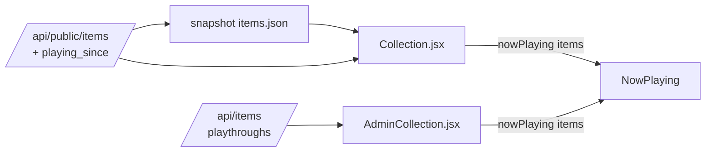

# Now Playing: the game I'm playing, up front

## Problem

A game I'm playing (`status: active`) is hard to spot on the shelf. On
`/shelf` and `/admin/collection` its only mark is the small status dot on
its poster, somewhere in a grid sorted by whatever the toolbar says, below
the hero numbers, favourites and stats. `/now` and Home do list it, but the
shelf, the page people actually land on, says nothing about what I'm doing
right now.

## Scope

**In**

- A **Now Playing** band on `/shelf` and `/admin/collection`: large cover,
  title, platform, "Playing since …", linking to the item page (public) or
  the edit page (admin).
- `playing_since` added to the public **list** body (`PublicItemOut`), so
  the public band can show it without a second request.

**Out**

- Paused games (they have `/now`), the Home and `/now` pages, journal
  "last played" (another request per visit), any grid re-sort or card
  restyle, admin controls inside the band (the card's own controls stay
  where they are, in the grid).

## Proposed solution



- **`lib/nowPlaying.js`** (pure): `nowPlaying(items)` returns
  the active, owned games, at most `NOW_PLAYING_LIMIT` (3), most recently
  started first, then title. It also returns each game's start: the public
  `playing_since`, or on admin the open playthrough's `started_on` (the run
  with no outcome); `started_at` only for a row with no runs, as the API
  does. It reads the row's shape rather than taking an admin flag. One place decides the
  order and the start date for both shelves.
- **`components/NowPlaying.jsx`**: `<section aria-labelledby>` with a
  "Now playing" heading and one card per game. The cover is the existing
  `CoverImage`, the title links through `linkFor` (the pattern
  `FavoritesRow` already uses), the platform comes next, then "Playing
  since 3 Nov" through `dayWords`. Renders nothing when nothing is active,
  so there's no empty band. One game gets a wide horizontal card; two or
  three sit side by side and stack on a phone (`useMediaQuery` is not
  needed: CSS grid `auto-fit`).
- **Placement**: directly under the hero numbers / stat tiles, above
  `NextBand` on `/shelf` and above `FavoritesRow` on admin. The band is
  the first thing after the figures, because it's the one row about today.
- **Styling**: plain CSS in `index.css` with tokens only. The accent is a
  left rule in `--status-active`, the same colour as the grid's Playing
  dot, so the band and the dot read as the same thing. `--status-active`
  already clears 3:1 on `--surface` in both themes. Text uses the existing
  text tokens, so no new contrast measurement is needed.
- Copy (`Now playing`, `Playing since`) goes in `content/spine.js` beside
  the rest of the shelf copy.

## Key decisions and tradeoffs

| Decision | Why | Tradeoff |
|---|---|---|
| A band, not a grid re-sort | A grid's order belongs to the sort control; pinning active games first would fight a chosen sort | The game appears twice (band and grid). That's acceptable: the band is a summary, the grid is the catalogue |
| `playing_since` on the list body | It's already public on the item page and leaks nothing new; the run dates are already loaded for the list (`_run_dates`), so it costs no query | A public API contract change (additive). `LIST_FIELDS` in `test_public.py` must grow, and an old snapshot simply lacks the field, so the band then omits the date |
| Admin start from `playthroughs` | `/api/items` already carries every run; the `started_at` column is the earliest start of *any* run, which after a replay is the wrong date | Logic in the frontend, kept in one pure helper with tests |
| Cap at 3 | Rarely more than one or two at once; a long band would push the shelf down | A fourth active game shows only in the grid |
| Active only, not paused | Paused is "set aside"; the ask is the game I'm *playing* | Paused stays on `/now` only |

## Docs alignment

- `CLAUDE.md`: tokens only, never raw hex; `--status-*` were chosen on
  measured contrast. Aligned: reuses `--status-active` as a non-text mark.
- `CLAUDE.md`: the public `playing_since` is "the open run's start on an
  active or paused game only". Aligned: the list takes the same value from
  the same `_Runs`.
- `CLAUDE.md`: nothing hover-only; `role="img"` on named non-text marks.
  The band has no hover reveal; the rule is decorative (no name).
- `CLAUDE.md`: shelf components live in `components/`. Aligned.
- Prerender reads only the snapshot and copy. The band is client-rendered
  like the favourites row, so no prerender change.

## Open questions

None blocking. If you'd rather the band also show paused games (muted),
that's a small follow-up.

## Smoke test strategy

- `smoke.sh` checks public field shapes against prod. Confirm it doesn't
  pin the list body's exact keys; if it does, add `playing_since`.
- Post-deploy: open `https://joey-haas.dev/shelf` with a game set to
  Playing and check the band appears with its date. If no public game is
  active it renders nothing, which is correct.

---

# Plan

## Milestones

```
Milestone 1 (auto): tasks 1–5
Finish gate → PR
```

No carve-outs. There's no migration, infra or auth change, and the API
change is an additive response field.

## Tasks

1. **Backend: `playing_since` on the list.** `backend/public.py`: move
   `playing_since` from `PublicItemDetailOut` to `PublicItemOut`, and set it
   in `_list_fields` as `dates.open_started` when the status is active or
   paused (`_start_fields` keeps overriding it for detail, so the item page
   is unchanged). `tests/test_public.py`: move `"playing_since"` from
   `DETAIL_FIELDS` to `LIST_FIELDS`, and add a list test with an active game
   carrying today's start and a finished one carrying null.
   *AC:* `pytest` green; detail behaviour unchanged.
2. **`lib/nowPlaying.js` + test.** Pure helper as above. Tests cover: only
   active and owned (a wanted active row is excluded), order by start date
   desc with undated last then title, cap 3, the admin start from the open
   playthrough over `started_at`, and the public start from `playing_since`.
3. **`components/NowPlaying.jsx` + test + CSS.** Renders nothing on an
   empty list; heading and links; date words; omits the date when it's
   null. CSS in `index.css` with tokens only.
4. **Wire into `pages/Collection.jsx` and `pages/AdminCollection.jsx`**,
   with copy in `content/spine.js`. Update both page tests to check the
   band appears for an active item and links correctly (`/shelf/<id>/` via
   `spinePaths`, `/admin/collection/<id>` on admin).
5. **Verify**: `npm test`, `npm run build`, backend `pytest`, then the dev
   server in the browser with an active item in both themes and at phone
   width; screenshot.

Tasks 2–3 touch separate files but feed task 4. They run sequentially
(nothing here is worth parallel worktrees).

## Environment test

Local: backend on :8000 with the test DB seeded with an active public game,
frontend on :5173. Check `/shelf` and `/admin/collection` in dark and
light, at 375px and at desktop width.
