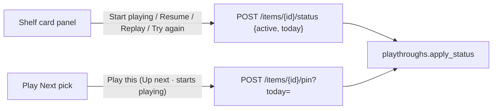

# Quick play: one move to Playing

## Problem

Setting a game to Playing takes too many steps. On the admin shelf the only
way is the status `<select>` in the card's action panel: hover, open the
dropdown, pick "Playing". On a phone it is "…", then the dropdown, then the
option. The List view and the edit page are further away still.

Play Next already does it. "Play this" calls the pin route, which pins the
game as Up next **and** moves it to Playing through `playthroughs.apply_status`
(`backend/items.py`, `pin_item`). The button doesn't say that, so it reads
as "remember this for later", not "I'm playing it now".

## Scope

In:

- A **play button** on every admin shelf card that isn't already Playing,
  named for the move it makes.
- Play Next's "Play this" says what it does.

Out:

- The public pages. The signed-in public shelf and `/shelf/<id>` stay
  read-only.
- A search-and-start box on `/admin/collection`.
- Any backend, API or schema change. Both buttons call routes that already
  exist: `POST /api/items/{id}/status` and `POST /api/items/{id}/pin`.
- Finish, Pause or any other one-tap move. The status dropdown keeps
  covering those.

## Proposed solution

### The card button

`lib/statusMoves.js` gains `playMove(item)`. It returns the move to Playing
as `{ label, hint, name }`, or null when the item is already Playing. The
label depends on the current status:

| From | Label | Hint (from `statusMoves`) |
|---|---|---|
| Backlog | Start playing (comics: Start reading) | dated today |
| Paused | Resume | since Oct 2026 |
| Finished | Replay | starts playthrough 3 |
| Abandoned | Try again | starts playthrough 2 |

Resume, Replay and Try again, with their hints, already come from `move()`.
`playMove` reuses that and only adds the Backlog wording, so the button and
the dropdown can never disagree.

`ShelfCardActions` renders the button first in `.shelf-actions-row`. It calls
the existing `onStatus(item, 'active')`, so `AdminCollection.updateStatus`
handles the request, the 422 message and the reload, exactly as the dropdown
does. Its accessible name is `name` ("Replay, starts playthrough 3"), and the
hint appears as its `title`.

The panel's existing reveal rules carry the button. On a pointer device it
shows on hover and on `:focus-within`, using opacity, so it stays reachable
by keyboard. On touch it lives in the "…" sheet. That is one click after
hover on desktop, and two taps on a phone instead of four.

### Play Next

"Play this" stays the action and gets a visible second line: *Up next ·
starts playing*. The second line is tied to the button with
`aria-describedby`. The handler (`playThis` → `pinPath`) doesn't change.

## Key decisions and tradeoffs

| Decision | Why | Tradeoff |
|---|---|---|
| Label the button with the move ("Replay"), not the target ("Playing") | Replaying is a different act from starting, and the server records it differently (a new playthrough). The dropdown already uses these verbs. | Four different labels instead of one. |
| The button lives inside the existing panel | Keeps the poster grid clean and inherits the panel's hover, focus and touch rules without new ones. | Still one hover (desktop) or one "…" tap (phone) away. See Open questions. |
| No button on a card that's already Playing | Nothing to start. Finishing gets no shortcut here (out of scope). | The row shifts by one control between states. |
| Want-list rows keep the button | The status menu already offers Playing there, and a wanted game can be played without an owned copy (borrowed, digital). Only Up next is hidden, because the server refuses to pin one. | A wanted card shows Start playing without Up next beside it. |
| Play Next keeps a single action | "Play this" already pins and starts. A second "start without pinning" button would put two near-identical buttons on every pick. | You can't start a pick without making it Up next. The card button covers that from the shelf. |

## Docs alignment

- **CLAUDE.md, "Nothing on the shelf is hover-only":** the button is inside
  the panel the `:focus-within` and opacity rules already reveal. Aligns.
- **CLAUDE.md, "A card's admin controls are a sibling of its link":** the
  button sits in `ShelfCardActions`, which PosterCard renders through
  `actions`. Aligns.
- **The play-states spec (`2026-11-03-play-states-design.md`):** the server
  is the only writer of status. Both buttons go through routes that call
  `apply_status`. Aligns.
- **Tokens:** the button reuses `.shelf-pin`'s token-based styling, with no
  raw hex. Aligns.

## Open questions

1. **Always visible on touch?** A small ▶ beside "…" on every non-Playing
   card would make it a single tap on a phone. Recommended: not now. It adds
   a control to every poster, and the sheet keeps it two taps. It can be
   added later without changing anything else.

## Smoke test strategy

Admin-only, frontend-only. `smoke.sh` can't see it because the admin pages
need a session. Done means:

- Component tests (below) and the full frontend gate pass.
- After deploy, one manual check on `/admin/collection`: Start playing on a
  Backlog card shows it as Playing after the reload.

## Plan

One milestone, autonomous to the PR. There are no carve-outs: no
infrastructure, migration, auth or deploy-path change.

### Task 1: `playMove` in `lib/statusMoves.js`

- **AC:**
  - Returns null for `active`.
  - For Backlog, returns "Start playing", or "Start reading" for
    `type === 'comic'`, with the hint "dated today".
  - For Paused, Finished and Abandoned, returns the same verb and hint as
    that status's entry in `statusMoves(item)`.
- **Files:** `frontend/src/lib/statusMoves.js`,
  `frontend/src/lib/statusMoves.test.js`
- **Tests:**
  - One case per status.
  - A case where Finish undoes today's Replay. That's a move from Playing,
    so `playMove` returns null.
  - A parity check against `statusMoves` for the three named moves.

### Task 2: the card button

- **AC:**
  - `ShelfCardActions` renders the button first in the row whenever
    `playMove(item)` is non-null.
  - Clicking it calls `onStatus(item, 'active')`.
  - Its accessible name is the move's `name`.
  - It's reachable by keyboard in hover mode and inside the touch sheet.
  - Styled in `index.css` next to `.shelf-pin`, with tokens only.
- **Files:** `frontend/src/components/ShelfCardActions.jsx`,
  `frontend/src/components/ShelfCardActions.test.jsx`,
  `frontend/src/index.css`
- **Tests:**
  - The label for each status.
  - No button when the item is Playing.
  - A click calls `onStatus` with `'active'`.
  - The button is present in the opened sheet (with `useMediaQuery`
    stubbed false).
  - An existing `AdminCollection.test.jsx` case is extended so the button
    posts to `/api/items/{id}/status` with `status: 'active'`.

### Task 3: Play Next's hint

- **AC:** each pick's "Play this" has the visible text *Up next · starts
  playing*, tied to the button by `aria-describedby`. Behaviour is
  unchanged.
- **Files:** `frontend/src/pages/PlayNext.jsx`,
  `frontend/src/pages/PlayNext.test.jsx`, `frontend/src/index.css`
- **Tests:** the button's description reads the hint, and it still POSTs
  `pinPath`.

### Parallel safety

Tasks 2 and 3 both touch `index.css`, so everything runs in order. The work
is small enough that parallel runs wouldn't save anything.

### Finish gate

- `npm test`, `npm run lint`, `npx prettier --check`, `npm run build`
- One reviewer subagent on the branch diff
- PR

### Environment test

After merge and deploy, `./scripts/smoke.sh https://joey-haas.dev
https://api.joey-haas.dev` stays green. That's a regression check only. The
manual check on `/admin/collection` (above) confirms the feature.
