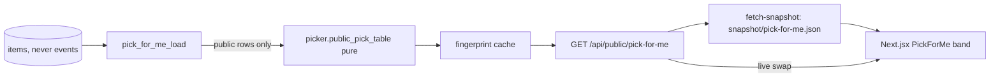

# Pick for me: a public backlog spinner — spec and plan

Date: 2026-11-08 · Repo: joey-haas.dev · Branch: `feat/pick-for-me`.
Brainstormed in Code (Joey: "go with recs"), so every decision below is the
recommendation, marked as such where it is a call rather than a fact.

## Spec

### Problem

Play Next is the most interesting piece of Spine and it is admin-only.
`/shelf/next` shows tonight's picks, the output, never the mechanism. A
control that lets a visitor say "something short, cozy" and watch the
backlog re-rank, with the reasons and the terms behind each score, shows the
engineering better than any paragraph about it. Audience (call): both
engineers reading the site and friends poking at it; the demo framing leads,
the copy stays light.

### Scope

In:
- A "Pick for me" band on `/shelf/next`, under Tonight: a size control
  (any/short/medium/long, `picker.SIZE_BANDS`) and mood chips (up to two of
  the six `Mood` values). Changing either re-ranks instantly; there is no
  submit button (call: the instant re-rank *is* the demo).
- Three picks per combination, each with `public_reasons` and a small term
  breakdown (taste, similar, quality, fits) and its total.
- One line under the band: deterministic ranking over public games, no model
  call, the same weights as Play Next.
- `GET /api/public/pick-for-me`: every combination in one body, precomputed.
- The optional snapshot `pick-for-me`, so the band works while the API sleeps.
- `/shelf/how`'s Play Next stop links to the band (`/shelf/next#pick-for-me`).
- Changelog entry, README section, CLAUDE.md lines, smoke check.

Out: Home; tracking the visitor's choices (the beacon stays path-only, and
choices never enter the URL); shareable query strings; platforms filter;
rerolls; any LLM; any write.

### Proposed solution



**Why precompute (fact + call).** Six moods give 1 + 6 + 15 = 22 mood sets of
at most two; times four sizes, 88 combinations. Each holds three ids, and the
cards are listed once by id, so the body is a few KB. Computing all 88 at once
lets the snapshot carry the whole feature, so a visitor never sees "Waking the
server" behind a button press, and a burst of visitors is one computation.

**What is ranked (decision, privacy).**
- Profile: public rows only, exactly as `public_reasons` requires, so no
  private rating, favourite or finish moves a score or is named.
- Pool: public, owned, `PICKABLE` (backlog, active, paused), unpinned — the
  same set Tonight draws from — minus games with a `never` event dated before
  today's UTC midnight (Tonight's rule, so a refusal shows up no faster here).
- Terms: affinity, similarity, quality and length fit, with Play Next's
  `PICKER_WEIGHTS` renormalised over those four. **Dropped:** `waiting`
  (reads the private `acquired_at`), `jitter` (the ranking must be the same for
  every visitor and every reload), and `staleness` (reads shown/skipped events,
  the owner's activity).
- No slots. Best fit / Change of pace / Pick it back up need the last finish,
  the journal and acquired dates; the band shows the top three by score.
  Ties break on title, then id.
- Moods are hard filters, as in `candidates`: a set with fewer than three
  matches shows what it has, and none shows "Nothing on the shelf is
  short and creepy" (copy in `content/spine.js`).

**Body (sketch, the builder may tighten names):**

```json
{
  "generated_on": "2026-11-08",
  "weights": {"affinity": 35, "similarity": 20, "quality": 15, "length_fit": 15},
  "games": {"<item id>": {"item_id", "title", "cover_url", "platform",
            "igdb_url", "hours", "reasons": [...]}},
  "combos": {"short|cozy+story": [{"item_id", "score", "terms": {...}}]}
}
```

Combo keys are `<size>|<moods sorted, joined with +>`, `any|` for none; one
pure helper builds them on both sides (`pickForMeKey` in `lib/`, the same
order in Python), and a test holds every one of the 88 present.

**Cache.** `public_next_cache.next_fingerprint` already covers every `items`
row, the UTC day and the windowed events; a second `PublicNextCache`-style
instance keyed on it is enough (the fingerprint errs wide, a spurious rebuild
costs one table). Refactor the class to take a builder if it does not already,
rather than copying it.

### Key decisions and tradeoffs

| Decision | Chosen | Over | Because |
|---|---|---|---|
| Where | Band on `/shelf/next` | The tour stop; Home | Next already paints a snapshot and shows picks; the tour stays a field guide and links to it |
| Delivery | Precompute 88 combos | Live per request | No wake-up on a button press; one computation per data change |
| Interaction | Instant re-rank | A "Pick" button | Watching the list move is the point |
| Ranking | Four public terms, no jitter | Full `recommend` | Waiting, jitter and staleness read private data or vary per visitor |
| Mechanism shown | Term breakdown per card | Reasons only | It is a demo of the scoring; reasons alone look like Tonight |
| Tracking | None | Logging choices | The beacon is path-only by design (analytics spec) |

### Docs alignment

- Public data rules: Spine Next spec B5/S9 (`2026-10-05-spine-next-design.md`);
  this body carries no store, price, score of a recommendation, pre-order
  window, acquired date, journal or event detail. The item score here is a
  public-only computation, not Play Next's.
- Snapshot convention: `frontend/scripts/fetch-snapshot.mjs` `SNAPSHOTS`
  (optional entry, like `next`); not in the nightly compare, since the
  redeploy after it carries a fresh one.
- Public router: `main.py` mounts the unauthenticated public reads; the new
  route goes on that router, GET only, so `origin_check.py` (writes) is not
  involved.
- Deviation: the brief suggested a TTL cache; the fingerprint cache is
  stricter and already exists.

### Open questions

None blocking. Copy wording is the builder's within `content/spine.js`.

### Smoke test strategy

`scripts/smoke.sh` gains: `GET /api/public/pick-for-me` is 200, has all 88
combo keys, every combo id is in `games`, and the body has no forbidden key
(the same key list the status checks use). Post-deploy run:
`./scripts/smoke.sh https://joey-haas.dev https://api.joey-haas.dev`, plus a
browser check of the band on `/shelf/next` with the API asleep (snapshot
path) and awake.

## Plan

One milestone, autonomous to PR. No migration, no env var, no CI or
render.yaml change: no carve-out. (The new unauthenticated GET follows the
existing public-read pattern and is pinned by `test_public_outputs.py`.)

### Task 1 — pure ranking (`backend/picker.py`)
- Add `public_pick_table(profile, pool, today) -> dict[key, list[ScoredPick]]`
  and `combo_keys()`; weights, table and references built once for all 88.
- AC: deterministic (same input, same output); excludes waiting, jitter,
  staleness; mood filter matches `candidates`; ties by title then id.
- Tests: `tests/test_picker_public_table.py` (pure, no DB): 88 keys, ordering,
  ties, mood filter, a private profile row never changes a score (profile is
  the caller's public list), empty combos.

### Task 2 — loader, route and cache (`backend/public_outputs.py`,
`backend/public_next_cache.py`, `backend/main.py` if wiring is needed)
- `load_pick_for_me(session, now)`: public rows, the pool rule above, never
  events before midnight; cards built with `public_reasons(slot=None)`.
- `GET /api/public/pick-for-me` with a Pydantic response model; cached on
  `next_fingerprint`.
- AC: a private game is never in `games`; a never'd game drops out from the
  next UTC day; a pinned game is out; cache hit on unchanged data.
- Tests: route tests in `tests/test_public_pick_for_me.py`; add the body to
  `test_public_outputs.py`'s forbidden-key walk and pin its fields.

### Task 3 — snapshot (`frontend/scripts/fetch-snapshot.mjs` + its test)
- Optional `pick-for-me` entry with a shape validator (object with `games`,
  `combos` of arrays).
- Tests: the existing fetch-snapshot test file gets valid/invalid cases.

### Task 4 — the band (`frontend/src/components/PickForMe.jsx`,
`frontend/src/lib/pickForMe.js`, `frontend/src/pages/Next.jsx`,
`frontend/src/content/spine.js`, `frontend/src/index.css`)
- Paints the snapshot, swaps in the live body when it arrives; hidden
  entirely when neither exists. Size as a radio group, moods as pressed
  chips styled like `FilterChips` (a third press is refused with a polite
  note); `aria-live="polite"` announces "Three picks for short, cozy".
- Cards reuse the Tonight card layout; the term breakdown is text plus a bar
  drawn with tokens only. Nothing hover-only.
- Tests: `PickForMe.test.jsx` (key building, re-rank on change, two-mood cap,
  empty state, announcement), `pickForMe.test.js` (key parity with the
  Python order: the same fixture list), `Next.test.jsx` (band present with
  data, absent without).

### Task 5 — tour link, docs, changelog
- `/shelf/how` Play Next stop: a "Try it" link to `/shelf/next#pick-for-me`.
- `frontend/changelog.md` entry under `## 2026-11-08` (or the ship date);
  README section "Pick for me"; CLAUDE.md lines under Play Next.
- `scripts/smoke.sh` checks from the smoke strategy.
- Tests: `npm test`, changelog parse via `npm run build`.

Parallel-safe: Tasks 1-2 (backend) and 3-4 (frontend) touch disjoint files,
but run sequentially (the frontend fixture mirrors the route's body).

### Finish gate
`backend/.venv/bin/pytest` (one run), `ruff format --check` + `ruff check`,
`npm test`, `npm run lint`, `npm run build`; single reviewer (under 10
files' worth of surface; no infra/auth/migration). Then PR.

### Environment test
After merge and deploy: the smoke script above, Render logs for fresh
errors on the API service, and the band checked in the browser on
https://joey-haas.dev/shelf/next/.
