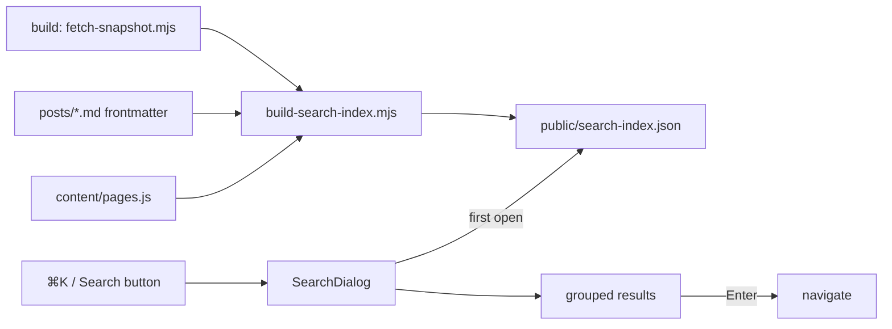

# Site search: a ⌘K palette over pages, posts and the shelf — design

Date: 2026-11-06 · Repo: joey-haas.dev · No mockups: the palette is built from
existing tokens and the shelf's `PosterCard` conventions, and its layout is
specified in prose below. If the first implementation looks wrong, flip this
doc back to `needs-design` and we mock it up.

## Problem

The public site now has fifteen-odd routes, a blog, a comics run page and a
shelf of several hundred items, and the only way to reach any one thing is
to know which tab it lives under and scroll. A visitor who read the post and
wants to see one game, or a hiring manager who wants "the piece about
Game-Key Cards", has no way to jump there. Nothing on the site answers
"where is X".

## Scope

**In**

- A search palette opened by `⌘K` / `Ctrl+K`, by `/` when focus is not in a
  field, and by a "Search" control in the public masthead.
- An index of: public routes (hand-listed titles and one-line descriptions),
  blog posts (title, summary, tags), TIL notes if `2026-11-06-til-notes-design.md`
  lands first (title, tags), shelf items (title, platform, year, status) and
  comic series (title, publisher) from the build-time snapshots.
- Client-only matching, so it works while the API sleeps. The index is a
  static JSON file fetched on first open, not part of the main bundle.
- Keyboard navigation, grouped results, Enter to go, Esc to close.

**Out**

- Full-text search of post bodies (summary and tags only; revisit if the
  blog grows past ~30 posts).
- Admin items, admin routes, anything not already public.
- Server-side search, a hosted search service, query analytics (the beacon
  stays path-only).
- Recent searches, suggestions, typo correction beyond the normalization
  below.

## Design

### Entry points

- Masthead: a small "Search" button with a `⌘K` hint on desktop (hint hidden
  on phones, where the button alone opens the sheet). It sits with the theme
  toggle, not in the tab row, so the tabs do not shift.
- Keys: `⌘K`/`Ctrl+K` anywhere; `/` only when `document.activeElement` is
  not an input, textarea, select or contenteditable.

### The palette

- A native `<dialog>` opened with `showModal()`, so focus trapping, Esc and
  the backdrop come from the platform. Backdrop uses `--overlay`.
- Desktop: a 36rem panel, top-aligned (about 12vh from the top), `--surface`
  background, `--line` border, the site's radius token. Phone: full-width
  sheet from the top, input pinned, results scroll.
- One text input, placeholder "Search pages, posts and the shelf", with the
  result count announced for screen readers.
- Results grouped in this order: Pages, Posts, Notes, Shelf, Comics. Each
  group shows at most 5 rows; a group with nothing matching is omitted.
- A row: a leading mark (a page glyph, a post glyph, or the item's small
  cover from the snapshot's cover URL), the title, and a muted line (the
  page's description, a post's date and first tag, an item's platform and
  year, a series' publisher). Shelf rows link to `itemPath(id)` from
  `lib/spinePaths.js`.
- Empty query: the Pages group alone, so the palette doubles as a site map.
- No match: "Nothing for '<query>'" and a link to `/shelf` with the query
  prefilled in the shelf's filter if the shelf grows a text filter; until
  then just the link.

### Matching

- Normalize both sides: NFKD, strip combining marks, case-fold, strip
  punctuation, collapse whitespace (the same rules the importer uses
  server-side, re-implemented in `lib/`; it is ten lines).
- Score: title prefix match 3, title word-prefix match 2, title substring 1,
  secondary-field substring 0.5. Ties broken by group order then by title.
  No dependency; a library is not justified at this index size.
- Results update on every keystroke; the index is small enough that no
  debounce is needed, but the fetch of the index is awaited once and cached.

### The index

- `frontend/scripts/build-search-index.mjs` runs after `fetch-snapshot.mjs`
  and before `vite build`, writing `public/search-index.json` from:
  `src/content/pages.js` (new, the hand-listed public routes), the posts'
  frontmatter (through `gray-matter`, as `generate-rss.mjs` does), and
  `public/snapshot/items.json` and `snapshot/comics.json` when present.
- Without a snapshot (local dev with no `VITE_API_URL`) the index contains
  pages and posts only; the palette says nothing about the missing groups.
- Expected size: a few hundred items at ~80 bytes each, well under 100 KB
  gzipped. Fetched with `cache: 'force-cache'` is wrong across deploys;
  fetch normally and let the static host's caching headers decide.

### Theme and responsive

- Everything through tokens; no literal colors. Verify the active row's
  contrast in both themes (`--surface` vs the hover/active tone) and record
  the ratio beside the token as the shelf tokens do.
- Phone (≤400px): sheet layout above; rows are 44px tall minimum.

### Accessibility

- Input has `role="combobox"`, `aria-expanded`, `aria-controls` pointing at
  the listbox, `aria-activedescendant` for the highlighted row; rows are
  `role="option"`. Arrow keys move the highlight without moving DOM focus.
- Group headings are visible text, not `aria-label`s on bare spans (the
  shelf rule).
- On close, focus returns to whatever opened the palette.
- `prefers-reduced-motion`: no open/close animation.

### Flow



## Key decisions

- **Client-only, build-time index** over an API endpoint: the backend sleeps,
  and the site's rule is that public pages render without it.
- **Hand-rolled scoring** over Fuse.js or MiniSearch: the index is a few
  hundred short strings; a library adds a dependency and a bundle cost to
  solve a problem this size does not have.
- **Rejected: Pagefind.** It indexes rendered HTML, and the shelf pages are
  rendered client-side from the snapshot; `prerender.mjs` writes heads, not
  bodies, so Pagefind would see almost nothing. Worth revisiting only if
  the site ever prerenders full pages.
- **Rejected: search as a page (`/search?q=`).** A palette reaches every
  page from the keyboard and needs no new route; a page would need its own
  layout and would still want the palette for the keyboard case.
- **Rejected: indexing post bodies.** Two posts today; a body index would be
  mostly one post, and the summary already carries the searchable terms.

## Component inventory

- New: `components/SearchDialog.jsx`, `components/SearchButton.jsx`,
  `lib/searchIndex.js` (fetch + cache + score), `lib/normalize.js`,
  `content/pages.js`, `scripts/build-search-index.mjs` (+ test).
- Existing: `RootLayout` (mounts the button and the key listener; it already
  owns the theme state and the outlet context), `itemPath`, the snapshot
  files, `gray-matter`, the `--surface`, `--line`, `--overlay`, `--muted`
  tokens and the page radius.

## Acceptance criteria

- `⌘K`, `Ctrl+K`, `/` (outside a field) and the masthead button each open
  the palette; Esc and backdrop click close it and return focus.
- Typing "key card" lists the "How My Shelf works" post; typing a game's
  title lists it under Shelf and Enter opens `/shelf/:id`.
- With the index missing (404), the palette opens, shows the Pages group
  from the in-bundle list, and shows a one-line "Search is unavailable"
  note; nothing throws.
- Arrow keys move the highlight; a screen reader announces the highlighted
  row and the result count (checked with VoiceOver on Safari and Chrome).
- Both themes clear 4.5:1 for row text and 3:1 for the active-row mark.
- `search-index.json` is under 100 KB gzipped with the current shelf, and is
  not in the main JS chunk (`npm run build` output shows it as a static asset).
- Phone width (400px): sheet fills the width, input stays visible while
  results scroll; no horizontal scroll.
- Tests: scoring order, normalization (accents, punctuation), the `/`
  guard, and the index script's handling of a missing snapshot.

## Open questions for Code

- Does the comics snapshot carry a stable series id and cover URL the row can
  link and show? If not, Comics rows link to `/shelf/comics` with the title
  as a hash.
- Should `content/pages.js` also feed the prerendered heads' descriptions, so
  there is one source for route titles and descriptions? Likely yes; decide
  in the plan.
- The highlighted-row tone: reuse the shelf's hover tone or add a token?

---

# Plan

Written 2026-11-06 against `e2b095e`. Branch `feat/site-search`, worktree
`~/Developer/joey-haas.dev-worktrees/feat-site-search`.

## Answers to the open questions

- **Comics snapshot ids.** `snapshot/comics.json` carries `series[]` with
  `item_id`, `title`, `publisher` and `cover_url` (`PublicComicRow`,
  `backend/public_comics.py`). A series is an ordinary item, so a Comics
  row links to `itemPath(item_id)`, the same as a Shelf row. Comic items
  are in `items.json` too, so the Shelf group takes `type !== 'comic'` and
  the Comics group comes from `comics.json`. Without `comics.json` (it is
  an optional snapshot) the Comics group falls back to the comic items in
  `items.json`, with `creator` as the muted line.
- **One source for route titles.** Yes, but the source already exists:
  `publicRoutes()` in `scripts/prerender-lib.mjs` hand-lists every static
  page's title and description. Task 1 moves those static rows into
  `src/content/pages.js` (`STATIC_PAGES`: path, short title, description)
  and has `publicRoutes()` build its static `page(...)` entries from it.
  The head titles keep their ` · Joey Haas` suffix, which `publicRoutes`
  adds. `prerender-lib.test.mjs` already pins the routes against
  `render.yaml`, so a drift between the two fails there.
- **Active-row tone.** Reuse `--sunken` for the row background (it is the
  shelf's skeleton tone and already in both theme blocks) with a 3px
  `--accent` inset bar as the active mark. Row text is `--text` and the
  muted line `--muted` on `--sunken`. Task 6 measures all four ratios in
  both themes and records them beside a new alias token,
  `--search-active: var(--sunken)`, so the palette has a name to change
  later without touching the shelf.

## Deviations from the spec half

- **"key card" acceptance criterion.** The post's `summary` and `tags` do
  not contain "key card". Only the body does ("Game-Key Card"), and
  post bodies are out of scope. Fix: posts get an optional `keywords:`
  frontmatter list, which the index includes as a secondary field, and
  `how-spine-works.md` gets `keywords: [Game-Key Card, cartridge, Play Next,
  Radar, Discover, IGDB]`. This keeps body indexing out. It does mean a
  copy change to a published post. The field is frontmatter only, so the
  page renders the same.
- **The no-match link prefills the shelf.** The shelf already has a text
  filter (`query` in `pages/Collection.jsx`), so the link is
  `/shelf?q=<query>` and Collection seeds `query` from `q` once on mount.
  The shelf never writes `q` back to the URL. Typing on the shelf stays
  local state, as it is today.
- **The index is gitignored.** `frontend/public/search-index.json` is a
  build output like `public/snapshot/`, so it is added to `.gitignore` and
  never committed.
- **Notes group.** The TIL notes spec has not landed. The scorer and the
  dialog know the `notes` group and its order, but the index script writes
  none until a notes source exists. The TIL plan adds it.

## Tasks

Each task ends with `npm test` green and `npm run lint` clean in
`frontend/`. Commits follow the task boundaries.

### Task 1 — `content/pages.js`, one list of static pages

- **Files:** `src/content/pages.js` (new), `src/content/pages.test.js`
  (new), `scripts/prerender-lib.mjs`.
- **Do:** export `STATIC_PAGES`: `/`, `/about`, `/projects`, `/shelf`,
  `/shelf/next`, `/shelf/how`, `/shelf/comics`, `/now`, `/colophon`, and
  `/blog` (search and prerender both include it only when there are
  posts). Each row has `path`, `title` (short, e.g. "About"), `headTitle`
  (the current prerender title without the name suffix, where it differs)
  and `description`, all built from `profile` and `spine` exactly as
  `publicRoutes` builds them now. `publicRoutes` maps over it and keeps
  its `feed`/`legacy` flags in a small path-keyed table.
- **AC:** `prerender-lib.test.mjs` passes unchanged. The prerendered head
  of every static route is byte-identical before and after. Check by
  diffing `dist/**/index.html` from a build on `main` against this one.
- **Tests:** `pages.test.js`: paths unique, all start with `/`, each has
  a non-empty title and description ≤ 160 chars.
- Parallel-safe: no (Task 3 and 5 import it).

### Task 2 — `lib/normalize.js` and `lib/searchIndex.js` (pure core)

- **Files:** `src/lib/normalize.js`, `src/lib/normalize.test.js`,
  `src/lib/searchIndex.js`, `src/lib/searchIndex.test.js` (all new).
- **Do:** `normalize(text)` mirrors `matching.normalize_title`: NFKD of the
  case-folded string, combining marks dropped, every run of
  non-alphanumerics (`/[^\p{L}\p{N}]+/gu`) to one space, trimmed.
  `searchIndex.js` exports:
  - `GROUPS`: `['pages', 'posts', 'notes', 'shelf', 'comics']` with
    their labels and a per-group cap of 5.
  - `score(entry, q)`: title prefix 3, a title word starting with `q` 2,
    title substring 1, any secondary field substring 0.5, else 0. Each
    entry carries its pre-normalized `t` (title) and `s` (secondary
    fields joined) from the index, so a keystroke normalizes the query
    only.
  - `search(index, query)`: an empty query gives the Pages group in list
    order. Otherwise score > 0, sorted by score, then group order, then
    title, then grouped, capped and with empty groups dropped. Also returns
    the total count for the live region.
  - `loadIndex()`: fetches `/search-index.json` once (a plain `fetch`, no
    `cache: 'force-cache'`), validates the shape, and caches the promise.
    A 404, a network error or a bad shape resolves to
    `{ unavailable: true }`, never a rejection. It also clears the cached
    promise on failure, so the next open retries.
- **AC/Tests:** normalization folds "Pokémon"→"pokemon", "Spider-Man:
  No Way Home"→"spider man no way home", "²"→"2". The scoring order
  (prefix beats word-prefix beats substring beats secondary; ties by group
  then title). The cap at 5. An empty query gives Pages only. "key card"
  ranks the post first given its keywords. `loadIndex` with a stubbed
  `fetch` returning 404, throwing and returning `{}` each give
  `unavailable` and do not throw.
- Parallel-safe: yes with Task 1 (no shared files).

### Task 3 — `scripts/build-search-index.mjs`

- **Files:** `scripts/build-search-index.mjs`,
  `scripts/build-search-index.test.mjs` (new), `scripts/README.md`,
  `.gitignore`.
- **Do:** a pure `buildIndex({ pages, posts, items, comics })` plus a thin
  `main()` that reads posts with `gray-matter`, skipping `draft: true`, as
  `generate-rss.mjs` does. It also reads `public/snapshot/items.json` and
  `comics.json` when present and writes `public/search-index.json`
  atomically (tmp + rename, as `fetch-snapshot.mjs` does). Entry shape:
  `{ g, t, s, title, sub, href, cover? }`. `title` and `sub` are display
  text, while `t` and `s` are normalized. `href` comes from `itemPath` for
  items and series, and `/blog/<slug>` for posts. `cover` is set only when
  the URL starts with `https://` (the prerender rule). Shelf takes public
  items only. The snapshot is public by construction, so the script adds
  no filter. It drops only rows with no id or title. The script logs the
  entry count and the gzipped size, and exits non-zero if the gzipped size
  goes over 100 KB, so a shelf that grows past the budget fails the build
  loudly instead of shipping a slow palette.
- **AC:** with no snapshot the index holds pages and posts only and the
  script exits 0. With a malformed `items.json` it logs and leaves the
  shelf groups out (it never fails the build for an optional input). A
  draft post is never in the index.
- **Tests:** `buildIndex` with and without items and comics. Drafts excluded
  (fed through `main()` against a temp dir). Comics come from `comics.json`
  when it is present and from the comic items otherwise, never both.
  Non-https covers dropped. `keywords` lands in `s`.
- Parallel-safe: no (needs Task 1 and `normalize` from Task 2).

### Task 4 — wire the script into the build (carve-out: deploy path)

- **Files:** `frontend/package.json`.
- **Do:** `build` becomes `fetch-snapshot && build-search-index && vite
  build && prerender && generate-rss`. Vite copies `public/` into `dist/`,
  so the index ships at `/search-index.json`, outside every JS chunk.
- **AC:** `npm run build` with no `SNAPSHOT_API_URL` succeeds. `dist/` has
  `search-index.json`, and the build output lists no JS chunk containing
  `"g":"shelf"`. With `npm run snapshot` first, the index carries the
  shelf and is under 100 KB gzipped (the size is logged).
- Parallel-safe: no.

### Task 5 — `SearchDialog`, `SearchButton`, mounting and keys

- **Files:** `src/components/SearchDialog.jsx` (+ `.test.jsx`),
  `src/components/SearchButton.jsx`, `src/components/SiteMast.jsx`
  (+ its test), `src/layouts/RootLayout.jsx`, `src/lib/searchKeys.js`
  (+ `.test.js`), `src/pages/Collection.jsx` (+ its test, for `?q=`).
- **Do:**
  - `SearchDialog` follows `MobileNavSheet`'s native-`<dialog>` pattern:
    the owner holds `open`, `showModal()` in an effect, the `cancel` event
    and a backdrop click close it, and focus returns to the opener after
    the close. A combobox input with `aria-expanded`, `aria-controls` and
    `aria-activedescendant`. A `listbox` of `option` rows under visible
    `<h2>` group headings. ↑/↓ move the highlight (wrapping), Enter
    navigates with `useNavigate` and closes. A polite live region says
    "N results". Pages render from `STATIC_PAGES` immediately, and the
    other groups appear when `loadIndex()` resolves. When it resolves
    `unavailable` the dialog shows "Search is unavailable" under the Pages
    group. No match shows "Nothing for '<q>'" and a link to
    `/shelf?q=<q>`.
  - `searchKeys.js`: `isSearchShortcut(event, activeElement)` is true for
    ⌘K/Ctrl+K anywhere, and for `/` only when the target is not an input,
    textarea, select or contenteditable (and has no modifier). RootLayout
    registers one `keydown` listener on `document`, calls
    `preventDefault` on a match, and opens the dialog. It skips `SHELL_ROUTES`
    (admin), where the masthead is absent and the palette is out of scope.
  - `SearchButton` sits in `.mast-end` before the theme toggle: "Search"
    plus a `<kbd>⌘K</kbd>` hint (`Ctrl K` off Mac, from
    `navigator.platform`/`userAgentData`). The hint is hidden at
    `useMediaQuery('(max-width: 640px)')` via CSS, not JS.
  - `Collection.jsx`: `useState(() => searchParams.get('q') ?? '')`. It
    reads only, never writes.
- **AC:** the four entry points open it. Esc and a backdrop click close it
  and return focus. Typing a snapshot title and pressing Enter lands on
  `/shelf/<id>/`. A 404 index leaves Pages working with the note and no
  console error. `/` typed in the shelf's search box types a slash.
- **Tests:** RTL with a stubbed `fetch`: open by button and by ⌘K, `/`
  ignored inside an input, arrow and Enter navigation (a MemoryRouter
  assertion on the location), Esc returns focus to the button, the
  unavailable path, the no-match link's href, `aria-activedescendant`
  tracking, and an axe pass via `axe.test-util.js`. The
  `Collection.test.jsx` `?q=` seed. `searchKeys.test.js` covers every
  guard case.
- Parallel-safe: no.

### Task 6 — styles, tokens, contrast

- **Files:** `src/index.css`.
- **Do:** `.search-dialog` is a 36rem panel, top 12vh, `--surface`,
  `1px solid var(--line)`, `var(--radius)`, with the `::backdrop` in
  `--overlay`. At ≤ 640px it is full width from the top, with the input
  sticky and the list scrolling (`max-height: 100dvh`). Rows are a 44px
  minimum, with a 32px cover or glyph (an SVG in `currentColor`, or
  `CoverImage` for covers). The active row uses `--search-active` with the
  `--accent` inset bar. Open and close animations sit only under
  `prefers-reduced-motion: no-preference`. Add `--search-active` to both
  theme blocks with measured ratios in a comment.
- **AC:** row text ≥ 4.5:1 and muted ≥ 4.5:1 on both `--surface` and
  `--search-active`, and the accent bar ≥ 3:1 on `--search-active`, in
  both themes, measured with the computed colours in the browser (not
  guessed from hex). If `--muted` on `--sunken` falls short in either
  theme, `--search-active` gets its own value instead of the alias, and
  the measurement is repeated.
- Parallel-safe: no.

### Task 7 — docs

- **Files:** `README.md` (a short "Site search" section), the repo
  `CLAUDE.md` (architecture note: the index is a build output, and
  `STATIC_PAGES` is the one list of static pages, so a new public page
  goes there), and `scripts/README.md` (done in Task 3).
- **AC:** a new public page is documented as needing its row in
  `STATIC_PAGES` (which now feeds prerender too).

## Milestones

```
Milestone 1 (auto): tasks 1–3, 5–7
STOP — carve-out review: task 4 changes the build command Render runs
Milestone 2 (auto): task 4 (package.json build chain), then the full build check
Finish gate → PR
```

Task 4 is a one-line change but it is the deploy path. A failure in the
new script fails every deploy, which is why the script exits 0 on every
missing or bad optional input and fails only on the size budget.

## Environment tests

- `cd frontend && npm test && npm run lint && npm run build` (no API
  URL), then `npm run snapshot && npm run build` for the real shelf, and
  record the logged index size and gzipped size in the PR.
- Browser (`npm run dev`, built-in browser pane): the four entry points;
  "key card" → the post; a shelf title → Enter → `/shelf/<id>/`; the
  no-match link → the shelf with the box filled; delete
  `public/search-index.json` and reload → Pages plus the note, no console
  errors; both themes; 400px width with no horizontal scroll and the input
  pinned; and the contrast measurements from Task 6.
- VoiceOver on Safari and Chrome (AC): this one is **Joey's to run**. I
  can check the ARIA wiring and axe, but not what VoiceOver speaks. The PR
  lists it as an unchecked box.
- Post-deploy: `./scripts/smoke.sh` unchanged. Add one check that
  `https://joey-haas.dev/search-index.json` is a 200 with
  `application/json`. Render serves an existing file before the `/*`
  rewrite, as it does for `/snapshot/*.json`, but this is the first
  root-level JSON file, so the check proves it.
