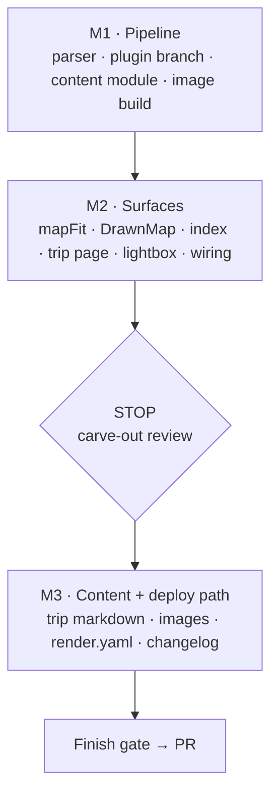

# Travel log: public trip pages with a map, days and photos (design)

Date: 2026-11-08 · Repo: joey-haas.dev · Mockups under
`docs/planning/mockups/2026-11-08-travel-log/` (`index.html` links them;
`a-journal.html` is the direction below). Shares the drawn-map component
with `2026-11-08-denver-spots-design.md`. The Ledger tokens from
`2026-10-19-site-refresh-design.md` apply; the markdown pipeline is the
one posts and TIL notes use (`frontend/vite-plugin-markdown.js` compiles
both collections to JS modules at build; `scripts/markdown-lib.mjs`
exports `readPublished(dir)`, `rssFeed` and `writeFeed`;
`prerender-lib.mjs` lists the routes).

## Problem

The site shows work (resume, projects, the shelf) and almost nothing of the
person. Two trips in autumn 2026 (Croatia and Greece in September: Dubrovnik,
Naxos, Athens; Tokyo in October) produced photos, notes and an itinerary
that live in a phone and a chat history. A travelogue is the most human page
a portfolio can carry, and it is a different data shape from anything on the
site today: places, dates and images rather than catalog records.

## Scope

In:

- A **Travel** top-level nav item, a `/travel` index and one page per trip
  at `/travel/<slug>`, written after the fact (travelogue first, decided
  2026-11-08; no planning mode).
- Trip content as **markdown with frontmatter** under `frontend/trips/`,
  compiled by the existing Vite markdown plugin alongside posts and notes,
  with the same published rule (drafts out, newest first) and prerendered
  heads.
- A **drawn route map**: the shared inline-SVG map component from the
  Denver spots design, fed stops from the trip's frontmatter. No tiles,
  no runtime fetch.
- **Photos in-repo** for v1: originals stay out of git; the build writes
  resized WebP (two sizes) from a source folder, strips EXIF, and the page
  references the build output. A stated threshold moves hosting to an
  object store later (Key decisions).
- Day sections with a kicker, title, place, prose and one- or two-up
  photo groups; **postcard cards** (text only) for days with no photo
  worth keeping; a **place chip row** that jumps to the first day in that
  place; a **lightbox**.
- Trip cards on the index; a "Travel" line in the footer and sitemap;
  `render.yaml` rewrites per published trip, like posts.
- Content for the two 2026 trips (authoring is the owner's; the spec
  covers the format and the pipeline).

Out, explicitly:

- Planning mode, bookings, offline view, live itinerary, comments,
  per-photo pages, anything that calls the API. The page renders fully
  while the backend sleeps.
- Live map tiles or a build-time raster map (rejected; see Key decisions).
- An object store, CDN or image service in this phase.
- A travel RSS feed (open question; cheap but not required).
- Any photo of the kid without an explicit per-photo opt-in
  (`publish: true` on that image). The default is not published.
- Home changes beyond a possible "Latest trip" line (open question).

## Design

Direction: **a-journal.html** — A (Journal), borrowing C's text-only
postcard cards for days without a photo, and C's place filter chips as
A's chip row (filter on the index, jump links on a trip page). See the
mockup's `/travel index`, `Trip page` and `Lightbox` states at 1280 and
400, both themes.

### `/travel` index

- Page title **Travel** in the `h1` style the Blog index uses; a one-line
  lede.
- A list of **trip cards**, newest first, each: cover photo (3:2, the
  trip's `cover` image), title, kicker *Sept 2026 · 12 days*, the places
  as a muted line (*Dubrovnik · Naxos · Athens*), and a photo count. The
  whole card is one link to the trip page.
- Place chips above the list (every place across trips, hidden when only
  one trip exists) filter the cards, FilterChips style, pressed state
  kept in the URL hash so a shared link lands filtered.
- Empty state (no published trip): the index is not linked from the nav
  or footer, mirroring how TIL hides until a note is published.

### Trip page

In the site's 45rem prose column (not `WIDE_ROUTES`). Top to bottom:

1. Kicker *Travel · Sept 2026* linking back to the index.
2. **Title** in `--font-display` (the serif the Home hero and About title
   use; this is the one new place it appears, by design: a trip title is
   a headline, not a tab).
3. Lede: one or two sentences from frontmatter `summary`.
4. **Facts row** (the `FactsTable` pattern, four cells, wrapping to two
   columns at 400px): Dates · Places · Days · Photos.
5. **Route map**: the shared drawn-map SVG, 16:9 on desktop and 4:3 on a
   phone, land in `--sunken`, sea in `--accent-soft`, the route as a
   dashed `--text-3` line, stops as numbered `--accent` pins with mono
   labels. A caption below the map says plainly *Drawn route, not a live
   map* and lists the stops with their numbers. The map does not pan or
   zoom; pins are links to that place's first day.
6. **Place chips**: one chip per place in visit order, each a jump link
   to the first day in that place; the current place is pressed while
   its days are in view (IntersectionObserver, optional).
7. **Days**, each a `section` with: kicker *Day 2 · Sat 13 Sept* (a range
   for grouped days, *Day 8–9 · Fri–Sat 19–20 Sept*), `h3` title with the
   place after a middle dot (*The walls · Dubrovnik*), prose, then a
   **photo group**: one photo full width, or two side by side (stacked on
   a phone). Each photo carries a short caption on the image's bottom
   edge, over `--overlay`, in `--text` at 0.8125rem.
8. **Postcard cards** for days with no photo: the same section chrome,
   the prose set in a bordered `--surface` card with a stamp-corner
   kicker, so a photo-less day still has an object on the page and the
   rhythm holds.
9. **Prev / next trip** links at the foot, like blog posts.

### Lightbox

A `dialog` (`showModal`) opened by any photo: the image at its large
size, the caption and the day beneath, previous / next buttons across
the trip's photos, a close button, Escape closes, arrow keys move. The
backdrop is `--overlay`. Focus moves to the dialog on open and returns
to the photo that opened it on close; the page behind is `inert`. On a
phone the image fits the width and the caption sits below it; swipe is a
nice-to-have, not required.

### Photos

- Source: `frontend/trips/<slug>/photos/` holds the originals as the
  owner exports them; the folder is gitignored except for a manifest the
  build reads (open question on how the originals travel to the build:
  committed resized output vs. built from a local source).
- The build writes `public/travel/<slug>/<name>-800.webp` and
  `-1600.webp`, strips EXIF (GPS above all), and emits width and height
  so the page reserves space (no layout shift). The page uses
  `` with the two sizes and `loading="lazy"` below the first
  group.
- Alt text is required per image in the markdown; the build fails on a
  photo without one (the same posture as the changelog parser).
- A photo marked `kid: true` in the manifest is skipped unless it also
  carries `publish: true`; nothing about the person appears in the
  output.

### Authoring format

One file per trip, `frontend/trips/<slug>.md`, frontmatter then days as
`##` headings. The plugin treats a `##` heading as a day, so headings
inside a day start at `###` (as TIL notes start at `###` under their
`h2`). Sample:

```markdown
---
title: Croatia & Greece
slug: croatia-greece-2026
summary: Twelve days, three places, one ferry that left on time.
start: 2026-09-12
end: 2026-09-23
cover: walls-afternoon
places:
  - { name: Dubrovnik, lat: 42.6507, lon: 18.0944 }
  - { name: Naxos, lat: 37.1036, lon: 25.3767 }
  - { name: Athens, lat: 37.9838, lon: 23.7275 }
published: true
---

## Day 1 · Arrive · Dubrovnik
Landed late and walked the Stradun at midnight when it was finally empty.

## Day 2 · The walls · Dubrovnik
Two kilometres around the top of the old town…


## Day 8–9 · Slow days · Naxos
Repeat of the good parts.
```

- The day heading's three parts are split on the middle dot: day label,
  title, place. The place must match one in `places`.
- An image line references a manifest name, not a path; the alt is the
  square-bracket text; the optional quoted title is the caption (the alt
  is used when the caption is absent). Two consecutive image lines form a
  two-up group.
- A day with no image line renders as a postcard card.
- `places` lat/lon feed the drawn map's pin placement (projected onto the
  trip's hand-drawn coastline; the coastline itself is per-trip SVG kept
  beside the markdown, open question on authoring).

### Responsive and theme

- 400px: facts row two columns, map 4:3, two-up groups stack, chips
  scroll horizontally, lightbox image fits width.
- 1280px: as the mockup, 45rem column; the map and photo groups stay
  inside the column (no breakout), which keeps the page a post, not a
  gallery.
- Both themes use existing tokens: `--sunken` / `--accent-soft` for the
  map, `--overlay` captions and backdrop, `--accent` pins, `--text-3`
  route. No new tokens; no new contrast measurement, since every text
  token sits on `--surface`, `--sunken` or `--overlay` as elsewhere
  (captions on `--overlay` reuse the format-mark measurement from the
  shelf).

### Accessibility

- Every photo has alt text (build-enforced); captions are visible text,
  not the alt.
- The map SVG has `role="img"` and an `aria-label` naming the stops in
  order; the stop list in the caption is the text alternative, so the
  drawing carries no information on its own.
- Chips are links with `aria-current` when pressed; day sections are
  labelled by their `h3`.
- Lightbox: `dialog`, focus trapped by `showModal`, Escape and arrows
  handled, focus returned to the opener, prev/next have names
  ("Next photo, 3 of 12").
- Nothing is colour-only; the dashed route is a shape distinction.

## Key decisions

- **Journal, not Atlas.** The site's voice is prose (blog, TIL); a trip
  told in order reads like the rest. Atlas's sticky live map was the best
  first impression and the only direction where the map is navigation,
  but it made the map-tile decision load-bearing for the travel page when
  the decision belongs to Denver spots. Spots chose the drawn map; the
  travel page adopts the same component and gives up pan/zoom knowingly.
- **Drawn SVG map, no tiles.** Honours the repo's no-runtime-third-party
  rule, works while the backend sleeps, themes itself with tokens, no key,
  no attribution line, no OSM tile-policy exposure. The cost is honest:
  not geographically exact and the coastline is hand-authored per trip.
  A build-time raster image was the fallback and lost on theming (one
  image can't be right in both themes) and on blur at phone DPR.
- **Postcards' text cards and chips, not its grid.** C's masonry told the
  trip out of order and tripled the image count, which would have forced
  object-store hosting before anything shipped. Its two good ideas (a
  card for a photo-less day, place chips) cost nothing in A.
- **Photos in-repo for v1, with a threshold.** A journal trip is a dozen
  photos; two sizes of WebP at ~1600px is a few MB per trip, defensible
  in the static build. Move to an object store (Cloudflare R2 or
  Backblaze B2; not chosen here) when the built `public/travel/` passes
  ~50 MB or a third trip lands, whichever first. The markdown references
  manifest names, not paths, so the move changes the build, not the
  content.
- **Serif display for the trip title.** The one addition to where
  `--font-display` appears; a trip title is editorial, the same register
  as the Home hero. The face is already loaded (`main.jsx`), so no new
  weight.
- **Rejected: planning/binder mode.** Different data (bookings, times,
  auth) and a different audience; the markdown format carries dates and
  places so a later binder could grow from it without a rewrite.

## Component inventory

Existing, changed:

- `vite-plugin-markdown.js` / `scripts/markdown-lib.mjs`: a third
  collection (`trips`) with the day/photo grammar above; the published
  rule and date formatting shared with posts and notes
  (`lib/markdownEntries.js`).
- `prerender-lib.mjs` `publicRoutes` and `render.yaml`: `/travel` and one
  rewrite per published trip, as per-post rules exist today; sitemap
  entries.
- `RootLayout` nav and `SiteFooter`: Travel link, shown only while a
  trip is published (`hasTrips`, like `hasNotes`).
- `FactsTable`: reused for the facts row.
- `FilterChips`: reused for place chips (index filter and trip jump
  links).
- `content/`: a `trips.js` module exporting the compiled trips, as
  `posts.js` and `notes.js` do; tests that import it mock it.

New:

- `pages/Travel.jsx` (index) and `pages/Trip.jsx`.
- `TripCard`.
- `DaySection`, `PhotoGroup`, `PostcardCard`.
- `Lightbox` (dialog).
- `DrawnMap` — the shared inline-SVG map component specified in the Denver
  spots design, taking a coastline asset and stop coordinates; the travel
  page is its second consumer.
- Build step: `scripts/build-travel-images.mjs` (resize to 800/1600 WebP,
  strip EXIF, write the manifest with dimensions; fail on missing alt or a
  `kid: true` photo without `publish: true`).

Tokens used: `--font-display`, `--sunken`, `--accent-soft`, `--accent`,
`--text*`, `--overlay`, `--surface`, `--line`, `--radius`. No new tokens.

## Acceptance criteria

- [ ] `/travel` lists published trips newest first with cover, title,
      dates, places and photo count; a draft trip is absent and, with no
      published trip, Travel is absent from nav and footer.
- [ ] `/travel/<slug>` renders fully with the backend asleep; no request
      leaves the site's origin except the analytics beacon.
- [ ] The trip page shows title (serif), lede, facts row, drawn map with
      caption listing the stops, place chips, day sections with kicker /
      title / place / prose / photo group, postcard cards for photo-less
      days, and prev/next trip links.
- [ ] Place chips jump to the first day in that place; map pins do the
      same.
- [ ] Lightbox opens from any photo, traps focus, closes on Escape,
      moves with arrow keys, returns focus to the opener.
- [ ] Build fails on a photo without alt text, or a `kid: true` photo
      without `publish: true`; output images carry no EXIF (checked by a
      test reading the WebP metadata).
- [ ] Output images exist at 800 and 1600 widths; the page sets width and
      height and lazy-loads below the first group; CLS is 0 on the trip
      page in Lighthouse.
- [ ] Prerendered head and `render.yaml` rewrite exist for `/travel` and
      each published trip; sitemap lists them.
- [ ] Matches `a-journal.html` at 400px and 1280px in both themes for the
      index, trip page and lightbox states.
- [ ] `frontend/changelog.md` entry.

## Plan-time decisions (2026-11-09)

Answers to the open questions below, and the places this plan deviates
from the spec. Each is settled; the list is the record of why.

**D1 — Travel owns the shared drawn map.** Denver spots is not built (its
worktree holds only its design doc), so the component this page needs does
not exist. Rather than wait or ship the trip page without its route map,
travel builds it: `components/DrawnMap.jsx` plus `lib/mapFit.js` (the pure
affine fit), to the contract in `2026-11-08-denver-spots-design.md` →
"`SpotMap`: the drawn poster component" — drawing as a prop, `{lat, lon}`
stops, a two-reference-point `fit`, the out-of-area rule (a stop projecting
outside the viewBox or within a 12px margin is not drawn but stays in the
caption's stop list), token-only colour, and the `--surface` pin halo so a
pin never depends on what is under it. *Deviation:* the component is named
`DrawnMap`, not `SpotMap` — travel is the first consumer and a route map has
no spots. Denver spots must consume `DrawnMap` and not add a second
component; its plan inherits this name and the `lib/mapFit.js` tests.

**D2 — The coastline is hand-authored, not derived.** The spec's open
question recommends simplifying a Natural Earth or OSM coastline offline and
committing the path. *Deviation:* this plan hand-authors the drawing,
starting from the mockup's existing path for Croatia & Greece, and gets
accuracy from the fit rather than the outline. At 560×320, stated in the
caption as *Drawn route, not a live map*, a derived coastline buys no visual
fidelity and costs a geodata chore per trip. Accuracy lives where it is
checked: two reference points project within 1px of their measured
positions and a third known point within 6px, as Denver's criteria require.
Deriving an outline later changes one path string, nothing else.

**D3 — Photo captions sit on an opaque bar, not `--overlay`.**
`--overlay` is `color-mix(in srgb, var(--bg) 60%, transparent)`
(`index.css:76`) — semi-transparent by design, which is why the shelf's
format and replay marks sit on it over *posters*, whose corners are
predictable. That measurement does not transfer to an arbitrary 1600px
photo: a bright sky behind a 40%-transparent scrim guarantees no ratio.
*Deviation from the spec* (which reuses the format-mark measurement) *and
from the mockup* (which uses `linear-gradient(transparent, rgba(0,0,0,.55))`
with white text and a text-shadow — raw colours the repo's token rule
forbids). The caption is a strip across the image's bottom edge with
`background: var(--bg)`, fully opaque, carrying `--text` at 0.8125rem: the
pair the theme blocks already measure, correct in both themes over any
photo. The lightbox backdrop stays `--overlay`; nothing has to be read
through it.

**D4 — Images are built locally and the output is committed.** Joey's call,
and the spec's recommendation. `frontend/scripts/build-travel-images.mjs`
runs on the owner's machine and writes `frontend/public/travel/<slug>/`,
which is **committed** — the one exception to `public/` holding build output
(`public/snapshot/` and `public/search-index.json` are gitignored,
`.gitignore:24-28`). `npm run build` on Render only compiles markdown, so
sharp's native binary and the resize minutes never touch the free tier.
`sharp` goes in as a pinned devDependency (0.35.x; the repo pins
`axe-core` and the fontsource packages exactly, so a tool this
load-bearing is pinned too). Two facts from sharp's output docs that the
script depends on: metadata is **stripped by default** — `keepMetadata()`
or `withMetadata()` must be called to retain any, and neither is — and
stripping EXIF also drops EXIF orientation, so the script calls `.rotate()`
with no argument first to bake the orientation into the pixels. Without it,
phone photos ship sideways.

**D5 — The day grammar is a pure parser that fails the build.**
`frontend/scripts/trip-markdown.mjs`, pure, imported by the Vite plugin and
tested directly — the shape `src/lib/changelog.js` uses, and for the same
reason: a bad trip file should fail `npm run build`, not the page. It throws
on a `##` heading that is not `Day <label> · <title> · <place>`, a place not
listed in `places`, an image line with no alt text, an image name absent
from the trip's photo manifest, and a `kid: true` photo without
`publish: true`.

**D6 — Scope confirmations.** In: trips in the ⌘K search index; a "Latest
trip" line on Home. Out: a travel RSS feed (sitemap entries are still
required, and `/travel` plus one rule per published trip go into
`render.yaml`).

**D7 — Content.** Joey is handing over notes and photos for Croatia &
Greece and Tokyo; the plan stops to collect them (Milestone 3). Until then a
`draft: true` fixture trip carries the tests, so the pipeline is provable
without waiting on content.

**D8 — Drafts are `draft: true`, not `published: true`.** The spec's sample
frontmatter uses `published: true`. *Deviation:* trips use the same
`draft:` flag posts and notes use. The plugin already compiles a draft to
`export default null` in a production build
(`vite-plugin-markdown.js:102-105`), which is what keeps unpublished prose
out of the shipped bundle rather than merely off the page; `readPublished`
and `publishedEntries` both key on it. A second word for the same idea
would mean a second code path for no gain.

**D9 — A trip's start date is `date:`.** The plugin requires `title` and
`date` and `publishedEntries` sorts on `frontmatter.date`
(`markdownEntries.js:13-19`). *Deviation from the spec's `start:`/`end:`
pair:* the start day is `date:` and the last day is `end:`, so trips sort
newest-first through the shared helper and read through `readPublished`
with no change to either. The facts row and the index kicker render the
span from the two.

**D10 — `/travel` is a gated page, not a `STATIC_PAGES` row.** It follows
`TIL_PAGE` exactly: a `TRAVEL_PAGE` export in `content/pages.js`, pushed by
`publicRoutes` only when a trip is published, so `staticPages(hasPosts)`
is untouched and `prerender-lib.test.mjs`'s hard-coded count of ten static
pages stays true. This is also what makes "hides until a trip is
published" fall out of the existing machinery.

## Open questions for Code

- **Image pipeline input.** Either commit the resized WebP output (simple,
  repo grows ~3 MB per trip, deterministic builds) or commit originals
  outside git and build from a local folder (Render's build has no access
  to the owner's machine, so output would still have to be committed or
  fetched). Recommend: run `build-travel-images.mjs` locally, commit the
  output and the manifest; the Render build only compiles markdown.
- **Build time.** Resizing a dozen photos with `sharp` is seconds; if it
  runs on Render instead, confirm it stays inside the free build minutes
  and that `sharp`'s native binary installs there.
- **Coastline authoring.** The mockup's SVG is a sketch; the Naxos/Athens
  placement is approximate. Draw each trip's coastline from real
  coordinates (Natural Earth or an OSM coastline extract, simplified
  offline to a few hundred points, projected with a simple equirectangular
  fit to the trip's bounding box) and commit the path string beside the
  markdown. The projection code is shared with the Denver `DrawnMap`.
- **Feeds and sitemap.** A trip is a rare event; a travel RSS feed is
  cheap through the existing feed writer but not required. The sitemap
  entries are required.
- **Day grouping.** `Day 8–9` is parsed from the heading; confirm the
  grammar (`·` separators, en dash ranges) and fail the build on a heading
  that doesn't parse, as the changelog parser does.
- **Search index.** `build-search-index.mjs` should include trips (title,
  summary, day titles) alongside posts and notes, since ⌘K search is
  already shipped or in flight.
- **Home line.** Whether Home gets a "Latest trip" line next to the
  facts table; cheap, but adds a third content module to Home's reads.

---

# Plan

Written 2026-11-09 against the facts surveyed in the worktree; every path
below is one that exists today unless marked **new**. Full tier.

## Shape of the work



The pipeline comes first because the page's shape is decided by what the
parser emits, and the fixture trip it unlocks is what every page test
renders. `render.yaml` is held to the end on purpose: with the fixture trip
a draft, `publicRoutes` emits no `/travel`, and
`prerender-lib.test.mjs`'s rewrite assertion is an **exact set equality**
against the file — so the rewrite rules and the first published trip have
to land in the same change or the suite is red either way.

## Milestone 1 — Pipeline (autonomous)

### T1 · The trip grammar, as a pure parser

**New** `frontend/scripts/trip-markdown.mjs`, the one authority on a trip
file's body and frontmatter, imported by the Vite plugin and tested
directly — the shape `src/lib/changelog.js` uses, for the same reason: a bad
trip file should fail `npm run build`, not the page.

- `parseTripFrontmatter(data, slug)` → `{title, date, end, summary, cover,
  places: [{name, lat, lon}]}`. Throws on a missing field, an `end` before
  `date`, a `places` entry without a numeric `lat`/`lon`, a duplicate place
  name, and a `cover` that is not a manifest name.
- `parseTripDays(content, {places, photos})` → `[{id, label, title, place,
  markdown, photos: [{name, alt, caption}]}]`. The `##` heading is split on
  ` · ` into day label, title and place; the place must appear in `places`.
  `id` is the anchor (`day-1`, `day-8-9`), derived from the label, and a
  repeated id throws. Image lines (``) are lifted out
  of the prose **before** markdown runs — there is no `rehype-raw` in the
  processor, so an image left in the body would reach the page as a bare
  ``. Two consecutive image lines are one two-up group; a
  day with none is a postcard.
- Throws, each with the file and heading in the message: a heading that
  does not parse, an unknown place, an image with empty alt, an image name
  absent from the manifest, and a `kid: true` photo without `publish: true`
  (defence in depth — the image build refuses to emit it as well).

**Tests** — **new** `frontend/scripts/trip-markdown.test.mjs`: one valid
file parsed end to end (days, ids, places, one-up and two-up groups, a
postcard day, a `Day 8–9` range), and one case per throw above.

### T2 · A trips branch in the markdown plugin

`frontend/vite-plugin-markdown.js`. The plugin is folder-agnostic
(`transform` keys only on `.md`, line 82) and emits a fixed frontmatter
whitelist (lines 108-115), so an unknown key is dropped silently — which is
exactly the trap here. Add a branch for an id under `/trips/`:

- validate through `parseTripFrontmatter`, then `parseTripDays`;
- run each day's prose through the existing module-level `processor`, so
  trips get the same GFM and the same two-palette Shiki pass as posts;
- emit `{slug, frontmatter, days}` — `days[].html` replaces the single
  `html` key. The draft rule (`export default null` in production) and the
  `SLUG_PATTERN` check are shared, untouched.

**Tests** — the grammar's tests carry the logic; the branch is covered by
the first real build in T4's environment check and by `npm run build`.

### T3 · The trips content module

**New** `frontend/src/content/trips.js` — a verbatim copy of
`content/notes.js` with `import.meta.glob('../../trips/*.md', {eager:
true})`, exporting `trips` and `findTrip(slug)` through the existing
`publishedEntries` / `findEntry` (no change to
`src/lib/markdownEntries.js`: trips sort on `frontmatter.date`, which D9
makes the start day).

**New** `frontend/trips/` with the fixture trip
`croatia-greece-2026.md`, `draft: true`, carrying every grammar feature the
parser knows, and `frontend/trips/croatia-greece-2026/photos/` holding a
handful of generated placeholder JPEGs plus `photos.json`.

### T4 · The local image build

**New** `frontend/scripts/build-travel-images.mjs`, run by hand
(`node scripts/build-travel-images.mjs <slug>`), never by `npm run build`.
Reads `frontend/trips/<slug>/photos/` and its `photos.json`
(`[{name, file, kid?, publish?}]`); writes
`frontend/public/travel/<slug>/<name>-800.webp` and `-1600.webp`; rewrites
`photos.json` with each image's emitted `width`/`height` so the page can
reserve space.

- `sharp` as a **pinned devDependency** (0.35.x), matching how `axe-core`
  and the fontsource packages are pinned. It never runs on Render.
- `.rotate()` with no argument before resize. sharp strips all metadata by
  default (`keepMetadata()` / `withMetadata()` are the opt-ins, and neither
  is called), and that strip takes EXIF **orientation** with it — without
  the rotate, phone photos ship sideways.
- `webp({quality: 82})`; `fit: 'inside'`, no enlargement.
- Refuses to emit a `kid: true` photo that lacks `publish: true`, and
  refuses a `photos.json` name that is not a manifest-safe slug.
- `frontend/trips/*/photos/` goes in `.gitignore` (originals stay out of
  git); `frontend/public/travel/` is **committed** — the one exception to
  `public/` being build output, called out in a `.gitignore` comment beside
  the `public/snapshot/` and `public/search-index.json` lines it is
  deliberately unlike.

**Tests** — **new** `frontend/scripts/build-travel-images.test.mjs`: builds
from a generated source image with EXIF orientation 6 and a GPS tag, then
asserts both widths exist, the 1600 output's dimensions are landscape (the
rotate ran), the bytes contain no `Exif` or GPS marker (the posture
`src/meta.test.js:37-43` already uses for `og-card.png`), the manifest
carries width and height, and the two refusals throw.

*Parallel-safe:* T4 is independent of T1-T3 and of T5-T6.

## Milestone 2 — Surfaces (autonomous)

### T5 · `lib/mapFit.js` — the projection

**New** `frontend/src/lib/mapFit.js`, pure. `fitFromPoints(refs)` takes two
reference points (`{lat, lon, x, y}`) measured on the drawing and returns a
projector: `x` linear in `lon`, `y` linear in inverted `lat`, no rotation.
`project(fit, {lat, lon})` → `{x, y}`; `isOnMap(fit, point, viewBox,
margin = 12)` → boolean. Also exports `scaleRatio(fit)` so a drawing whose
two implied scales are far from `cos(latitude)` can be caught rather than
shipped squashed.

**Tests** — **new** `mapFit.test.js`: the two reference points project
within 1px of their measured positions, a third known point within 6px, a
point outside the viewBox and a point inside the 12px margin are both off
the map, and `scaleRatio` flags a deliberately squashed fit. (These are
Denver's acceptance criteria, met here.)

### T6 · `DrawnMap` — the shared component

**New** `frontend/src/components/DrawnMap.jsx` and **new**
`frontend/src/content/maps/croatia-greece-2026.jsx` (the drawing: sea
`--accent-soft`, land `--sunken`, an outline in `--line-strong`, the route
as a dashed `--text-3` path, a mono sea label). Props: `drawing`, `fit`,
`stops`, `viewBox`, `label`.

- `role="img"` with an `aria-label` naming the stops in order; the stop
  list in the caption below is the real text alternative, so the drawing
  carries nothing on its own.
- Numbered pins in `--accent` with a 1.5px `--surface` halo (the contrast
  guarantee, from Denver's spec) and `--accent-ink` numerals; each pin is a
  link to that place's first day.
- A stop off the map is not drawn but keeps its number in the caption list.
- Fonts come from CSS, not SVG attributes; the only motion is a 120 ms
  hover/focus transform, inside
  `@media (prefers-reduced-motion: no-preference)`.
- No new tokens. *Deviation from the mockup,* which invents
  `--map-land` / `--map-sea` / `--map-road`.

**Tests** — **new** `DrawnMap.test.jsx`: the accessible name lists the
stops in order, each pin links to its day anchor, a stop outside the
viewBox renders no pin but still appears in the caption list, and axe is
clean.

### T7 · `/travel` index

**New** `frontend/src/pages/Travel.jsx` and **new**
`frontend/src/components/TripCard.jsx`. Cover at 16:9 from the trip's
`cover` manifest entry (srcset 800/1600, width and height set), the
`h1` in the Blog index's style, a one-line lede, cards newest first with
kicker (*Sept 2026 · 12 days*), serif title, the places as a muted line and
a photo count; the whole card one link. Place chips above the list through
the existing `FilterChips` (`groups` single-select, `onChange` taking the
whole next selection), the pressed place kept in the URL hash so a shared
link lands filtered; `FilterChips` already hides a group with one option
and nothing pressed, which is the "hidden when only one trip exists"
requirement for free. Empty state: the page renders its lede and nothing
else, and is unlinked (T11).

**Tests** — **new** `Travel.test.jsx`, mocking `../content/trips.js` in the
getter form `Til.test.jsx:7-24` uses: cards in order, a draft absent, chips
filter, the hash restores a filter, empty state, axe.

### T8 · `/travel/:slug` trip page

**New** `frontend/src/pages/Trip.jsx`, in the 45rem prose column (**not**
`WIDE_ROUTES`), plus **new** `components/DaySection.jsx`,
`PhotoGroup.jsx`, `PostcardCard.jsx` and `TripPhoto.jsx`.

Order is the spec's: kicker linking back to `/travel`, serif title, lede,
facts row through the existing `FactsTable` (`rows: {label, value}[]`,
labels unique), `DrawnMap` with its caption, place chips as jump links with
`aria-current` on the place in view, then the days, then prev/next trip.
`TripPhoto` is **new** rather than `CoverImage`, which exists for hotlinked
covers with no intrinsic size: travel photos need `srcset`, `width`,
`height` and `loading="lazy"` from the second group on. The caption is an
opaque `--bg` strip on the image's bottom edge carrying `--text` (D3).
`usePageTitle` on both pages; `findTrip` miss → `<NotFound />`, as
`TilNote.jsx:18` does.

**Tests** — **new** `Trip.test.jsx`: every section present and in order, a
two-up group and a one-up group, a postcard day for a photo-less day, chips
and pins pointing at the right anchors, the first group eager and the rest
lazy, every photo carrying width and height, prev/next, a draft slug 404s,
axe.

### T9 · Lightbox

**New** `frontend/src/components/Lightbox.jsx`, a native `<dialog>` opened
with `showModal()` — the pattern `SearchDialog.jsx:38-54` and
`WrapUpSheet.jsx:64-70` already use, including the backdrop-press guard
(close only when the press began on the backdrop) and focus returning to
the opener. The browser traps focus and inerts the page; Escape is routed
through `onClose`; arrow keys move; prev/next are named *Next photo, 3 of
12*. The backdrop stays `--overlay`.

**Tests** — **new** `Lightbox.test.jsx`: opens from a photo, focus lands
inside, Escape closes and focus returns to the opener, arrows move and wrap,
the counter reads correctly, axe clean.

### T10 · Styles

`frontend/src/index.css`: one commented travel block — trip cards, the
serif trip title, the route frame and caption, day sections, photo groups
(two-up stacking at 400px), the postcard card with its stamp-corner kicker,
the opaque caption strip, the lightbox. Tokens only; the block records D3's
reasoning beside the caption rule, as the file records its other measured
choices.

### T11 · Wiring

- `frontend/src/App.jsx`: `travel` and `travel/:slug` rows before the `*`
  catch-all (lines 127-129), statically imported like the other public
  pages.
- `frontend/src/layouts/RootLayout.jsx`: `navItems(hasPosts, hasTrips)`
  with a Travel item between Blog and the shelf, called inline as
  `navItems(posts.length > 0, trips.length > 0)` (line 219); `hasTrips`
  passed to `SiteFooter` beside `hasNotes` (line 242).
- `frontend/src/components/SiteFooter.jsx`: `hasTrips = false` prop and a
  Travel link, mirroring the TIL link at lines 22-26 — so the footer still
  needs no content mock.
- `frontend/src/content/pages.js`: a `TRAVEL_PAGE` export beside
  `TIL_PAGE` (D10); `staticPages()` untouched.
- `frontend/src/pages/Home.jsx`: a *Latest trip* fact through the existing
  conditional spread (lines 55-66) and a Travel card in the Work grid
  beside the Writing card (lines 117-125), both absent until a trip
  publishes.
- `frontend/src/lib/searchIndex.js`: a `trips` group in `GROUPS`;
  `frontend/scripts/build-search-index.mjs`: a `tripsDir`, a `trips = []`
  argument on `buildIndex`, the gated `TRAVEL_PAGE` push and
  `entryOf('trips', '/travel')` over title, summary and day titles. The
  100 KB gzipped budget is asserted by the existing test.
- `frontend/scripts/prerender-lib.mjs`: a `trips = []` argument on
  `publicRoutes`, a `TRAVEL_PAGE` row gated on `trips.length > 0` and a
  `/travel/<slug>` row per trip (`type: 'article'`, `lastmod`, the cover as
  the preview image when there is one) — the `notes` block at lines 162-179
  is the template. `prerender.mjs`: a `tripsDir` and `trips: await
  readPublished(tripsDir)` at lines 77-81.

**Tests** — update the content mocks in `App.test.jsx`,
`RootLayout.test.jsx`, `Home.test.jsx` and `SearchDialog.test.jsx` to
include `content/trips.js`; add cases to `prerender-lib.test.mjs` (no
`/travel` with nothing published; one route per published trip; the static
count of ten unchanged) and to `build-search-index.test.mjs`.

**STOP — carve-out review.** Everything past here touches the deploy path
(`render.yaml`) and commits binary photo output. Nothing in M1-M2 changes
infrastructure.

## Milestone 3 — Content and the deploy path

### T12 · The two trips

Joey hands over notes and photos for Croatia & Greece (Sept 2026) and Tokyo
(Oct 2026). I write `frontend/trips/croatia-greece-2026.md` and
`tokyo-2026.md` from them in the grammar above, author each trip's
coastline path and its two measured fit points (D2; the mockup's path is
the starting point for the first), run `build-travel-images.mjs` per trip
and commit `frontend/public/travel/`. The fixture trip becomes the real
one or is deleted.

### T13 · `render.yaml` and the sitemap

A rewrite for `/travel` and one per published trip, placed after the `/til`
rules and before the `/spine` ones, catch-all last. No placeholder rules: a
rewrite to a file the build did not write serves an empty 200. The sitemap
entries come free from `publicRoutes`. `prerender-lib.test.mjs`'s exact set
equality is the check that the file and the build agree.

### T14 · Documentation

`frontend/changelog.md` gets its `## 2026-11-09` entry (a shipped feature
adds one; it is part of done). README gains a **Travel log** section: the
authoring grammar, the image build command, what is committed and what is
not, and the ~50 MB / third-trip threshold at which hosting moves to an
object store. A line in the repo `CLAUDE.md` conventions for the trips
collection and for `DrawnMap` being the shared map component Denver spots
is to consume.

## Environment and verification

Run in the worktree (`npm ci` in `frontend/` first; it has no
`node_modules` yet):

- `cd frontend && npm test` — the whole suite, including the new parser,
  mapFit, component and page tests.
- `cd frontend && npm run build` — proves the plugin branch, the gated
  prerender and the search budget on the real content.
- `npm run preview` and a pass over `/travel`, a trip page and the lightbox
  at 400px and 1280px in **both** themes against
  `docs/planning/mockups/2026-11-08-travel-log/a-journal.html`.
- Lighthouse on the trip page for CLS 0 (the width/height and lazy-load
  criterion).
- Backend asleep: the trip page renders fully; the only request leaving the
  origin is the analytics beacon (checked in the network panel).
- After deploy: `./scripts/smoke.sh https://joey-haas.dev
  https://api.joey-haas.dev`, then `/travel` and `/travel/<slug>/` by hand —
  a new rewrite can serve a cached empty 200 for about five minutes after a
  deploy, so re-check before calling it broken.

## Risks

- **The map is the long pole.** Hand-authoring a coastline and measuring
  two fit points is fiddly handwork, and it is the one task with no
  precedent in the repo. If T6 runs long, the honest fallback is to ship
  the trip page with the caption's stop list and no drawing (the page is
  still complete prose) and finish the map in a follow-up — the component
  boundary makes that a one-line change.
- **Committed photos are forever.** Git keeps a deleted blob, so a photo
  committed by mistake (a kid photo, a GPS-tagged original) does not leave
  the history. The two refusals in T4 and the parser's check are the
  guard; the originals folder is gitignored so the unprocessed files cannot
  be added by accident.
- **Denver spots inherits a name.** Its plan must consume `DrawnMap` and
  `lib/mapFit.js` rather than add `SpotMap`. Recorded in T14's CLAUDE.md
  line so the next planning session sees it.

---

# Amendment · 2026-11-09 · Travel history onboarding

Joey's go came with a scope addition: the travel history has to be
*recovered*, not just written. Photos sit with his partner, and the old
trips (Ireland 2014) are half-remembered. So the feature needs a way in,
not only a format. Two decisions and three tasks.

**D11 — Onboarding is a local CLI plus a written collection plan, not an
admin page.** A browser surface cannot read a folder of a partner's photos,
and the travel feature deliberately makes no API call; the photos are built
locally and committed (D4). So the flow lives where the files are.

**New** `frontend/scripts/ingest-photos.mjs`:

- Scans a dump folder (`--from <dir>`, recursive) and reads each image's
  EXIF `DateTimeOriginal`, GPS and orientation with `exifr` — a pinned,
  pure-JS devDependency; sharp hands back EXIF only as a raw buffer.
- **Clusters by date gap**: photos more than `--gap` days apart (default 2)
  start a new candidate trip. This is the part that makes 2014 tractable —
  a folder of 900 unsorted photos comes back as six dated clusters.
- Maps GPS to a place name against a small committed gazetteer
  (`frontend/scripts/places.json`, a few hundred cities with lat/lon), so
  nothing leaves the machine. No GPS, no guess: the place is left blank for
  a human.
- **`--dry-run` is the default**: it prints a report — candidate trips,
  their date spans, the places it could name, photo counts, and a list of
  everything it could not date or place. Nothing is written until
  `--write`.
- `--write --slug <slug>` scaffolds `frontend/trips/<slug>.md` (frontmatter
  filled in, one `##` day heading per day it found, prose left empty for
  Joey) and `frontend/trips/<slug>/photos/photos.json` with each photo's
  name, source file and date confidence.
- **Date confidence is recorded, never invented**: `exif` when the camera
  said so, `mtime` when only the filesystem did, `none` when neither is
  trustworthy. Messaging apps strip EXIF, so partner photos will mostly be
  `mtime` or `none`, and the report says which days rest on a guess.
- Originals are never copied into the repo; the tool writes into the
  gitignored `photos/` folder and leaves the dump where it is.

**New** `docs/travel-onboarding.md`, the plan half of the same thing: what
to ask the partner for (originals from the camera roll, not messages, which
arrive stripped and resized), how to hand them over in batches, a per-trip
worksheet (dates, places in order, what happened each day, which photos
matter), the rule for a trip nobody can date precisely, and a table of the
trips to recover with a status column. It is a working document that gets
ticked off, not reference.

**D12 — Old trips may be imprecise, and say so.** Ireland 2014 may be
"June 2014" and no more. *Addition to the grammar in T1:* optional
`precision: day | month | year` frontmatter (default `day`). `date` and
`end` stay real dates so sorting and `lastmod` keep working, but at month
precision the facts row and index kicker render *June 2014* rather than
inventing the 3rd.

*Settled while writing the parser (T1):* a day heading never carries a
date. It is `## Day <n> · <title> · <place>`, and the date is derived — day
1 is the trip's `date`, day N is N-1 days later, a `Day 8–9` range spans
both — so a heading cannot disagree with the frontmatter. `dayDates()`
returns null at month or year precision, which leaves the kicker a bare
*Day 3*. An invented day has nowhere to enter.

*Settled while writing the ingest tool (T15):* D11 said the scaffold's day
prose would be empty. It is `TODO` instead, like the title and summary: the
grammar requires prose under every day heading, so an empty scaffold would
not parse in `npm run dev`, and a draft has to render while it is written.
The non-draft `TODO` guard (`assertNoPlaceholders`) is what keeps a
scaffold from being published unfinished.

## Revised milestones

Milestone 3 becomes **Onboarding**, and the content-and-deploy milestone
becomes Milestone 4. The carve-out STOP stays where it was — the onboarding
tooling touches no infrastructure, commits no photos, and can run before
Joey has collected anything.

- **M3 · Onboarding (autonomous)** — T15 `ingest-photos.mjs` with tests on
  a generated fixture dump (clustering by gap, EXIF vs mtime vs none, GPS
  to a place, `--dry-run` writing nothing, `--write` scaffolding a draft);
  T16 `docs/travel-onboarding.md` and the recovery table; T17 the `precision`
  support of D12 through the parser, the facts row and the index kicker,
  with tests at each precision.
- **STOP — carve-out review** (unchanged).
- **M4 · Content and the deploy path** — the former T12-T14, now run
  *through* the ingest tool rather than by hand: Joey's dumps go in, the
  report comes back, the drafts get their prose, then `render.yaml`, the
  changelog and the README.

## Deviations from the spec (recorded at the end of M2)

What was built differs from the design above in these places, each for the
reason given. None changes a public URL or adds a token.

- **Map pins are HTML, not SVG.** `DrawnMap` draws the coastline and route
  in SVG but places the numbered pins as absolutely positioned links over
  it: inside an `<svg role="img">` a link is focusable but unnamed to a
  screen reader, and an HTML pin keeps one tap-sized footprint at every
  width where an SVG circle shrinks with the drawing. The coastline is
  projected through the same `mapFit` as the pins.
- **Map colors are `--sunken` and `--surface`**, land on sea, rather than
  new map tokens: both already clear the contrast the route and pins need
  in both themes, and the rule is no new tokens without measuring.
- **A maps registry** (`content/maps/index.js`, `findMap(slug)`) holds each
  trip's drawing, fit and viewBox. A trip without an entry simply has no
  map, which is what a month-precision trip like Ireland wants.
- **The trip module carries `cover` and each day's `dates`**, so the index
  card, Home and the prerendered `og:image` read one value instead of each
  finding the first photo again.
- **Place chips show only when a trip has more than one place.** One chip
  pointing at the only place is noise.
- **A place's anchor prefers the day that ends there**, and only falls back
  to a travel day that passes through, so Athens on a Dubrovnik → Athens →
  Naxos day links to the day actually spent in Athens.
- **Day headings are `h2`, not `h3`.** The trip page's `h1` is the title and
  nothing sits between; an `h3` would skip a level (axe flags it).
- **Photos pair in order**: two consecutive photos in a day share a row,
  an odd one out stands alone. No layout hints in the markdown.
- **Nav order** is Home, About, Projects, My Shelf, Travel, Blog: Travel
  sits beside the other personal project, ahead of the writing.
- **Prerendered trip heads** use the trip's `summary` as the description
  (falling back to an excerpt of the prose) and its cover at 1600px as the
  link-preview image, with the cover's alt text.
