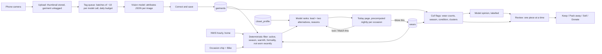
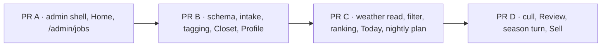

# Closet: what to wear today, and what to stop keeping (design)

Date: 2026-11-09 · Repo: joey-haas.dev · Mockups under
`docs/planning/mockups/2026-11-09-outfit/` (`index.html` links them;
`chosen.html` is the Closet direction below, `d-admin-areas.html` the admin
shell it lives in). Brainstormed in Cowork; the brief half is first, the
spec half follows "Design".

## Problem

Getting dressed currently runs through the Gemini and Claude phone apps:
"what should I wear today", "what goes with this shirt". Every conversation
starts from nothing. The model does not know what is in the closet, what was
worn Tuesday, that Denver will swing 30 °F between the bike ride in and the
ride home, or that Wednesday is an office day. The answers are generic
because the context is.

The second half of the problem is the closet itself. Things stay on the rail
that have not been worn in a year, that are out of season for the next five
months, or that no longer suit how I dress. Nothing tracks that, so nothing
prompts the decision to sell, donate or pack them away, and the active
closet is noisier than it needs to be.

A third problem surfaced while designing this one: the admin. After Closet
and Denver land it has about sixteen pages in six groups, and the flat
sidebar plus five-tab bar with sheets (site refresh, 2026-10-19) was sized
for ten pages in four. It needs reorganising in the same release.

## Decisions already made (2026-11-09)

- **Lives on joey-haas.dev as a private, phone-first admin area.** Same
  stack, sign-in and `llm.py` provider switch; no standalone app, no MCP
  connector in v1. Rationale: auth, the LLM seam and hosting already exist,
  and the weather data is coming anyway (below).
- **Intake is a photo per garment, tagged by the vision model, corrected in
  a quick form.** The same camera-first argument `importer.py` makes for the
  shelf: a closet typed into a form is abandoned at item forty. Photographs
  of racks as a first pass were rejected: segmentation is unreliable and
  the per-item photo is needed anyway for "what goes with this".
- **Occasion is quick-pick chips with a weekly default** (office Tue–Thu
  prefilled, say), not a calendar read. Zero integrations, two seconds a
  day. Calendar is a possible v2.
- **Private only.** No public page, no anonymized demo. A project
  case-study page (how the ranking and the cull work) fits the case-study
  pages already queued, later.
- **Closet direction: A with B's lock gesture and one-at-a-time Review, and
  C's table as the Closet list view.** Admin shell: **D · Areas**. Both
  chosen 2026-11-09; reasons under Key decisions.

## Scope

In (v1):

- The Closet area: **Today**, **Closet**, **Review**, **Profile** pages
  (`/admin/closet/today`, `/admin/closet`, `/admin/closet/review`,
  `/admin/closet/profile`).
- Tables `garments`, `outfits`, `outfit_garments`, `wears`,
  `closet_profile`, `garment_decisions`; the untagged state and the
  batched, quota-aware tagging queue; vision tagging through `llm.py`.
- NWS hourly weather for home (ZIP 80205) from the shared weather job the
  Denver-spots spec introduces.
- Occasion chips with a weekly default and the Bike modifier.
- Deterministic candidate filter plus model ranking for Today; **lock a
  piece** (build around it) and **Match this** from a closet piece or a
  shop photo; Wore this / Swap / Not this with reasons.
- The cull: flags, the four outcomes, the season-turn banner with Pack
  all, the Sell checklist.
- Nightly job: plan Today for each occasion chip; drain the tag queue to a
  daily budget.
- **Admin shell reorganisation**: area rail + per-area page list on
  desktop, area tab bar + segmented sub-nav on a phone, Home as one card
  per area plus the jobs list; existing routes keep their URLs.

Out (v1): any public page; MCP connector or exposing the closet to the
phone chat apps; calendar integration; laundry state; shopping suggestions
or "gaps in the closet"; packing lists for trips (natural v2 on the same
data, with the travel log); the week view (C) as a page; outfit photos of
me; sharing outfits; a "considering" status for shop photos (v1 discards
the transient garment after the Match this session).

## Proposed shape



Same architecture as Play Next and the shelf importer: the expensive
nondeterministic step (tagging, ranking) is a pure function of its input
and runs through `LLMProvider.complete_json`; the filtering, the wear
statistics and the cull rules are deterministic and testable with no model
call.

### Variables the recommendation uses

- **Weather**, NWS hourly for home. Denver specifics that shape the rules:
  large diurnal swing (layering beats one warm piece), strong sun and low
  humidity (UV, hats, sunglasses matter more than the temperature
  suggests), afternoon storms in summer, snow days where footwear is the
  whole decision.
- **Occasion**: Office, WFH, Date night, Weekend (durable, washable, Finn
  in tow), Travel, Event; **Bike** as a modifier (no dress shoes, nothing
  that fights a helmet or a chain, a cuff-free bottom). Weekly default
  pattern, editable on Profile.
- **Wear history**: no repeat of a top within N days, no repeat of the
  same outfit within M weeks; favour pieces that have not had a turn this
  season.
- **Season window** per garment (from tags, editable), so shorts are not
  proposed in November even on a warm day unless the chip says so.
- **Fixed pieces**: watch, ring and glasses are worn daily; modelled as
  always-on accessories the palette should flatter, not as garments.
- **Profile** (one row, edited rarely): sizes by category (for the Sell
  checklist, and so Match this on a shop photo can say "this runs small"),
  coloring (hair, skin undertone, so palette rules are mine rather than
  generic), build and fit preferences, a few style words and dislikes
  ("vintage, understated; no logos"). The ranking prompt gets the profile
  every call; tagging does not. Not a body-metrics tracker: nothing dated,
  nothing that changes weekly.
- **Laundry state**: **out** of v1. "Wore this" is a usable proxy (a top
  worn two days ago is probably in the hamper); a real in-the-wash toggle
  is friction every day for a small gain.
- **Feedback**: Not-this reasons (too warm, too formal, not those two
  together, tired of it) stored per outfit and summarised into the
  ranking prompt, so taste accumulates the way the shelf's pick events do.

### Garment attributes (what tagging extracts, all editable)

Category (fixed enum in code: outer, mid, top, bottom, shoes, accessory)
and free subtype (tee, oxford, overshirt, chinos, denim, sneaker, boot,
coat, knit, cap…), primary and secondary colors (named, plus a hex the
grid can render), pattern, material, warmth (1–5), formality (1–5, lounge
to business), seasons, fit or condition notes, acquired date. Tagging runs
on the downscaled copy; the model gets no candidate list, as in
`importer.py`.

### Intake budget (the free-tier problem)

The Gemini key is on AI Studio's free tier, which caps requests per day per
model (the exact figures are in the
[rate limits table](https://ai.google.dev/gemini-api/docs/rate-limits);
forum reports in 2026 put some Flash models at 20 RPD). A closet of a few
hundred garments tagged one request each would take weeks. Design around
the cap rather than assume it goes away:

- **Decouple upload from tagging.** Uploading stores the thumbnail at once
  and marks the garment `untagged`; it shows in the Closet grid as a photo
  with an "Add details" state and is usable by hand immediately. Tagging
  is a queue, not part of the upload request.
- **Batch many garments per request.** `llm.py` already sends several
  images per call under the 20 MB inline limit; ten downscaled garment
  photos per request at ~400 px is a fraction of that. The schema returns
  one attribute object per image, in order. Three hundred garments is
  thirty requests, not three hundred.
- **Quota-aware queue.** The nightly job (or a "Tag next batch" button)
  drains the queue in batches up to a configurable daily budget, stops on
  a 429 and resumes tomorrow. Daily use after intake is small: the nightly
  plan is one call per occasion chip; Swap, lock and Match this are one
  call each when used.
- **Escape hatches, both already in the stack.** The provider switch
  (`LLM_PROVIDER` env var) can send the intake burst to Anthropic
  pay-as-you-go, or billing can be enabled on the AI Studio project for a
  paid tier; either way a few hundred image taggings is small money. The
  consumer Google AI Pro subscription does not, as far as I know, carry
  API quota — verify before counting on it.

### Cull rules (deterministic first, model second)

Flags, each shown with its evidence so the decision is mine:

- **Not worn this season**: active, in season for at least eight weeks of
  the last twelve months, zero wears. The strongest signal.
- **Rarely worn**: one or two wears in twelve months while its category
  peers averaged many more.
- **Out of season now**: season window closed for the next three months →
  suggest Pack away with the bring-back month filled in. Surfaced as a
  seasonal review twice a year (Denver: roughly late October and late
  April), not every day.
- **Condition**: a note I wrote (pilled, stained, stretched) is a flag on
  its own.
- **Duplicate cluster**: more than N garments sharing category, color and
  formality; suggest keeping the most-worn.
- **Model opinion** (second pass, labelled as an opinion): given the
  closet, the wear history and the flags above, which pieces no longer fit
  how I dress. Shown with lower weight and never alone as a reason; style
  judgement is subjective and the data should carry the recommendation.

Sell vs donate is my call, but the review can help: a Sell outcome opens a
short listing checklist (brand, size, condition, photo already on file);
Donate just closes it. Both record the date so the history stays honest.

## Design

### The admin shell (`d-admin-areas.html`)

**Areas.** The admin is organised as five areas, in fixed order: **Home**,
**Shelf**, **Closet**, **Denver**, **Site**. Every existing page keeps its
URL and moves into an area:

| Area | Pages | Routes |
|---|---|---|
| Home | Home, Jobs | `/admin`, `/admin/jobs` (new: the jobs list on its own) |
| Shelf | Collection, Import photos, Play Next, Discover, Radar, Pull list, Sources, Store list | unchanged |
| Closet | Today, Closet, Review, Profile | `/admin/closet/today`, `/admin/closet`, `/admin/closet/review`, `/admin/closet/profile` |
| Denver | Spots, Weekend, Candidates | per the Denver-spots spec |
| Site | Analytics, Jobs (alias), Search index, Changelog | `/admin/analytics` unchanged; the rest are optional v2 rows |

`ADMIN_GROUPS` becomes `ADMIN_AREAS`: `{ key, label, icon, home, pages[] }`,
with each page `{ to, label, count?, end? }` as today. The Shelf area's
eight pages keep their three sub-groups (Collection · Recommend · Catalogue)
as mono-uppercase kickers inside the area list, so the grouping from the
site refresh is preserved one level down.

**Desktop (≥ 900px).** A 56px **area rail** (surface `--sunken`, hairline
right): the monogram, one icon per area with its label under it in
`--text-3` at 9px, a warn-coloured count badge where an area has something
pending (Closet shows the review count), and "View site ↗" at the foot.
Beside it the 200px **page list** (surface `--surface`): the area name
with a one-line description, the pages, and the foot with the signed-in
email, "View site ↗" and "Sign out". The active area is `--accent-soft`
on the rail; the active page is `--accent-soft` in the list. The main
column keeps `admin-main`'s padding; the two nav columns are both sticky
and scroll independently.

**Phone (< 900px).** The tab bar is the five areas, icon over label, with
the same count badge. Tapping an area lands on its home page (Home → Home,
Shelf → Collection, Closet → Today, Denver → Weekend, Site → Analytics).
Inside an area, the pages are a **segmented control** under the tab bar
and above the page title: full width, `--sunken` track, `--surface`
thumb, 4–5 segments at most (Shelf's eight pages collapse to Collection ·
Picks · Sources ·  More, where Picks and More open the existing
`TabSheet`; this is the only place a sheet remains). The segmented
control scrolls away with the page; the tab bar stays fixed.

**Home (`/admin`).** One card per area (Closet, Shelf, Denver, Site), two
columns on desktop and one on a phone, each with the area name, a link to
its home page, the single thing that matters today, two or three figures,
and at most two actions:

- Closet: today's lead outfit as four small swatches with its one-line
  summary and the weather/occasion line; figures: to review, untagged;
  actions **Wore this**, **Swap**.
- Shelf: the Continue card's game when one is active (else tonight's lead
  pick); figures: owned, comics this week, radar pre-orders; actions
  **Log tonight**, **Wrap up** (the existing sheet).
- Denver: the weekend's lead suggestion (from the planner) and the second
  day in one line; figures: new candidates, spots; action **Review
  candidates**.
- Site: views and visitors over 7 days, top path; the jobs summary line
  (ok count, the first non-ok job with its time); action **Jobs**.

A card hides when its area has nothing to show (no outfit planned yet, no
spots). Under the cards, the **Nightly jobs** list from the current
dashboard, extended with the Closet and Denver jobs, every row `Area ·
job`, time, one-line summary, status dot with its word. The current tiles,
quick actions and recent changes move: tiles become the figures on the
cards, quick actions become the card actions, recent changes move to
`/admin/jobs` under the jobs list.

**Header status** stays as today (API awake · nightly ok with time).

### Today (`chosen.html`, Today view)

Opens on the phone as the Closet area's home. Top to bottom:

1. **Page header**: "Today", with the date and "planned last night" (or
   "planned just now" after a re-plan) in `--text-3`.
2. **Weather strip** (`Panel`-styled, one row): the morning low as the big
   figure, the afternoon high after an arrow, a one-sentence read ("Cold
   ride in, mild ride home — layer for a 23° swing"), and six hourly
   figures in mono (7a to 6p). On a phone the hourly row wraps under.
3. **Occasion chips** (`FilterChips` reused): the day's default pressed,
   plus the **Bike** modifier chip in the `--accent-soft` pressed style so
   it reads as a modifier, not a second occasion. Changing a chip re-plans
   today only (one model call) and shows "planned just now".
4. **Wear this card**: a `--surface` panel with the mono kicker "Wear
   this", four garment tiles (four columns on desktop, two on a phone),
   each a 4:5 thumbnail with the slot name in mono in the corner, the
   garment name, and one short qualifier (warmth, last worn, bike note).
   Under them the **reason**, two sentences, in `--text-2`. Then the
   actions: **Wore this** (primary), **Swap a piece**, **Match this…**,
   **Not this…** (ghost). If the model is unavailable the card still
   renders the deterministic top candidate with "picked without the model"
   in place of the reason, the template-eight pattern from Discover.
5. **Two alternatives**: half-width cards (full on a phone) with four small
   swatches, the garment names as one line, a one-line reason and **Wear
   this instead**, which promotes the alternative into the lead card.
6. **Footnote**: how many active pieces, how many fit, how many skipped as
   worn this week, when it was planned.

**Lock (build around a piece).** Long-press a tile (or hover on desktop)
to reveal a **Build around** pill in its corner; pressing it locks that
garment, outlines the tile in `--accent`, relabels the pill "Built
around", and re-ranks the other three slots with the lock as a
constraint (one call). The reason opens with "You locked the …". A second
press unlocks. One lock at a time in v1.

**Swap a piece.** Opens a sheet listing the pressed tile's slot candidates
(the deterministic filter's output for that slot, ranked), each with its
qualifier; choosing one re-ranks nothing — it is the owner's choice and
the reason gets "(you swapped the …)" appended.

**Match this….** A sheet with two entries: **From the closet** (the Closet
grid in a picker mode; pick one garment, it is locked, and Today re-plans
around it) and **From a photo** (camera; the photo is tagged in one call
as a transient garment, shown as a tile with "not owned", and the other
slots are built around it). The transient garment and its outfit are not
saved; a **Save as owned** button on the tile is the only way they
persist. This is the "what goes with this shirt" question.

**Wore this.** Writes one `outfits` row (date, occasion, source =
`planned` / `swapped` / `alternative` / `own`) and a `wears` row per
garment, then changes to "Worn ✓ · Change" for the rest of the day.
**Not this…** opens a reason chip row (Too warm · Too cold · Too formal ·
Too casual · Not those together · Tired of it · Other) and re-plans once
with the reason added to the prompt; the reason is stored on the outfit.

### Closet (`chosen.html`, Closet view)

Header: "Closet", with pieces · active · packed · untagged as the subline.
Toolbar: status chips (Active pressed by default, Packed, Untagged with
its count), a divider, category and attribute chips (Tops, Bottoms, Outer,
Shoes, Warm, Smart), a **Grid / List** toggle (persisted via
`readShelfPref` under `closet.view`), and **＋ Camera** (primary).

**Grid**: `PosterGrid`'s layout with 4:5 tiles instead of covers; the slot
name in mono in the tile corner; name and one stat line (wears, season
window). Untagged tiles carry a dashed `--warn` outline and the label
"Untagged · add details"; packed tiles render at 45% opacity with "Packed ·
back in May". Tapping a tile opens the edit form.

**List**: C's table. Columns Piece (thumbnail + name), Type, Wears 12 mo (a
4px meter scaled to the closet's maximum plus the number), Last worn,
Season, and a trailing cell for a "flagged" tag or "packed → May". On a
phone only Piece, Wears and the trailing cell show.

**Camera → upload.** Multiple photos per upload; each becomes an untagged
garment with its thumbnail immediately. A toast says "12 added · tagging
tonight" and offers **Tag now** (runs one batch, respecting the budget).
The edit form is the same for untagged and tagged garments: thumbnail,
category (segmented), subtype, colors (two swatch pickers with the model's
hex prefilled), pattern, material, warmth and formality (1–5 steppers),
seasons (month chips), notes, acquired, status.

### Review (`chosen.html`, Review view)

Header: "Review", subline "9 flagged · autumn turn" when a season turn is
open. Then:

- **Season-turn banner** (`--accent-soft`): "It's the autumn turn. 12
  summer pieces close their season until February" with **Pack all 12**
  and **One by one** (ghost). Pack all sets each to `packed` with the
  bring-back month from its season window and shows an undo toast. The
  banner appears from the turn date until dismissed or emptied, twice a
  year (turn dates are two constants, configurable on Profile).
- **Four stat tiles** (`StatTile`): active pieces, worn in the last 30
  days, flagged for a decision, sold or donated this year.
- **The deck**: progress line ("3 of 9 flagged", the running tally of
  decisions) and a 3px progress bar, then **one piece** at a time: the
  thumbnail at 8rem (7rem on a phone, above the text), name, one mono stat
  line (wears, added, size), and the **evidence list**: one bullet per
  flag in full sentences, filled `--warn` bullets for data flags and a
  hollow `--text-3` bullet for the model's opinion, which is always last.
  Under it, the four outcomes as equal buttons with a small sub-label
  (Keep · clear until next season; Pack away · pick a month; Sell ·
  listing checklist; Donate · mark gone); the suggested outcome carries the
  `--accent` border and `--accent-soft` fill. Two columns on a phone.
- **Outcomes.** Keep writes a `garment_decisions` row (`kept`) and clears
  the flags until the next season turn. Pack away asks for the month
  (prefilled from the season window) and sets `status = packed`,
  `back_on`. Sell opens the checklist sheet (brand, size from the profile,
  condition from notes, material, the thumbnail; copy-to-clipboard for a
  listing) then sets `status = listed`; **Mark sold** on a listed garment
  sets `gone` with a date. Donate sets `gone` with `reason = donated`.
  Every outcome advances the deck; **Skip** (ghost, under the deck) leaves
  the piece for next time. An empty deck says "Nothing to decide. Next
  season turn: late April."

### Profile

A settings-style form, one row: sizes by category, coloring (hair, skin
undertone as three words), build and fit preferences (free text), style
words and dislikes (chips plus free text), the weekly occasion default
(seven day pickers), the Bike default per weekday, the two season-turn
dates, N and M for repeat rules, the daily tagging budget. Saved with one
button; nothing here is dated.

### Responsive and theme

- Phone ≤ 400px: tab bar fixed, segmented sub-nav, two-column tiles,
  one-column alternatives and area cards, list view drops its middle
  columns, the deck stacks thumbnail over text, outcomes two by two.
- Desktop 1280px: rail + page list + main; four-column tiles; two-column
  alternatives and area cards; the deck is capped at 34rem so the evidence
  stays readable.
- Tokens only; both themes are in every mockup. New marks: the untagged
  dashed outline (`--warn`), the opinion bullet (`--text-3`), the lock
  outline (`--accent`), all already measured tokens. Garment swatches in
  the mockups stand in for thumbnails and are not tokens.

### Accessibility

- Tiles are buttons with the garment name as text; the slot name in the
  corner is `aria-hidden` and repeated in the button's `aria-label`.
- The Build around pill is revealed on hover **and** `:focus-within`, by
  opacity, never `display: none`; on touch, long-press is the gesture and
  a visible **Match this…** button is the equivalent path.
- Chips keep `aria-pressed`; the segmented sub-nav is a `nav` with
  `aria-current="page"`; the area rail is a `nav aria-label="Areas"` with
  the label text present (not icon-only), and the badge's number is in the
  accessible name ("Closet, 9 to review").
- Flags are text, never colour alone; the opinion bullet's hollow shape is
  decorative, the word "Opinion:" carries the meaning.
- Sheets (Swap, Match this, Sell checklist) reuse `TabSheet`'s focus trap
  and Escape handling.

## Key decisions

1. **A · Morning card wins for Today**, because at 7am the question is
   "what do I put on", and A answers it as one finished outfit with a
   reason; it is also the shape Play Next already uses, so it reads as
   native.
   - *B · Rails* lost as the primary view because it shows candidates, not
     an outfit; glanceability suffers. Its **lock gesture** survives,
     because it answers "what goes with this" on the same page and makes a
     separate Match this page unnecessary. Its **one-at-a-time Review**
     survives because the cull is a decision per piece and deserves the
     evidence in full, not a row of four buttons per card.
   - *C · Week ledger* lost as a page: the nightly plan already covers the
     week's data, and a five-column plan is a desk view for a tool used on
     a phone. Its **table** survives as the Closet list view, where wear
     meters and last-worn dates are the point. The week view is parked for
     v2 (packing lists would want it).
2. **D · Areas for the admin shell** over E · Folding groups. Areas scale
   to the next three features without another redesign, the phone gets
   every area one tap away instead of burying Denver and half of Shelf
   behind More, and Home becomes a landing screen with the day's actions
   rather than a figures page. Cost accepted: `AdminShell` is rewritten,
   not extended, and the Dashboard's tiles move onto cards.
   - *E* lost because it is the same list with hinges; it fixes the
     sidebar's length and nothing about the phone, and the jump box is a
     feature for people who already know the page names.
3. **Deterministic filter, model ranks** (the picker pattern) over asking
   the model to pick from the whole closet. Testable without a model,
   cheaper per call, and the reason can cite the rule that excluded a
   piece ("denim worn Friday").
4. **Data-first cull with the model's view labelled as an opinion.** The
   decision is mine; the data earns the flag, the model adds colour. A
   model-led cull was rejected as unfalsifiable.
5. **Upload and tagging decoupled, batched, budgeted**, so the free tier
   is a speed limit rather than a wall, and the provider switch stays the
   escape hatch.
6. **Thumbnails in Postgres, originals discarded.** Consistent with the
   importer's "photographs are not kept"; a few hundred garments at ~400px
   WebP is low tens of MB, inside Neon's free tier; no new storage service.
7. **No laundry state, no calendar, no public page in v1.** Each is real
   scope for small gain against "Wore this" as a proxy, the weekly
   default, and a closet nobody else needs to see.

## Component inventory

**Existing, reused**: `AdminPageHeader`, `Panel`, `StatTile` (+
`StatTiles`), `JobStatusRow`, `FilterChips` (occasion, status, category
chips), `TabSheet` (Swap, Match this, Sell checklist, Shelf's Picks/More
on the phone), `PosterGrid` (layout only), `readShelfPref` /
`writeShelfPref` (grid/list, last area), `useMediaQuery`, the toast
pattern with undo, `llm.py` (`Image`, `complete_json`, provider switch),
the job-route pattern (`JOB_TOKEN`, `items.JOB_ROUTES` or the sibling
registry the Denver spec allows), `nightly.yml`.

**New, shell**: `AdminShell` rewritten around `ADMIN_AREAS`: `AreaRail`,
`AreaPages` (desktop list with kickers), `AreaTabs` (phone), `AreaSubnav`
(segmented), `AreaCard` (Home), `JobsList` (shared by Home and
`/admin/jobs`). `ADMIN_ROUTES` in `prerender-lib.mjs` gains the Closet and
Jobs routes.

**New, Closet**: pages `AdminClosetToday`, `AdminCloset`,
`AdminClosetReview`, `AdminClosetProfile`; components `WeatherStrip`,
`OutfitCard` (lead) and `OutfitAlt`, `GarmentTile` (grid and card tile,
lock pill), `GarmentTable` (list view), `GarmentForm`, `SwapSheet`,
`MatchSheet`, `ReviewDeck` (+ `EvidenceList`, `OutcomeRow`),
`SeasonTurnBanner`, `SellChecklistSheet`, `UploadToast`.

**Backend**: `closet.py` (pure: filter, repeat rules, season windows, cull
flags, clusters), `closet_rank.py` (prompt + schema for ranking,
provider-agnostic, Discover style), `closet_tag.py` (prompt + schema for
batch tagging; one object per image, in order), `closet_routes.py` (admin
CRUD, upload, today, plan, wore, decisions, profile), `closet_jobs.py`
(plan Today per occasion; drain the tag queue to the budget), weather read
from the shared weather module (Denver spec's `weather.py`). Migration:
`garments`, `outfits`, `outfit_garments`, `wears`, `closet_profile`,
`garment_decisions`, enum types `garment_category`, `garment_status`
(`untagged`, `active`, `packed`, `listed`, `gone`), `outfit_source`.

**Tokens used**: `--bg`, `--surface`, `--sunken`, `--line`,
`--line-strong`, `--text*`, `--accent`, `--accent-ink`, `--accent-soft`,
`--ok`, `--warn`, `--radius`, `--font-mono`. No new tokens.

## Acceptance criteria

- [ ] `/admin` signed in at 1280px matches `d-admin-areas.html` (Home
      screen): area rail, page list, four area cards, nightly jobs list; at
      400px the rail and list are replaced by the five-area tab bar.
- [ ] Every existing admin route still resolves and renders inside the new
      shell with the correct area and page highlighted; `/admin/analytics`
      is under Site, the eight Shelf pages under Shelf with their three
      kickers.
- [ ] `/admin/closet/today` at 1280px and 400px, light and dark, matches
      `chosen.html` (Today view): weather strip, chips with the weekly
      default pressed, four-tile lead card with reason, two alternatives,
      footnote.
- [ ] Changing an occasion chip re-plans today with one model call and the
      header reads "planned just now"; the nightly job writes one plan per
      occasion chip so the page paints from a stored row with no model
      call.
- [ ] Locking a tile re-ranks the other three slots with that garment held;
      the reason opens with "You locked the …"; unlocking returns to the
      stored plan.
- [ ] Match this from the closet locks the chosen garment and plans around
      it; from a photo, tags it in one call and builds around it without
      persisting anything unless Save as owned is pressed.
- [ ] Wore this writes one `outfits` row and one `wears` row per garment
      for today, and the same garment is excluded from tomorrow's plan by
      the repeat rule (N days, from the profile).
- [ ] Uploading 12 photos creates 12 `untagged` garments visible in the
      Closet grid before any model call; the tag job tags them in batches
      of up to 10 per call, stops at the daily budget or a 429, and
      resumes the next night; a garment edited by hand is never retagged.
- [ ] Closet grid/list toggle persists across reloads; the list at 400px
      shows Piece, Wears and the trailing cell only.
- [ ] Review shows one flagged piece at a time with every flag as a
      sentence and the opinion last and hollow; each outcome writes a
      `garment_decisions` row and advances; Pack away sets `packed` with a
      `back_on` month; a packed garment never appears in Today's candidates
      or the Active grid.
- [ ] The season-turn banner appears on the turn date with the correct
      count, Pack all packs them with undo, and the banner clears when
      the count is zero.
- [ ] With the model unavailable, Today renders the deterministic lead
      with "picked without the model" and no error; the nightly job records
      the failure on the jobs list with the reason.
- [ ] Every text/background pair measures ≥ 4.5:1 and every non-text mark
      (untagged outline, lock outline, opinion bullet, badge) ≥ 3:1 in both
      themes.
- [ ] No hover-only control: the Build around pill is reachable by focus
      and the Match this… button exists on touch.

## Open questions for Code

- **Weather sharing.** Confirm the Denver spec's `weather.py` caches per
  point; Closet needs one point (home), cached hourly, with the hourly
  series for the day. If spots cache per spot only, add the home point to
  that job rather than a second NWS client.
- **Thumbnail pipeline.** Where the downscale runs (Pillow in the upload
  route is the simple answer; HEIC from iPhone needs `pillow-heif`), the
  target size (~400px long edge, WebP q≈80), and whether `bytea` in
  Postgres or a `garment_images` table is cleaner for the ORM.
- **Tag schema per image.** One JSON object per image in order, as the
  brief says, or a `{ index, attributes }` array so a dropped image is
  detectable; recommend the latter and reject a batch whose count does not
  match.
- **Plan storage.** One `outfit_plans` row per date × occasion × bike,
  or the plan JSON on a `days` row; the Home card and Today both read it,
  so one shape. Re-plans overwrite the row for that key.
- **Ranking prompt budget.** How much wear history to include (the last
  30 days as counts per garment is probably enough) and whether the
  profile is sent verbatim or summarised once and cached.
- **Repeat rules** N (top within N days) and M (outfit within M weeks):
  profile fields with defaults 5 and 3 recommended.
- **`ADMIN_AREAS` and `prerender-lib.mjs`.** `ADMIN_ROUTES` is flat today;
  decide whether it derives from `ADMIN_AREAS` (one list) or stays a
  parallel list with a test that they match, the way `publicRoutes` and
  `render.yaml` are checked.
- **Jobs page.** `/admin/jobs` is new; it can be the Home jobs list plus
  recent changes and a Run now per job (the Denver spec's pattern), or
  deferred to the Denver phase. Recommend shipping it here, since Home no
  longer has room for recent changes.
- **Shelf sub-nav on a phone.** Collection · Picks · Sources · More as
  proposed, or Collection · Play Next · Discover · More with the rest in
  the sheet; Code's call after seeing it at 400px with real labels.

## Pointers

- `backend/importer.py` and `backend/llm.py` (`Image`, `complete_json`,
  provider-neutral JSON schema): the pattern for photo intake and tagging.
- `backend/picker.py` and `discover.py`: deterministic filter plus model
  ranking with reasons; the template fallback when the model cannot
  answer; `pick_events` for feedback.
- `components/AdminShell.jsx` (`ADMIN_GROUPS`, `SHEETS`, `TabSheet`),
  `layouts/AdminLayout.jsx`, `pages/Admin.jsx` (tiles, jobs panel, quick
  actions, recent changes): what the shell rewrite replaces.
- `StatTile`, `Panel`, `JobStatusRow`, `FilterChips`, `PosterGrid`,
  `readShelfPref` in `frontend/src/`.
- Denver-spots spec (`2026-11-08-denver-spots-design.md`) for the NWS job
  and the job-registry question; `nightly.yml`, `JOB_TOKEN`,
  `items.JOB_ROUTES` for the nightly pattern.
- Site refresh spec (`2026-10-19-site-refresh-design.md`) for the shell's
  original IA and the contrast measurements it must keep.

---

# Plan (Code, 2026-11-09)

Tier: **Full** (migration, new dependencies, job-token whitelist, nightly
workflow, admin shell rewrite). Built from `origin/main` at `a6df75e`
(Denver spots and Travel log merged).

## Corrections to the spec, found in the code

- **Denver has two admin pages, Weekend and Spots** (`/admin/weekend`,
  `/admin/spots`); candidates live inside Spots (`SpotFinder`). There is no
  Candidates page. The Denver area is Weekend · Spots, and its Home card's
  action **Review candidates** links to `/admin/spots`.
- **Breakpoint.** The current shell switches at 700px
  (`AdminShell.jsx:163`). The area layout needs 256px of nav, so it moves to
  **900px** as the spec says; tests that stub the query change with it.
- **The header status lives in the Dashboard page** (`pages/Admin.jsx`
  :176-183), not the shell. It moves with the jobs list into `JobsList`'s
  owner (Home keeps it), unchanged in wording.
- **No image library in the backend.** `importer.py` sends raw bytes and
  keeps nothing; nothing in Python decodes images. Thumbnails need one
  (decided below).
- **No shared weather read.** `weather.py` fetches one point (`DOWNTOWN`)
  into `weather_hours` (keyed by gridpoint); the planner reads it through a
  private closure (`spots_weekend_routes.py:214-236`). There is no home
  point.
- **Free-tier quota is per model**, ~20 requests a day
  (`llm.FREE_TIER_DAILY_REQUESTS`), and `GeminiProvider` falls through three
  models, so a day holds roughly 60 calls across the chain, shared with
  Discover and the importer. AI Studio's docs no longer publish free-tier
  figures; the live limits are per project in AI Studio
  (<https://aistudio.google.com/docs/rate-limits>, read 2026-11-09). The
  budget is a Profile field, never a constant.

## Open questions, resolved

| Question | Decision | Why |
|---|---|---|
| Weather sharing | Factor `_hours` into `weather.hours_for_day(session, day)` (reads `weather_hours`, latest gridpoint, Denver day); the planner and Closet both call it. **Home reuses the downtown gridpoint**; no second fetch. | 80205 is ~3 km from `DOWNTOWN`; NWS grid cells are 2.5 km, so the series differs by a cell at most, well inside forecast error. One NWS client, one table, one nightly step. |
| Thumbnail pipeline | **Server-side Pillow** (Joey, 2026-11-09). `Pillow==13.0.0` and `pillow-heif==1.8.1` pinned (both ship cp312 manylinux wheels; released 2026-10-16 / 10-11). `closet_images.py` (pure): `register_heif_opener()`, `ImageOps.exif_transpose`, `draft()` for JPEG, long edge 400px, WebP q80, refuse > `MAX_PHOTO_BYTES` before reading and anything Pillow cannot open (422). Photos are processed one at a time so a 12 MP HEIC never sits beside eleven others in Render's 512 MB. | Joey's call over browser-side canvas: robust for any input, verifiable on the server. `exif_transpose` is the footgun: iPhone JPEGs are stored sideways with an orientation tag. |
| Image storage | `garment_images` table (`garment_id` PK/FK, `webp bytea`, `width`, `height`), served by `GET /api/closet/garments/{id}/image` with `Cache-Control: private, max-age=86400` and an ETag from `updated_at`. | Keeps bytes out of every list query (the ORM never loads them by accident); the first `bytea` in `models.py`. |
| Tag schema | `{ items: [{ index, attributes }] }`; a batch whose indices do not cover exactly `0..n-1` is rejected whole, and those garments stay queued. | A dropped image is detectable instead of shifting every later answer by one. |
| Tag state | `status = untagged` plus `tag_source` (`model`/`manual`, NULL until either) and `tag_attempts`. The queue takes `untagged AND tag_source IS NULL AND tag_attempts < 3`, oldest first. A hand save sets `manual` and `active`; tagging sets `model` and `active`. | "Edited by hand is never retagged" becomes a query, not a convention; a poison image stops after three tries. |
| Plan storage | `outfit_plans` keyed `(day, occasion, bike)`, JSON body (lead, alternatives, reasons, `ranked_by`, `model_note`, `planned_at`); a re-plan overwrites its key. Locks, swaps and Match this are **not** stored: they are computed on request and only reach the database through Wore this. | One shape for Home and Today; transient choices stay transient, as the spec asks of Match this. |
| Plan day | The nightly job runs at ~17:17 Denver time and plans **tomorrow's** Denver day. Today with no stored plan for its key plans on open (one call) and says "planned just now". | "Planned last night" is literally true; a failed nightly costs one call, not a broken page. |
| Ranking prompt budget | Last 30 days of wears as counts per garment plus last-worn date; the profile verbatim (it is a few hundred characters); the five most recent Not-this reasons. Candidates are capped at 12 per slot after the filter. | Keeps a call well under a few thousand tokens; the cap is a constant beside the weights. |
| Repeat rules | Profile fields `repeat_top_days` (5) and `repeat_outfit_weeks` (3). | Spec's defaults. |
| `ADMIN_AREAS` vs `ADMIN_ROUTES` | Parallel lists. `prerender-lib.test.mjs` already pins `ADMIN_ROUTES` to App.jsx's admin block; a new Vitest test pins every `ADMIN_AREAS` page to a route in App.jsx and every fixed App.jsx admin route to exactly one area (`/admin/collection/:id` belongs to Shelf by prefix). | `ADMIN_AREAS` lives in a JSX module that the Node prerender script cannot import; two pinned lists are the pattern `publicRoutes` already uses. |
| `/admin/jobs` | Ships in the shell PR: the full jobs list, recent changes, and the existing re-enable link. Run now per job is **out** (no route runs a job from the browser today except each page's own button). | Home loses the room for recent changes; Run now is new auth surface for little gain. |
| Shelf sub-nav on a phone | Decided at 400px with real labels in PR A; start from Collection · Picks · Sources · More. | Spec leaves it to Code. |
| Job status | A `closet_settings` key/value table (the `spot_settings` shape: `{at, state, note?}`) under keys `tag.last_run`, `plan.last_run`, `opinion.last_run`, read by `GET /api/closet/status`; `lib/nightly.js` gains the rows. | Same contract the Denver rows use; no new pattern. |
| Packed garments coming back | On the first of a `back_on` month, Review shows "N pieces due back" with **Unpack all** (undo toast). Nothing unpacks without a press. | The spec sets `back_on` but never says what happens on it; the owner's press keeps the closet honest. |
| Changelog | Shell reorganisation: no entry (admin is private and unseen). Closet: one unlinked entry when Today ships (PR C), describing the tool, never the contents. | `changelog.md` has no admin entries so far; Closet is a feature worth a line. |

## Conflicts with open PR #113 (recommendation engine)

#113 changes `items.py` `JOB_ROUTES` (drops `/api/picker/next`),
`tests/test_job_token.py`, `nightly.yml` (drops the picks step),
`PlayNext.jsx` and `index.css`. Whichever lands second rebases. PR A's
Home Shelf card reads `/api/picker/continuing` and reuses `ContinueCard` /
`WrapUpSheet` as components; it does **not** pull logic out of
`PlayNext.jsx`, so the overlap stays in the job list and the workflow.

## Delivery: a four-PR stack

Each PR is independently valid (builds, tests green) and reviewable on its
own, as Denver spots was. Branches: `feat/closet` (PR A, this worktree,
where this doc is committed), then `feat/closet-intake`,
`feat/closet-today`, `feat/closet-review`, each in its own worktree and
based on the previous.



### PR A — Admin shell by area (frontend only)

1. **`ADMIN_AREAS`** (`components/adminAreas.js`, data only): five areas,
   Shelf's three kickers, `home` per area, `count` keys. Closet's pages are
   absent until PR B adds them; Site holds Analytics and Jobs.
   *Tests:* `adminAreas.test.js` — the area/route pinning above; every area
   has a home in its pages.
2. **Shell components**: `AreaRail`, `AreaPages`, `AreaTabs`, `AreaSubnav`
   (segmented `nav` with `aria-current="page"`), rewritten `AdminShell` at
   900px; Shelf's Picks and More keep `TabSheet` (built on `<dialog>`, so the
   focus trap is the browser's). Area resolution is a pure
   `areaFor(pathname)` (prefix match, `/admin` exact for Home).
   *Tests:* `AdminShell.test.jsx` rewritten — area order, page order with
   kickers, active area and page for every route including
   `/admin/collection/:id`, badge in the accessible name, rail labels as
   text, phone tabs land on each area's home, sub-nav current page, sheet
   Escape returns focus, breakpoint change closes the sheet, sign-out.
3. **Home and Jobs**: `pages/Admin.jsx` becomes Home (`AreaCard` ×
   Shelf, Denver, Site, each hiding when empty; Closet joins in PR C) with
   the header status and `JobsList` below; `pages/AdminJobs.jsx` at
   `/admin/jobs` with `JobsList`, the re-enable link and recent changes.
   Tiles become card figures; quick actions become card actions (Shelf: Log
   tonight / Wrap up via `ContinueCard` props and `WrapUpSheet`, else the
   lead pick; Denver: the weekend lead from `/api/spots/plan`, Review
   candidates → `/admin/spots`; Site: 7-day views and visitors, top path,
   jobs summary, **Jobs**). App.jsx and `ADMIN_ROUTES` gain `jobs`.
   *Tests:* `Admin.test.jsx` cases carried over to the cards and
   `AdminJobs.test.jsx` (header words, job rows and failure paths, recent
   changes, card hiding, each card's actions); `App.test.jsx` title for
   `/admin/jobs`; `prerender-lib.test.mjs` passes unchanged in shape.
4. **CSS** in the admin block of `index.css` (:1323-1720): rail, page list,
   tabs, segmented control, area cards. Tokens only. Measure the new pairs
   (rail label `--text-3` on `--sunken`, badge on `--sunken`, segmented thumb
   text on `--surface`) in both themes and record them beside the rules.
   *Verification:* browser at 1280 and 400, both themes, against
   `d-admin-areas.html`; every existing admin route renders in the right
   area.

### PR B — Schema, intake, tagging, Closet and Profile

5. **Migration `0014`** (all Closet tables at once, additive): enums
   `garment_category`, `garment_status` (`untagged`, `active`, `packed`,
   `listed`, `gone`), `outfit_source`, `garment_tag_source`,
   `garment_outcome` (`kept`, `packed`, `listed`, `sold`, `donated`);
   tables `garments`, `garment_images`, `outfits`, `outfit_garments`,
   `wears`, `outfit_plans`, `closet_profile` (single row, `id = 1` check),
   `garment_decisions`, `closet_settings`. Enum pattern from `0013`
   (`create_type=False`, `checkfirst=True`). `models.py` mirrors it.
   *Tests:* `test_migrations` round-trip if present, `schema_check` at head,
   model CRUD smoke.
6. **`closet_images.py`** (pure, Pillow) and the deps.
   *Tests:* JPEG with EXIF orientation 6 comes out upright (generated in
   the test with Pillow), HEIC generated with pillow-heif decodes, PNG with
   alpha flattens, oversize refused before decode, garbage bytes → 422,
   output long edge ≤ 400 and WebP.
7. **`closet_routes.py`** (admin router, own lock): garments CRUD (PATCH
   sets `tag_source = manual`, `status` derives `active` from `untagged`),
   multi-photo upload → untagged garments, image route, profile GET/PUT
   with validation (sizes, coloring, style words, weekly occasion and bike
   defaults, turn dates, N, M, tag budget), status route.
   *Tests:* upload of 12 creates 12 untagged with images and no model
   call; image route headers and 304; PATCH by hand marks manual; profile
   round-trip and 422s; every route 401 signed out.
8. **`closet_tag.py`** (pure prompt + schema + validation) and the tag job:
   `POST /api/closet/tag` (button: one batch) and
   `POST /api/closet/jobs/tag` (nightly: batches of ≤ 10 until the budget,
   a 429 or the queue ends; writes `tag.last_run`). Added to `JOB_ROUTES`
   and `test_job_token.py` `EXPECTED`.
   *Tests:* `FakeProvider` batch fills attributes in order; index gap
   rejects the batch and increments attempts; budget stops at N calls; a
   quota `LLMError` stops with the owner-worded note (`_failure_note`
   reused, moved to a shared spot if it must be); manual and three-strike
   garments never taken.
9. **Nightly step** `closet-tag` after `weather`, in `nightly.yml`.
10. **Frontend**: `AdminCloset` (grid/list, status and category chips,
    `closet.view` pref under the admin namespace, untagged and packed tile
    states), `GarmentTile`, `GarmentTable`, `GarmentForm` at
    `/admin/closet/:id`, the camera input (`accept="image/*"`, `multiple`)
    with `UploadToast` (Tag now), `AdminClosetProfile`; Closet joins
    `ADMIN_AREAS` with Closet and Profile, its badge the untagged count for
    now. *Tests:* page tests for grid/list persistence, chips, upload toast,
    form save, profile save; the area pinning test picks up the routes.

### PR C — Today

11. **`weather.hours_for_day`** factored out; the planner switches to it
    with no behaviour change. *Tests:* existing planner tests unchanged;
    new unit test for the day window in Denver time.
12. **`closet.py`** (pure): slots, season windows (month sets), warmth
    target from the morning low and afternoon high plus the swing, the Bike
    rules, formality per occasion, repeat rules (N, M), candidate ranking
    without a model, and the deterministic outfit (`ranked_by =
    "template"`). *Tests:* table-driven, no database.
13. **`closet_rank.py`** (pure prompt + schema + validation, Discover
    style: indices into the candidate list, never free titles; lock and
    transient garment as constraints; Not-this reasons summarised).
    *Tests:* validation drops foreign indices, a lock is honoured, partial
    answers top up from the template.
14. **Routes**: `GET /api/closet/today?occasion=&bike=` (stored plan or
    plan-on-open), `POST /api/closet/plan` (re-plan with
    `lock`/`not_this`), `GET /api/closet/candidates?slot=` (Swap), `POST
    /api/closet/match` (photo → tag one image → plan around it; nothing
    persisted), `POST /api/closet/garments/from-match` (Save as owned),
    `POST /api/closet/wore` (outfit + wears, today in Denver), `POST
    /api/closet/jobs/plan` (nightly: one plan per occasion chip in the
    profile's default week for tomorrow; `plan.last_run`), added to
    `JOB_ROUTES`. Model failure follows Discover's `rank()` contract and
    stores `model_note`. *Tests:* each route with `FakeProvider` and with
    `raises=LLMError(...)`; Wore this excludes the top tomorrow; match
    leaves row counts unchanged.
15. **Nightly step** `closet-plan` after `closet-tag`.
16. **Frontend**: `AdminClosetToday` (`WeatherStrip`, occasion chips via
    `FilterChips` with Bike as a toggle, `OutfitCard`, `OutfitAlt` ×2,
    footnote), lock pill (hover and `:focus-within`, opacity),
    `SwapSheet`, `MatchSheet` (closet picker mode, camera), Not this reason
    row, Wore this → "Worn ✓ · Change". Closet's home becomes Today; the
    Home **Closet card** (lead swatches, Wore this, Swap) and the Closet
    rows in `lib/nightly.js`. *Tests:* page tests for each interaction with
    fetch stubs; "picked without the model"; card hides with no plan.
17. **Changelog** entry (unlinked).

### PR D — Review and the cull

18. **`closet.py` cull** (pure): the five data flags with their sentences,
    duplicate clusters, the suggested outcome, season-turn membership and
    count, due-back set. *Tests:* table-driven per flag, both turn dates,
    a garment added mid-season is not "never worn".
19. **Model opinion**: `POST /api/closet/jobs/opinion` (Sundays, one call
    over the closet summary and flags; stored per garment with the batch
    date; any failure stores no opinions and a note), in `JOB_ROUTES` and
    the nightly Sunday block. *Tests:* opinions only for flagged pieces,
    never alone as a flag, failure leaves the deck intact.
20. **Routes**: `GET /api/closet/review` (deck, tiles, banner state),
    `POST /api/closet/garments/{id}/decision` (four outcomes, `garment_decisions`
    row, status changes, `back_on`), `POST /api/closet/pack-all` and
    `/unpack-all` (return the ids for undo), `POST .../undo`, Mark sold,
    banner dismiss in `closet_settings`. *Tests:* each outcome's writes;
    packed never in Today's candidates or the Active grid; Pack all + undo
    restores exactly the prior states.
21. **Frontend**: `AdminClosetReview` (`SeasonTurnBanner`, `StatTiles`,
    `ReviewDeck` with `EvidenceList` and `OutcomeRow`, Skip, empty state),
    `SellChecklistSheet` (copy to clipboard), the due-back banner, Closet's
    badge becomes the review count. *Tests:* deck order and advance,
    opinion last with the word "Opinion:", outcomes, undo toast.
22. **Docs**: README sections (Closet, the tag budget and the provider
    escape hatch, the deploy order), `backend/` README notes for the new
    modules, repo `CLAUDE.md` (Closet conventions, `0014`, the shell
    areas), close the spec's acceptance checklist.

## Milestones

```
Milestone 1 (auto): PR A — tasks 1–4 (frontend only), opened as PR A
STOP — carve-out review: migration 0014 (table and enum list above),
       Pillow + pillow-heif, three new JOB_ROUTES entries, the nightly.yml
       steps (closet-tag, closet-plan, Sunday opinion)
Milestone 2 (auto): PR B — tasks 5–10
Milestone 3 (auto): PR C — tasks 11–17
Milestone 4 (auto): PR D — tasks 18–22
Finish gate per PR → PRs B, C, D opened as a stack
```

The carve-out stop happens once, before any of it is written; the
reviewed list is then built across B–D without stopping again unless it
grows. **Deploy order:** apply `0014` to Neon (`migrate_neon.py current`,
then `upgrade`, from the PR B worktree), then merge B; C and D need no
further migration. Merging A alone is safe at any time.

## Environment testing

- Backend: `./.venv/bin/pytest` from the main checkout's venv, one run at
  a time (shared local test database). `pip install` the two new pins into
  that venv first.
- Frontend: `npm test`, `VITE_DAILY_SALT=local npm run build` per PR.
- Browser, per PR: local API on `stats_dev` with dummy env vars (worktree
  local verification note), Vite dev server, signed-in session; 1280 and
  400px, both themes, against the mockups. PR B uploads real iPhone photos
  (JPEG and HEIC) and checks orientation. One real tagging batch of ~5
  garments through Gemini on the dev key is the only model spend before
  merge.
- Contrast: every new text/background pair and mark measured in both
  themes, recorded beside the rules.

## Smoke test strategy

`smoke.sh` gains signed-out checks only (admin is private): `GET
/api/closet/today`, `GET /api/closet/garments/1/image` and `POST
/api/closet/jobs/tag` without the token all answer 401, and the new admin
paths serve the shell (200, noindex). After PR B deploys, Joey uploads a
first rack's worth on the phone and presses Tag now once; after PR C, the
next morning's Today paints from the stored plan with no model call (the
nightly row shows `closet-plan` ok).
