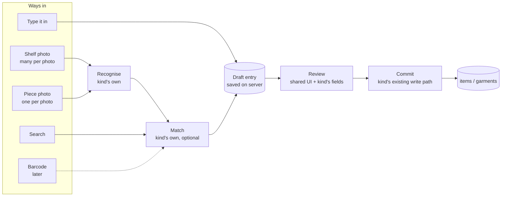
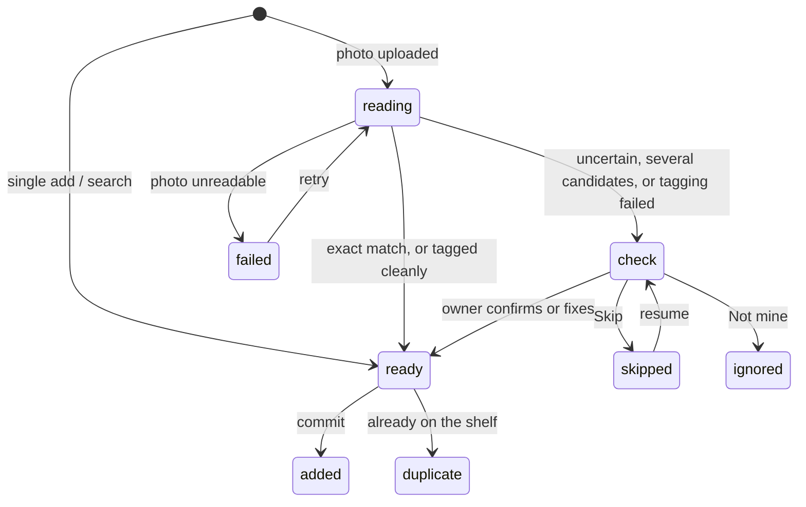

# Intake: one way in for everything with data behind it (design)

Date: 2026-11-10 · Repo: joey-haas.dev · Mockups under
`docs/planning/mockups/2026-11-10-intake/` (`index.html` links them;
`chosen.html` is the direction below, `d-public-demo.html` the public demo).
Every mockup has a toolbar for theme (dark / light), width (1280 / 400) and
screen.

## Problem

The whole closet, the whole comic collection and a Blu-ray/DVD collection
are about to be entered. Each needs a bulk path and a single path, by photo
or by search, and it has to be pleasant enough to survive item 300.

Today each "thing" has its own way in, built at a different time:

| Thing | Bulk | Single | Unfinished work lives |
|---|---|---|---|
| Games, movies, comics, board games | `/admin/import`: photos → titles read by the model → matched through `sources/` → review grid → `POST /api/items/bulk` (`importer.py`, `AdminImport.jsx`) | `ItemForm` with the metadata picker (`GET /api/items/search-metadata`) | In the browser only. Closing the tab loses the batch (`AdminImport.jsx` says so) |
| Comics (series) | same importer, no issues or format asked | Pull list search → Follow / Want (`comics_routes.py`); owned issues typed on the edit page | n/a |
| Garments | ＋ Camera: up to 24 photos, one untagged garment each (`POST /api/closet/garments/photos`), tagged 10 per model call by the queue (`closet_tag.py`) | `POST /api/closet/garments` | On the server, as `untagged` garments |
| Denver spots | finder candidates → accept / dismiss | `POST /api/spots` | On the server, as candidates |

The parts are good and already shaped alike (read, match, review, commit),
but nothing binds them: a new kind of thing, or a new field on an existing
one, means another page, another review grid and another commit route.

## Scope

**In**

- An intake framework: a registry of **kinds**, each declaring its ways in,
  its recogniser, its matcher, its review fields and its commit.
- Five kinds at launch: game, movie, comic, board game, garment. Plus
  "mixed shelf", which is not a kind but a sitting whose reader assigns a
  kind per title (the importer already does this).
- **Sittings** (bulk): Shoot → Check → Details → Done, saved on the server,
  resumable on another device.
- **The add bar** (single): search or type on the Collection and Closet
  pages, with a drawer for the kind's fields.
- An **Add page** per area (`Shelf` and `Closet`) that starts sittings and
  lists unfinished ones. It replaces Import photos (`/admin/import`).
- A **barcode slot**: shown, disabled, labelled as later.
- A **public sandbox demo**, client-only, plus a stop on How it works.

**Explicitly out**

- Barcode scanning itself (no lookup source or iPhone Safari camera support
  has been verified).
- Denver spots: its candidates come from Overpass, not the owner.
- Board game matching (BGG is still blocked; the kind is type-only).
- Issue-level comics. A comic stays one row per series with range text.
- Bounding boxes or per-title crops of a shelf photo.
- Changing what any existing write rule decides (`formats.py`, `comics.py`,
  `playthroughs.py`, `apply_garment_fields`, the favourites cap).
- The pull list's Follow / Want and the edit pages: unchanged.

## Design

### The framework

A kind is the unit of extension: a declaration plus the few functions that
are truly its own. Everything else is shared.

| A kind declares | Game / movie / comic / board game | Garment |
|---|---|---|
| Ways in | shelf photo, search, type (board game: type only) | piece photo, type |
| Recognise | the importer's title extraction, one photo per request | thumbnail, then the tag queue (10 per call, three strikes) |
| Match | `sources/` adapter + `matching.py` confidence | none: no catalogue |
| Review fields | game: platform, format · movie: disc · comic: issues owned, shelf format · all: status, acquired | name, slot, colour, material, warmth, formality (the tagger's answer, editable) |
| Has a Details step | yes | no |
| Commit | the existing item write path (`apply_copy_fields`, `comics.py` ranges, duplicate skip, `playthroughs` seeding) | `apply_garment_fields` |
| Duplicate rule | `(external_source, external_id)` | none |
| "Check" means | confidence is not exact, or more than one candidate | tagging failed three times, or a required value came back unusable |

One field list per kind drives three places: the sitting's Details step, the
single-add drawer, and the "set for all" row. Adding a field is one entry in
that list (plus its column if new). Adding a kind is one module and one
registry line, as `sources/` already works for adapters.

An entry's states:

### Screens (all in `chosen.html`)

**Add bar** (screen "Add bar"; Collection and Closet). One row above the
grid: a text field, ▤ Photos, and the disabled barcode button.

- Typing and submitting searches every configured source for the area and
  lists results, each labelled with its kind. A result already owned says
  "On shelf" and links to it instead of adding.
- Add on a result opens the drawer. ▤ Photos opens the Add page's kind
  choice (or goes straight to Shoot when the area has one photo kind, as
  the Closet does).
- On the Closet the field is "type a piece to add it by hand" and there is
  no search.
- An unfinished sitting shows as one line under the bar with Resume. Shelf
  drafts never appear in the collection grid.

**Single-add drawer** (screen "Single add"). The chosen result, the kind's
fields, then Add to shelf, Add and search again (adds, closes, refocuses
the bar with the query cleared), Cancel. Beside the grid at 1280; a bottom
sheet at 400. "No match, keep as typed" is offered when a search returns
nothing, creating a manual row.

**Add page** (screen "Add page"; `Add` in the Shelf and Closet page lists,
badge = entries left to check). Kind tiles built from the registry, each
listing the ways in it declared; then Unfinished, one row per sitting with
its label, kind, counts, a three-part meter (ready, to check, still
reading) and Resume / Discard. Discard asks once.

**Sitting · 1 Shoot.** Take photos / Choose files. Each photo is uploaded
and read on its own; the strip shows per photo: queued, reading, N read,
N read · 1 blurred, or failed with Retry. A running line gives titles so
far, exact, to check, and photos still reading. Start checking is enabled
as soon as one photo is read. "Search instead" adds entries to the same
sitting by search.

**Sitting · 2 Check.** Two parts.

- *One at a time*, for entries in `check` only: the source photo, the text
  that was read, candidates as a radio group with the best pre-selected,
  then Yes, this one · Search… · Skip, and two quieter actions: Not mine,
  ignore · Keep as typed, no match.
- *Skim grid*, for exact matches: covers with a ticked checkbox each;
  untick to drop one. No per-item tap needed.

For garments (screen "Clothes · Check") the left side is the piece photo
and the right side is the tagger's fields with the missing ones empty;
actions are Save and next · Tag again · Skip · Remove this photo. Pieces
tagged cleanly are not shown one at a time.

**Sitting · 3 Details** (kinds that have one). "Set for all N" with the
kind's fields and Apply, then a compact row per entry with the fields that
differ per item (a comic's issues). Finish later keeps the sitting; Add N
commits.

**Sitting · 4 Done.** Four figures taken from the commit's own answer:
added, already on the shelf, skipped and kept, photos that read nothing.
Then Shoot the next box (new sitting, same kind), Publish these N (shelf
kinds only), See them on the shelf.

**Closet** (screen "Closet"). Unchanged in substance: untagged pieces are
real garments and show in the grid at once; ＋ Camera becomes the add bar's
▤ Photos, and the "N photos waiting · Tag now" line stays.

**Public demo** (`d-public-demo.html`, proposed at `/shelf/intake`). A
drawn shelf of nine film spines, "Read this shelf", a four-stage strip
(Read, Match, Review, Add) that lights as the recording plays, and the
Check rows with their confidence labels. The final button says it is
pretend. Everything comes from a recorded fixture shipped with the site:
no API call, no model call, nothing stored. It states that confidence is
computed from string distance and never reported by the model.

### States and errors

| Situation | What the owner sees |
|---|---|
| Backend asleep | The existing "Waking the server" treatment; the add bar and Add page stay usable once it answers |
| A photo fails to read (model error, timeout) | That photo's tile says failed with Retry; other photos are unaffected |
| A photo reads nothing | "nothing read" on the tile; counted on Done |
| Wrong file type or too large | Refused before upload with the file's name, as today (JPEG, PNG, WebP, HEIC; 14 MB) |
| Source has no credentials | That kind's search and matching are off; the tile says so (board games: "no source until BGG opens") and entries are kept as typed |
| Source rate-limited or down | The entry stays in `reading` with "Comic Vine is busy, will retry"; nothing is recorded as a miss |
| Already on the shelf | Shown dimmed and unticked in the skim grid; counted on Done, never an error |
| A commit refuses a row (bad issue range, contradicting cart ID) | The Details row shows the write path's own message beside the field; nothing is added until it is fixed or unticked |
| The day's model budget is used up | Unread photos say "waiting for tomorrow's budget"; checking what is already read carries on; the reason uses #121's wording, never "did not answer" |
| Garment tagging budget spent | "N waiting for tonight's run" with Tag now; the sitting stays open |
| Empty Add page | The kind tiles and "Nothing unfinished" |
| Sitting opened on a second device | The same state; the last write wins per entry |

### The model budget

`llm.py` records the free tier as measured: twenty requests a day per
model (`FREE_TIER_DAILY_REQUESTS`), across three models tried in order, so
about sixty calls a day for the whole site. A 429 is not retried, because
a daily quota does not refill in seconds. Intake shares that budget with
the nightly Closet tags, outfit plans, Discover, the Sunday spot finder
and the Closet opinion (#121 already saw Discover fall back to its
template picks with the model unanswered).

What intake spends:

| Work | Calls |
|---|---|
| One shelf photo (15 to 20 titles) | 1 |
| Ten garments tagged | 1 |
| A 300-piece closet | about 30 |
| 400 discs and comics at 15 to 20 a photo | about 20 to 27 |

So the whole backfill is roughly a day's entire budget, and realistically
two or three days beside the nightly jobs. Design consequences:

- **Uploading and reading are separate.** Shoot accepts every photo at
  once; reading is a queue. When the day's budget is gone the unread tiles
  say "waiting for tomorrow's budget" and the running line says how many
  are waiting. Nothing fails and nothing is lost.
- **This makes keeping the photo a requirement, not a nicety**: a photo
  that has to wait for tomorrow must be stored until it is read (see Open
  questions).
- **The sitting says what it will cost** before Shoot ("about 1 model call
  per photo; N left today" when the count is knowable, the plain rule when
  it is not).
- **Intake leaves room for the nightly** (proposed: stop reading when a
  small reserve is left; see Open questions).
- Search and typing cost no model calls and are never blocked by the
  budget.
- **Intake stays on the free tier** (Joey, 2026-11-10). The ceiling is
  widened without paying, by adding further free Gemini models to
  `GEMINI_MODELS` (see Open questions); the queue absorbs whatever ceiling
  remains. A paid model for a one-off sitting stays possible later through
  the provider switch `llm.py` already has, and nothing here assumes it.

### Responsive and theme

- 1280: the admin shell's rail and page list; Check is two columns (photo,
  candidates); the skim grid is eight across; the drawer sits beside a
  five-column grid.
- 400: the area's segmented control gains Add; Check stacks (photo on top,
  capped height); the three primary actions are full width with the primary
  on its own row; the skim grid is four across; the drawer is a bottom
  sheet; kind tiles are two across; the stepper keeps all its labels.
- Form controls take the shared admin rule from #123 (`:where(.admin-main)`
  inputs, selects, textareas and classless buttons: `--surface`, `--line`,
  8px radius). The mockups draw fields on `--bg` with a 6px radius; the
  shared rule wins, and intake adds no input styling of its own.
- Both themes, tokens only. No new colour tokens: confidence uses `--ok`
  (exact), `--accent` (probable) and `--badge` (check). `--badge` rather
  than `--warn` because `--warn` as text on `--surface` measures 4.24 in
  light, under 4.5; `--badge` is recorded at 5.38 there and equals `--warn`
  in dark. The meter's segments are non-text marks: measure `--ok`,
  `--badge` and `--line-strong` against `--sunken` before shipping
  (`--line-strong` is recorded as failing 3:1 elsewhere, so the "still
  reading" segment may need `--status-backlog`).

### Accessibility

- The stepper is an ordered list with `aria-current="step"`; moving a step
  moves focus to the step's heading.
- Candidates are a real radio group; the skim grid is real checkboxes whose
  label is the title.
- Reading progress is announced through one polite live region ("Photo 3
  read, 11 titles"), not per title.
- Confidence is always a word (Exact, Probable, Check), never colour alone.
- Nothing is hover-only; the drawer traps focus and returns it to the Add
  button that opened it; Escape closes it.
- Touch targets are at least 44px at 400.
- A disabled way in (barcode, a source with no credentials) is a disabled
  button with its reason in text, not a hidden one.

### Public copy

**How it works: rewrite stop 1, do not add a tenth.** Stop 1 is already
the photo import (`where: '/admin/import'`), and its live caption says in
public that "nothing from a photo is kept after the request completes".
That sentence stops being true if sittings keep a thumbnail, so it changes
in the same release. Draft, in the page's voice:

- `where`: Shelf's Add page.
- `title`: Takes everything in the same way
- `claim`: Games, films, comics and clothes all come in through one
  pipeline: photograph a shelf or search for a title, let the source match
  it, check the doubtful ones, add. A vision model reads the titles off the
  photo and is never asked how confident it is: the server compares each
  title with the source by string similarity and marks the match exact,
  probable or uncertain.
- `why.lead`: Why one pipeline:
- `why.text`: each kind of thing declares only what is its own: how it's
  recognised, what it's matched against, which fields it asks for. A new
  kind is one module, not a new page. And a similarity score can be tested
  where a model's confidence can't, so the whole matching path runs in
  tests without calling the model.
- `live.caption`: The newest things on the shelf. The intake itself is
  signed-in only, but you can try it on a recorded shelf. A shelf photo is
  kept as a small thumbnail until its sitting is added or discarded, then
  deleted. (Drop the last sentence if photos are not kept.)
- The capture's rows and the `code` list follow the built files.

**Demo page** (as drawn in `d-public-demo.html`):

- Title: Try the intake
- Lede: Everything on my shelf got there through one pipeline: photograph
  it or search for it, let the sources match it, confirm, add. This is that
  pipeline on a recorded shelf. No model is called and nothing is saved.
- Stages: Read (a model reads the spines) · Match (titles looked up in
  TMDB) · Review (a person confirms) · Add (rows written, private)
- Buttons: Read this shelf · Search instead · Start over · Add 7 (pretend)
- Empty: Nothing read yet. Press "Read this shelf".
- Under the shelf: The same four stages take a rack of clothes: one photo
  per piece, a tagger instead of a catalogue, the same review and the same
  commit. How it is built →
- Fine print: Confidence is computed from string distance between what was
  read and what the source returned. The model never grades itself.

**Changelog entry** (for the day it ships):

- One way in for everything I track: photograph a shelf or a rack, or
  search for one title; the sources match it, I check the doubtful ones,
  and it's added. Games, films, comics and clothes all use it, and a
  sitting can start on my phone and finish at my desk.
  [Try it on a recorded shelf](/shelf/intake).

## Key decisions

1. **B for bulk, C's bar for single, A's list for unfinished work.** Bulk
   and single are different jobs.
   - *A · Inbox lost* as the main surface: a cross-kind table is heavy on a
     phone and sits across an admin organised by area. Its batch list
     survives as Unfinished on each Add page.
   - *C · Add in place lost* for bulk: 400 dashed cards in the collection
     grid is scrolling, and it puts rows that do not exist yet inside the
     real collection. Its bar and drawer survive for single adds.
2. **Drafts are saved on the server** (Joey, 2026-11-10). A closet or a
   longbox is more than one sitting on more than one device. Cost: one
   additive migration and an expiry rule.
3. **Shelf drafts stay out of the collection; untagged garments stay in the
   closet.** A shelf draft is not an item until commit (it may be a
   duplicate or a misread). An untagged garment is already a garment with a
   photo, and the Closet design chose to show it at once.
4. **Only uncertain entries are asked one at a time.** Exact matches are a
   skim grid. One tap per item across a few hundred items is where the
   current importer would be abandoned.
5. **"Check" is data, never the model's opinion**, for every kind. This is
   the existing rule in `matching.py` and in Closet Review.
6. **The write paths do not move.** Intake calls them; it never writes a
   column itself. This is what keeps "entirely customised per kind"
   compatible with "one framework".
7. **Generic draft payload over a table per kind.** Less type-safe, checked
   by the kind on the way in and again at commit; in exchange a new kind
   needs no migration.
8. **Barcode gets a slot, not a build** (Joey). Ways in are pluggable, so
   it can arrive later without redesign.
9. **The public demo is a recording**, in the manner of Shelfle: the site's
   public pages stay free of model calls and writes.
10. **Reading is a queue under a daily budget**, not a promise of one
    sitting. The free tier's measured ceiling is the reason; server-saved
    sittings are what make waiting painless.
12. **Free tier only.** The backfill takes a few days instead of an
    evening; the budget is widened with more free models, not with
    billing. Sources for the figures:
    [Gemini pricing](https://ai.google.dev/gemini-api/docs/pricing),
    [Gemini rate limits](https://ai.google.dev/gemini-api/docs/rate-limits).
11. **How it works keeps nine stops.** Intake replaces what stop 1
    describes, so stop 1 is rewritten rather than a tenth added.

### Checked against the PRs in flight (2026-11-10)

Read from the worktrees for #118 to #129 and the docs branch; the main
checkout had not been updated, so anything merged outside those is unseen.

| PR | Effect on this design |
|---|---|
| #123 admin form controls | Intake's fields use the shared rule; see Responsive and theme |
| #121 Discover failure note | Its named reasons are the wording for intake's model failures; its quota finding led to "The model budget" |
| #125 hide empty pages | The Comics tab appears only once a public comic is in the build's snapshot, so "Publish these N" on Done shows publicly after the next build, not at once. Done says so for comics |
| #120 weekly job next run | If sitting expiry joins the nightly, its row uses the same "next run" treatment |
| #119 / #124 wide routes | `/shelf/intake` is under `/shelf` and already wide; no change |
| #118, #122, #126, #127, #128, #129 | None |

## Component inventory

**New**

- `AddBar`: field, ▤ Photos, disabled barcode; props decide search or
  type-only.
- `AddResults`: the result list under the bar, kind label per row.
- `AddDrawer`: chosen result + `KindFields` + actions; drawer / bottom
  sheet.
- `KindFields`: renders a kind's field list; used by the drawer, Details
  rows and "set for all".
- `SittingStepper`, `ShootStep` (with `PhotoTile`), `CheckOne`,
  `SkimGrid`, `DetailsStep`, `DoneStep`.
- `ConfidenceBadge` (Exact / Probable / Check / On shelf).
- `KindTile`, `UnfinishedList` (with the three-part meter).
- Public: `IntakeDemo` with the drawn shelf and the stage strip, reusing
  `ConfidenceBadge` and the Check row.

**Existing, reused**

- `AdminPageHeader`, `Panel`, `StatTile` (Done's figures), `CoverImage`,
  `FilterChips` where a filter is needed, `useMediaQuery` for the
  drawer / sheet switch, `ADMIN_AREAS` for the two Add pages.
- Backend: `sources/` adapters and registry, `matching.py`, the importer's
  extraction prompt and schema, `closet_tag.py`, `closet_images.py`, the
  item and garment write paths.

**Retired**

- `AdminImport.jsx` and the Import photos entry (the route should redirect
  to Shelf's Add page).

**Tokens used**: `--bg`, `--surface`, `--sunken`, `--line`,
`--line-strong`, `--text`, `--text-2`, `--text-3`, `--accent`,
`--accent-ink`, `--accent-soft`, `--ok`, `--badge`, `--badge-ink`,
`--radius`, the three font tokens. No new tokens expected.

## Acceptance criteria

1. Each screen of `chosen.html` matches the built page at 400px and 1280px
   in both themes: Add bar, Single add, Add page, Shoot, Check, Details,
   Done, Closet, Clothes · Check.
2. The public demo matches `d-public-demo.html` at 400px and 1280px in both
   themes, makes no request to `/api`, and works with the backend asleep.
3. A sitting started on one device can be resumed on another at the same
   step with the same entries and choices.
4. Closing the tab during Shoot loses nothing already uploaded; reopening
   shows each photo's true state.
5. A shelf sitting of 40 exact matches can be committed without any
   per-item interaction beyond the skim grid.
6. Committing a sitting produces the same rows the current paths would:
   copy fields through `apply_copy_fields`, comic ranges canonicalised by
   `comics.py`, duplicates skipped and reported, playthroughs seeded, new
   items private.
7. A garment sitting creates the same garments and thumbnails as ＋ Camera
   does today, and an untagged piece is visible in the Closet at once.
8. Done's four figures equal what the commit reported.
9. Registering a kind (a test kind in the suite) makes it appear on the Add
   page with its declared ways in and renders its fields in the drawer and
   Details, with no change to any shared component.
10. Adding one field to a kind's list shows it in the drawer, the Details
    row and "set for all" without touching those components.
11. A kind whose source has no credentials shows its search disabled with
    the reason, and its entries commit as typed.
12. One failed photo does not fail the others, and can be retried alone.
13. No colour is a literal; confidence labels clear 4.5:1 and the meter's
    segments 3:1 on the surface they sit on in both themes, with the ratios
    recorded beside the rules in `index.css`.
14. Every action is reachable by keyboard; the stepper, radio group,
    checkboxes and live region behave as described under Accessibility.
15. `/admin/import` lands on Shelf's Add page.
16. With the day's model budget used up, uploaded photos wait and are read
    after the reset without being uploaded again; search and typing still
    work; no entry is recorded as a miss.
17. How it works still has nine stops, stop 1 describes intake, and no
    public sentence says a photo is never kept unless that is true.
18. The changelog has an entry, and the public demo has its row in
    `STATIC_PAGES` and `publicRoutes` and its rewrite in `render.yaml`.

## Open questions for Code

- **Movie disc format: recommended shape.** `OwnedFormat` is physical /
  digital / subscription and `PhysicalFormat` has only `disc`, so Blu-ray,
  4K UHD and DVD cannot be told apart today. Recommended: a new nullable
  `disc_format` column with its own enum (`dvd`, `bluray`, `uhd`), the way
  migration `0010` gave comics `shelf_format`. Reasons:
  - `physical_format` is the game copy's field: `formats.py` derives and
    protects it from cart IDs and the registry, the catalogue tables reuse
    the type, and the public shelf counts it per platform. Film values
    there would pass through rules written for cartridges.
  - Postgres cannot drop an enum value (the `0011` migration notes this),
    so widening a shared type is the one choice that cannot be undone; a
    new column can.
  - `source_metadata` is the source's snapshot, refreshed from TMDB; an
    owner's fact stored there would be overwritten or need special-casing.
  A combo pack records its best disc. Whether the field is public (as
  `shelf_format` is) and gets a filter chip is Code's call; the design
  needs only that the movie kind can write it. Code to confirm against the
  write paths.
- **Draft storage shape.** Proposed: a batch row (kind, area, label, step,
  timestamps) and an entry row (batch, kind, state, JSONB payload,
  candidates, chosen candidate). For garments, should the entry point at
  the existing `untagged` garment rather than copy it? Recommended: point
  at it, so images stay in `garment_images`.
- **Shelf photos have to be kept until read.** The importer keeps nothing
  after the request, but a photo waiting for tomorrow's model budget must
  be stored somewhere. Proposed: keep a reading-size copy until the photo
  is read, then only a small WebP (as `closet_images.py` makes) for Check,
  deleted when the sitting is committed or discarded. The alternative is
  asking the owner to upload again the next day, which defeats the
  sitting. Stop 1's public sentence changes either way (see Public copy).
- **Widen the free budget with more models.** `llm.py` found the free
  quota is per project per model, so each further model in `GEMINI_MODELS`
  adds its own daily allowance. Google's pricing page (read 2026-11-10)
  lists as free of charge: gemini-3.5-flash, gemini-3.1-flash-lite,
  gemini-3-flash-preview, gemini-2.5-flash and gemini-2.5-flash-lite. Its
  rate-limits page names models the pricing page does not (and `llm.py`
  already calls 3.7 and 3.6), and publishes no free-tier numbers, so:
  - list what the key can actually call, and measure each model's daily
    allowance the way the current figure was measured;
  - record real fixtures first: the same shelf photos and the same garment
    batch through each candidate, compared with today's answers (titles
    read, garments tagged, schema obeyed). A Flash-Lite model joins the
    list only if it holds up; a model that reads worse costs more in Check
    than it saves in waiting;
  - consider order by job: the strongest models for reading and tagging,
    the lighter ones as the tail, so the nightly jobs are not left with
    only the weakest model;
  - free-tier content is used to improve Google's products (stated on the
    pricing page). That already applies to today's importer and Closet
    photos; noted so it is a known choice.
- **A reserve for the nightly.** Should intake stop reading while some
  calls remain, so Discover and the outfit plan still get an answer?
  Google reports which limit was hit only on a 429, so a count of the
  day's calls would have to be kept by the API itself. Proposed: count
  them, and hold back a small fixed reserve.
- **Who drives reading?** Three photos in one request once took seven to
  eight minutes, hence one per request. With drafts on the server, can
  reading continue after the tab closes (a background task on a free-tier
  service that sleeps), or does the browser still drive it photo by photo,
  with criterion 4 covering only what was uploaded?
- **Cross-kind search** fans one query out to every configured adapter
  under each one's own throttle (Comic Vine about 1 req/s, 10 results
  max). The design is search-on-submit, not type-ahead; is a per-source
  partial answer acceptable when one is slow?
- **Mixed shelf.** The reader already classifies each title. Does a mixed
  sitting split into one Details pass per kind, or skip Details and leave
  kind fields for the edit page? Recommended: one pass per kind present.
- **Expiry and jobs.** Do abandoned sittings expire (proposed: 30 days,
  with their photos), and does the cleanup join the nightly job and
  `JOB_ROUTES`?
- **Limits.** Bulk create caps at 500 and Closet upload at 24 per request;
  does a sitting have its own cap, or just many requests under those?
- **Demo route.** `/shelf/intake` is proposed (it inherits the wide
  measure). Does it need the slash-form handling the other `/shelf/*`
  catch-all pages use, or its own rewrite like a static page?
- **Demo fixture.** Record it from a real run against a real shelf photo
  (fixtures first), not hand-written.

## Appendix: barcode, researched 2026-11-10

Not in this release. Findings, for the follow-up brief:

- **Scanning in the browser.** The native `BarcodeDetector` API is listed
  by caniuse as "disabled by default" in Safari on iOS and macOS and
  unsupported in Firefox; MDN calls it not Baseline. It does list `ean_13`,
  `upc_a` and `upc_e`. On an iPhone it would therefore need a decoder
  bundled with the site (self-hosted, like the fonts). No specific library
  has been evaluated, and camera access in iOS Safari was not tested.
- **UPC to title.** UPCitemdb's free plan needs no sign-up: 100 requests a
  day, 6 lookups a minute, at `api.upcitemdb.com/prod/trial/lookup`. Its
  terms pages were not read and its coverage of discs is unknown. TMDB's
  find-by-id accepts only IMDb, TVDB, Wikidata and social IDs, not a UPC.
- **Comics.** Comic Vine's issue resource lists no UPC or barcode field
  (its filter table could not be read in full). Trades and hardcovers have
  ISBNs: Open Library looks one up at `/isbn/<isbn>.json` with no key, at
  1 request a second, or 3 with an identifying User-Agent, and says its
  APIs are not meant as a backend for third-party services.
- **What that means.** Barcode is workable as one more recogniser: a scan
  yields a product title, which goes through the existing matcher like a
  title read from a photo. That fits films and collected comics, not
  single issues or clothes, and it costs no model calls, which matters
  under the budget above. Before designing it: scan twenty real discs
  against UPCitemdb and record the hit rate.

Sources: [caniuse: BarcodeDetector](https://caniuse.com/mdn-api_barcodedetector) ·
[MDN: Barcode Detection API](https://developer.mozilla.org/en-US/docs/Web/API/Barcode_Detection_API) ·
[UPCitemdb rate limits](https://www.upcitemdb.com/wp/docs/main/development/api-rate-limits/) ·
[UPCitemdb plans](https://www.upcitemdb.com/wp/docs/main/plan) ·
[TMDB find by ID](https://developer.themoviedb.org/reference/find-by-id) ·
[Open Library APIs](https://openlibrary.org/developers/api) ·
[Comic Vine API](https://comicvine.gamespot.com/api/documentation)
