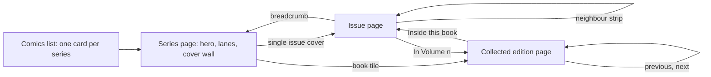

# Comic issue pages: every cover, every issue

The brief comes first, as written. The spec half follows it.

## Problem

A comic series shows one cover: the volume's. The public series page
(`/shelf/:id`) and the admin item page each render a single `cover_url`,
and the Covers view on `/shelf/comics` is one cover per series. The issues
themselves are cells in a grid: a number and a state, no cover and no
description.

Joey wants to see every book. In his words (11 Nov 2026): think of a
series as a core cover card in a list, and each issue has its own show
page, with its cover and its description.

## What is wanted

- The series stays the unit in lists: one cover card per series.
- Opening a series shows all of its issues with their covers.
- Each issue has its own page: cover, description, and whatever else is
  known about it (number, name, dates, owned / read / missing).

Decided by Joey on 11 Nov 2026:

- Issue pages are public, with the owner's controls shown only when
  signed in.
- Collected editions (trades, omnibuses) get the same treatment: their
  own cover, description and page.

Three directions were mocked up under `mockups:` (A Cover wall, B Contents,
C Browser). Joey chose the recommended blend, D: see the spec below.

## Relation to the series display spec

`2026-11-11-comic-series-display-design.md` (status `planned`, in the
`feat-llm-fallback-chain` worktree; chosen direction Lanes + Longbox)
redesigns the same series page and puts two things explicitly out of
scope: an issue table and per-issue cover art. This brief reverses both.
The mockups keep that spec's hero, lanes, bundles and mark language and
replace its cells with covers, so the two need to be planned together or
in order.

## What exists today (checked in the code, 11 Nov 2026)

- Comics are one `items` row per series; there is no issue table. The
  comics spec chose this on 2026-11-01 and names a per-issue table as "a
  later phase if the ranges prove too" limiting
  (`docs/planning/2026-11-01-comics-design.md`, line 57). This brief may
  be that phase, or may be served without a table: see Open questions.
- Comic Vine's issue list is stored per series in
  `source_metadata.issues`, but only the latest ten
  (`ISSUE_FETCH_LIMIT = 10` in `backend/sources/comicvine.py`), and
  CLAUDE.md describes it as kept for followed series. Joey follows 0
  series today, so no series has it right now.
- Each stored issue has `number`, `name`, `store_date`, `cover_date` and
  `cover_url`. There is no description: `ISSUE_FIELD_LIST` does not ask
  Comic Vine for one.
- The series page already has the issue grid (`IssueGrid`, `RunBar`) and
  the tap modes (Owned, Read to here, Skip) in the admin.

## Open questions raised by the brief

Carried into the spec's own list at the end.

- Data shape: an `issues` table, or the full issue list kept in
  `source_metadata.issues`? Issue pages need a stable address either way.
- Fetching every issue of every series, with descriptions: how many
  Comic Vine requests is that for the whole collection, and how does it
  sit inside Comic Vine's rate limits? (Not looked up for this brief.)
- Does `/api/public/comics` or the item endpoint pass issue covers
  through today? Not checked.
- Skips are private (`issues_skipped` never reaches a public output). An
  issue page must not reveal one.
- Issue routes need prerender heads and `render.yaml` handling like
  `/shelf/:id` (CLAUDE.md, link previews).
- Do collected editions carry a cover or a Comic Vine id of their own?

---

# Spec (design, 2026-11-11)

Everything above is the brief. This half is the design that answers it.
Code writes the plan.

## Problem

A comic series shows one cover, the volume's, and its issues are numbered
cells with no cover and no description. Joey wants to see every book he
owns or is missing: the series stays one cover card in a list, the series
page shows every book's cover, and each issue and each collected edition
has its own page with its cover and description.

## Scope

**In**

- The public series page: the box of cells becomes a wall of covers.
- A public page per issue.
- A public page per collected edition.
- The owner's controls on those two pages, shown only when signed in.
- Missing, not-out-yet and no-description states.

**Explicitly out**

- The Comics list and the series card. One cover card per series, as the
  series display spec draws it.
- The admin series edit (`AdminItem`). Its tap-to-edit cells stay as that
  spec defines them; whether they also become covers is a later question.
- Intake. A sitting still adds series and ranges.
- Variant covers, creator credits, story arcs, and per-issue ratings or
  notes.
- The pull list and Out this week.
- New tokens. None are needed.

## Design

**Chosen direction: D, "Cover wall + strip"**, A with one piece of B.
Mockup: `docs/planning/mockups/2026-11-11-comic-issue-pages/chosen.html`
(`index.html` there links every direction). The toolbar switches theme,
width (1280 and 400), screen, which run is drawn, and signed in. Sample
runs, dates and descriptions are illustrative; covers are coloured
placeholders standing in for Comic Vine art.

### Series page

The hero and lanes are the series display spec's, unchanged. The run card
below them is titled "Every book in the run" and holds the wall, in issue
order:

- **Book tile** for each collected edition: its cover on a stacked edge,
  captioned with the short label and range (`Vol. One · #1–6`), and
  `read to n` when partly read. Opens the edition page.
- **Cover tile** for each single issue not inside an edition: cover,
  `#n` and the in-stores month. Opens the issue page.
- **Missing stack** for 12 or more consecutive missing issues that no
  edition covers: one dashed tile (`#61–72 · 12 missing · Show covers`).
  A tap opens it into its cover tiles, with a "Fold these back up" tile
  first. Open state is per visit, not stored.
- **Not out yet**: one hatched tile for the next dated issue, with its
  number and date. It is not a link.
- Held books never fold. A fully owned 300-issue run is 300 covers.
- The key, as pills, under the wall.

An issue is drawn once: inside its book, or as a tile. The issues inside a
book are reached from the edition page.

Grid: `auto-fill` columns of at least 112px at desktop; three columns at
phone width.

### Issue page

- Breadcrumb: Comics / series / `#n`.
- **Neighbour strip**: up to four issues either side of this one, as small
  cover tiles with the same marks, this one outlined. It scrolls sideways
  and opens centred on the current issue. It includes the hatched
  not-out-yet tile when that is a neighbour. It replaces previous and next
  links.
- Cover (300px column at desktop; 62% width, centred, above the text on a
  phone). The cover is always shown in full colour here, missing or not.
- Kicker (series · publisher), `#n · name` (the name only when Comic Vine
  has one), a state pill, and for an issue inside a book a second pill
  linking to it (`In Volume Nine →`).
- Facts: Issue (`#55 of 72+`), In stores, Held as, Read.
  - Held as reads `Single issue`, `In Volume Nine (trade paperback)`,
    `In Volume Nine (trade paperback) and as a single, counted once`, or
    `Not owned`.
- Description from Comic Vine. A long one shows its first paragraph with
  "More". None: "Comic Vine has no description for this issue."
- Attribution line: "Cover and description from Comic Vine", linking to
  Comic Vine. Required by its terms, as on the collection page.
- **Signed in only**, in a dashed box labelled "Only you see these
  buttons.":
  - `I own this` / `Owned ✓`: toggles the issue in `issues_owned`.
  - `Read to here`: sets `read_to` to this issue.
  - `Skip · private`: only on an issue that is not held.
  - For an issue held only through an edition, the Owned button reads
    `I own this` and adds the single; the edition is edited on the series
    edit page (comics spec D6).

### Collected edition page

Same layout as the issue page, without the strip.

- Cover on a stacked edge.
- Kicker: kind and range (`Trade paperback · collects #1–6`). Title:
  series and label (`Saga, Volume One`). State pill.
- Facts: Collects, Format, Read (`All of it`, `To #n`, `Not yet`).
- Description.
- **Inside this book**: a strip of the collected issues' covers, each
  opening its issue page.
- Previous and next: the neighbouring editions; after the last edition,
  next is the first issue after it.
- Signed in: `Owned ✓`, `Read to the end`, `Edit edition` (to the series
  edit page).

### The mark language on covers

The series display spec's states, drawn on a cover instead of a cell.

| State | Cover tile | Pill | Never colour alone because |
|---|---|---|---|
| Read | frame `--chart`, tick badge top right | filled `--chart`, "Read ✓" | the tick |
| Owned | frame `--chart-2` | `--accent-soft`, "Owned" | solid frame, no tick |
| Missing | 1.5px dashed `--run-missing` frame, cover greyscale and dimmed | hollow, "Missing" | dashed frame and grey cover |
| Not out yet | `--hatch`, no cover, number on a `--surface` chip | hatch swatch, "Not out yet" | hatched |
| Skipped (signed in only) | as Missing, plus a dashed "Skipped · private" pill | dashed | labelled private |

Every tile is a link or button with an accessible name giving series,
number and state ("Saga #58, Missing"). A cover image inside a named tile
has empty alt text.

### Responsive and theme

- 1280: wall of about eight columns; issue page in two columns.
- 400: wall of three columns; issue page in one column, strip first, then
  cover, then text; no horizontal page scroll (the strip scrolls inside
  itself).
- Dark and light use the existing tokens only. The mockup's cover colours
  are placeholders, not tokens.

### Accessibility

- Nothing is hover-only; the frame highlight on hover also shows on focus.
- The strip is a labelled list ("Neighbouring issues"); the current issue
  is marked `aria-current`.
- The missing stack is a button with `aria-expanded`.
- The greyed missing cover is decoration; the state is in the tile's name
  and the pill.
- Skips never reach a public output, including the issue page's facts and
  the strip.

## Key decisions

- **D1: A wall of covers, not a list of rows.** B (Contents) showed
  descriptions inline but made covers thumbnails; the request was to see
  the covers. Descriptions live one tap away.
- **D2: One page per issue with its own address**, not a pane. C (Browser)
  was fastest on a desktop but its pane has no room on a phone, so it was
  two designs.
- **D3: The neighbour strip replaces previous and next.** It shows where
  you are in the run and what you hold either side, and one tap moves
  several issues.
- **D4: Missing stretches fold; held books never do.** Spawn's sample run
  would otherwise be 334 grey covers. The cost: a gap's covers take a tap
  to see.
- **D5: A missing issue still shows its cover**, greyed on the wall and in
  full colour on its page, so a gap looks like the book to look for.
- **D6: Editions get the same treatment as issues.** A series owned in
  trades would otherwise still show one cover. The cost: editions are
  typed by hand today and need matching to a Comic Vine record.
- **D7: This reverses two exclusions in the series display spec** (an
  issue table or its equivalent, and per-issue cover art). Its hero,
  lanes, bundling rule for missing stretches and mark language are kept.

## Component inventory

| Component | New or existing | Notes |
|---|---|---|
| Series hero and lanes | existing (series display spec) | unchanged |
| `CoverImage` | existing | used for every tile and both pages |
| `IssueGrid` on the public series page | replaced | by the cover wall; the admin keeps cells |
| Cover tile | new | cover, frame, tick, caption; three sizes (wall, strip, inside-book) |
| Book tile | new | cover tile on a stacked edge |
| Missing stack | new | the series display spec's bundle, for missing stretches only |
| Neighbour strip | new | issue page |
| State pill | new or shared with the series display spec's pills | four public states and Skipped |
| Issue page | new | |
| Edition page | new | |

Tokens used, all existing: `--chart`, `--chart-2`, `--accent-soft`,
`--accent-ink`, `--run-missing`, `--hatch`, `--surface`, `--sunken`,
`--line`, `--line-strong`, `--text`, `--text-2`, `--text-3`, `--accent`.

## Acceptance criteria

- The Comics list is unchanged: one card per series.
- A public series page shows a cover for every single issue I hold and
  every collected edition, in issue order.
- A stretch of 12 or more missing issues shows as one tile that opens into
  covers and folds back; a stretch of 11 shows 11 greyed covers.
- Every cover tile opens a page for that issue or edition with its own
  address, cover, facts and description, and a link back to the series.
- An issue with no Comic Vine description says so; nothing is left blank.
- The issue page's strip shows up to four neighbours each side, opens
  centred on the current issue, and moves to an issue on tap.
- An issue inside a book links to the book; the book's page lists the
  issues inside it.
- Signed out, no owner control, skip or Following state appears on either
  page or in the strip. Signed in, Owned and Read to here change the same
  `issues_owned` and `read_to` the series edit page does.
- The series, issue and edition pages match `chosen.html` at 400px and
  1280px, in dark and light, with no horizontal page scroll at 400px.
- Every tile has an accessible name with series, number and state.
- Comic Vine attribution appears on the issue and edition pages.

## Open questions for Code

- **Data shape.** An `issues` table, or the full issue list kept in
  `source_metadata.issues`? Issue pages need a stable address either way.
  A suggested address is the series page's plus the issue number; the
  route, prerender and `render.yaml` handling are Code's call (CLAUDE.md:
  shelf item paths are served only at the slash form).
- **Fetching.** Today `ISSUE_FETCH_LIMIT` is 10 and the list is kept for
  followed series only. This design needs every issue of every public
  series, with `description`. How many Comic Vine requests is that, how
  does it fit Comic Vine's rate limits (not looked up), and does it run at
  intake, nightly, or on first view?
- **Editions.** Do collected editions map to Comic Vine records that carry
  a cover and description? If not for some, what does the book tile show:
  the first collected issue's cover?
- **Public API.** Which endpoint carries per-issue data, and does
  `test_public_outputs.py` need new pins so skips cannot leak?
- **Missing covers.** What does a tile show when Comic Vine has no image
  for an issue?
- **Images.** Hundreds of covers on one page: lazy loading and the image
  size to request (Comic Vine offers several) are not specified here.
- **Order of work.** The series display spec is `planned` in the
  `feat-llm-fallback-chain` worktree. Build this after it, or fold the
  two series-page changes into one plan?
