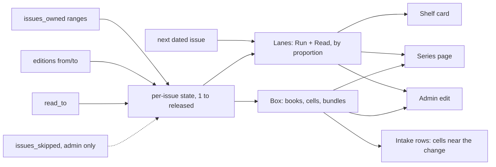

# Comic series display — design brief

## Problem

Comics are stored as **one row per series** (a Comic Vine volume), with the
issues I own kept as range text ("1–4, 7"), plus collected editions, how far
I've read, and whether I follow the series. The first real intake of comics
(Waterworld, four issues from four photos) showed that the way a series
looks — on the shelf, on its own page and in the admin — doesn't read well.
A series is not a single game or film, and the current cards and pages
mostly treat it like one with a run bar attached.

The goal is a design where a series reads as a *run*: what I own, what I've
read, what's missing, what's collected, and what's next. It should work
whether the series has 4 issues or 400.

## Constraints

- **Stack:** Vite + React 19, react-router v8. Plain CSS in
  `frontend/src/index.css`, with no framework.
- **Tokens only.** Every color is a CSS variable declared for both themes:
  dark values on `:root`, light under `[data-theme='light']`. Never use raw
  hex.
- **Measured contrast.** Non-text marks need 3:1 against what they sit on,
  and text needs 4.5:1. The ratios are recorded beside the tokens in
  `index.css`.
- **Existing run tokens:**
  - `--run-missing` (missing issues) measures 3.30 on `--surface` in dark
    and 3.25 in light.
  - `--hatch` (not out yet) is the second run token.
  - `--line-strong` was measured and refused, at 1.73 and 1.66.
  - Reuse these, or measure any replacement.
- **Nothing hover-only.** Anything shown on hover must also show on
  `:focus-within`. Named non-text marks get `role="img"`.
- **Phones and dark.** Design at 1280 and 400 wide. Dark is the brand
  default; light must work too.
- **Public versus private** (comics spec D5).
  - A series is public only when its row is public: owned and published,
    or a Want.
  - Following a series is private.
  - Skipped issues (`issues_skipped`), prices and stores are **never**
    public. The public design must not need them.
- **Shelf design system.** `/shelf` and `/admin/collection` share one design
  system:
  - `PosterCard`
  - `PosterGrid`
  - `FilterChips`
  - `SortControl`
  - `ShelfToolbar`
  - `Stars`
  - `QuickRate`
  - `ShelfCardActions`

  A card's admin controls are a sibling of its link, never nested inside
  it.
- **Data available per series** (`items` row, type `comic`):
  - `title`, cover, `creator`, release year
  - `issues_owned` (range text)
  - `read_to` (an issue number)
  - `editions` (`[{kind, label, from, to}]`, e.g. a trade collecting 1–6)
  - `shelf_format` (`comic_shelf_format`)
  - `following`, rating, status
  - Comic Vine's issue list per followed series, in
    `source_metadata.issues` (numbers and dates)

  **Not in scope:** an issue table. There is none, and adding one would be a
  separate decision. The design should work from ranges.

## Relevant files

- Spec this builds on: `docs/planning/2026-11-01-comics-design.md`
- Public comics shelf: `frontend/src/pages/Comics.jsx` (`/shelf/comics`)
- Series page (shared item page): `frontend/src/pages/Item.jsx`
- Admin series edit: `frontend/src/pages/AdminItem.jsx`
- Components:
  - `frontend/src/components/SeriesList.jsx`
  - `frontend/src/components/SeriesRow.jsx`
  - `frontend/src/components/RunBar.jsx`
  - `frontend/src/components/RunBadge.jsx`
  - `frontend/src/components/IssueGrid.jsx`
  - `frontend/src/components/PosterCard.jsx` (comic variant)
- Range logic:
  - `backend/comics.py`, the one range parser
  - `frontend/src/lib/comics.js`, which expands canonical text only
- Intake, which adds issues to series: `frontend/src/components/intake/`
  (Check, Details, Done)
- Repo conventions: root `CLAUDE.md`, the Conventions and Comics sections

## Open design questions

1. **Shelf card.** How does a series card differ from a game card at a
   glance: issue count, run bar, a stacked-cover look, or something else?
   And what does the card show for a 4-issue series compared with a
   400-issue one?
2. **Series page layout.** In what order do these appear: the run (owned,
   read, missing, not out yet), the collected editions, and what's next?
   Does the issue grid stay, and how does it scale to hundreds of issues?
3. **Owned versus read versus missing.** Is there one visual language that
   works on the card, the page and the admin? Can it avoid relying on color
   alone?
4. **Editions alongside single issues.** How does a trade collecting 1–6
   sit next to single issues 7–12 without looking like double counting?
5. **Admin editing.** Range text ("1–54, 60") is precise but unfriendly.
   Should owned and read be edited by tapping a grid, by typing, or both?
   And how does a skip (private) show only in the admin?
6. **Intake.** When a sitting adds issues to a series already on the shelf,
   how do Check and Done show that? Example: "Waterworld · adds #3, #4 to
   1–2".
7. **Empty and edge states:**
   - a series with no issues recorded yet
   - a Want with nothing owned
   - a finished or cancelled run
   - an ongoing run with future issues

## What "done" looks like for the design

- Mockups in `docs/planning/mockups/2026-11-11-comic-series-display/`, which
  is gitignored and stays out of git. Each should show:
  - the public shelf card
  - the public series page
  - the admin series edit
  - the intake Check and Done rows for "adds to an existing series"
- Each mockup at 1280 and 400 wide, in dark and light.
- At least one long run (100+ issues) and one short run (4 issues).
- Any new token named, with its measured contrast noted.
- The spec half of this doc filled in, with:
  - Problem
  - Scope (in and explicitly out)
  - Proposed solution
  - Key decisions and their tradeoffs
  - Open questions
- `status:` changed to `ready-for-plan`. Code then plans and builds from it.

---

# Spec (design, 2026-11-11)

Everything above is the brief as written. This half is the design that
answers it. Code writes the plan.

## Problem

A comic series is one `items` row, but it is not one object: it is a run of
issues held as collected editions, single issues or both, partly read, with
gaps, and sometimes still coming out. Today the shelf card, the series page
and the admin form treat it like a game with a run bar attached, and the
issue grid gives up past 300 issues. The first real intake (Waterworld, four
issues) showed that none of the three reads as a run.

## Scope

**In**

- The comic variant of the shelf card (`/shelf/comics` Covers view, and
  wherever `PosterCard` draws a comic).
- The public series page (`Item.jsx`, comic branch).
- The admin series edit (`AdminItem.jsx`, comic fields).
- The intake Check and Done rows for a sitting that adds issues to a series
  already on the shelf.
- One mark language for owned, read, missing, not out yet and skipped,
  shared by all four.
- Empty and edge states: no issues recorded, a Want, a finished run, an
  ongoing run.

**Explicitly out**

- An issue table. Everything derives from the ranges, `editions`, `read_to`
  and, for the next issue, `source_metadata.issues`.
- New tokens. None are needed (see Component inventory).
- The pull list, Out this week, and the Comics toolbar, chips and sort.
- Per-issue cover art, prices, stores, and anything else D5 keeps private.
- The game, movie and board game cards.
- The rest of the intake flow (Shoot, the uncertain-match step, Details).

## Design

**Chosen direction: D, "Lanes + Longbox"**, a blend of C and B.
Mockup: `docs/planning/mockups/2026-11-11-comic-series-display/chosen.html`
(`index.html` in the same folder links every direction). The mockup's
toolbar switches theme, width (1280 and 400), screen and which run is drawn.
Its sample runs are illustrative, not the real shelf.

The idea in one line: **lanes are the overview, the box is the detail.** The
lanes show the whole run at one fixed width whatever its length. The box
shows what is physically held, issue by issue where that is worth drawing.

### The mark language (all screens)

An issue is **held** when it is in `issues_owned` or an edition covers it.

| State | Lane mark | Cell or tile mark | Never colour alone because |
|---|---|---|---|
| Owned | filled, `--chart` | fill `--accent-soft`, border `--chart-2` (as today) | filled versus hollow |
| Read | a second, thinner lane under Run, `--text-2` | fill `--chart`, numeral `--accent-ink`, small tick | its own lane; solid fill plus tick |
| Missing | hollow, 1.5px `--run-missing` outline | hollow, `--run-missing` border | hollow |
| Not out yet | `--hatch` | `--hatch` | hatched |
| Skipped (admin only) | dashed `--run-missing` outline, own lane | dashed border, small × | dashed, labelled private |
| Added this sitting (intake only) | filled `--ok` | fill `--ok`, "+" before the number | "+" and the sentence beside it |

This changes one existing mark: the run bar draws missing as a solid
`--run-missing` fill today; it becomes hollow so owned and missing differ by
shape, not only by colour.

### Shelf card

- The cover sits on two offset edges (a stack), so a series reads as more
  than one book before any text. The edges are decorative.
- The cover itself carries only the status mark. `RunBadge` leaves the
  cover.
- Under the title: two lanes, Run (8px) over Read (3px), full card width.
- Line 1: `owned/released` (with `+` when ongoing), then the first of these
  that applies: `Next #n · date` when a dated next issue exists,
  `n missing`, `Up to date`, `Complete run`.
- Line 2: `read next: #n`, or `all read`.
- A run of 12 issues or fewer draws one block per issue in the Run lane, so
  a 4-issue series shows four blocks; longer runs draw by proportion.
- An ongoing run ends in a short hatched tail of fixed width. It says "more
  is coming", not how much.
- The Runs view row (`SeriesRow`) swaps its `RunBar` for the same two
  lanes. Nothing else in that row changes. This is not drawn in the mockup.

### Series page

Order, top to bottom:

1. **Hero**: kicker, title, status and stars, then `58 of 72+` with a state
   pill (`n missing`, `Up to date`, `Complete run`).
2. **What's next**, three tiles, inside the hero:
   - *Next to read*: the first held issue above `read_to`, with the edition
     it is in or the unread count. `All read` when there is none.
   - *First gap*: the first missing issue and the missing count. When there
     are no gaps, the run state instead.
   - *Next out*: the next dated issue. Shown only when the API returns one.
3. **The run** card:
   - Lanes: Run, Read, and an axis with tick labels. Skipped when the series
     has 12 issues or fewer, since the cells already show everything.
   - **In the box**, in issue order:
     - a **book tile** per collected edition (label, range, and `read to n`
       when partly read);
     - a **cell** per single issue;
     - a **bundle** for 12 or more consecutive issues in the same state that
       no edition covers (`#61–72 · 12 missing`);
     - one hatched cell for the next dated issue.
   - The key, then a sentence: "I own #1–57, 60 and have read to #54." That
     sentence is the text equivalent of the lanes and the box.
4. **Collected editions**, the list as today, with a note when issues are
   also owned as singles ("counted once").
5. About and the Comic Vine attribution, unchanged.

An issue is drawn once in the box: inside its book, or as a cell. An issue
held both ways is drawn in the book and counted once.

`ISSUE_GRID_CAP` goes away. Bundles are what keep a long run readable:
Spawn's sample run of 362 issues is 15 tiles.

### Admin series edit

- **The run** card leads the form. The lanes are a live preview and gain a
  Skipped lane, marked private.
- A labelled group of three toggle buttons sets what a tap does: **Owned**,
  **Read to here**, **Skip**.
- The box below it is the editor. Cells are buttons. A bundle opens into its
  cells. Book tiles are not tappable (comics spec D6); editions are edited
  as rows.
- Under the box, the typed fields stay and stay in step with the taps:
  *Single issues I own* (range text), *Read to* (number), *Skipped* (range
  text, marked private).
- **Collected editions** become rows (kind, label, from, to, remove) with
  an Add button, replacing the one-per-line textarea.
- Taps edit the form; Save commits, as the form does today. The server stays
  the one range parser (D7): a bad range shows the API's 422 message.

### Intake: adds to an existing series

- **Check** gains a group above the new series: "Already on the shelf · adds
  issues · n".
- Each row: checkbox, cover thumb, title, what was read from the photo, one
  sentence (`adds #3, #4 · 2 of 4 → 4 of 4` and the state pill), then the
  cells around the change: up to three before the first added issue and two
  after the last, an ellipsis cell where the run continues, and the added
  issues in `--ok` with a "+". An *Edit issues* action sits at the end.
- An issue that is already owned is a row with a disabled checkbox:
  "#60 is already on the shelf · nothing to add".
- **Done** adds two tiles ("2 series grew · 3 issues", "1 issue already
  owned") and a "Series that grew" list of the same rows, each title
  linking to its series page.

### Screens and states

| State | Card | Series page |
|---|---|---|
| No issues recorded | no lanes; "Issues not recorded" | no run card; a dashed box: "On the shelf, but which issues isn't recorded yet." |
| Want, nothing owned | no lanes; "n out · none owned" and the Want pill | a dashed box: "Nothing owned yet. n issues are out." |
| Finished, complete | full Run lane, no tail; "Complete run" | pill "Complete run"; no hatched cell |
| Finished, gaps | hollow stretches; "n missing" | First gap tile; missing cells or bundles |
| Ongoing, up to date | hatched tail; "Next #n · date" | pill "Up to date"; one hatched cell |
| Ongoing, gaps | hollow stretches and tail | all three tiles |
| Nothing read | empty Read lane; "read next: #1" | "none read yet" in the sentence |

### Interactions

- **Bundle** (public and admin): a button. A tap opens it into its cells,
  with a fold button as the first cell that closes it again. Open state is
  per visit, not stored.
- **Admin cell, Owned mode**: toggles the issue in `issues_owned`. Owning a
  skipped issue removes the skip.
- **Admin cell, Read to here**: sets `read_to` to that issue; tapping the
  current `read_to` moves it back one.
- **Admin cell, Skip**: toggles the issue in `issues_skipped`. Refused on a
  held issue, matching the pull list's rule.
- **Signed in on the public series page**: cells stay owned toggles as they
  are today. The three-mode control lives only in admin.
- Nothing appears on hover only. A book's range is printed on the tile, not
  left to a `title`.

### Responsive and theme

- 1280: the page-wide column. The admin form is two columns, the run card on
  the left.
- 400: the shelf grid is two cards wide; the hero cover shrinks and the
  What's next tiles stack; cells are ten to a row; the lane label column
  narrows; the admin form is one column; an intake row's *Edit issues* drops
  under the row.
- Dark and light use the same tokens. No raw colour anywhere.

### Accessibility

- The lanes are one `role="img"` with a name stating the facts: "58 of 72
  issues owned, 14 missing, series still coming out, read to number 54".
- On the public page the cells are decorative (`aria-hidden`); the sentence
  under the box carries the same information as text. Bundles are real
  buttons with `aria-expanded` and a name ("Issues 61 to 72, 12 missing.
  Show each issue").
- In admin every cell is a button named with its number and state ("Issue
  59, Missing"); the tap-mode control is a labelled group of
  `aria-pressed` buttons.
- A skip is never in the public DOM, in any form.
- Focus is visible on every button; bundles and cells keep focus when the
  box redraws.

**Contrast.** These are computed from the token values in `index.css` with
the WCAG formula, not measured in a browser. Code measures them again and
records them beside the tokens, as the convention asks.

| Mark | On | Dark | Light |
|---|---|---|---|
| Owned lane, `--chart` | `--bg` (card) | 7.15 | 5.93 |
| Owned lane, `--chart` | `--surface` (page) | 6.73 | 6.09 |
| Missing outline, `--run-missing` | `--bg` (card) | 3.50 | 3.17 |
| Missing outline, `--run-missing` | `--surface` | 3.30 | 3.25 |
| Read lane, `--text-2` | `--bg` / `--surface` | 9.06 / 8.53 | 8.03 / 8.24 |
| Added, `--ok` | `--surface` | 8.27 | 5.32 |
| "+n" numeral, `--bg` on `--ok` | | 8.78 | 5.18 |
| Read cell numeral, `--accent-ink` on `--chart` | | 7.15 | 6.09 |

Two marks in the mockup do not clear 3:1 and must not be relied on:

- The book tile's spine (`--text-2`) against a read book's `--chart` fill is
  1.27 dark, 1.35 light. The spine is decoration; the label and range are
  what make a tile a book. Keep it decorative or measure a replacement.
- The owned cell's `--chart-2` border against its own `--accent-soft` fill
  is 2.69 dark, 2.71 light. This is today's issue-grid style, and the border
  clears 3:1 against `--surface` (3.15, 3.10), which is the edge that
  matters.

The mockup also fades a bundle's second line with opacity. Do not: use
`--text-3` or the tile's own text colour at full strength.

## Key decisions

| Decision | Why | Tradeoff |
|---|---|---|
| Lanes for overview, box for detail | The lanes look the same at 4 issues and 362; the box shows the actual books and issues. | Two views of one run on the page. The lanes are skipped at 12 issues or fewer to avoid saying the same thing twice. |
| Read is a position, not a colour | Owned-but-unread is the gap between two lanes. | A second lane costs 5px on every card. |
| An edition is one tile | A trade is one object on the shelf, and an issue drawn once cannot be counted twice. | The page's Collected and Singles lanes from direction C are dropped; the box carries that. |
| Bundles at 12 or more, opening on tap | Keeps a long run to a screen while leaving every issue reachable. | A long run with big even stretches is mostly bundles until opened. |
| Missing becomes hollow | Owned versus missing by shape, not by a blue and a grey. | Changes the existing run bar's missing fill. |
| Tap and type in admin | Tapping suits one issue; typing suits `1–100`. | Two inputs to keep in step. |
| Skips dashed and admin only | Private by D5; visibly different from missing. | A skipped issue looks missing in public. That is already true today. |
| No new tokens | Every mark is built from measured tokens. | `--ok` gains a second meaning (added this sitting), in intake only. |
| No Following pill in the public design | The brief says following is private. | The current `SeriesRow` and public chips show it; see Open questions. |

**Rejected directions**

- **A, Ledger** (`a-ledger.html`): one bar and a table with a row per
  stretch of the run. Accurate and the most accessible, but it shows the
  least: no sense of the issues themselves. Its table survives as the
  sentence under the box.
- **B, Longbox** (`b-longbox.html`): books, cells and bundles with no
  overview. Good detail, but the card had the run printed on the cover's
  edge and a long run had no single picture. Its box and stacked cover are
  kept.
- **C, Lanes** (`c-lanes.html`): lanes only, with Collected and Singles as
  extra lanes. The clearest overview, but single issues in a long run
  shrink to slivers and no issue is ever individually visible. Its lanes,
  card lines and what's-next tiles are kept.

## Component inventory

**New**

- Run lanes: Run and Read on one axis, in a mini form (card, Runs row) and
  a full form with labels and axis ticks (page, admin, with the Skipped
  lane in admin).
- Run box: books, cells and bundles in issue order, in a read-only form and
  an editing form.
- What's next tiles for a series.
- Edition rows for the admin form.
- The tap-mode control.
- The intake "adds to a series" row and its near-cells strip.
- The stacked-cover treatment on the comic card.

**Existing, changed**

- `PosterCard` (comic variant): stack, lanes and two lines; no badge.
- `SeriesRow`: lanes in place of `RunBar`.
- `IssueGrid`: superseded by the run box; its cap goes.
- `RunBar` and `RunLegend`: superseded by the lanes and their key.
- `RunBadge`: no longer used on the cover.
- `ComicFields`: the run card, the tap-mode control, edition rows, and a
  Skipped field.
- `Item.jsx` comic branch (`ComicFacts`, `ComicCards`): reordered as above.
- Intake Check and Done.

**Existing, unchanged**

- `PosterGrid`, `FilterChips`, `SortControl`, `ShelfToolbar`, `Stars`,
  `QuickRate`, `ShelfCardActions`, `CoverImage`, the series pill.
- `lib/comics.js` `expandRanges`, `compactRanges`, `editionCoverage`.

**Tokens used** (all existing): `--chart`, `--chart-2`, `--accent-soft`,
`--accent-ink`, `--run-missing`, `--hatch`, `--text-2`, `--text-3`, `--ok`,
`--warn`, `--surface`, `--sunken`, `--bg`, `--line`, `--line-strong`.
**New tokens: none.**

## Acceptance criteria

1. The shelf card, series page, admin edit and intake rows match
   `chosen.html` at 400px and 1280px, in dark and in light.
2. A comic card shows a stacked cover, a Run lane and a Read lane, and no
   badge on the cover.
3. A series of 12 issues or fewer draws one Run block per issue on the card
   and no lanes on the series page.
4. A series of more than 300 issues renders its box (no fallback to a bar),
   and any 12 or more consecutive same-state issues outside an edition
   render as one bundle.
5. Activating a bundle shows its cells and a fold control; activating the
   fold control restores the bundle. Both work by keyboard, and
   `aria-expanded` reflects the state.
6. An issue covered by an edition and also in `issues_owned` is drawn once
   and counted once in every count on the page.
7. The series page shows, in order: hero with count and what's next, the
   run card, collected editions, about.
8. The Next out tile appears only when the API returns a dated next issue.
9. No public response and no public DOM contains a skip, a price or a
   store; the public design shows no Following pill.
10. In admin, with Owned selected, activating a missing cell adds that
    issue to the *Single issues I own* field, and the lanes and counts
    update before Save.
11. In admin, Skip on a held issue does nothing; a skipped issue shows a
    dashed cell and appears in the Skipped lane.
12. A book tile in admin is not a button.
13. A range the server refuses shows the API's 422 message beside the
    field, and the form keeps what was typed.
14. Each state in "Screens and states" renders as listed.
15. On intake Check, a sitting that reads issues of a series already on the
    shelf lists it under "Already on the shelf · adds issues" with the
    sentence and the near-cells strip; an already-owned issue is a disabled
    row.
16. On intake Done, the "Series that grew" list names each series and the
    issues added, and each title links to the series page.
17. Every non-text mark in the mark-language table is measured at 3:1 or
    better against what it sits on, every text at 4.5:1, and the ratios are
    recorded beside the tokens in `index.css`.
18. No raw hex is added to `index.css`; no new token is added.
19. Nothing is shown on hover that is not also shown on `:focus-within`.

## Open questions for Code

1. **Following in public.** The brief says following is private, but
   `SeriesRow` renders a Following pill from the public row and
   `COMIC_CHIPS` has a `following` chip. Which is right? The design assumes
   private, and shows a next issue's date only because the public detail
   already returns it.
2. **Intake components.** `frontend/src/components/intake/` is not in the
   main checkout, so the intake rows are designed against the
   `2026-11-10-intake` mockup. Does intake read issue numbers from a photo
   today, and does its commit report "issues added" and "already owned" per
   series? Done needs both.
3. **Skips on the item form.** `ComicFields` has no `issues_skipped` field;
   skips are set from the pull list. Does the item update route accept
   `issues_skipped`, and does it enforce "Skip refuses an owned issue"?
4. **Edition rows.** Editions are edited as text and parsed by
   `parseEditions`. Is `kind` a fixed list or free text, and can the rows
   reuse the same validation?
5. **Segments from the API.** The run bar draws `segments` from
   `comics.run_summary` and never re-derives the run. Should the lanes and
   box follow that (the API returns per-stretch state including editions
   and read), or derive in `lib/comics.js` from `owned_text`, `editions`
   and `read_to`? The public payload must not let skips be inferred.
6. **Ended and cancelled runs.** Nothing in the row says a run was
   cancelled, and an end year is not a stored field. Is "finished" simply
   not `ongoing`? The design shows no "Ended" tile unless the data exists.
7. **Worst-case box size.** A run that alternates owned and missing never
   bundles, so 400 issues is 400 cells. Is that acceptable to render, or
   does it need a ceiling?
8. **The signed-in toggle on the public page.** It saves each tap at once;
   admin saves on Save. Keep both behaviours, or make one?
9. **Tests.** `IssueGrid`, `RunBar` and `RunBadge` have tests that pin
   today's marks and the 300 cap; they change with this design.
