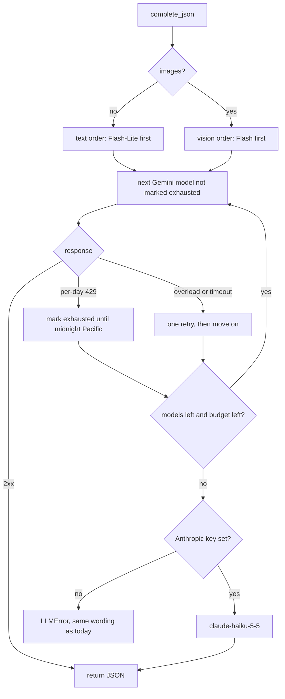

# A faster, longer free chain with a paid last resort (design)

Date: 2026-11-11 · Repo: joey-haas.dev · Touches the model seam in
`backend/llm.py` and nothing visible. No mockups: the only user-facing
surface is the failure wording the routes already show.

## Problem

Model calls time out and run out of daily quota, and both are getting worse
as features are added.

**Daily limit.** The Gemini chain is `gemini-3.7-flash`, `gemini-3.6-flash`,
`gemini-3.5-flash`. `llm.py` measured the free tier at 20 requests per day
per project per model, so the whole site has about 60 calls a day. Seven
call sites now share that: photo import, Discover picks, closet opinion,
closet tagging (batch and single match), closet Today ranking, and the
Denver spot finder.

**Timeouts.** Four things in the chain add latency before any answer:

- The first model is the one `llm.py`'s own comment calls "the most
  contended", and each model gets four attempts with 2s, 5s and 10s waits
  before the chain moves on.
- Nothing remembers that a model returned a per-day 429, so every later
  request asks it again first.
- No thinking level is set. Google's thinking page lists Flash models as
  "On (medium)" by default and says to lower the level "to reduce cost or
  latency".
- The chain is stale. Google's models page (updated 2026-10-28) lists
  `gemini-3.8-flash`, `gemini-3.6-flash`, `gemini-3.5-flash-lite` and
  `gemini-3.1-flash-lite` as stable, with `gemini-2.5-flash` and
  `gemini-2.5-flash-lite` still served. `gemini-3.7-flash` and
  `gemini-3.5-flash` are not on that page. No Flash-Lite model is in the
  chain.

**The paid path is all-or-nothing and overpriced.** `LLM_PROVIDER` picks
Gemini or Anthropic for every call. The Anthropic default is
`claude-haiku-4-5` at $1 / $5 per 1M tokens, marked "Active (legacy)".
`claude-haiku-5-5` is $0.10 / $0.50 for prompts up to 100K tokens and
accepts images.

## Scope

**In**

- A refreshed, longer Gemini chain that includes the Flash-Lite models.
- Chain order chosen per call: fast models first for text-only calls,
  stronger models first for calls with images.
- A lowered thinking level on Gemini requests.
- Skipping a model that returned a per-day 429 until its quota resets.
- Fewer overload retries per model before falling through.
- Anthropic as the last link of the chain when a key is set, on
  `claude-haiku-5-5`.
- Logging that shows which model answered and how long the chain took.

**Explicitly out**

- Turning on Gemini billing. It would end the free quota this design is
  built around.
- Any third provider (Groq, OpenRouter, DeepSeek, OpenAI). Groq's free
  models are text-only apart from one preview vision model at $0.80 / $4.00;
  the others add an adapter with no advantage over the Haiku overflow.
- Render's free-plan cold start (spins down after 15 minutes idle, about a
  minute to wake). Real, but a hosting decision, not a model one.
- Prompt, schema or UI changes at the seven call sites.
- Persisting quota state in Postgres.

## Design

One chain, walked in order, ending in a paid model only when the free ones
cannot answer.

**Chain contents.** Candidates, to be confirmed against the live API before
they ship: `gemini-3.8-flash`, `gemini-3.6-flash`, `gemini-3.5-flash-lite`,
`gemini-3.1-flash-lite`, `gemini-2.5-flash`, `gemini-2.5-flash-lite`. Keep
the existing rule that an alias sharing a quota bucket with a listed model
stays out. Drop any model the API no longer serves.

**Two orders, one list.** Text-only calls (Discover picks, closet opinion,
closet Today ranking, spot scoring) start with the Flash-Lite models: they
are the least contended and the task is ranking against a schema. Calls with
images (photo import, closet tagging) start with the full Flash models,
because reading titles off a photograph is where model quality shows. Both
orders contain every model, so either can fall all the way through.

**Thinking.** Set the lowest level each model accepts. The thinking page
lists `minimal, low, medium, high` for 3.6 Flash and 3.5 Flash-Lite, and
`low, medium, high` for 3.8 Flash. A level a model rejects must not fail the
request; the per-model value is part of the chain entry.

**Exhaustion memory.** A per-day 429 (the `PerDay` quota id `llm.py`
already parses) marks that model exhausted until the next midnight Pacific.
In-process memory is enough: the Render instance losing it on spin-down
costs one wasted request per model, which is today's behaviour. A per-minute
429 does not mark the model; it falls through for this request only.

**Retries.** One retry per model on overload or timeout, then move on. With
six models and a paid last link, moving on is cheaper than waiting. The
whole-chain budget (`TOTAL_BUDGET_SECONDS`) stays as the ceiling.

**Paid last link.** If `ANTHROPIC_API_KEY` is set, the chain ends with
`claude-haiku-5-5`, reached when every Gemini model is exhausted or
overloaded, or when the chain budget is spent with no answer. If the key is
not set, behaviour is as today. `LLM_PROVIDER=anthropic` keeps its meaning
(Anthropic only), now on Haiku 5.5.

**Failure wording.** The routes' `_failure_note` matches on `llm.py`'s
messages ("used up", "rate limit"). The messages a caller can see must keep
those phrases, and the per-day message should stop advising
`LLM_PROVIDER=anthropic` once the overflow exists.

**Responsive, theme, accessibility.** Not applicable; no markup changes.

## Key decisions

- **Free first, paid overflow, over paid everywhere.** Estimated cost of a
  text call on Haiku 5.5 is under a tenth of a cent (assuming about 3K
  tokens in, 1K out), so paid-everywhere would also be cheap. The overflow
  wins because it keeps the free quota and costs nothing on a normal day.
- **Rejected: enable Gemini billing.** Simplest change, no code. Lost
  because it replaces the free quota the per-model fallthrough exists to
  stretch.
- **Rejected: a third free provider.** Groq cannot serve the image calls on
  its free models. OpenRouter's free models allow 50 requests a day (1,000
  after a one-time $10) with no uptime guarantee. Each needs a new adapter
  and schema translation for less reliability than the Haiku link.
- **Rejected: persistent quota tracking.** A table of per-model counts
  would survive restarts, but the API already reports exhaustion and the
  cost of forgetting is one request.
- **Two orders over one.** A single Lite-first order would be simpler but
  would send photo import to the weakest models first.

## Component inventory

Existing, changed: the Gemini model list and its ordering, the Gemini
request body (thinking level), the retry loop, the 429 handling, the
provider factory (chain instead of either/or), the default Anthropic model,
the quota message text.

New: a per-model exhausted-until marker held in process; a chained provider
that tries Gemini then Anthropic behind the existing `LLMProvider` protocol.

Unchanged: the `complete_json` signature, the seven call sites, schemas,
prompts, env var names, `render.yaml`. No design tokens involved.

## Acceptance criteria

- A text-only call tries a Flash-Lite model first; a call with images tries
  a full Flash model first.
- A model that returns a per-day 429 is not requested again in the same
  process until after the next midnight Pacific.
- A per-minute 429 falls through to the next model without marking it.
- An overloaded or timed-out model is retried at most once before the chain
  moves on.
- Every Gemini request carries a thinking level, and no chain model rejects
  the level it is sent.
- With `ANTHROPIC_API_KEY` set and every Gemini model exhausted, the call
  returns a valid schema-conforming answer from `claude-haiku-5-5`, for both
  a text-only and an image call.
- With no Anthropic key, an exhausted chain raises an `LLMError` whose text
  still contains the phrase `_failure_note` matches for the per-day case.
- `LLM_PROVIDER=anthropic` still sends every call to Anthropic only.
- The chain never runs past `TOTAL_BUDGET_SECONDS` before either answering
  or handing off to the last link.
- One log line per call names the model that answered, the models skipped
  or failed, and the elapsed time.
- Existing `test_llm.py` behaviours that are not changed above still pass.

## Open questions for Code

- **Which models actually answer on the free tier, and with what daily
  quota?** Google publishes free-tier limits only in AI Studio. Probe each
  candidate and record the measured numbers the way `llm.py` already does.
- **Is `gemini-3.7-flash` still served?** It is absent from the models page.
  Same question for `gemini-3.5-flash`, which is on the pricing page only.
- **The thinking field for `generateContent`.** The thinking page documents
  only the Interactions API shape (`generation_config.thinking_level`).
  Confirm the `generateContent` equivalent from the API reference before
  writing it; do not guess it.
- **Does "minimal" hurt photo extraction?** Compare title detection on a
  few real shelf photos at the lowest level against the current default.
- **Do Flash-Lite models hold up on the ranking prompts?** Check Discover
  and closet Today output against a Flash answer for the same prompt.
- **Structured outputs on `claude-haiku-5-5`.** The models page confirms
  image input but does not mention `output_config.format`; verify it works
  as it does on 4.5.
- **Budget hand-off.** If Gemini spends the whole chain budget, how much
  time does the Anthropic call get, given callers such as closet opinion
  wrap the call in their own timeout?
- **Nightly job.** The closet Today job stops calling the model after its
  first failure (`budget["failed"]`). Decide whether a call answered by the
  paid link should count against anything there.

## Sources

- `backend/llm.py`, `backend/config.py`, `render.yaml`, and the seven
  `complete_json` call sites, read 2026-11-11.
- Gemini models: https://ai.google.dev/gemini-api/docs/models
- Gemini thinking: https://ai.google.dev/gemini-api/docs/thinking.md.txt
- Gemini pricing: https://ai.google.dev/gemini-api/docs/pricing
- Gemini rate limits: https://aistudio.google.com/docs/rate-limits
- Claude models: https://platform.claude.com/docs/en/about-claude/models/overview
- Claude Haiku 5.5: https://platform.claude.com/docs/en/models/haiku-5-5/overview
- Claude pricing: https://platform.claude.com/docs/en/about-claude/pricing
- Render free plan: https://render.com/docs/free
- Groq models and vision: https://console.groq.com/docs/models , https://console.groq.com/docs/vision
- OpenRouter limits: https://openrouter.ai/docs/api-reference/limits
