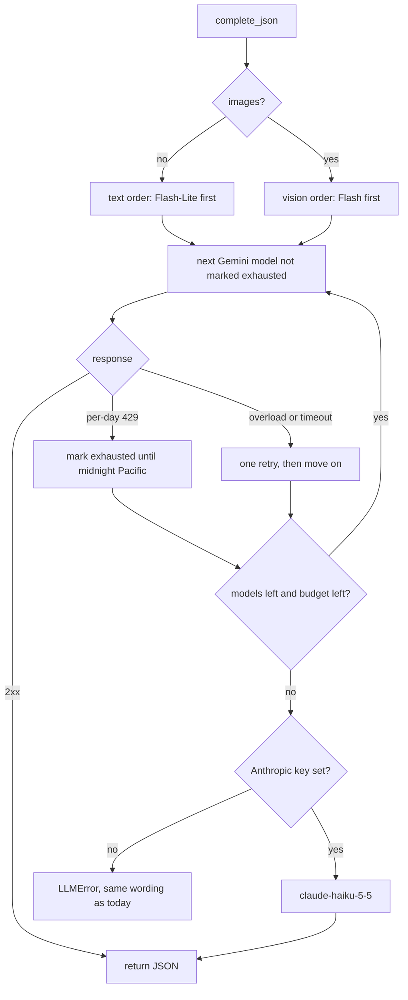

# A faster, longer free chain with a paid last resort (design)

Date: 2026-11-11 · Repo: joey-haas.dev · Touches the model seam in
`backend/llm.py` and nothing visible. No mockups: the only user-facing
surface is the failure wording the routes already show.

## Problem

Model calls time out and run out of daily quota, and both are getting worse
as features are added.

**Daily limit.** The Gemini chain is `gemini-3.7-flash`, `gemini-3.6-flash`,
`gemini-3.5-flash`. `llm.py` measured the free tier at 20 requests per day
per project per model, so the whole site has about 60 calls a day. Seven
call sites now share that: photo import, Discover picks, closet opinion,
closet tagging (batch and single match), closet Today ranking, and the
Denver spot finder.

**Timeouts.** Four things in the chain add latency before any answer:

- The first model is the one `llm.py`'s own comment calls "the most
  contended", and each model gets four attempts with 2s, 5s and 10s waits
  before the chain moves on.
- Nothing remembers that a model returned a per-day 429, so every later
  request asks it again first.
- No thinking level is set. Google's thinking page lists Flash models as
  "On (medium)" by default and says to lower the level "to reduce cost or
  latency".
- The chain is stale. Google's models page (updated 2026-10-28) lists
  `gemini-3.8-flash`, `gemini-3.6-flash`, `gemini-3.5-flash-lite` and
  `gemini-3.1-flash-lite` as stable, with `gemini-2.5-flash` and
  `gemini-2.5-flash-lite` still served. `gemini-3.7-flash` and
  `gemini-3.5-flash` are not on that page. No Flash-Lite model is in the
  chain.

**The paid path is all-or-nothing and overpriced.** `LLM_PROVIDER` picks
Gemini or Anthropic for every call. The Anthropic default is
`claude-haiku-4-5` at $1 / $5 per 1M tokens, marked "Active (legacy)".
`claude-haiku-5-5` is $0.10 / $0.50 for prompts up to 100K tokens and
accepts images.

## Scope

**In**

- A refreshed, longer Gemini chain that includes the Flash-Lite models.
- Chain order chosen per call: fast models first for text-only calls,
  stronger models first for calls with images.
- A lowered thinking level on Gemini requests.
- Skipping a model that returned a per-day 429 until its quota resets.
- Fewer overload retries per model before falling through.
- Anthropic as the last link of the chain when a key is set, on
  `claude-haiku-5-5`.
- Logging that shows which model answered and how long the chain took.

**Explicitly out**

- Turning on Gemini billing. It would end the free quota this design is
  built around.
- Any third provider (Groq, OpenRouter, DeepSeek, OpenAI). Groq's free
  models are text-only apart from one preview vision model at $0.80 / $4.00;
  the others add an adapter with no advantage over the Haiku overflow.
- Render's free-plan cold start (spins down after 15 minutes idle, about a
  minute to wake). Real, but a hosting decision, not a model one.
- Prompt, schema or UI changes at the seven call sites.
- Persisting quota state in Postgres.

## Design

One chain, walked in order, ending in a paid model only when the free ones
cannot answer.



**Chain contents.** Candidates, to be confirmed against the live API before
they ship: `gemini-3.8-flash`, `gemini-3.6-flash`, `gemini-3.5-flash-lite`,
`gemini-3.1-flash-lite`, `gemini-2.5-flash`, `gemini-2.5-flash-lite`. Keep
the existing rule that an alias sharing a quota bucket with a listed model
stays out. Drop any model the API no longer serves.

**Two orders, one list.** Text-only calls (Discover picks, closet opinion,
closet Today ranking, spot scoring) start with the Flash-Lite models: they
are the least contended and the task is ranking against a schema. Calls with
images (photo import, closet tagging) start with the full Flash models,
because reading titles off a photograph is where model quality shows. Both
orders contain every model, so either can fall all the way through.

**Thinking.** Set the lowest level each model accepts. The thinking page
lists `minimal, low, medium, high` for 3.6 Flash and 3.5 Flash-Lite, and
`low, medium, high` for 3.8 Flash. A level a model rejects must not fail the
request; the per-model value is part of the chain entry.

**Exhaustion memory.** A per-day 429 (the `PerDay` quota id `llm.py`
already parses) marks that model exhausted until the next midnight Pacific.
In-process memory is enough: the Render instance losing it on spin-down
costs one wasted request per model, which is today's behaviour. A per-minute
429 does not mark the model; it falls through for this request only.

**Retries.** One retry per model on overload or timeout, then move on. With
six models and a paid last link, moving on is cheaper than waiting. The
whole-chain budget (`TOTAL_BUDGET_SECONDS`) stays as the ceiling.

**Paid last link.** If `ANTHROPIC_API_KEY` is set, the chain ends with
`claude-haiku-5-5`, reached when every Gemini model is exhausted or
overloaded, or when the chain budget is spent with no answer. If the key is
not set, behaviour is as today. `LLM_PROVIDER=anthropic` keeps its meaning
(Anthropic only), now on Haiku 5.5.

**Failure wording.** The routes' `_failure_note` matches on `llm.py`'s
messages ("used up", "rate limit"). The messages a caller can see must keep
those phrases, and the per-day message should stop advising
`LLM_PROVIDER=anthropic` once the overflow exists.

**Responsive, theme, accessibility.** Not applicable; no markup changes.

## Key decisions

- **Free first, paid overflow, over paid everywhere.** Estimated cost of a
  text call on Haiku 5.5 is under a tenth of a cent (assuming about 3K
  tokens in, 1K out), so paid-everywhere would also be cheap. The overflow
  wins because it keeps the free quota and costs nothing on a normal day.
- **Rejected: enable Gemini billing.** Simplest change, no code. Lost
  because it replaces the free quota the per-model fallthrough exists to
  stretch.
- **Rejected: a third free provider.** Groq cannot serve the image calls on
  its free models. OpenRouter's free models allow 50 requests a day (1,000
  after a one-time $10) with no uptime guarantee. Each needs a new adapter
  and schema translation for less reliability than the Haiku link.
- **Rejected: persistent quota tracking.** A table of per-model counts
  would survive restarts, but the API already reports exhaustion and the
  cost of forgetting is one request.
- **Two orders over one.** A single Lite-first order would be simpler but
  would send photo import to the weakest models first.

## Component inventory

Existing, changed: the Gemini model list and its ordering, the Gemini
request body (thinking level), the retry loop, the 429 handling, the
provider factory (chain instead of either/or), the default Anthropic model,
the quota message text.

New: a per-model exhausted-until marker held in process; a chained provider
that tries Gemini then Anthropic behind the existing `LLMProvider` protocol.

Unchanged: the `complete_json` signature, the seven call sites, schemas,
prompts, env var names, `render.yaml`. No design tokens involved.

## Acceptance criteria

- A text-only call tries a Flash-Lite model first; a call with images tries
  a full Flash model first.
- A model that returns a per-day 429 is not requested again in the same
  process until after the next midnight Pacific.
- A per-minute 429 falls through to the next model without marking it.
- An overloaded or timed-out model is retried at most once before the chain
  moves on.
- Every Gemini request carries a thinking level, and no chain model rejects
  the level it is sent.
- With `ANTHROPIC_API_KEY` set and every Gemini model exhausted, the call
  returns a valid schema-conforming answer from `claude-haiku-5-5`, for both
  a text-only and an image call.
- With no Anthropic key, an exhausted chain raises an `LLMError` whose text
  still contains the phrase `_failure_note` matches for the per-day case.
- `LLM_PROVIDER=anthropic` still sends every call to Anthropic only.
- The chain never runs past `TOTAL_BUDGET_SECONDS` before either answering
  or handing off to the last link.
- One log line per call names the model that answered, the models skipped
  or failed, and the elapsed time.
- Existing `test_llm.py` behaviours that are not changed above still pass.

## Open questions for Code

- **Which models actually answer on the free tier, and with what daily
  quota?** Google publishes free-tier limits only in AI Studio. Probe each
  candidate and record the measured numbers the way `llm.py` already does.
- **Is `gemini-3.7-flash` still served?** It is absent from the models page.
  Same question for `gemini-3.5-flash`, which is on the pricing page only.
- **The thinking field for `generateContent`.** The thinking page documents
  only the Interactions API shape (`generation_config.thinking_level`).
  Confirm the `generateContent` equivalent from the API reference before
  writing it; do not guess it.
- **Does "minimal" hurt photo extraction?** Compare title detection on a
  few real shelf photos at the lowest level against the current default.
- **Do Flash-Lite models hold up on the ranking prompts?** Check Discover
  and closet Today output against a Flash answer for the same prompt.
- **Structured outputs on `claude-haiku-5-5`.** The models page confirms
  image input but does not mention `output_config.format`; verify it works
  as it does on 4.5.
- **Budget hand-off.** If Gemini spends the whole chain budget, how much
  time does the Anthropic call get, given callers such as closet opinion
  wrap the call in their own timeout?
- **Nightly job.** The closet Today job stops calling the model after its
  first failure (`budget["failed"]`). Decide whether a call answered by the
  paid link should count against anything there.

## Sources

- `backend/llm.py`, `backend/config.py`, `render.yaml`, and the seven
  `complete_json` call sites, read 2026-11-11.
- Gemini models: https://ai.google.dev/gemini-api/docs/models
- Gemini thinking: https://ai.google.dev/gemini-api/docs/thinking.md.txt
- Gemini pricing: https://ai.google.dev/gemini-api/docs/pricing
- Gemini rate limits: https://aistudio.google.com/docs/rate-limits
- Claude models: https://platform.claude.com/docs/en/about-claude/models/overview
- Claude Haiku 5.5: https://platform.claude.com/docs/en/models/haiku-5-5/overview
- Claude pricing: https://platform.claude.com/docs/en/about-claude/pricing
- Render free plan: https://render.com/docs/free
- Groq models and vision: https://console.groq.com/docs/models , https://console.groq.com/docs/vision
- OpenRouter limits: https://openrouter.ai/docs/api-reference/limits

---

# Plan

Written 2026-11-11 by Code. The spec above stands except where
"Research findings" says otherwise.

## Research findings (answers to "Open questions for Code")

| Question | Answer | Source |
|---|---|---|
| Thinking field on `generateContent` | `generationConfig.thinkingConfig.thinkingLevel`, enum `MINIMAL`, `LOW`, `MEDIUM`, `HIGH` (send uppercase, the documented enum). The reference says using it on pre-Gemini-3 models "results in an error". | https://aistudio.google.com/api-reference/generate-content |
| Levels per model | 3.8 Flash: low/medium/high. 3.6 Flash, 3.5 Flash-Lite, 3.1 Flash-Lite: minimal and up (Flash-Lite already defaults to minimal). 2.5 models: listed with levels, but see the row above. | https://aistudio.google.com/docs/thinking |
| 2.5 thinking budget | Not documented: no `thinkingBudget` range, minimum, or "0 = off". | same pages |
| `thinkingLevel` + `responseSchema` | No documented conflict and no documented support. Confirmed only by the probe (task 1). | https://aistudio.google.com/docs/structured-output |
| Haiku 5.5 structured outputs | GA via `output_config.format`, no beta header. Images supported. $0.10 / $0.50 per 1M up to 100K-token prompts. Schemas must keep `additionalProperties: false` and use no min/max constraints (true of today's schemas, which already run on Haiku 4.5). | https://platform.claude.com/docs/en/build-with-claude/structured-outputs , https://platform.claude.com/docs/en/models/haiku-5-5/overview |
| Free-tier daily quota per model | Not published. The 429 body carries `violations[].quotaValue` in practice, which comes from third-party logs, not Google docs. The probe reads it when present; otherwise `FREE_TIER_DAILY_REQUESTS = 20` stays. | https://aistudio.google.com/docs/rate-limits ; forum logs linked in research notes |
| Which models are served | **Not yet checked.** The live `models.list` probe is task 1 and needs Joey's OK to run with the real key. | — |

**What the code already does (found while planning, not in the spec):**

- Overload retries are already down to one attempt per model, except the
  last model, which still backs off 2s/5s/10s (`llm.py`, commit 1c3c2be).
  The "Fewer retries" change is therefore small: the last Gemini link gets at
  most one retry, and none when the paid link follows it.
- There is an eighth call site, the intake reader (`intake/reader.py`,
  `intake/nightly.py`, `intake/routes.py`). It is unchanged, like the other
  seven.
- `intake/budget.UsageRecorder` already writes every attempt and every
  per-day 429 to `llm_usage` in Postgres. `budget.remaining()` computes the
  reader's daily allowance as `20 × len(GEMINI_MODELS)` minus a reserve of 12.
  A six-model chain raises that from 48 to 108. That is correct only if every
  new model really has 20 a day, so task 1's quota readings feed it.

## Decisions taken while planning

- **D1: Thinking for the 2.5 models.** Each chain entry carries its own
  `thinkingConfig` or `None`. The 3.x entries get the lowest accepted
  level (`MINIMAL`, or `LOW` for 3.8 Flash). The 2.5 entries get `None`
  (model default) unless the probe shows a `thinkingBudget` value they
  accept. As a safety net, a 400 whose message names thinking is retried
  once on the same model without `thinkingConfig`, and logged at WARNING so
  a bad entry gets noticed. *Deviation:* the AC "every Gemini request
  carries a thinking level" becomes "every 3.x request does", because the
  docs say the field breaks 2.5.
- **D2: Exhaustion memory is in-process,** as the spec says: a module-level
  `{model: exhausted_until}` dict. The existing Postgres recorder keeps
  writing as it does today. Reading it back on each call would be a DB round
  trip per model call, and the spec ruled out persisted quota state.
  `_next_pacific_midnight` moves from `intake/budget.py` into `llm.py`
  (budget already imports `llm`, so the dependency points that way) and
  budget re-imports it.
- **D3: Budget hand-off.** The whole-call ceiling stays at
  `TOTAL_BUDGET_SECONDS = 150`. When the paid link exists, Gemini's share is
  `150 − ANTHROPIC_RESERVE_SECONDS (60)` = 90s, and Haiku gets whatever is
  left, at least 60s. That is well inside the tightest caller wrapper
  (closet opinion `OPINION_BUDGET_S = 240`; the nightly Today job's
  `JOB_MODEL_BUDGET_S = 200` is per run, not per call). Without a key,
  Gemini keeps the full 150s.
- **D4: Nightly job.** An answer from Haiku is a success and does not set
  `budget["failed"]`. No change. Worst case, a nightly run with Gemini
  exhausted costs a few tenths of a cent.
- **D5: Orders** (pending the probe, which may drop models):
  - text: `3.5-flash-lite`, `3.1-flash-lite`, `2.5-flash-lite`,
    `3.6-flash`, `3.8-flash`, `2.5-flash`
  - vision: `3.6-flash`, `3.8-flash`, `2.5-flash`, `3.5-flash-lite`,
    `3.1-flash-lite`, `2.5-flash-lite`

  3.6 goes before 3.8 for vision because 3.6 is measured healthy on photos.
  3.8 is new and, like 3.7 was, likely the most contended. A pinned model
  (`GeminiProvider(model=...)`) still means a chain of one.
- **D6: Provider shape.** `GeminiProvider` keeps the Gemini walk.
  `ChainedProvider(gemini, anthropic)` implements `LLMProvider`: it calls
  Gemini with the reduced budget, and on an `LLMError` that is a
  quota/overload/timeout/budget failure it calls Anthropic. A 400 or a bad
  key is not handed off, because it fails identically on the paid link's
  schema. `build_provider`:
  - `gemini`, no Anthropic key → `GeminiProvider` (as today)
  - `gemini` + Anthropic key → `ChainedProvider`
  - `anthropic` → `AnthropicProvider` on `claude-haiku-5-5`
- **D7: Wording.** The per-day message keeps "per day" and "used up".
  - Its suffix becomes "It resets at midnight Pacific." with no key set,
    and the error is never shown when a key is set, since Haiku answers.
  - If Haiku itself fails after Gemini ran out, the raised error keeps the
    Anthropic SDK's "Error code: …" text, which `_failure_note` already
    reads, prefixed with "Gemini unavailable; ".
- **D8: Logging.** One INFO line per `complete_json`:
  `llm answered by <model> in <s>s (images=<n>); skipped: a(exhausted),
  b(503), c(timeout)`, or `llm failed in <s>s; …` on failure. The
  per-attempt lines move to DEBUG.

## Tasks

All in `backend/`. TDD per task: write the failing test, make it pass, run
`./.venv/bin/pytest tests/test_llm.py` (full suite at the finish gate; one
run at a time, per repo CLAUDE.md). Nothing is parallel-safe: tasks 2–6 all
edit `llm.py`.

1. **Probe script.** `scripts/probe_llm_chain.py` plus a
   `scripts/README.md` entry. It loads `Config` the way
   `record_intake_demo.py` does and calls `models.list`, which uses no
   quota. For each candidate model, it sends one tiny text request with the
   planned `thinkingConfig` and a one-field `responseSchema`, then prints
   the status, the thinking-level acceptance, `quotaId` and `quotaValue` on
   a 429, and the latency. It never prints the key.
   *AC:* the script runs offline in a test with a fake client; it prints a
   per-model table.
   **Joey runs it, or OKs me running it.** It reads the real key and costs
   one request per model from today's free quota. Its output fixes
   `GEMINI_CHAIN`, D1's 2.5 values, and `FREE_TIER_DAILY_REQUESTS`.
   *Tests:* `tests/test_probe_llm_chain.py`.
2. **Chain table and orders.** Replace `GEMINI_MODELS` with a `ChainModel`
   dataclass tuple (`name`, `tier` = lite|flash, `thinking: dict | None`),
   plus `text_order()` and `vision_order()`. Keep `GEMINI_MODELS` as the
   tuple of names for `intake/budget.py` and the tests that import it.
   *AC:* text-only starts on a Flash-Lite model, images start on a Flash
   model, and both orders hold every model.
   *Tests:* new ordering tests; existing tests reworked from the 3-model
   chain to fixtures that set the chain explicitly.
3. **Thinking in the body.** `_build_body(…, model)` adds
   `generationConfig.thinkingConfig` from the entry. A 400 that names
   thinking is retried once on that model without it.
   *AC:* a 3.x body carries the level and a `None` entry carries none; the
   400 retry works and is logged.
   *Tests:* body tests, plus a fake 400 "thinking" response.
4. **Exhaustion memory.** Module-level `_exhausted_until`. A per-day 429
   sets it to the next midnight Pacific (`_next_pacific_midnight` moves here
   from `intake/budget.py`). The walk skips marked models. A per-minute 429
   only falls through. Add an injectable clock and a `reset_exhaustion()`
   for tests.
   *AC:* the spec's two 429 ACs; a model is asked again after midnight
   Pacific.
   *Tests:* clocked tests in `test_llm.py`; `test_intake_budget.py` still
   green.
5. **Retries and budget parameter.** The last Gemini model gets at most one
   retry (0 when a paid link follows). `complete_json` takes an optional
   `budget_seconds` (default `TOTAL_BUDGET_SECONDS`).
   *AC:* at most two attempts per model; the share arithmetic is unchanged
   under the new budget.
   *Tests:* update `test_a_transient_503_is_retried_and_can_succeed` and
   the overload-everywhere tests; add one for a 90s budget.
6. **Paid last link.** `DEFAULT_ANTHROPIC_MODEL = "claude-haiku-5-5"`, add
   `ChainedProvider` and the `build_provider` matrix (D6), plus the wording
   from D7.
   *AC:* the spec's Anthropic ACs (text and image hand-off, no-key wording,
   `LLM_PROVIDER=anthropic` stays Anthropic-only, nothing runs past 150s);
   a 400 is not handed off.
   *Tests:* fake Gemini that exhausts everything, plus a fake
   `AnthropicProvider`; `build_provider` matrix tests; a `_failure_note`
   round-trip test for each raised message.
7. **One log line per call** (D8).
   *AC:* exactly one INFO line per `complete_json` from `llm`, naming the
   answering model, the skipped/failed models and the elapsed time.
   *Tests:* `caplog` tests on success, fall-through, hand-off and total
   failure.
8. **Budget and docs consistency.**
   - Check that `intake/budget.remaining()` is still right for the new
     `GEMINI_MODELS`, using the probe's per-model quota. If quotas differ
     per model, add a per-model dict in `llm.py` and have `remaining()` use
     it.
   - Update `llm.py`'s module docstring and the chain comment with the
     measured facts.
   *Tests:* `test_intake_budget.py` with the new model count.
9. **(carve-out) `render.yaml` comment.** Change "Used only when
   LLM_PROVIDER is anthropic." to say the key also enables the paid
   overflow. This is a comment only and changes no infrastructure, but any
   push to `main` that touches `render.yaml` re-applies the Blueprint.

## Milestones

```
Milestone 1 (auto): task 1, code and tests only
STOP: Joey runs the probe (or OKs me running it) and I record its output
Milestone 2 (auto): tasks 2–8
STOP: carve-out review (render.yaml)
Milestone 3 (auto): task 9
Finish gate → PR
```

If Joey prefers to leave `render.yaml` alone, task 9 is dropped, and the
stale comment is noted in the PR.

## Environment test section

- **Unit:** `cd backend && ./.venv/bin/pytest`, the full suite, once,
  green. The worktree needs its own `.venv` (Python 3.12) or must use the
  main checkout's; to be decided at execution.
- **Live smoke (local, needs real keys, Joey's OK):**
  1. Run the probe script and confirm every chain model returns 200 with
     its thinking config.
  2. Run Discover and closet Today locally and compare Flash-Lite output
     with a pinned 3.6 Flash answer for the same prompt. This answers the
     Flash-Lite ranking question.
  3. Run one shelf photo through intake with `MINIMAL` versus the default
     on 3.6 Flash and compare the detected titles. This answers the photo
     extraction question.
  4. Force the hand-off by marking every model exhausted in a REPL
     (`_exhausted_until`), then run one text and one image call and confirm
     Haiku answers with schema-valid JSON.
- **Post-deploy:** `./scripts/smoke.sh https://joey-haas.dev
  https://api.joey-haas.dev`, then read the Render log for the new
  one-line-per-call entries.
- **Rollback:** unset `ANTHROPIC_API_KEY` on Render to drop the paid link
  without a deploy; revert the PR to restore the old chain.
