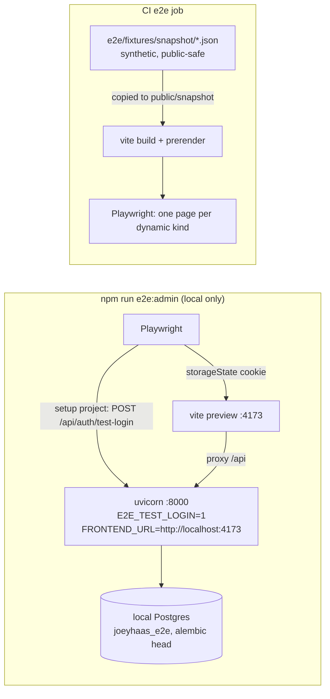

# Browser tests for admin pages and dynamic routes (#205) — design and plan

Follow-up to `2026-11-12-playwright-e2e-design.md`, which covers the public static routes only
(its lines 34-36 defer admin and the dynamic routes to this work).

## Problem

Nothing in a browser covers `/admin*`, and nothing covers the dynamic public routes:
`/shelf/<id>/`, `/shelf/year/<y>/`, `/shelf/journal/<m>/`, comic issues and editions. Admin pages
are where most of the code is, and every check today runs on the static pages only. Admin sign-in
is Google OIDC (`backend/auth.py`), so a browser test cannot sign in without a real Google
account.

Acceptance, from the issue: `npm run e2e` covers every admin area's main page locally, and CI
covers one page of each dynamic kind.

## Scope

In:
- A local-only test sign-in route behind an env flag. Joey approved this on 2026-11-12.
- A Playwright admin suite run against a real local backend and a dedicated local database.
- A synthetic fixture snapshot, so CI builds and tests one page of each dynamic kind.

Out:
- `toHaveScreenshot` baselines. The issue says "once layouts settle", and #213 is still open.
- Running the admin suite in CI. The acceptance says locally. Adding a Postgres service to the
  e2e job is a follow-up issue.
- Seeding rich admin data. Admin pages are tested on an empty, migrated database: heading,
  no console errors, axe.

## Solution

### Architecture decision

Options:
- **A. Test sign-in route on the backend.** `POST /api/auth/test-login` sets the normal session
  for the configured admin. The route is mounted only when `E2E_TEST_LOGIN=1`, and config refuses
  to boot with that flag unless `FRONTEND_URL` is `http://localhost…`.
- **B. Mint the cookie in Playwright.** Reimplement Starlette's itsdangerous session signing in
  Node with `SESSION_SECRET`. No backend change, but it couples the tests to Starlette's cookie
  format (pinned at 1.10.0) and puts the session secret in the test environment.
- **C. Mock every `/api` call in Playwright.** No backend and no auth change, and it would run in
  CI. But it tests the UI against hand-written responses, not the API, and the mocks drift.

Chosen: **A**, because:
- Joey approved it.
- It goes through the real session middleware, `session_admin` and `require_admin`.
- The bypass is guarded twice: the router is absent unless the flag is set, and config refuses
  the flag on a non-localhost `FRONTEND_URL`.
- A backend test pins that the route is absent by default. That follows `test_job_token.py`,
  where the point of the test is that an auth route cannot appear unnoticed.

Gives up:
- Admin coverage in CI, for now.
- The OIDC callback itself stays untested in a browser. `test_auth.py` covers it with a mocked
  token exchange.

Hard to undo: nothing. No migration, no public URL and no production env change. The flag is
never set on Render.

Ship path: no migration. Two new local-only env vars, `E2E_TEST_LOGIN` and the e2e database URL;
neither is set on Render. CI gains a fixture copy step in the e2e job. Needs `/security-review`.

Sources:
- `backend/auth.py:56-81` and `:90-155`, `backend/items.py:455-475` (`require_admin`),
  `backend/config.py:19-27` and `:93-108`, `backend/origin_check.py`, `backend/main.py:43-98`.
- `backend/tests/conftest.py:24-67`: it drops every table per test, so e2e needs its own
  database. `backend/tests/test_job_token.py`.
- `frontend/playwright.config.js`, `frontend/e2e/fixtures.js:25-30`,
  `frontend/vite.config.js:30-36`, `.github/workflows/ci.yml`.
- Playwright 1.64.1, auth with a setup project and storageState: https://playwright.dev/docs/auth
- Multiple webServers: https://playwright.dev/docs/test-webserver
- Vite: `preview.proxy` defaults to `server.proxy`: https://vite.dev/config/preview-options

### Decisions (my call, auto mode)

- The test sign-in uses the configured `ADMIN_EMAIL`, and `ADMIN_GOOGLE_SUB` when it is set, so
  `session_admin` re-checks it like any real session. It takes no request body, so it cannot
  sign in as anyone else.
- The flag needs both `E2E_TEST_LOGIN=1` and a localhost `FRONTEND_URL`. Either check alone is
  one typo away from production.
- The e2e database is `joeyhaas_e2e` on the local Postgres. A setup script creates it if it is
  missing and runs `alembic upgrade head`. It is never the pytest database.
- The fixture snapshot is synthetic: invented titles, no real collection data. It is the smallest
  set that prerenders one page of each dynamic kind.

## Open questions

None blocking. Running the admin suite in CI becomes a follow-up issue.

## Smoke check

Production: `smoke.sh` passes, and `POST https://api.joey-haas.dev/api/auth/test-login` returns
404 (add this check to `smoke.sh`).

## Plan

Each task: the relevant tests, the formatter and the linter pass before its commit. Backend:
`cd backend && ./.venv/bin/ruff format --check . && ./.venv/bin/ruff check . && ./.venv/bin/pytest -q`,
run one at a time. Frontend: `npm test`, `npm run lint`, `npm run format:check`.

### Task 1: the test sign-in route (backend)
- `config.py`: add an optional `e2e_test_login: bool` from `E2E_TEST_LOGIN` (only `"1"` counts).
  Raise at load when it is true and `FRONTEND_URL` does not start with `http://localhost`.
- New `backend/e2e_login.py` (APIRouter, documented): `POST /api/auth/test-login` writes
  `request.session["user"] = {"sub": <ADMIN_GOOGLE_SUB or "e2e">, "email": ADMIN_EMAIL}` and
  returns 204. `main.py` includes the router only when `config.e2e_test_login` is set.
- Tests:
  - With the flag off, the route answers 404 (the app is built as in production).
  - With it on and a localhost URL, it signs in, and a `require_admin` route then answers 200.
  - Config raises for the flag with a non-localhost `FRONTEND_URL`.
  - `"true"` and `"0"` do not enable it.
- README → Admin authentication: a short "Test sign-in (local only)" paragraph. Add
  `E2E_TEST_LOGIN` to `backend/env.example`, commented and off.
- `scripts/smoke.sh`: add a check that `POST $API/api/auth/test-login` answers 404.

### Task 2: the local admin suite (frontend)
- `frontend/scripts/e2e-admin-db.mjs`, or a shell script under `backend/scripts/`: create
  database `joeyhaas_e2e` if it is missing (via `psql` or `createdb` against the local Postgres
  the README describes), then `alembic upgrade head` with `DATABASE_URL_DIRECT` pointing at it.
- `frontend/playwright.admin.config.js`:
  - webServer array: uvicorn from `../backend/.venv/bin/uvicorn main:app --port 8000`, with env
    for all seven required variables (dummy Google values, a random `SESSION_SECRET`, an
    `ADMIN_EMAIL`, `FRONTEND_URL=http://localhost:4173`, both DB URLs on `joeyhaas_e2e`) plus
    `E2E_TEST_LOGIN=1`; and `npm run preview -- --port 4173 --strictPort`. Health URL
    `/api/public/status`.
  - A `setup` project (`e2e/admin.setup.js`) that POSTs test-login through the page origin and
    saves storageState. The desktop and phone projects depend on it.
  - `/api/track` is aborted. `/api/**` is not aborted here.
- `e2e/admin.spec.js`: for every admin area's main page, taken from `ADMIN_AREAS` in
  `src/components/adminAreas.js` (no second list), check the `AdminPageHeader` h1 renders, there
  are no console errors beyond known API-empty noise, and axe has no new serious or critical
  violations. Use `known-a11y.js`'s mechanism for any accepted ones, each with an issue number.
  Also check that signing out returns to the signed-out admin page.
- `package.json`: `"e2e:admin"` runs the db script, then
  `playwright test -c playwright.admin.config.js`. `npm run e2e` itself does not change, so CI
  stays green without Postgres.
- README → Browser tests: how to run it, and what it needs (local Postgres per README → Tests,
  backend venv, a build).
- Model: Sonnet. If the webServer and cookie flow (Secure on localhost, the proxy) fights back
  past three rounds, escalate to Opus per the agents rule.

### Task 3: dynamic routes in CI from a fixture snapshot
- `frontend/e2e/fixtures/snapshot/`: synthetic JSON in the shapes `fetch-snapshot.mjs` writes.
  Copy the shape from the code and tests, not from real data. Include one game (with a
  finished date in a year and a journal month), one comic series with issues and an edition, and
  whatever `next.json`, `status.json` and `meta.json` the build needs. Invented titles only.
- Make the build use it: check what `fetch-snapshot.mjs` does with no API URL. If it leaves
  `public/snapshot` alone, CI copies the fixture there before `npm run build`. Otherwise add a
  `SNAPSHOT_FIXTURE_DIR` input that it copies from. Prefer the smaller change.
- `e2e/dynamic.spec.js`: pick one URL per dynamic kind from `dist/sitemap.xml` (the
  `playwright.shots.config.js` sampler has this logic; reuse it, moving it to a shared module if
  needed). Check the h1, no console errors, and axe. Add it to `playwright.config.js`'s
  `testMatch`, skipping when the sitemap has no such URL. Locally a normal build has data, so it
  runs there too.
- `.github/workflows/ci.yml` e2e job: the fixture copy step before the build.
- Changelog: none. This is test infrastructure with no visible change.

### Finish
Preflight: backend lint, format and pytest; frontend test, lint, format, build and `npm run e2e`;
and `npm run e2e:admin` locally. Then the whole-branch review (Opus), `/code-review high` and
`/security-review` (auth is touched). Add the `decision` entry to `docs/learnings.md`. Open a
follow-up issue for the admin suite in CI.

Ship notes: no migration. Two local-only env vars, never set on Render. Smoke gains the
test-login 404 check.
