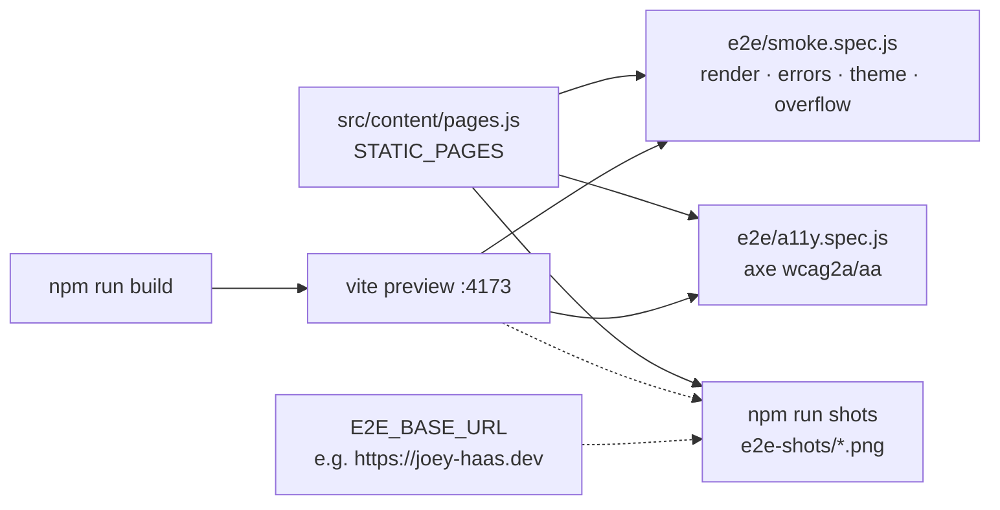

# Browser tests with Playwright (design)

Branch `feat/playwright-e2e`. Plan: `2026-11-12-playwright-e2e-plan.md`.

## Problem

Nothing renders the site in a real browser before it ships. Vitest runs components in jsdom (no
layout, no computed styles, so axe runs with `color-contrast` off: `src/lib/axe.test-util.js`),
and `scripts/smoke.sh` is curl against production after the deploy. Render deploys `main`
straight to production with no staging, so a layout break, a theme bug or a page that throws on
load reaches visitors first. Reviews of the site have also depended on a connected desktop
Chrome; with that unavailable there is no way to look at the site at all.

## Scope

In:

- `@playwright/test` in `frontend/` with a route smoke suite: every static public route, in both
  themes, at desktop and phone widths, renders an `h1`, throws no uncaught error, logs no console
  error (bar the API being absent), applies the theme, and does not scroll sideways at phone
  width.
- An axe pass in a real browser (contrast included) on the same routes.
- `npm run shots`: full-page screenshots of every route × width × theme into a gitignored folder,
  against the local build or any base URL (production included), for reviews.
- A CI job that builds and runs the suite on every PR.
- README section, CLAUDE.md commands line.

Out: admin pages (need a session; a later task can sign in against a local backend), pixel
baselines (`toHaveScreenshot`), Firefox/WebKit, item/post detail pages in the gating suite (they
need snapshot data CI builds without).

## Solution

- Routes come from `STATIC_PAGES` (`src/content/pages.js`), the one list search and prerender
  already read, imported directly (it has no Vite imports). Every path is requested with a
  trailing slash, which is what Render serves the prerendered file at; `vite preview` maps
  `/about/` to `dist/about/index.html` the same way.
- Theme is seeded with `page.addInitScript` writing `localStorage.theme` before the pre-paint
  script runs, then checked on `html[data-theme]`.
- The analytics beacon is kept out of the numbers twice: `navigator.globalPrivacyControl` is set
  true in the init script (the beacon's own opt-out) and `**/api/track` is aborted.
- With no backend, `/api/*` fails; console errors about failed `/api` requests are expected and
  filtered. Everything else is a failure.

### Architecture decision

Options:

- A · `@playwright/test` as a page-level suite in `frontend/e2e/`, served by `vite preview`.
- B · Vitest browser mode (`@vitest/browser-playwright`): component tests in a real browser.
  Still installs Playwright, and tests components, not routed pages with prerendered heads.
- C · An ad hoc Node script on the `playwright` library for screenshots only. No runner, no
  retries, no report, no CI story.

Chosen: A — it tests what ships (the built, prerendered `dist/`), the runner gives reports,
traces and projects for widths for free, and the same harness serves reviews (`shots`) and CI.
`@axe-core/playwright` is Deque's, pinned to the axe-core the repo already uses (4.14.0).

Gives up: about a minute of CI per PR (Chromium download, the docs advise against caching it);
~150 MB of browser in `~/Library/Caches/ms-playwright` locally. Chromium only.

Hard to undo: nothing. Dev dependency and a CI job; no data, URL or account.

Sources: https://playwright.dev/docs/test-webserver · https://playwright.dev/docs/test-projects ·
https://playwright.dev/docs/ci · https://playwright.dev/docs/api/class-page (addInitScript,
`console`, `pageerror`) · https://github.com/dequelabs/axe-core-npm/blob/develop/packages/playwright/README.md ·
`frontend/src/lib/axe.test-util.js` · `scripts/smoke.sh` · `frontend/vitest.config.js`.

## Decisions (my call, auto mode)

1. **Pins:** `@playwright/test` 1.64.1 (1.65.0 is under two weeks old), `@axe-core/playwright`
   4.14.0, exact versions.
2. **Projects:** `desktop` (Desktop Chrome, 1280×720) and `phone` (Pixel 5, Chromium). Themes are
   a loop inside the spec, not projects, so a route's two themes read side by side in the report.
3. **Axe gates on serious and critical only,** with a known-issues list naming the backlog issue
   for each existing violation, so the PR does not wait on fixing every finding, and a new
   violation fails.
4. **Shots is its own config** (`playwright.shots.config.js`) so `npm run e2e` never writes
   screenshots and CI never runs it. Against a remote base URL it also samples one page of each
   dynamic kind from the site's `sitemap.xml`.
5. **Vitest ignores `e2e/**`** (Playwright's `*.spec.js` would otherwise be collected).
6. No changelog entry: this is tooling, nothing a visitor sees.

## Open questions

None blocking. Admin coverage and pixel baselines are follow-ups for the backlog.

## Smoke check

CI's new `e2e` job green on the PR; `npm run e2e` green locally; `E2E_BASE_URL=https://joey-haas.dev npm run shots` writes one PNG per route × width × theme.
