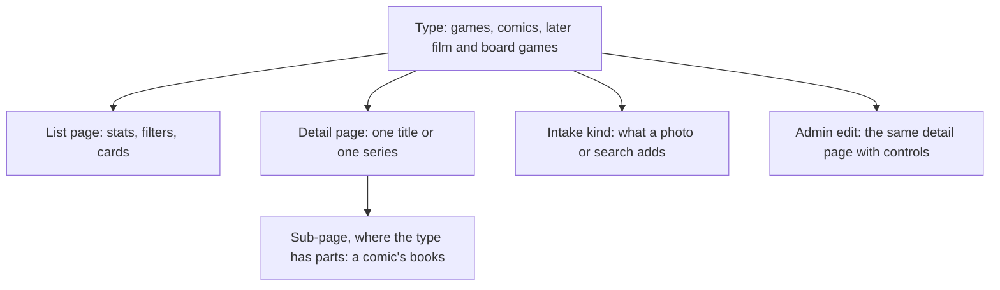

# Shelf design sweep, 12 Nov 2026

A review of My Shelf as it stands: the public pages, the admin, and the data
behind them. Checked on production (signed in, 12 Nov 2026, evening) and in
the main checkout's code. Anything not confirmed says so.

## Summary

1. The shelf has no single rule for how a media type is presented. Public has
   Collection (games and comics mixed) plus a separate Comics page; the admin
   has one Collection for everything and no comics page.
2. Comic issue pages are built and deployed, but the table behind them is
   empty in production. No series has a single issue cover or description,
   so every series falls back to numbered cells or to nothing.
3. Intake cannot record which book a photo shows. The reader is told to
   return one entry per work, and its schema has no issue number. Eleven of
   twelve series have no issues recorded.
4. Delete exists but is hard to find: only in the admin List view and at the
   bottom of the edit page. There is no bulk delete and no "redo this one".
5. Comics carry no genres at all. Games carry IGDB genres too broad to
   filter on. One of today's game adds matched the wrong record.

## 1. Structure: one page per type

### What is there now

| | Public | Admin |
|---|---|---|
| Area name | My Shelf | Shelf (page title "Shelf", nav label "Collection", URL `/admin/collection`) |
| All types together | `/shelf`, tab "Collection": 107 games and 12 comics in one grid, with a Type chip row | `/admin/collection`: 110 games and 12 comics in one grid |
| Comics only | `/shelf/comics`, tab "Comics": the same 12 series again, as runs | none (Pull list is the only comics page, under Recommend) |
| Games only | none | none |
| Series page | `Item.jsx`, the generic item page | `AdminItem.jsx`, the generic edit form |
| Issue page | `/shelf/<id>/<n>/`, with owner buttons when signed in | none; the run editor's cells on the edit form |

So a comic appears twice publicly, in two designs, and once in the admin in
a third. The public tab says "Collection" for a page that is really the games
shelf with comics mixed in. The Type chip list in `Collection.jsx` also
names Film & TV and Board games, which have no rows.

### Recommendation: one shelf per type, no combined page yet

You leaned this way and I agree. A type page can then be designed around
what that type is (platform and play status for games; runs and books for
comics) instead of the lowest common card.

- Public tabs: Games, Comics, What's next, Year in review, How it works,
  Daily. A type's tab appears when it has rows, as Comics does today.
- Admin Shelf area mirrors it: Games, Comics, Add, then Recommend and
  Catalogue as now. Same names both sides.
- Comics leave the games grid, its hero numbers, favourites and charts.
- Each type page is built from the same parts, so Film & TV and board games
  are a new entry rather than a new design:

Tradeoff: no single "everything I own" number or grid. It is cheap to add
later as an overview that links to each type, because the type pages will
already exist.

Open choice for the planning session: whether `/shelf` becomes the Games
page under a new label, or Games moves to `/shelf/games` and `/shelf`
redirects. Keeping `/shelf` is less work now (prerendered heads, sitemap and
the feed already point at it); moving Games now saves a second move if an
overview takes `/shelf` later.

## 2. Comics: series and books

### What is there now

- A series is one `items` row. What you own is range text on that row
  (`issues_owned`, e.g. `1–4`), plus `editions` and `read_to`.
- `comic_issues` (migration 0016) holds one row per issue: number, name,
  dates, cover, description. It is a Comic Vine cache, keyed
  `(item_id, number)`. It records nothing about your copy.
- **`comic_issues` is empty in production.** `GET /api/public/comic-issues`
  lists all 12 series with 0 covers out of 55 issues, and
  `/api/public/items/<id>/issues` returns no issues for any of them. The
  deploy note says to run the sync once by hand after merging, and the
  nightly has a step for it. Why neither has filled the table is not
  confirmed; I did not trigger a sync.
- What you see as a result:
  - Star Wars Tales, series page: one cover, "On the shelf, but which
    issues isn't recorded yet", the series blurb. Nothing else.
  - Star Wars Tales #3: a blank cover panel, seven blank neighbour tiles,
    "Comic Vine has no description for this issue."
  - Waterworld: four numbered cells, 1 to 4. No covers.
  - Admin edit page: one bundle cell reading "#1–24, 24 missing", then a
    text field for ranges. This is the vague box.
  - `/shelf/comics` headline: 12 series, 4 issues owned, 55 missing, 0% read.
- The edit page for a comic is the game form with words swapped: Pin as Up
  next, a journal with Minutes, a Reads table.

### Why the books went missing at intake

`EXTRACTION_PROMPT` in `backend/importer.py` (reused by the intake reader)
says "Return one entry per distinct work" and "Report each work once, even
if it appears in more than one photograph." `DETECTION_SCHEMA` has title,
type, year and platform; no issue number. The comic kind's only place for
issues is a typed "Issues owned" text field at the Details step.

So four photos of four Waterworld books are, by design, one detection. The
photos were not rejected; the reader has nowhere to put "this is #3". The
same rule is why Star Wars Tales has a row and no issues.

### Recommendation

The model does not need to grow much. Keep the series as the `items` row
and make the book the thing you own.

1. **Fill `comic_issues` first.** Nothing else about comics can be judged
   until covers and descriptions exist. Run the sync, confirm rows, then
   look at the cover wall as designed on 11 Nov.
2. **Ownership moves onto the book.** Add owned, read and skipped to the
   issue row (additive migration, backfilled from the ranges). The series'
   range text becomes something derived for display, or is kept in step by
   the same single writer (`comics.py`) until it can be dropped. The cost of
   keeping both is two places that can disagree; one writer is what
   prevents that.
3. **Intake reads the book.** For a comic, the reader returns series title
   and issue number per photographed cover, and a sitting commits "Waterworld
   #1, #2, #3, #4", shown as four covers to confirm. A photo of a spine or a
   trade still falls back to the series.
4. **The series page is the cover wall; the book page is the detail.** This
   is the 11 Nov design. It has not been seen with data.
5. **One place to edit a book.** Today there are three: range text, the run
   editor's cells, and the owner buttons on the public issue page. With
   covers present, tapping a cover (own it, read it) can replace the cells
   and the text field.
6. **A comic edit page of its own**, without Pin as Up next, Minutes or
   platform fields.

Not checked, and worth a look before planning: issue numbers that are not
plain positive integers (#0, #½, annuals, specials). The table's key is a
small integer and the route accepts 1 to 9999 only. "Grimm Fairy Tales: 2026
Swimsuit Special" is on the shelf as a one-issue series, which works, but a
#0 would not.

## 3. Add, change, remove

### What is there now

| Thing | Add | Change | Remove |
|---|---|---|---|
| Game or series | Add bar, sitting, full form | Edit page; inline status, rating, publish | Edit page (bottom, next to Save) and List view only. Not on a Shelf-view card. One at a time. |
| A book in a series | Range text or cell tap | same | same (untick) |
| A sitting | Add page | resume | Add page; an empty "Game · Nov 11" sitting is still open and shown on the Shelf |
| Wrong match | — | Re-link on the edit page | — |
| Bad intake result | — | — | Delete the row, start a new sitting |

There is no flag for test rows, so test data can only be told apart by eye.

### Recommendation

- Delete in the card's menu on the Shelf view, with the same confirm.
- Multi-select with bulk delete in the List view, next to the existing bulk
  set.
- "Redo" on a row: remove it and reopen it as an intake entry, so a bad
  read is one action instead of delete, new sitting, re-shoot.
- Discard for an empty sitting from the banner that announces it.
- Deleting a series already removes its issues, reads and journal
  (`ON DELETE CASCADE`). The confirm should say so.

### Rows to look at

Added 11 and 12 Nov. I have not deleted or changed anything; which of these
are test rows is yours to say.

- Comics, 11 Nov: Waterworld: Children of Leviathan (1–4 recorded);
  Creepshow 2022, 2023, 2024 and 2025 (four separate volumes, no issues);
  Star Wars Tales; Jurassic Park: Raptor; Jurassic Park: Raptors Attack;
  Mad Max: Fury Road; Haunt of Horror; Hello Darkness; Grimm Fairy Tales:
  2026 Swimsuit Special. None but Waterworld has an issue recorded.
- Games, 12 Nov: The Legend of Zelda: Ocarina of Time (see section 4);
  Tomb Raider: Definitive Edition; The Thing: Remastered.

For the comics, deleting and re-adding only helps after intake can read
issue numbers (section 2, step 3). Until then a retry produces the same
series row.

## 4. Tags and genres

- **Comics have none.** All 12 series have `genres: []`. Comic Vine does not
  supply genres for a volume. What it does supply is "concepts", and on
  these rows they are things like Variant Cover, Skybound, Max Comics,
  Vertigo: imprints and print trivia. `facets.py` already filters some of
  that out for the recommendation engine, but nothing readable reaches the
  shelf. Waterworld, both Jurassic Park series and Hello Darkness have no
  concepts either.
- **Games are tagged, but coarsely.** 20 IGDB genres and 20 themes across
  110 games. Adventure is on 69 of them and the Action theme on 87, so
  neither narrows anything. This matches issue #184 (genre "Platform" reads
  as a label).
- **A wrong match from today.** The Legend of Zelda: Ocarina of Time is
  linked to IGDB record 405460: year 2026, Nintendo EPD Production Group
  No. 3, no platform. That is not the 1998 N64 game. It is the only game
  with no platform.

Recommendation: decide what a tag is for before adding more. For filtering
and for "why this pick", a short curated set per type (what `facets.py`
already maps: setting, tone, source such as movie tie-in) is more use than
the source's raw lists. For comics that means deriving tags from the series
description and publisher line, since Comic Vine has no genre field; that is
a model call per series and should be stored, not recomputed.

## 5. Where admin and public have drifted

- Names: My Shelf, Shelf, Collection and `spine` all mean the same thing in
  different places.
- The public side has six tabs; the admin Shelf has eight pages. Only
  Collection lines up. Comics is public-only; the admin's comics tools are
  spread across Collection, Add and Pull list.
- Owner controls live on a public page (issue) for comics but only in the
  admin for games.
- The public series page and the admin edit page are both generic item
  pages, so neither shows a series as a run of books.
- Type chips on both shelves offer types with no rows.

One rule would settle most of it: each public type page has an admin twin
at the matching path with the same name, and signed-in controls appear in
the same places for every type.

## 6. A lightweight design system

Asked on 12 Nov: is it time for one, or is that overkill for a beta?

It is time, in a small form. The site has about 45 pages, about 90
components and one 11,800-line stylesheet. The tokens are already a system
(colour, status, run marks, each with measured contrast). What is missing is
the layer above them, and today's site review shows it: page headers built
three ways (#187), three or more content widths on one page (#188), four
different "way back" patterns on detail pages, unlabelled chip rows (#189).
The rules that do exist are scattered through CLAUDE.md as prose, so each
new feature's design session re-decides them.

What I would build, and what I would not:

- **Yes: one short rules file** in the repo (`docs/design-system.md`),
  which CLAUDE.md points to and the design step reads first. It holds
  decisions, not aspirations:
  - page types and their parts: list, detail, sub-detail, tool, prose
  - one page header, one breadcrumb, two widths (full and reading)
  - the card, the stat tile, the chip row, the state pill, the empty and
    error states: one of each, with the component that implements it
  - naming: what the area, its pages and its types are called, the same on
    both sides
  - the public and admin twin rule from section 5
  - a status for every feature: live, dark, or parked
- **Yes: a feature inventory** in the same file. One line per feature with
  that status. This is the "lock some stuff down" part: a parked feature
  stops receiving design changes until it is picked back up.
- **No: a component library, Storybook, a token build step or a second
  theme pass.** One person, one app; the components are already shared. A
  gallery page would be nice and is not needed to get the benefit.

Tradeoff: writing the rules means choosing between existing variants, and
the losers need a migration pass. That pass is the real cost, not the
document. Do it per page type as each is next touched, starting with the
shelf split in section 1, which needs the list, detail and sub-detail
patterns settled anyway.

## Suggested order

1. Run the comic issue sync and confirm covers and descriptions exist.
2. Write the rules file (section 6) for the page types the shelf uses, then
   split the shelf by type, public and admin together (section 1).
3. Delete on cards, bulk delete, discard sitting (section 3).
4. Intake reads issue numbers; ownership moves to the book (section 2).
5. Clean up the 11–12 Nov rows, then backfill comics.
6. Tags (section 4).

Steps 1 to 3 need no schema change. Step 4 is one additive migration.

## Evidence

- Production API, 12 Nov 2026: `/api/items` (122 rows: 110 games, 12
  comics; 119 public), `/api/public/items`, `/api/public/comics`,
  `/api/public/comic-issues`, `/api/public/items/<id>/issues`,
  `/api/intake/sittings?area=shelf`.
- Pages viewed: `/shelf`, `/shelf/comics`, Star Wars Tales and Waterworld
  series pages, Star Wars Tales #3, `/admin/collection`, the Star Wars
  Tales edit page.
- Code: `frontend/src/App.jsx`, `components/adminAreas.js`,
  `components/SpineTabs.jsx`, `content/spine.js`, `pages/Collection.jsx`,
  `pages/AdminCollection.jsx`, `pages/AdminItem.jsx`, `backend/models.py`,
  `backend/importer.py`, `backend/intake/shelf_kinds.py`,
  `backend/comic_issues.py`, `backend/comics_routes.py`, `backend/facets.py`,
  `.github/workflows/nightly.yml`.
- Related: `2026-11-11-comic-issue-pages-design.md`,
  `2026-11-12-comic-shelf-fixes-design.md`, `2026-11-12-site-review-issues.md`
  (#184, #185, #189).
