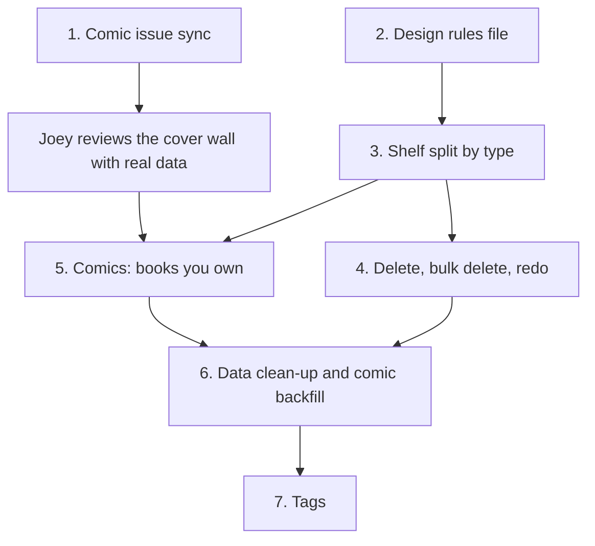

# Shelf sweep: work queue for Claude Code

Seven pieces of work from the 12 Nov shelf sweep, in pickup order. Start
after the current frontend bug-fix run is merged. Each item is a brief:
Code writes the design (where one is needed) and the plan. The findings and
evidence behind every item are in the sweep doc named above; read it first.

Decisions already made by Joey are marked **Decided**. Everything else is
a recommendation.

## Order and dependencies

Items 1 and 2 are independent and can start together. Items 1 to 4 need no
schema change. Item 5 is one additive migration.

---

## 1. Comic issue sync: find out why it is empty, then run it

Kind: bug. Design step: no.

**Problem.** `comic_issues` has no rows in production (checked 12 Nov 2026).
`GET /api/public/comic-issues` lists 12 series with 0 covers across 55
issues; `GET /api/public/items/<id>/issues` returns no issues for any
series. Every comic series and issue page is therefore blank or falls back
to numbered cells. The deploy order for migration `0016` says to run the
sync once by hand after merging, and `nightly.yml` has a step for it
(`/api/comics/issues/sync?budget=120`). Neither has filled the table. The
cause is not known.

**Do.**
- Check the last nightly run's `comic-issues` step and the API logs for it.
- Check that `COMICVINE_API_KEY` is set on the Render API service and that
  `fetch_issue_page` succeeds against one real volume (Waterworld: Children
  of Leviathan, Comic Vine volume 22918, 4 issues).
- Fix what is found, then run the sync.
- If the sync can fail without anyone noticing, make it visible: a row on
  `/admin/jobs` with the last run's result, like the other nightly steps.

**Done when.**
- All 12 public series have issue rows; the count of issues with a cover is
  reported (some Comic Vine issues may have none).
- `/shelf/<waterworld id>/` shows four covers, and `/shelf/<id>/1/` shows a
  cover and a description or the "no description" line.
- A failed sync shows on the Jobs page.

**Then stop for Joey.** He reviews the cover wall and issue page with real
data before item 5 is designed. That review may change item 5.

---

## 2. Design rules file and feature status list

Kind: docs. Design step: yes, as a short decision session, not mockups.

**Problem.** Tokens are consistent; the layer above them is not. The 12 Nov
site review found page headers built three ways (#187), three or more
content widths on one page (#188), four different "way back" patterns on
detail pages, and unlabelled chip rows (#189). The rules that exist are
prose scattered through CLAUDE.md, so each feature's design session
re-decides them.

**Do.** Write `docs/design-system.md`, linked from CLAUDE.md, read by the
design step before it draws anything. Decisions only, each naming the
component that implements it:

- Page types and their parts: list, detail, sub-detail, tool, prose.
- One page header. One breadcrumb. Two content widths (full, reading).
- One each of: card, stat tile, chip row (labelled), state pill, empty
  state, error state with retry.
- Naming: what the area, its pages and its media types are called, the same
  on public and admin.
- The twin rule: each public type page has an admin page at the matching
  path with the same name, and signed-in controls sit in the same places
  for every type.
- A feature status list: one line per feature, marked live, dark or parked.
  A parked feature gets no design changes until it is picked back up.

Scope for the first version: only what the shelf pages need (list, detail,
sub-detail). Other page types are added when they are next touched.

**Not in scope.** A component library, Storybook, a token build step, a
gallery page.

**Done when.** The file exists, CLAUDE.md points to it, the feature list
covers every route in `App.jsx`, and item 3's design cites it.

---

## 3. Split the shelf by type

Kind: feature. Design step: yes.

**Problem.** Public `/shelf` ("Collection") shows 107 games and 12 comics
in one grid; `/shelf/comics` shows the same 12 comics again in a second
design. The admin has one Collection for everything and no comics page.
The Type chip row offers Film & TV and Board games, which have no rows.

**Decided (Joey, 12 Nov 2026).**
- One page per type. No combined page yet.
- The games page is "Games" at `/shelf/games`.
- The grouped page, when it is built, is "Shelf" at `/shelf`.
- The admin mirrors it: Games and Comics side by side.

**Do.**
- Public: `/shelf/games` (games only: grid, hero numbers, favourites,
  charts) and `/shelf/comics`. Tabs: Games, Comics, What's next, Year in
  review, How it works, Daily. A type's tab shows only when it has rows.
- Admin Shelf area: Games, Comics, Add, then Recommend and Catalogue as
  now. The admin Comics page is new.
- Remove the Type chip row from the type pages.
- Both type pages follow the list pattern from item 2.

**Open, for the plan.**
- What `/shelf` answers until the grouped page exists. Suggested: a
  client-side redirect to `/shelf/games`, as the `/spine` routes do. A
  Render redirect rule loops on paths without a file (CLAUDE.md,
  2026-10-19).
- `/shelf` is in the prerendered heads, sitemap, feed and site search
  today. Games needs its row in `publicRoutes` and a rewrite in
  `render.yaml`. Item paths (`/shelf/<id>/`) do not change.
- `shelf/games` must be a declared static route so `shelf/:id` does not
  read it as an item id.
- Whether `/admin/collection` is renamed or kept as the Games URL.
- Shelfle, Year in review, How it works and What's next read all types
  today. Check each still makes sense once the pages are split.

**Done when.**
- A comic appears on exactly one public list page and one admin list page.
- Public and admin use the same names for the same pages.
- Old links to `/shelf` and `/shelf/comics` still land somewhere sensible.
- No chip offers a type with no rows.
- A changelog entry is added.

---

## 4. Delete, bulk delete, redo

Kind: feature. Design step: small.

**Problem.** Delete exists only in the admin List view and at the bottom of
the edit page. A Shelf-view card has no delete. There is no bulk delete and
no way to send a bad result back through intake. An empty sitting
("Game · Nov 11") stays open and is announced on the Shelf with no way to
discard it from there.

**Do.**
- Delete in the card's menu on the Shelf view, with the existing confirm.
- Multi-select with bulk delete in the List view, beside the existing bulk
  set.
- "Redo" on a row: remove it and reopen it as an intake entry in a sitting.
- Discard on the unfinished-sitting banner.
- The delete confirm says what goes with the row (a series' issues, reads
  and journal are removed by `ON DELETE CASCADE`).

**Done when.**
- A row can be deleted from the Shelf view, the List view and the edit
  page, and several at once from the List view.
- Redo on a row leaves one intake entry and no item.
- An empty sitting can be discarded from the banner.
- Nothing is deleted without a confirm that names the row and what goes
  with it.

---

## 5. Comics: the book is what you own

Kind: feature. Design step: yes. One additive migration. Starts after
Joey's review at the end of item 1.

**Problem.**
- Intake cannot record which book a photo shows. `EXTRACTION_PROMPT` in
  `backend/importer.py` says to return one entry per distinct work and to
  report each work once, and `DETECTION_SCHEMA` has no issue number. Four
  photos of four Waterworld books become one detection. The only place for
  issues is a typed text field at the Details step.
- What is owned is range text on the series row (`issues_owned`).
  `comic_issues` is a Comic Vine cache and records nothing about the copy.
- 11 of 12 series have no issues recorded. `/shelf/comics` reads "4 issues
  owned, 55 missing".
- A book can be edited in three places: the range text, the run editor's
  cells, and the owner buttons on the public issue page.
- The admin edit page for a comic is the game form with the words swapped
  (Pin as Up next, a journal with Minutes).

**Do, as three plans in this order.**

5a. **Intake reads the book.** For the comic kind, the reader returns the
series title and the issue number for each photographed cover. Check shows
one entry per book, and a commit adds those numbers to the series. A spine
or a collected edition still falls back to the series. Other kinds keep the
"one entry per work" rule.

5b. **Ownership on the book.** Add owned, read and skipped to the issue row
(additive; backfilled from the ranges, `editions` and `read_to`). One
writer (`comics.py`) keeps the series' range text in step until it can be
dropped. Skips stay private: `test_public_outputs.py` needs a pin for any
new field.

5c. **One place to edit, and a comic edit page.** With covers present,
tapping a cover on the series page marks it owned or read; this replaces
the cells and the range text field. The admin comic page drops Pin as Up
next, Minutes and the game fields.

**Open, for the design.**
- Issue numbers that are not plain positive integers: #0, #½, annuals,
  specials. The table's key is a small integer and the route accepts 1 to
  9999. Not checked against Joey's collection; ask him what he owns.
- Variant covers: the same number photographed twice. Out of scope unless
  Joey says otherwise.
- Whether the reader can tell an issue number from a cover reliably. Test
  on real photos before committing to the design; a typed fallback on each
  Check entry is needed either way.
- LLM budget: one read per book instead of per series raises request counts
  on the free tier (intake design, 2026-11-10; fallback chain, 2026-11-11).

**Done when.**
- Four photos of Waterworld #1 to #4 produce four entries at Check and a
  series holding #1 to #4.
- Owned and read can be set by tapping a cover, signed in, on the series
  page and the issue page, and both write the same data.
- The range text field and the run editor's cells are gone from the comic
  edit page.
- Signed out, no skip or owner control appears anywhere.
- Existing rows keep what they recorded (Waterworld still owns #1 to #4).

---

## 6. Data clean-up and comic backfill

Kind: chore. Mostly Joey's, with items 4 and 5 in place.

**Rows added 11 and 12 Nov, for Joey to sort into keep, redo or delete:**

- Comics: Waterworld: Children of Leviathan; Creepshow 2022, 2023, 2024,
  2025 (four separate Comic Vine volumes); Star Wars Tales; Jurassic Park:
  Raptor; Jurassic Park: Raptors Attack; Mad Max: Fury Road; Haunt of
  Horror; Hello Darkness; Grimm Fairy Tales: 2026 Swimsuit Special.
- Games: The Legend of Zelda: Ocarina of Time; Tomb Raider: Definitive
  Edition; The Thing: Remastered.

**Known wrong match.** Ocarina of Time is linked to IGDB record 405460
(year 2026, no platform), not the 1998 N64 game. It can be fixed today with
Re-link on its edit page; it does not need to wait.

**For Code.** Nothing to build. If the clean-up shows a pattern (the same
kind of wrong match more than once), log it as an issue against intake's
matching.

**Done when.** Every comic series on the shelf records which issues are
held, and no test row remains.

---

## 7. Tags

Kind: feature. Design step: yes. Last, because it is best judged on a
clean, backfilled shelf.

**Problem.**
- All 12 comic series have `genres: []`. Comic Vine has no genre field for
  a volume; its "concepts" on these rows are imprints and print trivia
  (Variant Cover, Skybound, Vertigo), and four series have none.
- Games have 20 IGDB genres and 20 themes across 110 rows. Adventure is on
  69 and the Action theme on 87, so neither narrows anything. The item
  page's chip row mixes genres and platforms (#184).

**Do.**
- Decide what a tag is for: filtering the shelf, and the "why this pick"
  reasons. One short curated set per type, built on what `facets.py`
  already maps (setting, tone, source such as movie tie-in).
- Comics: derive tags from the series description and publisher. That is a
  model call per series; store the result, never recompute on read, and
  keep it inside the free-tier budget.
- Games: show the curated facets on the shelf and item page in place of the
  raw genre list.

**Done when.**
- Every public comic series has at least one tag a visitor can read.
- No filter chip on the Games page matches more than half the shelf.
- The item page shows genres and platforms as separate, labelled groups.

---

## For Joey, not Code

- Review the cover wall and an issue page once item 1 has run.
- Say which 11–12 Nov rows are test data (item 6).
- Re-link Ocarina of Time.
- Say whether you own any #0, annual or variant issues (item 5).
