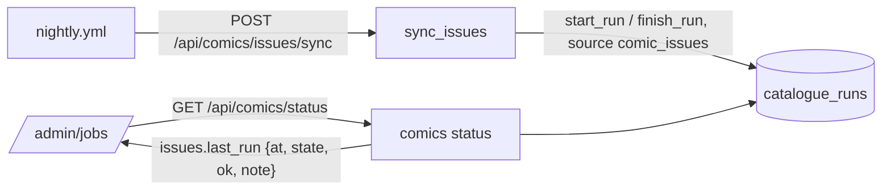

# Comic issue sync: why it was empty, and showing it on Jobs

Shelf sweep queue, item 1 (`2026-11-12-shelf-sweep-queue.md`).

## Problem

On the evening of 12 Nov `comic_issues` had no rows in production, so every
comic series and issue page was blank or fell back to numbered cells.

## What was found (13 Nov 2026)

- The table is full now. The 13 Nov nightly (run 43380133650, 06:38 UTC)
  logged `comic-issues: ok`, and production holds 59 issue rows across all
  12 public series, every one with a cover and 52 with a description. Every
  series has `issues_synced_on = 2026-11-13`.
- **Cause:** #173 (migration `0016`, the route and the nightly step) merged
  at 07:32 UTC on 12 Nov. That night's nightly had started at 07:05 UTC,
  from the old `nightly.yml`, so it had no sync step. The deploy order's
  "run the sync once by hand" was not done, and the sweep looked at
  production that evening, before the next nightly. No code fault: the sync
  worked the first time it ran.
- Comic Vine and `COMICVINE_API_KEY` are fine on Render: the run fetched
  every volume, Waterworld (volume 22918) included, #1 to #4 with covers.
- **Why nobody noticed:** the Jobs page has no row for the sync. A run that
  never happens, or that fails, is visible only in the GitHub Actions log
  (the nightly does warn on `ok: false`).

## Scope

In: record every run of `POST /api/comics/issues/sync`, a
`GET /api/comics/status` read, and a "Comic issues" row on `/admin/jobs`
(and Home's Site summary, which reads the same jobs).

Out: the followed comics' refresh (`/api/comics/refresh`) gets no row in
this PR. Noted for later. No migration.

## Solution

- `sync_issues` opens a `catalogue_runs` row (`source = "comic_issues"`)
  with `start_run`, and finishes it whatever happens (a `try/finally`, so an
  unexpected exception still closes the row as failed): `ok` = no series
  failed; `rows_seen` = series attempted; `rows_changed` = issue rows
  written; `items_synced` = series completed; `short_run` = the budget ran
  out before every series was complete; `errors` = `[{code, detail,
  item_id}]` per failed series (`code` is `rate_limited` or `source_error`).
- `GET /api/comics/status` (admin) answers `{"issues.last_run": {...} |
  null}` in the shape `runRow` already reads: `at` (finished, else started),
  `state` (`ok`, `partial` when the budget ran out, `failed`), `ok`, and a
  `note` ("N of M series failed: …" on a failure; "Budget spent; N series
  wait" on a partial run). A run still open after `STALE_RUN_MINUTES` reads
  as failed (`run_failed`).
- `lib/adminJobs.js` reads the status beside the other jobs;
  `lib/nightly.js` adds a "Comic issues" row with `runRow` (36-hour stale
  clock, "Run now" → `/admin/pull-list`, `quiet.partial`).

## Decisions and tradeoffs

- **`catalogue_runs`, not a new settings table (my call).** Items 1 to 4
  carry no schema change, and `catalogue_runs.source` is a plain string
  built for exactly this: one row per run of one source. The other jobs
  keep a single `last_run` blob; a run log also keeps history for free. Cost:
  `public_next_cache`'s fingerprint counts every run row, so `/next`'s cache
  is cleared once more per night, which the catalogue's runs already do.
  `/api/physical/status` lists only its own sources, so the catalogue page
  is unchanged.
- **A run that never happens shows as stale, then "No run recorded"**: that
  covers the 12 Nov case without a separate check.
- Run now links to the Pull list, where the sync runs on Follow and
  Refresh; there is no button for the full sync.

## Sources

- `backend/comics_routes.py` (`sync_issues`), `backend/comic_issues.py`
- `backend/physical_sources/catalogue.py` (`start_run`, `finish_run`,
  `run_failed`), `backend/models.py` (`CatalogueRun`)
- `backend/intake/routes.py` (`/status`, the shape copied)
- `frontend/src/lib/adminJobs.js`, `frontend/src/lib/nightly.js` (`runRow`)
- `.github/workflows/nightly.yml` (`call`), run logs 43172739459 and
  43380133650

## Smoke check

- `curl` the status route signed out: 401.
- After deploy, run the sync once with the job token, then `/admin/jobs`
  shows "Comic issues" ok with a time.
- `/shelf/<Waterworld id>/` shows four covers; `/shelf/<id>/1/` shows a
  cover and "A sequel to Waterworld."

## Plan

### Task 1: record the run (backend)

Files: `backend/comics_routes.py`, `backend/tests/test_comics_routes.py`
(or `test_comic_issues_sync.py`, wherever `sync_issues` is tested).

- Wrap the series loop in `start_run` / `finish_run` as above, committing the
  run row at the end (the loop commits per page; the run row must survive
  a series' rollback, so open it, commit, and re-fetch it to finish).
- Add `GET /status` returning `{"issues.last_run": summary | null}`.
- Tests: a clean run records ok with counts; a source error on one series
  records `ok=false` with that series in `errors` and the note; a rate limit
  stops and records; the budget running out records `partial`; an unexpected
  exception still finishes the row as failed and re-raises (500); status is
  null before any run; status is admin-only (401 signed out). The job token
  whitelist is unchanged (`test_job_token.py` passes untouched).

### Task 2: the Jobs row (frontend)

Files: `frontend/src/lib/adminJobs.js`, `frontend/src/lib/nightly.js`, their
tests (`nightly.test.js`, `adminJobs.test.js` or the page tests).

- `comicsRun()` reads `/api/comics/status` like `intakeRun()`; null when it
  cannot be read. `nightlyJobs` takes it as a new last parameter and adds a
  "Comic issues" row after Intake.
- Tests: ok, partial, failed with note, null → "No run recorded", stale
  after 36 hours.

### Task 3: docs

- `frontend/changelog.md` 2026-11-13: comic series pages show every issue's
  cover.
- CLAUDE.md: the comic issue pages bullet names the run row and status
  route; tick item 1 in the TODO.
- `docs/learnings.md`: the lesson below, and the API version-signal lesson
  carried from the 12 Nov run.

### Ship notes

No migration. Merge, wait for Render, run the sync once by hand with the job
token, check Jobs, smoke.
