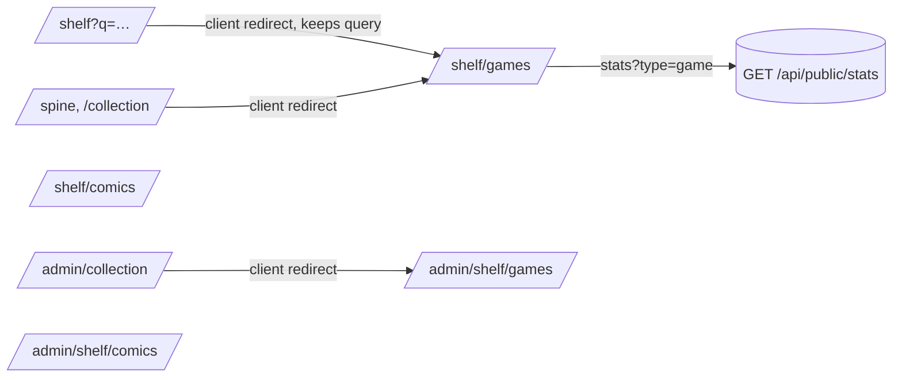

# Split the shelf by type

Shelf sweep queue, item 3 (`docs/planning/2026-11-12-shelf-sweep-queue.md`).
Rules: `docs/design-system.md` (item 2). Every list-page decision below
cites it.

## Problem

Public `/shelf` ("Collection") shows 107 games and 12 comics in one grid,
and `/shelf/comics` shows the same 12 comics again in another design. The
admin has one Collection for everything and no Comics page. The Type chip
row offers Film & TV and Board games, which have no rows. The Games hero
figures, favourites and charts count comics too, because
`GET /api/public/stats` has no type filter.

## Scope

In:
- Public `/shelf/games` (new) and `/shelf/comics` (rebuilt) as list pages.
- `/shelf` redirects to `/shelf/games` until the grouped Shelf page exists.
- Admin twins `/admin/shelf/games` and `/admin/shelf/comics`; `/admin/collection`
  redirects to Games.
- A `type` filter on `GET /api/public/stats`.
- An `EmptyState` component.
- Names: "Games" and "Comics" on both sides; the area is "My Shelf" in public
  and "Shelf" in the admin.
- The rules the designer found missing, added to `docs/design-system.md`.

Out:
- The grouped `/shelf` page (later).
- Add and edit pages keep their paths (`/admin/collection/add*`,
  `/admin/collection/:id`). The comic edit page moves in 5c.
- Multi-select and bulk delete (item 4).
- The cover wall, Missing toggle and per-issue state (item 5).
- Shelfle, Year in review, Month journal and Tour already read games only and
  stay as they are. What's next keeps both types, because it is a cross-type
  "what to do next" page.

## Mockups

`docs/planning/mockups/2026-11-13-shelf-split/` (out of git).

- **Chosen: Direction A, "same grid, type-tuned cards"**:
  `a-games.html`, `a-comics.html`, `a-admin-games.html`,
  `a-admin-comics.html`, plus `phone.html` for the phone widths.
- Rejected: Direction B (`b-*.html`). It needs a second card shape, a
  sectioned grid and a new control pattern, which breaks "one component per
  job". Its select-and-act bar goes to item 4, and its wide run card is a
  candidate for the series page head in 5c.
- Rejected: `shelf-alt.html`, a thin `/shelf` page with one link per type.
  It repeats the tabs beside it.

Acceptance: the built pages match the chosen files at 400px and 1280px, in
light and dark.

## Solution

### Public list pages (design-system.md → Page types → List)

Parts, top to bottom: area band (`SpineHeader`, no `h1`) · `PageHeader`
(the page's `h1`: "Games" or "Comics", no trail) · figures (`StatTile` row) ·
labelled filters (`FilterChips labelled`) · search/sort/result bar · grid
(`PosterGrid` of `PosterCard`) · `EmptyState` or `LoadState`.

- **Games**: three hero figures as today, built from `StatTile`. Favourites
  and charts below the grid read `/api/public/stats?type=game`. Filters:
  status and platform. There is no Type chip row.
- **Comics**: one `PosterGrid`. A series card is the stacked cover, with
  the run as a lane in the card's run slot: owned issues filled, missing
  issues hollow, plus a read bar. Out this week leaves this page; it is
  already on What's next.
- **Tabs** (`content/spine.js`): Games, Comics, What's next, Year in review,
  How it works, Daily. A type's tab shows only when that type has public
  rows.

### Admin twins (design-system.md → Twin rule)

The rail, then `AdminPageHeader` in place of the area band, then the same
parts as the public page.

- **Admin Games**: today's `AdminCollection` restricted to games. It keeps
  Grid and List views, since item 4's multi-select lives in List. Card
  controls show on hover or focus, or in a "…" sheet on a phone. "Private"
  always shows.
- **Admin Comics**: the same grid for comics. Its card controls are Follow,
  Public, sync state, a link to the cover wall with its missing count, and
  Edit. A failed sync always shows.
- **Admin Shelf group** in `lib/adminAreas.js`: Games, Comics, Add, then
  Recommend and Catalogue as now.

### Redirects and plumbing

- `/shelf` becomes a client-side `Navigate` to `/shelf/games` that keeps
  `location.search` (SearchDialog's no-match link uses `/shelf?q=…`).
  `/spine` and `/collection` go straight to `/shelf/games`, so there are no
  redirect chains. A Render redirect rule would loop on paths without a file
  (CLAUDE.md, 2026-10-19).
- `shelf/games` is a declared static route, so it outranks `shelf/:id`.
- `spine.path` stays `/shelf`, because the feed URL is built from it. A
  `gamesPath` helper is added beside it.
- `/shelf/games` gets a `publicRoutes` row in `prerender-lib.mjs`, a rewrite
  in `render.yaml`, an entry in `STATIC_PAGES` (`content/pages.js`) and an
  entry in analytics `_EXACT_PATHS`. `/shelf` stays in the sitemap and feed
  only as long as the existing tests need it; its prerendered head points
  to Games.
- `/admin/collection` (the list only) becomes a `Navigate` to
  `/admin/shelf/games`. Add and the item edit routes are unchanged.
- Prefs: the existing `shelf.public.*` and `shelf.admin.*` keys stay the
  Games keys, and Comics keeps `shelf.public.comics.*`. Nobody loses a
  saved view.

### Backend

`GET /api/public/stats` takes an optional `type` query parameter (an
`ItemType` value). When it is given, every aggregate adds
`Item.type == type`. With no parameter the response is unchanged. Pinned in
`test_public_outputs.py`: the same output fields; comic rows don't reach
`?type=game`; private rows reach neither.

## Decisions (Joey, 13 Nov 2026: "go with recs")

1. Direction A, with lanes in the card.
2. Admin paths `/admin/shelf/games` and `/admin/shelf/comics`;
   `/admin/collection` redirects to Games; Add and edit paths stay for now.
3. Admin Games keeps the List view.
4. Admin card controls show on hover; "Private" and a failed sync always
   show.
5. Games keeps today's three hero figures.
6. Out this week leaves the Comics page.
7. Games' figures, charts and favourites become games-only through
   `stats?type=`.
8. The missing rules go into `docs/design-system.md` in this PR: the area
   band's size, the admin twin's chrome, and the order of a list page's
   parts (search/sort/result bar and an optional overview).

My calls (open in the queue):
- **What `/shelf` does:** the client redirect above. It is the pattern the
  `/spine` routes already use.
- **`/admin/collection`:** renamed and redirected, per the rules file's twin
  rule ("moves when touched").
- **Admin group label:** stays "Shelf". The rules file names the area
  "Shelf" in the admin.
- **Phone admin segments:** Games, Comics, Add, More.
- **Per-series sync state on admin Comics:** read from the data
  `/api/comics/*` already returns. If a field is missing, the card shows
  nothing rather than a guess, and the gap is written down for item 5.

LLM requests: none added. Migration: none.

## Sources

- `docs/design-system.md` (page types, one-of-each, twin rule, the "Not yet
  migrated" rows this item closes)
- CLAUDE.md 2026-10-19: Render redirect loops
- `frontend/src/App.jsx` routes; `backend/public.py` `public_stats`

## Smoke check

- `./scripts/smoke.sh https://joey-haas.dev https://api.joey-haas.dev` is
  green, with `/shelf/games` in its route list.
- `/shelf` lands on `/shelf/games`, and `/shelf?q=zelda` keeps the query.
- `/shelf/comics` lists comics only. A comic appears on no Games page.
- `/api/public/stats?type=game` answers 200, and its `by_type` holds only
  games.

---

## Plan

Each task is TDD: write the failing test, make it pass, then commit. Run
one backend suite at a time; check with `ps aux | grep '[p]ytest'`.

1. **Stats type filter (backend).** In `backend/public.py` `public_stats`,
   add an optional `type: ItemType | None = Query(None)` and apply it to
   every query. Tests: `test_public_outputs.py` pins (fields; game-only;
   no private rows) and a public stats test.
   *Accept:* `?type=game` excludes comics; no parameter gives today's
   output.
2. **EmptyState component.** Add `components/EmptyState.jsx` and its test:
   a title, an optional line and an optional action, using the existing
   tokens.
   *Accept:* it renders and is used by tasks 3 and 4.
3. **Public Games page.** Add `pages/Games.jsx`, built from what
   `Collection.jsx` does for games only: `PageHeader` "Games", figures as
   `StatTile`, labelled filters without the Type row, the search/sort bar,
   `PosterGrid`, favourites and charts from `stats?type=game`, and
   `EmptyState`. Retire `Collection.jsx`, or reduce it to shared pieces.
   Tests ported from `Collection.test.jsx`.
   *Accept:* no comic is rendered and no Type chips appear. Matches
   `a-games.html`.
4. **Public Comics page.** Rebuild `pages/Comics.jsx` per `a-comics.html`:
   `PageHeader` "Comics", `PosterGrid` of series cards with the run lane,
   no Out this week, and `EmptyState`.
   *Accept:* matches `a-comics.html`, and the tests are updated.
5. **Routes, tabs and redirects.** In `App.jsx`, add `shelf/games`, turn
   `/shelf` into a query-keeping redirect, and retarget `/spine` and
   `/collection`. In `content/spine.js`, set the tabs (Games, Comics, …),
   show a type's tab only when it has rows, and add the `gamesPath` helper.
   Also update `prerender-lib.mjs` `publicRoutes`, `render.yaml`,
   `content/pages.js` STATIC_PAGES and `backend/analytics.py`
   `_EXACT_PATHS`, with their tests (App.test.jsx,
   prerender-lib.test.mjs, test_analytics.py).
   *Accept:* every old link lands on a page with no chain.
6. **Admin twins.** Add the routes `admin/shelf/games`
   (`AdminCollection` restricted to games, keeping Grid and List) and
   `admin/shelf/comics` (new `AdminComics.jsx` per `a-admin-comics.html`).
   `/admin/collection` becomes a redirect. Update the Shelf group in
   `lib/adminAreas.js`, and point every in-app link that targets the admin
   list at the new paths (edit paths unchanged). Tests: adminAreas,
   AdminShell/AdminLayout, App, ADMIN_ROUTES in `prerender-lib`, and the
   new AdminComics test.
   *Accept:* a comic appears on exactly one admin list page, and the names
   match the public side.
7. **Docs.** Edit `docs/design-system.md`: add the missing rules (area
   band size, admin twin chrome, list-page part order) and strike the
   "Not yet migrated" rows this item closes. Update the "Collection is the
   tab" line in `docs/voice.md`, CLAUDE.md (shelf paths, the twin paths,
   ticking TODO item 3), the `frontend/changelog.md` line, and this doc's
   `status: done`.
8. **Verify.** Run the full backend and frontend suites, the e2e run and
   the build. Screenshot the four pages at 400px and 1280px and compare
   them with the mockups.

Ship notes: no migration. The frontend and backend deploy together on
merge. The live check is that `/shelf/games` answers with the Games page
and `/api/public/stats?type=game` answers 200.

## Deviations

- Tasks 3 to 6 landed as one commit: they share `App.jsx`, `spine.js` and
  `index.css` and are not valid apart.
- Admin comic cards show no sync state and no "Sync failed" chip:
  `ItemOut` has no `issues_synced_on`. Logged in design-system.md's gap
  table for item 5. Admin Comics has no Overview charts.
- On a phone, admin comic card controls are inline, not behind the "…"
  sheet: item 4 reworks card actions.
- The add form and the pull list's "Own…" prefill stay on admin Games
  (Admin Comics has no form until 5c); a saved comic shows a line linking
  to Comics.
- Games carries the IGDB credit only; the TMDB line returns with a Film &
  TV page.
- The `stats` snapshot, its live read and the nightly compare use
  `?type=game`.
- `/shelf` stays in `STATIC_PAGES` (it writes the redirect's
  canonical-to-Games head), so site search lists it beside Games.
