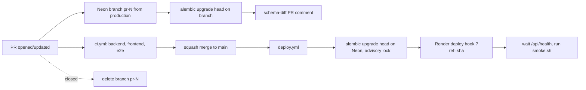

# Parallel-safe CI, migrations in the deploy, faster CI

## Problem

1. **Parallel work collides.** Seven worktrees are open at once, but they share one local
   test database (`conftest.py` runs `drop_all`/`create_all` on it), so only one pytest run
   can go at a time. There is no per-branch environment of any kind.
2. **Migrations are a manual step.** Deploy order is "apply `0NNN` to Neon by hand, then
   merge". A step done by hand gets skipped (learnings, 2026-11-13), and the CI rehearsal
   runs on an empty Postgres, not on production's shape.
3. **CI time.** Three jobs run on every push; nobody has measured where the minutes go, so
   speed-ups are guesses.

Constraint chosen by Joey: **stay on free tiers** (Render free, Neon free). Render preview
environments (Pro workspace) and `preDeployCommand` (paid services) are out.

## Scope

In: per-worktree test databases; Neon branch per PR for a migration rehearsal on
production-shaped data and a schema diff; a GitHub Actions deploy workflow that migrates and
then deploys the API; coverage-neutral CI speed-ups, measured first.
Out: Render preview environments, a staging environment, merge queue, changing what any
test asserts, dropping or skipping any check.

## Solution

- **Local parallelism.** `conftest.py` derives the test database name from the worktree
  (default `postgres` kept when `TEST_DATABASE_URL` or `CI` says so) and creates it if
  missing, so each worktree owns a schema. A later task adds pytest-xdist with
  one database per worker (`worker_id`), if measurement says the suite is worth splitting.
- **PR rehearsal.** The `backend` job creates/reuses Neon branch `pr-<N>` from production,
  runs `alembic upgrade head` against its direct URL, then `schema-diff-action` comments the
  diff. A close workflow deletes the branch; `expires_at` is the safety net. Skipped for
  fork PRs (no secrets). Unit tests still use the Postgres service container: they need a
  drop/create database, not production's data.
- **Deploy workflow.** `deploy.yml` on push to `main`: `alembic upgrade head` (serialised
  by a Postgres advisory lock taken in `env.py`), then POST the API's deploy hook with
  `?ref=$GITHUB_SHA`, then poll `/api/health` and run `scripts/smoke.sh`. The API service
  moves to `autoDeployTrigger: off` so only this workflow deploys it. The static site stays
  on auto-deploy (it runs no migration). Concurrency group `deploy`, never cancelled.
- **CI speed.** Task 1 records baseline timings per job and step. Candidates, each
  coverage-neutral and applied only if the baseline shows it matters: audits into their own
  parallel job, Playwright browser cache, `--shard` for e2e, pytest-xdist per-worker
  databases.

### Architecture decision

Options:
- **A. Migration in `buildCommand`** (free, no new moving parts).
- **B. GitHub Actions deploy job: migrate, then deploy hook** (free; Render deploy gated by us).
- **C. Status quo, hand migration**, plus the CI rehearsal.

Chosen: **B**, because a failed migration stops the deploy instead of a deploy failing
after the schema changed, the migration has real logs in Actions, and the repo already
calls a deploy hook from `nightly.yml` (`RENDER_DEPLOY_HOOK_URL`). A runs the migration on
every build, including rebuilds with nothing to migrate, and an unhealthy build leaves the
schema ahead with no gate.

Gives up: Render's own auto-deploy for the API; deploys now depend on GitHub Actions being up.
Hard to undo: little. `autoDeployTrigger` flips back in `render.yaml`. Safety rests on the
existing additive-only rule and `schema_check` tolerating a database ahead of the code, so
a migrated database with an old API still boots.
Sources: `backend/migrations/README.md`, `docs/learnings.md`,
https://render.com/docs/blueprint-spec (`autoDeployTrigger`: `commit | checksPass | off`),
https://render.com/docs/deploy-hooks (`ref` parameter), https://render.com/docs/preview-environments
(Pro only), https://neon.com/docs/guides/branching-github-actions,
https://github.com/neondatabase/create-branch-action (v6),
https://github.com/neondatabase/delete-branch-action (v3),
https://github.com/neondatabase/schema-diff-action (v1),
https://pytest-xdist.readthedocs.io/en/stable/how-to.html,
https://docs.github.com/en/repositories/configuring-branches-and-merges-in-your-repository/defining-the-mergeability-of-pull-requests/troubleshooting-required-status-checks.

## Decisions (my calls unless marked)

- **Free stack, no Render previews** (Joey's decision).
- **No `paths:` filters on required workflows**: GitHub leaves a skipped required check
  Pending and blocks merge. A docs-only PR paying the full suite is cheaper than that trap.
- **Advisory lock in `env.py`** is our own choice: the Alembic cookbook has no recipe for
  serialising runs.
- **Neon branch budget**: free is 10 branches per project (the docs also mention a 3-root
  limit; production is the only root). One branch per open PR, so ten open PRs is the
  ceiling; the close workflow and `expires_at` keep it clear.
- **Only the API is gated on migration.** The frontend may still deploy before the API;
  that is today's behaviour.

## Open questions

1. **Branch data**: rehearse on a branch with production's current data (catches backfill
   problems like `0011`'s) or `branch_type: schema-only` (nothing private in CI)? The repo
   is public and secrets never reach fork PRs, but the copy would hold private rows.
   Default in this plan: **schema-only**, flip later if wanted. (Joey's call.)
2. **Unverified, to prove in task 4 before the cutover:** that `autoDeployTrigger: off`
   applies to the existing service through the Blueprint; that a hook call with `?ref=`
   works on the free plan; that the Neon action's default branch copies data. None is
   confirmed from Render's or Neon's pages.
3. Ports for several local dev servers (Vite proxies to `:8000`): out of scope here.

## Always-stops in this work

New GitHub secrets (`NEON_API_KEY`, `DATABASE_URL_DIRECT` for the deploy job) and variable
(`NEON_PROJECT_ID`); the Render setting `autoDeployTrigger: off`. Each is Joey's OK at the
moment it is needed. No migration here drops or rewrites data.

## Plan

Model: Sonnet for every task. Each task is its own commit; tests and `ruff`/format run before it.

1. **Baseline timings.** `gh run list`/`gh api` for the last ~20 `main` and PR runs; write
   per-job and per-step medians into this doc's appendix. Accept: numbers recorded; the
   speed-up list below is trimmed to what they justify.
2. **Per-worktree test database.** `backend/tests/conftest.py`: name the test database from
   the worktree, create it if missing, keep the old default under `CI`. Test: two
   concurrent `pytest` runs from two worktrees both pass. Update `CLAUDE.md` ("one run at a
   time" note) and `backend/README.md`.
3. **Alembic safety.** `env.py` takes `pg_advisory_lock` around `upgrade`; CI step fails on
   more than one head (`alembic heads`). Test in `tests/test_migrations.py`: a second
   concurrent upgrade waits, then is a no-op.
4. **Neon PR rehearsal.** In `ci.yml`: create `pr-<N>` (schema-only unless Open question 1
   says otherwise), run `alembic upgrade head`, post `schema-diff-action`, `if: always()`
   cleanup is the close workflow `pr-closed.yml`. Fork PRs skip it. Accept: a PR with a
   migration shows the diff; closing removes the branch. **Stop for Joey: secrets.**
5. **Deploy workflow.** `deploy.yml` as above, with `workflow_dispatch` for a dry run
   (migrate to head against Neon is a no-op when current). Prove `?ref=` and health/smoke
   before step 6. Accept: a manual run on `main` deploys the API at that SHA and smoke is
   green. **Stop for Joey: secrets.**
6. **Cutover.** `render.yaml` API service gets `autoDeployTrigger: off`; Blueprint syncs it.
   **Stop for Joey: production setting.** Accept: a merge to `main` deploys only through
   `deploy.yml`; rollback is `autoDeployTrigger: commit`.
7. **CI speed-ups** chosen from task 1 (see Solution). Accept: wall time down, same checks
   run, same assertions; compare the job list before and after.
8. **Docs.** `backend/migrations/README.md` deploy order, `CLAUDE.md` Ship and Deploying
   sections, a README for `deploy.yml`/`pr-closed.yml`, a `decision` entry in
   `docs/learnings.md`. Changelog: not public, none.

Ship notes: no database migration. Rollout order is 2, 3, 1, 4, 5, 6, 7 as separate PRs
(1 first if it is just a doc). Rollback: revert the PR; for 6, set the trigger back to
`commit`.

## Smoke check

After 6: merge a trivial PR; `deploy.yml` goes green, `https://api.joey-haas.dev/api/health`
answers, `./scripts/smoke.sh https://joey-haas.dev https://api.joey-haas.dev` passes, and
the Render dashboard shows the deploy came from the hook with the merge SHA.
