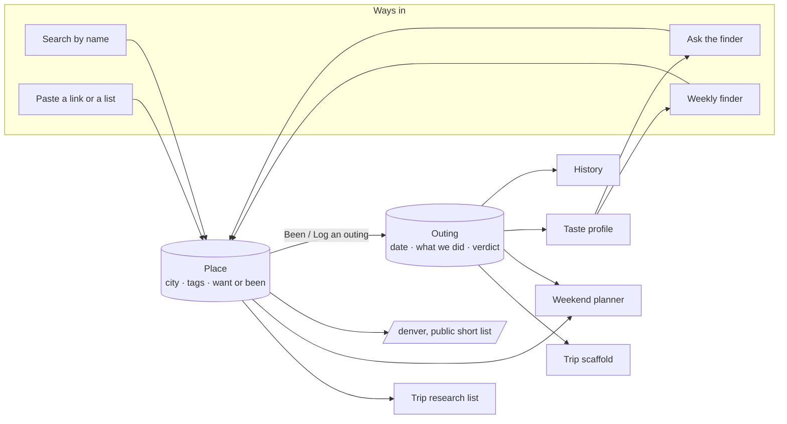

# Places and outings: one way in, a history of what we did, and a finder that uses it (brief)

Date: 2026-11-15 · Repo: joey-haas.dev · For Claude Code's planning session.
This is a requirements brief, not a UI design. It revises parts of
`2026-11-08-denver-spots-design.md`, `2026-11-08-travel-log-design.md` and
`2026-11-10-intake-design.md`; where they disagree, this wins.

## Why

Denver spots and the travel log are built, and neither is usable yet.

- The only way into Denver at scale is the Sunday finder, which pushes
  OpenStreetMap places at an owner with no spots, so the model has no taste
  to score against. The recorded pull was 104 restaurants of 136 places
  (`candidates.py`).
- A place the owner already knows needs a pasted lat/lng. There is no search
  by name, no way to save a tip, and no "want to try".
- `visits` exists but is only written from the planner's Been and the table's
  Log a visit. Nothing shows the history back.
- Travel ingest is a laptop CLI that ends in hand-replacing `TODO`s. There is
  no research side, by the 11-08 decision.
- `/denver` is public with 0 spots.

Two goals, from Joey (2026-11-15):

1. **Build a history of the fun things we have done.**
2. **Help find new things to do.**

The second depends on the first: the history is what the finder learns from.

## The model

One idea covers Denver and travel: a **place** in a **city**, and **outings**
to it.

- **Place** is today's `spots` row plus a real `city` (the 11-08 schema
  proposed the column; confirm it shipped). "Want" and "been" are derived,
  not stored: a place with no outing is a want.
- **Outing** is today's `visits` row, grown. It needs: what we did (a short
  title, optional, for "Rockies game" at Coors Field), a verdict (loved / fine
  / not again), and whether the kid came. `note` stays private.
- **Recommended: every outing has a place.** A concert's place is the venue,
  a hike's is the trailhead. This keeps the `visits → spots` key and the
  planner's visit logic as they are. The cost is that a one-off place becomes
  a private spot; that is acceptable because spots are private by default.
- A **trip** is a city (or several) with dates. Outings inside those dates in
  those cities belong to it without a foreign key.

## Requirements

### 1 · Places come in through intake

Register a `place` kind in `backend/intake/kinds.py`. Ways in: search, paste,
type. No photo way in.

- **Search by name** geocodes through Nominatim, on submit, never as
  type-ahead. The public instance allows at most 1 request a second, needs an
  identifying User-Agent, and forbids autocomplete. Reuse the catalogue's
  `USER_AGENT` and a throttle like the other sources.
- **Paste** takes a text blob or map links, one place per line. Each line is
  geocoded and lands in the existing Check step: one candidate is ready,
  several or none is a check. No model call is required; one may be used to
  split messy text if the budget allows.
- Fields: city (defaults to Denver), tags, blurb, public. Commit goes through
  the existing spot write path.
- The add bar appears on `/admin/spots`. The lat/lng paste field stays as the
  fallback.

### 2 · Outings and the history

- **Log an outing** in one gesture on a phone: pick or search a place, date
  defaults to today, verdict, one optional line. Searching a place that is not
  saved yet creates it in the same step.
- **Did you go?** A plan saved in the weekend planner asks on Sunday evening
  and after: Been (with verdict) or Didn't. This is the stale-state pattern
  from Tonight's Continue card.
- **Backfill**: paste lines of "place, date" for past outings. Same Check
  step. A date may be a month or a year when that is all anyone remembers.
- **History page** in the Denver admin area: outings newest first, grouped by
  month, filterable by city, tag, verdict and kid-along. A header line with
  counts for the year. A place's row in the spots table links to its outings.
- History is **private**. No public body carries an outing; the existing
  public-output tests keep that true.

### 3 · Finding new things

- **Ask the finder.** A text ask plus a city or neighbourhood ("rainy
  Saturday with a kid near RiNo", "ramen in Shinjuku"). The server builds the
  Overpass query, the model picks from the server's list by index as
  `candidates.py` does today, and results land in the same Accept / Dismiss
  queue. One model call per ask; when the budget is spent the queue still
  fills, unscored.
- **Taste comes from outings.** The profile sent to the model is built from
  loved and recent outings, not just the spot list. The weekly push stays off
  until there are about 20 places or 10 outings to learn from, then resumes.
- **A wider pool.** `TAG_SET` is cafe, restaurant, library, museum, park,
  playground and attraction. Fun things need more: cinema, theatre, ice
  cream, brewery, zoo, aquarium, mini golf, bowling, arcade, climbing, ice
  rink, pool, nature reserve, trailhead. Verify each tag on the OSM wiki and
  re-record the fixture. The six-tag vocabulary in `spots.TAGS` needs to grow
  with it.
- **Gaps, rule-written.** No model: "nothing indoors since March", "never
  tried a place in Sunnyside". Feeds the planner's "Try somewhere new" slot,
  which should draw from wants first.
- Accepted finds are wants. Dismissals stay permanent.

### 4 · Trips

- A trip gains a private **planning** state before it is a draft: a list of
  wants in the trip's cities, filled by the same search, paste and ask.
  This reverses "no planning mode" narrowly. Bookings, times and itineraries
  stay out.
- After the trip, `ingest-photos.mjs --write` scaffolds days from outings in
  the trip's dates plus photo dates, so day titles and places arrive filled
  instead of `TODO`.
- Photos stay on the laptop CLI. Originals should not pass through the
  free-tier server.

## Order

1. Places through intake (search, paste), city. This also fills `/denver`.
2. Outings: log, Did you go?, backfill, history page.
3. Finder: ask, wider pool, taste from outings, gaps.
4. Trips: planning list and the scaffold.

Later, each needing its own check first:

- **Maps export import.** Google Takeout gives one CSV per saved list. The
  columns have not been seen; look at a real export before designing.
- **Photos propose outings.** The ingest script already reads date and GPS;
  a photo within a short distance of a saved place could propose an outing.
- **Events** (things with a date). Ticketmaster's Discovery API has a free
  key at 5,000 calls a day and covers ticketed shows and sports, not markets,
  festivals or library events. Eventbrite removed public event search in
  2019. Its caching and display terms have not been read. Until then, an
  event comes in by pasting its link and logging the outing.
- **Phone share sheet.** iOS Safari has no Web Share Target, so the site
  cannot appear there. The add bar is the phone path.

## Open questions for Joey

- **Does every outing need a place?** Recommended yes (see The model).
- **Is any history public?** Recommended no. The public page stays the
  recommended list; a "year in outings" page can come later.
- **Who came?** Recommended one kid-along toggle, matching the planner's
  constraint, and no per-person record.

## Sources

- [Nominatim usage policy](https://operations.osmfoundation.org/policies/nominatim/)
- [Ticketmaster Discovery API](https://developer.ticketmaster.com/products-and-docs/apis/discovery-api/v2)
- [Eventbrite API changelog](https://www.eventbrite.co/platform/docs/changelog)
- [WebKit bug 194593, Web Share Target](https://bugs.webkit.org/show_bug.cgi?id=194593)
