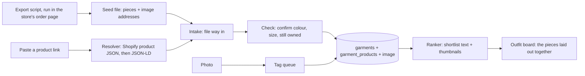

# Closet: real products, seed import, and a ranker that sees the clothes (brief)

Date: 2026-11-16 · Repo: joey-haas.dev · Reviewed against `main` at `aae92fa`.
Brainstormed in Cowork. This is a brief, not a spec: the design happens in
the planning session.

## Problem

The closet is empty, and before it is filled three things are wrong.

1. **A garment cannot be a real product.** `garments` has a free-text
   `primary_color` and a hex, both guessed by the vision model from a 400px
   phone photo. The tagging prompt asks for "plain colour names", so
   burgundy, brick and dusty red all come back as "red". There is no field
   for the store's colour name, a size, a price or where the piece came
   from.
2. **Intake has nowhere to attach a product.** The garment kind offers
   `photo` and `type`, has no source and no Details step, and the Closet
   add bar has no search.
3. **The ranker never sees the clothes.** `closet_rank.py` sends text only
   (subtype, colour word, pattern, material, warmth, formality). Choosing
   an outfit is a visual judgement and the model makes it blind. The
   outfit is also shown as four separate tiles, never as one picture.

## What was learned from the stores (2026-11-16)

Order histories were read from Joey's signed-in browser. Result: 63
purchased pieces, 44 still owned.

| Store | Kept | What an order line carries | Colour names |
|---|---|---|---|
| Stitch Fix | 33 | brand, name, colour, size, price, date, flat product image, returned or kept | Family level: Burgundy, Olive, Burnt Orange |
| Duer | 5 | name, colour, size, image | Stone Wash, Gull, Army Green |
| Nordstrom Rack | 4 | brand + name, colour, size, price, item number, image | Uneven: MILITARY GREEN, but also "TWILL" |
| Marine Layer | 2 | name, colour, size, image | Tan Geo Print, Forest Night |

The 44 kept pieces are 21 tops, 18 bottoms, 3 accessories, 1 mid, 1 outer
and no shoes. Today will have little to layer with until more is added.

Other findings:

- Gmail holds no receipts for any of these stores. Order history on the
  store's site is the only record.
- Stitch Fix has no public product page worth matching for most pieces;
  the order line is the product record. Its product pages do list fabric
  composition (one page checked).
- Marine Layer is a Shopify store with public product JSON, one product
  per colour. Duer answers in Shopify's format but its product list came
  back empty; a single product link was not tested.
- Nordstrom was shallow: six purchases, mostly children's clothes.

The seed file is at `~/Developer/closet-seed/closet-seed-all-2026-11-16.csv`,
outside the repo on purpose (it is purchase history). Columns: `n, source,
order_id, date, date_basis, brand, name, color_name, size, price_usd,
category_hint, store_item_no, still_owned`. It has no image addresses; see
"Export scripts" below.

## Proposed shape

### Storage

- `garments.color_name`: the store's wording, verbatim. This is what the
  ranking prompt should read.
- `garments.primary_color` stays as the plain colour family. Filters and
  `closet.duplicate_clusters` key on it, so it must not hold store names.
- `garments.color_source` (`vendor`, `manual`, `model`): the tagger may
  fill warmth, formality and seasons but must never overwrite a vendor or
  manual colour. Today `tag_source` is one flag for the whole row.
- `garments.size`: per piece. The Sell checklist currently takes size from
  the profile.
- `garment_products`, one row per garment: `source` (`stitchfix`,
  `nordstromrack`, `marinelayer`, `duer`, `link`, `manual`), nullable
  `url`, order reference, store item number, title, price, a JSONB
  snapshot and `fetched_at`. A side table for the reason `garment_images`
  is one. The snapshot matters because clothing is delisted every season.
- Purchase date feeds the existing `acquired_on`.
- Store a larger image. `closet_images.LONG_EDGE` is 400; an outfit board
  needs about 800.

### Intake

- **File way in** for the garment kind: a seed file becomes draft entries
  and goes through the existing Check step. Rows marked `still_owned = no`
  are skipped. The product image is fetched once and stored as the
  garment's image, so these pieces need no photograph. No model call.
- **Link way in**: paste a product address. Try the Shopify per-product
  endpoint first (`physical_sources/shopify.py` already has the throttle,
  robots check and variant parsing), then JSON-LD `Product` /
  `ProductGroup` on the page, then fall back to typed. Colour variants are
  the candidate radio group Check already draws. No model call.
- **Photo** stays as built, for everything else. The edit form gains an
  "attach product" field so a photographed piece can be matched later.
- The garment kind's review fields gain brand, store colour and size.

### Export scripts

Claude Code cannot sign in to a store, and Stitch Fix sends a new box
roughly monthly, so this has to be repeatable by Joey. Proposed: a small
script per store that he runs in the browser console on the order page and
that downloads a seed file including image addresses.

Stitch Fix, as observed on 2026-11-16 (may change):

- `/orders` lists orders, paged with `?page=2`; each is `/orders/<id>`.
- The order page's HTML has a `div[data-react-class="OrderHistory"]` whose
  `data-react-props` attribute is JSON.
- Pieces are at `clientOrder.order.deliveries[].skus[]` with `id`, `brand`,
  `name`, `color`, `sku_size`, `department`, `flat_image_url` and
  `price_with_currency.value` (cents).
- A returned piece's `id` appears in `clientOrder.order.returns[].skus[]`.
  Exchanges were not examined.
- `clientOrder.date_checked_out` is the purchase date.

The other three stores are low volume; the link way in or typing covers
them.

### Ranking and display

- Send the shortlist's thumbnails to the ranker along with the text. The
  deterministic filter already narrows each slot, so the call count does
  not change; the payload does.
- Show the chosen outfit as one composed picture (top over bottom over
  shoes). Store flat-lay images on white make this straightforward.

## Open questions for Code

- **Cost of images in ranking.** Latency and tokens on the free tier are
  unmeasured. Record a fixture (same shortlist with and without images)
  before making it the default, and decide how many images per call.
- **Colour family from a store name.** A lookup table, a one-off model
  call at import, or the owner picks it in Check. "TWILL" and "Tan Geo
  Print" show that the store value is not always a colour.
- **Hex.** Stores publish names, not hex values. Sample it from the product
  image, or drop hex for vendor-coloured pieces.
- **Image rights and storage.** The images are the stores' own. The Closet
  is private and signed-in only; confirm nothing serves them publicly, and
  that 800px copies fit the database tier.
- **Duer.** Test one product link before promising the resolver covers it.
- **Stitch Fix fabric.** Product pages list composition, but the order data
  did not obviously carry the product page address. Worth having only if
  it can be found without a second scrape.
- **Draft shape.** A file entry has no photo and no untagged garment to
  point at; decide whether it creates the garment at upload (as a photo
  does) or at commit (as a shelf entry does).

## Pointers

- `backend/models.py` (`Garment`, `GarmentImage`, `GarmentTagSource`),
  migration 0014.
- `backend/closet_tag.py` (prompt and schema), `closet_rank.py`
  (`_describe`), `closet.py` (`duplicate_clusters`), `closet_images.py`.
- `backend/intake/garment_kind.py`, `intake/kinds.py` (`Kind`,
  `FieldSpec`), `intake/commit.py` (`_typed_garment`).
- `backend/physical_sources/shopify.py`, `base.py`, `courtesy.py`.
- Specs: `2026-11-09-outfit-design.md`, `2026-11-10-intake-design.md`.
- Sources: [Shopify Ajax API: Product](https://shopify.dev/docs/api/ajax/reference/product),
  [Google: product variant structured data](https://developers.google.com/search/docs/appearance/structured-data/product-variants).
