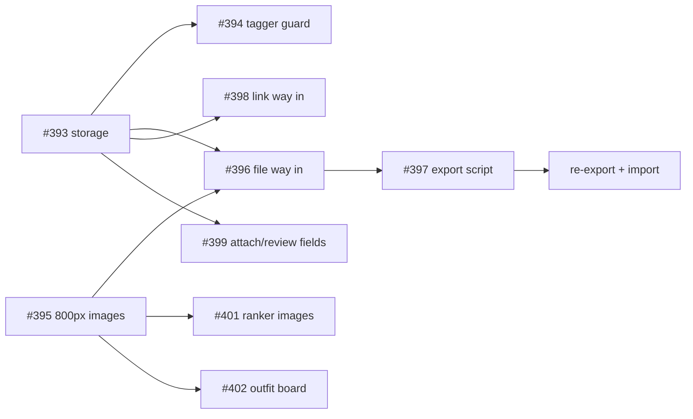

# Closet products: design and plan

Epic #392. Brief: `2026-11-16-closet-products-brief.md`. Issues #393–#403.
Nothing here is public-facing: the Closet is admin-only, so no changelog entry is owed.

## Problem

The closet is empty and a garment cannot be a real product (no store colour, size,
price, source), intake has no way to attach one, and the ranker chooses outfits
without seeing them. Joey also wants his current closet **seeded** with what the
order histories hold (44 kept pieces), the rest filled in by hand.

## Scope

In: storage fields, larger images, tagger guard, file way in, Stitch Fix export script,
link way in, attach-a-product and review fields, thumbnails to the ranker, outfit board,
the first real seed load (re-export with image addresses, import to the local
database; Joey runs the production upload).
Out: other stores' export scripts, server-side store sign-in, keeping originals,
searching a store by name.

## Decisions (my call, auto mode)

| # | Decision | Why |
|---|---|---|
| D1 | One migration `0020` (#393): `garments.color_name`, `color_source` (enum vendor/manual/model, nullable), `size`; table `garment_products`. Additive. Bump the head pin in `test_schema_check.py` and add a section to `test_migrations.py`. | Learnings: the head is pinned. |
| D2 | **No schema change for #395.** Store garment images at 800px long edge in the existing `garment_images.webp`; serve a 400px grid rendition by resizing on read (`?size=thumb`, cached by ETag). A separate constant for closet garments: shelf photos keep 400 (`LONG_EDGE` is shared today). | Avoids a second migration and a second model conflict; a few hundred 800px WebPs are ~30–60 KB each (recorded in the PR). |
| D3 | Colour family from a store name: a pure lookup module `closet_colors.py` (keyword table, longest match, e.g. "Burgundy"→red, "Military Green"→green); no match → `primary_color` left empty and Check asks. No model call. Folds in #403. | Import must stay model-free; "TWILL"/"Tan Geo Print" fall to the owner. |
| D4 | Hex: dropped for vendor-coloured pieces (`primary_hex` null); swatches fall back to the image. | Stores publish names, not hex. |
| D5 | File entries create the garment **at commit** (as typed entries do), the image bytes held on the entry until then (as shelf photos' reader does not; design in task 5). | Skipped/ignored lines must never leave a stray garment. |
| D6 | **Tag queue gets imported pieces** (feedback 1): a committed seed garment is `status=UNTAGGED`, `tag_source=NULL`, `color_source=vendor`. The existing queue picks it up and #394's guard keeps its colour, brand and size while warmth, formality, seasons, pattern, material are filled. | No new queue path. |
| D7 | **Owned-or-gone survives re-export** (feedback 2): Check shows the product photo with "Don't own this". The answer is stored per order line, key `(source, order_id, store_item_no or name+size)`, in `closet_settings["import.not_owned"]` (durable across sittings; intake's ignored state is per sitting). Re-import skips keys in that list. The 19 pieces marked gone in today's CSV seed it. | The monthly run must never ask twice. |
| D8 | **Public repo hygiene** (feedback 3): the export script reads only the line-item fields it names, never the address or card; fixtures are synthetic. `~/Developer/closet-seed/` stays out of the repo. The brief is committed as is (counts only, no item-level purchases). | The repo is public. |
| D9 | Ranker: send thumbnails (grid size) with the text, capped at 4 images per slot (top of the deterministic shortlist), under the 20 MB ceiling; gated by `closet_settings["rank.images"]`, default **off** until the #400 fixture shows latency/tokens are acceptable. | Free-tier cost unmeasured. |
| D10 | Outfit board: client-side composition of the existing tile images (top over bottom over shoes) in `AdminClosetToday.jsx`; no server render. | Flat-lay images on white; no new endpoint. |
| D11 | Link resolver lives outside `physical_sources/` (it writes drafts) but calls its throttle/robots helpers. Shopify `/products/<handle>.json` first, then JSON-LD, then typed. Colour variants become candidates with unique `external_id` = variant id; candidates are persisted on the entry (add_entry does not today). | Radio is keyed on `external_id`. |

## Sequence (feedback 4)

`#393 ∥ #395` → `#394 ∥ #396` → `#397 ∥ #398` → **re-export, then import** → `#401 ∥ #402` (+ spike #400) → `#399`.
#397 is required, not polish: without image addresses the first load has no pictures.
At most two implementers at once (disjoint files, named below); one backend pytest per checkout; PRs merge one at a time, `gh pr update-branch` between.
The main session does the browser work in parallel: reading Duer, Nordstrom Rack and Marine Layer order pages and Stitch Fix for image addresses (item fields only).

## Tasks

Gates for every brief (learnings): backend `ruff check`, `ruff format --check`, targeted pytest built from the imports of the diff, `pip-audit`; frontend `npm run lint`, `npm run format:check`, `npm test`, `VITE_DAILY_SALT=local npm run build`, audit. Do not claim CI green; CI runs the full suite.

1. **#393 storage** (Sonnet). Files: `models.py`, `migrations/versions/0020_*.py`, `tests/test_migrations.py`, `tests/test_schema_check.py`, `closet_routes.py` (`GarmentFields`, `apply_garment_fields`, `garment_out`), `closet_schemas.py`, `tests/test_closet_response_models.py` (`GARMENT_KEYS`). Accept: #393's criteria; `acquired_on` takes the purchase date; `duplicate_clusters` tests unchanged; downgrade/upgrade cycle passes.
2. **#395 images** (Sonnet). Files: `closet_images.py`, image route in `closet_routes.py` (only the image handler, lines ~679-696), tests `test_closet_images.py`. Accept: #395 per D2; ETag/versioning kept; size note in PR.
3. **#394 tagger** (Sonnet). Files: `closet_tag.py`, tag job/queue in `closet_routes.py` (tag section only), `closet_rank.py` `_describe`, tests. Accept: #394; `color_source=model` set on tag; vendor/manual keeps `color_name`, `primary_color`, both hexes.
4. **#396 file way in** (Sonnet). Files: `intake/garment_kind.py`, `intake/kinds.py`, `intake/routes.py`, `intake/commit.py`, `intake/schemas.py`, `intake/README.md`, `closet_colors.py` (+test), tests, frontend `AddSection.jsx`, `GarmentCheck.jsx`, `KindFields.jsx`, `content/intake.js`, `lib/intake.js`. Accept: #396 plus D3, D5, D6, D7 (Check shows the product photo with "Don't own this"; answers persist across re-imports); duplicate detection on `(source, order_id, store_item_no/name+size)`; no model call.
5. **#397 export script** (Sonnet). Files: `scripts/closet/stitchfix-export.js`, `scripts/closet/README.md`, synthetic fixture + a Node test of the pure mapping. Accept: #397 plus D8 (item fields only, `--since` date, no network).
6. **#398 link way in** (Sonnet). Files: `closet_resolver.py` (+tests), `intake/routes.py` link route (after #396 merged), `fixtures/closet/` (one Marine Layer, one Duer, scrubbed). Accept: #398 per D11.
7. **Seed load** (main session). Build `closet-seed-all-with-images.csv` in `~/Developer/closet-seed/` (outside the repo) from the browser; import into a local database and verify counts (44 owned minus marked-gone; images stored); Joey uploads to production.
8. **#400 spike → #401 ranker images** (Sonnet): `closet_rank.py`, `closet_today_routes.py` (`rank()` only), fixture with/without images, setting from D9. **#402 outfit board** (Sonnet): `AdminClosetToday.jsx`, `OutfitSwatches.jsx`, tests.
9. **#399 attach/review** (Sonnet): `GarmentForm.jsx` attach field, brand/colour/size in review, `SellChecklistSheet.jsx` + `closet_review_routes.py` (garment size beats profile size).

Ship notes: one additive migration (0020), applied by the Deploy API workflow on merge, rehearsed by `neon-rehearsal`. No destructive migration. Smoke: no public page changes; run `scripts/smoke.sh`, then render-logs.

## Open questions

None blocking. The #400 spike decides D9's default.

## Outcome (2026-11-16)

Merged: #405 (#393), #406 (#395), #407 (#394), #408 (#397), #409 (#396), #410 (#401), #413 (#398), #412 (#402), #415 (#399); #403 closed as part of #396. Deviations from the plan:

- **D2 kept:** garment images are 800px and the grid rendition is made on read (`?size=thumb`); no second migration. Existing garments stay at 400px until re-uploaded.
- **D5 changed in detail:** a file entry holds its photo as an `intake_photos` row until commit, so nothing reaches `garments` early; photos are fetched during Check, not at upload or commit.
- **D7 kept:** `closet_settings["import.not_owned"]` holds the durable not-owned keys; the dedupe and not-owned keys carry size and colour.
- **D9 kept:** ranker thumbnails sit behind `closet_settings["rank.images"]`, default off, no admin control; `backend/scripts/closet_rank_images_probe.py` records the with/without comparison once the closet has photos. **#400 stays open** until that is run.
- **D11 kept:** the resolver is `backend/closet_resolver.py`; a candidate is a colour (its first variant id), not a variant.
- **#399 widened:** add or replace a garment's photo, and attach a product (read, then confirm; PATCH rather than PUT because CORS allows no PUT). A manual colour or size is kept unless a replace flag is sent.
- **Seed load:** 45 owned pieces loaded from the Stitch Fix export (34) and the other stores' order lines (11); the 11 have no photo until attached with #399.
- **Known limits:** two sittings committing the same file rows at the same instant can double-write (needs a unique index); DNS rebinding is accepted for the admin-only fetches; a changed vendor colour does not update an existing colour family.
