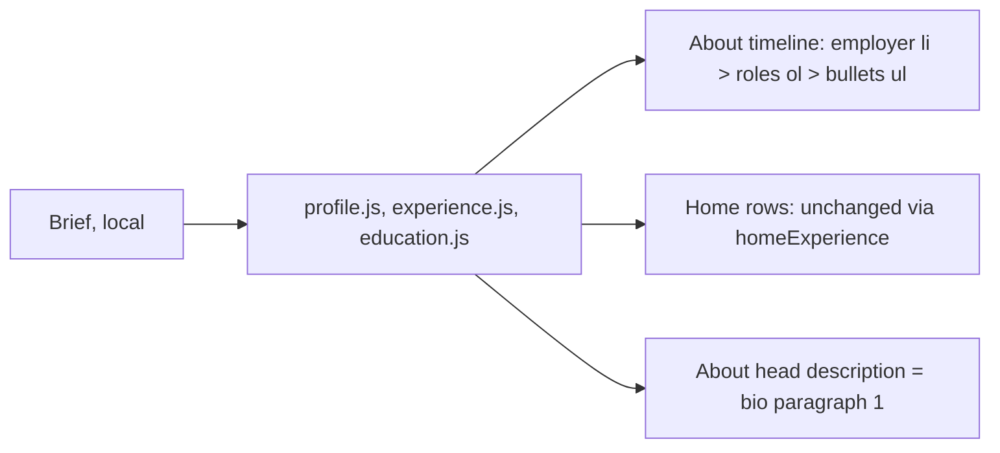

# Resume content update on the site (#390)

## Problem

The site's resume-derived content (bio, expertise, toolbox, Experience timeline, certifications) predates Joey's final 2026 resume. Issue #390 holds the story and every decision Joey made on 2026-11-16; this doc is the plan.

## Source of the wording

Joey's brief, kept **local and out of git** at `docs/planning/2026-11-14-resume-site-update.md` in the main checkout (the repo is public; a committed planning doc would publish it ahead of the site). Its wording is final and goes into the content modules verbatim, with one correction already applied in the brief (the funding-position bullet no longer ends with its "and built its foundation" clause). This plan and the PR never quote the brief.

## Scope

In:
- `frontend/src/content/profile.js`: the bio (summary), the areas of expertise (15 items), the toolbox (technical skills). The bio's old wording is replaced, not merged. `aboutFacts`, the headline, lede, tagline and facts table stay.
- `frontend/src/content/experience.js`: a new shape for an employer with roles (below), with the brief's Guild blurb, four Guild roles and bullets, and MJ Freeway, Charter and iBAHN with their bullets. Home's `homeExperience()` output stays byte-for-byte (its `short` clauses, titles and the folded earlier row).
- `frontend/src/content/education.js`: the Pragmatic chip becomes "Pragmatic Marketing Certification · Pragmatic Institute". Education years stay. The Charter Champion Award chip stays as is.
- `frontend/src/pages/About.jsx` and `index.css`: the Experience timeline in Joey's chosen direction B (stepped rail), including the print rules.
- `docs/design-system.md`: the Experience timeline rule (draft text from the designer's mockup report, edited to Joey's decisions).
- Docs and changelog (below).

Out (Joey: unchanged): the hero, title line, SITE_DESCRIPTION, Home title, index.html tags, JSON-LD, OG card, the site name, the About title and `smoke.sh`'s pin, education years.

## Solution

**Data shape.** `ExperienceEntry` gains optional fields; every existing field and Home's reads stay:
- `blurb?: string` for an employer with several roles (the brief's Guild paragraph).
- `bullets?: string[]` for a one-role employer.
- `roles?: { title: string, dates: string, bullets: string[], current?: boolean }[]`, newest first, for an employer with several roles. A test requires exactly one `current` across the timeline (a role, or a one-role employer's entry), and exactly one of `bullets` or `roles` per entry.
- The existing `summary` stays for entries that keep one (Home does not read it); an entry with `roles` or `bullets` renders those instead. `short`, `companyShort`, `earlier` and `meta` keep their meaning.
- Dates use the site's existing meta style (spaced en dash, lowercase present), with exactly the brief's months and years (Gate: design question 1).

**Markup (direction B, shared with the mockups).** `li.timeline-entry.timeline-employer` › `h3` (company alone, `--fs-18`, hollow ring) › meta kicker › blurb › `ol.timeline-roles` › `li.timeline-step` (own dot; `current` on the present role) › `h4.timeline-step-title` (`--fs-16`) › dates kicker › `ul.timeline-points` (`--fs-14`). A one-role employer keeps today's `h3` (company and role), the meta kicker, then a `ul.timeline-points`. Heading order h2 › h3 › h4. Nothing hover-only, nothing folded.

**Print.** The existing print block gets: `.about { display: block }` with the aside `position: static` stacked above the body; `.timeline-entry.timeline-employer { break-inside: auto }`; `.timeline-step` and `.timeline-points li` `break-inside: avoid`; `h4 { break-after: avoid }`. Target about 5 pages. `print.test.js` extends to pin these selectors.

**Mockups** (local, gitignored): `docs/planning/mockups/2026-11-16-resume-experience/b-stepped-rail.html` is the reference for CSS and spacing; copy tokens and parts from it, not raw values.

## Decisions (all Joey's, 2026-11-16, see #390)

Employer detail published as written (nine flagged bullets reviewed); nested roles under Guild; name unchanged; hero and title line unchanged; education years kept; Pragmatic chip renamed; the brief's wording beats the voice rules (exception recorded below); tech parentheticals stay off site bullets; direction B; site date style; Guild name at `--fs-18`; print stacks the aside; bullet cap stated in the rule only; Education and `aboutFacts` unchanged.

## Risks and checks

- **Visual baselines:** About changes substantially (Home must not). After the code lands, `gh workflow run update-visual-baselines.yml --ref 390-resume-update`, then push an empty commit.
- **Real-data a11y:** `cd frontend && SNAPSHOT_API_URL=https://api.joey-haas.dev VITE_DAILY_SALT=local npm run build && npx playwright test e2e/a11y.spec.js --project=desktop` (learnings 2026-11-12), since About is a data-free page the risk is low but the timeline is new markup.
- **Exact-string tests:** `About.test.jsx` (bio paragraphs, expertise and toolbox counts and uniqueness, certifications, the award, the new timeline), `Home.test.jsx` (must pass unchanged), `pages.test.js` (About description is the bio's first paragraph), `print.test.js`.
- **Smoke and e2e:** grep `scripts/smoke.sh` and `frontend/e2e/` for any changed text (none expected; About title unchanged).
- **The brief must not leak:** nothing from it goes into commit messages, the PR body, test names or comments beyond the content modules and the tests that assert on them.
- **Stale branches:** `chore/resume-grammarly` and `resume-jth-edits` carry older PDFs and overlapping edits; Joey closes or leaves them unmerged.

## Tasks (execution: Sonnet, one implementer, in order)

1. **Data shape and content.** Extend `ExperienceEntry` and the typedef; load the brief's Experience (Guild blurb, four roles, MJ Freeway, Charter, iBAHN) into `experience.js` verbatim; replace the bio, expertise and toolbox in `profile.js`; rename the Pragmatic chip in `education.js`. Tests first: shape validation (exactly one `current`, one of `bullets` or `roles` per entry, no duplicate between expertise and toolbox, every bullet non-empty), Home's rows unchanged. Acceptance: content tests and the Home tests pass.
2. **About timeline and CSS.** Render per direction B in `About.jsx`; add the timeline parts to `index.css` with tokens only (`--fs-*`, `--space-*`; the spacing and type tests must stay green); the print block per above. Acceptance: About tests, `print.test.js`, typeScale and spaceScale tests, lint, format, build.
3. **Docs.** Add the Experience timeline rule to `docs/design-system.md`; update `docs/voice.md` where it quotes the bio; record the sync and the voice exception in `docs/planning/2026-09-18-resume-copy-sync-design.md` (decisions only, no brief wording); set `status: done` on `docs/planning/2026-11-15-site-facts-sync-design.md` if its work shipped; add a dated `frontend/changelog.md` bullet linking `/resume.pdf` once the PDF ships.
4. **Browser check.** Phone (about 400px) and desktop, both themes, and a print emulation of About, via the throwaway Playwright approach used for #292; confirm about 5 print pages.
5. **PDF swap (Joey's file).** After Joey drops his final export into the repo, replace `frontend/public/resume.pdf` in place under that exact name; check `file` reports PDF and 2 pages; the About PDF test (`%PDF-` magic bytes) passes; the download name stays "Joey Haas Resume.pdf". Nothing here generates a PDF.
6. **PR.** One PR, `Closes #390`, ending with the Claude Code line. Wait for CI, regenerate baselines, push the empty commit, merge when `backend` and `frontend` are green and the branch is up to date.

Model: Sonnet for every task (no exception).

## Ship notes

Frontend and content only. No migration, no env change. After deploy: `./scripts/smoke.sh`, open `/resume.pdf` and check the download name, view About at phone width.

## Open questions

None. If the PDF is not ready when tasks 1 to 4 are done, ship tasks 1 to 4 as the PR and add the PDF in a second small PR so content is not held up.
