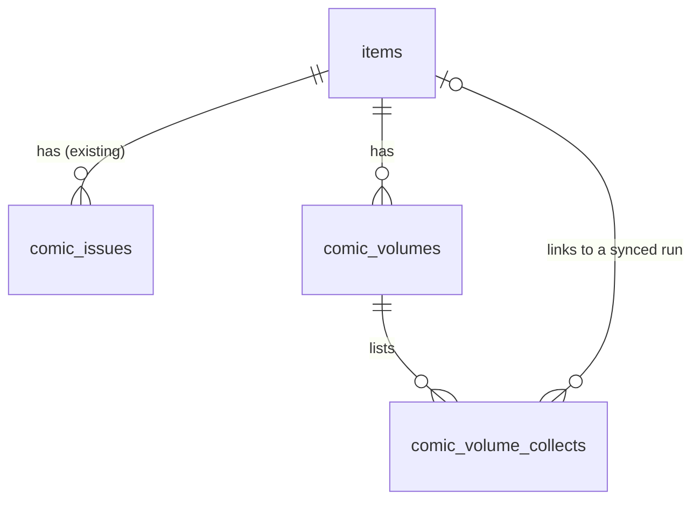

# Comics, book-first (epic #323)

## Problem

An `items` row is a series (a Comic Vine volume). A collected edition is a JSONB entry
`{kind, label, from, to}` on `items.editions`, so a trade can only be one contiguous range of
one series, and it has no ISBN, page count, line number or cross-series contents. Joey owns mostly
trade paperbacks and wants to see what is in each one. Full brief and rules: issue #323.

## Scope

In: stories #324-#335. Out: #336 and #337 (deferred), story-level contents, variants, grading,
prices, the pull list. Dropping `items.editions` is a separate, destructive release: an
always-stop for Joey, not part of this epic's PRs.

## Solution

**Title = an `items` row.** Its `external_source`/`external_id` are nullable (partial unique
index), so a cross-series book or original graphic novel is an `items` row with neither set. No
new titles table.

**Volume = a `comic_volumes` row** (additive migration `0021`):
`id` UUID pk, `item_id` FK items CASCADE, `position` int (order in the title), `slug` text
(unique per item; `ed-<from>-<to>` for migrated rows so old URLs keep working, `vol-<n>` for new
ones), `label`, `kind` (check: trade, hardcover, omnibus, compendium, ogn), `kind_raw` (the
original free text, never lost), `line_number` smallint null, `isbn`, `pages`, `description`,
`cover_url`, `large_url`, `cv_id`, `owned`, `read`, `created_at`.

**Collects = `comic_volume_collects` rows**: `id`, `volume_id` FK CASCADE, `position`,
`series_name` text, `issue_text` text (as written: `#1-6, Annual 1`), `source` (check: migrated,
typed, parsed, photo), and an optional link: `item_id` FK items SET NULL plus `from_number`,
`to_number` (canonical range; both null = text only). A link is never required.
Two volumes may collect the same issues: no uniqueness across volumes.

### My calls

1. **Title kind is derived, not stored.** From contents: issues only = run; volumes only with
   two or more = book line; one volume and no issues = single book; volumes and issues = both.
   A stored kind goes stale the moment a row is added or deleted. Written in `comics.title_kind`.
2. **Migration copies, never moves.** `items.editions` stays and is frozen from #326 on (still
   written as a mirror by the compat shim so a code rollback loses nothing). Every edition becomes
   one volume (`kind_raw` = old kind; kind mapped Trade/Hardcover/Omnibus, anything else = trade)
   plus one collects row (`series_name` = the title, `issue_text` = `#from-to`, linked to the
   item, source `migrated`). Count of volumes after = count of edition entries before, tested.
3. **Held issues come from volumes.** `owned_set` = loose singles + linked ranges of owned
   volumes. A volume with `read` set marks its linked issues read. `read_to` keeps working as
   today. Text-only and unlinked entries mark nothing.
4. **Held-only-through-a-volume refusal** names the volume (replaces the edition wording).
5. **`shown_status` rule for an owned, unread book:** a title whose only holdings are owned,
   unread volumes is `unread` (not caught up); it is `caught_up` only when every owned volume is
   read and every owned issue is read.
6. **Compat shim.** Until #334 ships the volume editor, the existing `editions` PATCH payload is
   upserted into volumes by slug (so the Editions panel keeps working) and mirrored to
   `items.editions`. #334 retires the panel; the shim stays until the destructive drop.
7. **Title-sharing rule (#330).** A trade joins a title's page when its title text normalises to
   the same name as the series and at least 60% of its linked collects entries (by issue count)
   point at that series; otherwise it is its own title. Constants live in `comics.py`; one test
   pins a case on each side.
8. **Old edition URLs** `/shelf/<id>/ed-<from>-<to>/` resolve by `slug`; new volume pages are
   `/shelf/<id>/<slug>/` with the slug family `ed-*` and `vol-*`. No redirects.
9. **UI work in auto:** no mockup round. Each UI story reuses `CoverTile`, `StatTile`,
   `ShelfConfirm`, the twin rule and `docs/design-system.md`; the plan for that PR names the
   components. Joey can reject the look in review; the PR says so.
10. **Audit (#324) is a script Joey runs.** The migration is lossless by construction (raw kind
    kept, every edition copied), so it does not wait on his counts; the PR says what to check
    after he runs it and the migration's own counts test covers the mapping.

## Plan (one PR per slice, one implementer at a time, Sonnet)

| PR | Stories | Content | Migration |
|---|---|---|---|
| 1 | #324, #325 | audit script + README; migration `0021` (two tables, backfill from `editions`); models; `title_kind`; head pin; migration tests | additive, copies data |
| 2 | #326 | `owned_set`/`sync_marks`/`plan_mark`/`check_skips`/`shown_status` read volumes; compat shim; volume owned/read write route; tests keep run-bar numbers identical | none |
| 3 | #335 slice, #329 | public volume read, title volume list, volume index; snapshot, prerender, sitemap, analytics, fingerprint; Book page; `ed-*` URLs; e2e fixture; pinned tests | none |
| 4 | #334 slice | admin volume page: edit fields and collects by hand, add, move, delete (preview + `ShelfConfirm`), Comic Vine link | none |
| 5 | #327 | collects parser (rules, then budgeted model), reprint note, entry sources, edit control | none |
| 6 | #328 | intake commits volumes, new formats, Check/Done language, idempotent re-commit | none |
| 7 | #330 | book-line title page, title-sharing rule | none |
| 8 | #331 | shelf kind, "Vol. 1, 2 and 4 of 6", Books/Single issues chips (public + admin) | none |
| 9 | #332 | issue page "Also in" | none |
| 10 | #333 | stats | none |

Each PR also: changelog entry, `docs/learnings.md` if it taught something, README/CLAUDE.md
updates for new modules, pinned field lists updated deliberately, smoke `PRIVATE_KEYS` check on
new field names, and the twin where a page ships.

### PR 1 tasks

1. `backend/scripts/audit_comics.py` (read-only, default connection like
   `export_picker_fixture.py`): counts rows by only singles / only editions / both / neither and
   by public/private/following; every distinct `editions[].kind` with a count; rows with
   overlapping editions or an edition `cv_id`; rows with skips, `read_to`, stub `comic_issues`;
   rows the migration cannot map. README entry. Unit-tested against fixture rows.
2. Models `ComicVolume`, `ComicVolumeCollect` in `models.py`; migration `0021` creating both,
   then backfilling in SQL/Python from `items.editions` (slugs via the same rule as
   `comics.edition_slugs`); downgrade drops both. Head pin bumped in `test_schema_check.py`;
   section in `tests/test_migrations.py` asserting counts before and after, kind mapping,
   `kind_raw`, linked collects, cascade (delete title deletes volumes; delete volume keeps issue
   rows).
3. `comics.title_kind(...)` pure function and tests.

Acceptance is the issue's #324 and #325 lists. Gates (named in every brief): `ruff check`,
`ruff format --check`, `pytest` on the touched files plus `tests/test_migrations.py` and
`tests/test_schema_check.py`, `pip-audit` if deps change (they will not).

## Sources

Issue #323 and its stories; `docs/planning/2026-11-13-comics-book-design.md`;
`backend/CLAUDE.md` (comics, marks, additive migrations); `backend/migrations/README.md`;
code sweep of 2026-11-17 (alembic head is `0020`; `items` has no `cv_id`, the series identity is
`external_source` + `external_id`; `items.issues_skipped` exists).

## Open questions

- Production counts (the audit) are Joey's to run; unknown edition kinds are carried in
  `kind_raw`.
- Whether `comics.json` should carry volume counts (decided in the #331 PR).

## Smoke check

After PR 1 deploys: `GET /api/version` reports the SHA, `scripts/smoke.sh` green, Neon at `0021`,
`select count(*) from comic_volumes` equals the audit's edition count.

## Shipped (2026-11-17 and 18)

| PR | Stories | Notes |
|---|---|---|
| #428, #430 | #324, #325 | Tables, audit script, migration 0021. The first deploy failed on a non-list `editions` value; #430 fixed it. |
| #429 | #326 | Marks come from volumes; the compat shim `sync_volumes_from_editions`. |
| #431, #432 | #335, #329 | Public volume endpoint, the Book page, the old edition endpoint removed. |
| #433, #434 | #334 | Admin routes and migration 0022 (`edited`), the admin Book page and Books panel. |
| #435 | #327 | Contents parser (rules, then a grounded model fallback inside the budget). |
| #436, #437 | #328 | Intake commits volumes, migration 0023 (`intake_entry_id`), Check and Done. |
| #438, #439 | #330 | `comics.shares_title` (60%), public kind, volumes and slots, the title pages. |
| #440 | #331 | Shelf kind and Books / Single issues chips. |
| #441 | #332 | The issue page "Also in". |
| #442 | #333 | Books owned, volumes missing, issues read. |

Verified on production after the last deploy: four volumes, `comic_volumes` matches the audit's four edition entries, the marks backfill returned no mismatches, and `books_owned` 7 equals a hand count (four Creepshow trades plus the three one-issue Comic Vine volumes).

## Follow-ups (not done)

- **Drop `items.editions`** is a separate destructive release and an always-stop. Before it: retire `comics.sync_volumes_from_editions`, the old `PUT /api/comics/{id}/editions/{slug}/link` route and the `editions` field on the items API and `ItemForm`, intake's Details `editions` path, and every reader still on `items.editions` (`comics_routes._state`, `row_run`, `series_from_row`).
- #336 (ISBN and barcode lookup) and #337 (GCD as a contents source) stay deferred.
- Known limits, each noted in `backend/CLAUDE.md`: an add-bar retry duplicates a volume (no idempotence key); a model re-parse can clear a rules-linked entry's link; `check_skips` in `apply_comic_fields` looks only at editions; the shelf card says "1 book with no number" when two books share one line number; the audit report is not posted on #324.
