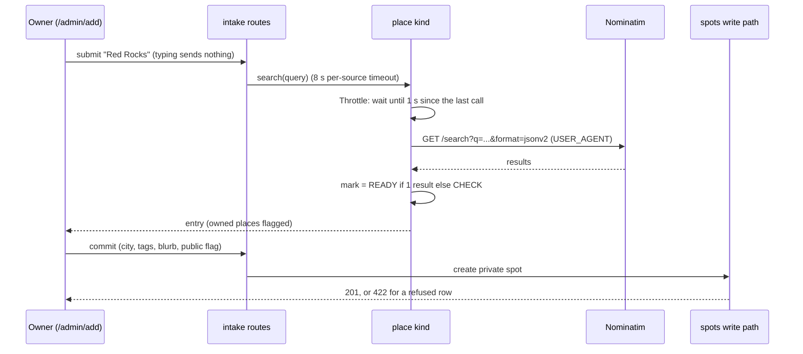

# Place kind in intake, with search by name (#340)

Story 1 of epic #339 (places and outings). Brief:
`docs/planning/2026-11-15-places-outings-brief.md`, section 1. Where the brief and an older
spec disagree, the brief wins.

## Problem

Adding a place the owner already knows needs a pasted lat/lng. Spots do not go through intake
at all, and nothing in the repo geocodes. The owner wants to type a name, get a place, check it,
and save it as a private spot. This is the first of three ways places enter (search here, the
add bar #341, paste #342), and every later place story builds on the kind this adds.

## Scope

In:

- A `place` kind in the intake registry, ways in `search` and `type` only.
- A Nominatim client (`backend/spot_sources/nominatim.py`): on submit only, at most one request
  a second, the catalogue's `USER_AGENT`, a timeout inside intake's 8 s per-source limit.
- Ready / Check mark computed from the result count.
- Commit creates a private spot through the existing spot write path.
- Owned-place detection (same OSM id, else same name within a short distance).
- The usage policy, the verified id question and the recorded fixture, written into
  `backend/spot_sources/README.md`.

Out (as in the story): the add bar on `/admin/spots` (#341), paste (#342), a photo way, model
calls, outings (#344+), city-aware `/denver` (#343).

## Solution

### Architecture decision

Options:

- **A.** Nominatim, the public OpenStreetMap instance, called on submit through a per-process
  throttle.
- **B.** Overpass name search, reusing the finder's existing source.
- **C.** A paid geocoder (Mapbox, Google, or Foursquare search, which `spots.source` already names).

Chosen: **A**, because it is free, needs no key or account, returns OSM ids that match what the
finder stores, and the policy allows one request a second for a single-user admin tool.

Gives up: a result quality guarantee (OSM coverage of small places varies, which is why more than
one result goes to Check), and the free instance's availability (no SLA; a failure shows a message
and the owner falls back to lat/lng, which still works).

Why not B: Overpass is built for area queries, not name lookup; a name search is a heavy query on
a shared server, with the 90 s timeout the finder uses, which cannot fit inside an 8 s intake
timeout. Why not C: a new paid account and a secret is an always-stop, and Foursquare is not
wired for search.

Hard to undo: little. Spots stored from Nominatim carry `source=osm` and an OSM `source_id`, the
same shape the finder writes, so swapping the geocoder later changes one module.

Sources: the policy (https://operations.osmfoundation.org/policies/nominatim/), the Search API
(https://nominatim.org/release-docs/latest/api/Search/), `backend/spot_sources/overpass.py:128`
(`source_id` form), `backend/sources/base.py:132` (`Throttle`), `backend/intake/search.py`
(`SEARCH_TIMEOUT = 8.0`), `docs/learnings.md`.

### Decisions (my call, to approve with the plan)

1. **A new intake area `places`**, not reuse of `shelf`. `kinds_for(area)` and the area enum
   keep shelf tiles off a place and vice versa. Cost: `IntakeArea` is a Postgres enum
   (`intake_area`), so this is an **additive** migration (`ALTER TYPE ... ADD VALUE`), rehearsed by
   `test_migrations.py` and `neon-rehearsal`. Task 1 checks whether an area value is genuinely
   required; if the registry can carry a place without it, the migration drops out.
2. **No new `candidate_source` value.** A Nominatim hit is an OSM element, so it stores
   `source="osm"` and `source_id=f"{osm_type}/{osm_id}"` if task 1 verifies that equals the
   finder's form. If it does not, the row stores no source and dedupes by name and distance
   (`spot_sources/dedupe.py`, 75 m, ratio 0.85) only.
3. **Mark from the count, in the place kind:** 1 result is ready, 0 or several are Check. The
   existing reader maps model confidence and `commit.py` hard-codes READY, so this rule is new
   and no model is involved.
4. **Commit has a spot branch.** `commit_one` writes shelf `Item`s today. The place branch calls
   the same code `create_spot` uses (`spots_routes.py`: coords, tags, slug, `commit_spot`), pulled
   into a shared function so the two cannot drift. A refused row answers 422 like the other kinds.
5. **Throttle:** a module-level `sources.base.Throttle(1.1)` for Nominatim. Per process is
   enough: one API instance, one owner.
6. **Timeout 6 s on the HTTP call**, inside intake's 8 s, so a slow Nominatim reports "failed"
   rather than the per-source timeout cutting it off. Any error becomes an entry message, never a
   500.
7. **Search parameters:** `format=jsonv2`, `addressdetails=1`, `limit=5`, `countrycodes=us`, a
   Denver `viewbox` as a boost (not `bounded`), so a name outside Denver still resolves.
8. **Attribution:** the place entry shows "Search by OpenStreetMap contributors" (ODbL), since
   the policy asks for visible attribution. Spots stay private, so nothing public changes.
9. **No cache beyond the request.** The policy asks for caching on bulk use; a single submit by
   one owner is not bulk, and a cache would hide a changed OSM record. Recorded in the README.

## Sources

Repo: `backend/intake/kinds.py`, `intake/routes.py` (import registration at 31-32, 422 at ~318 and
~750), `intake/search.py`, `intake/commit.py` (778, 802), `models.py` (`Spot` 861,
`IntakeArea` 1389), `spots_routes.py` (`create_spot`, `commit_spot`), `spot_sources/dedupe.py`,
`scripts/record_spot_fixtures.py`, `physical_sources/limits.py:13` (`USER_AGENT`).
External: the two Nominatim URLs above. The policy quotes in the researcher's report came from a
fetch summary; task 1 re-reads the page and quotes it verbatim.

## Open questions

- Does `Kind.source = None` (as the garment kind does) pass through `intake/search.py` for the
  search way, which filters `kind.source is not None` at line 82? If not, the place kind needs its
  own search hook. Task 3 settles it by reading the code first.
- Can the generic Check screen in `AdminAdd.jsx` draw a place (name, address, a map link)? If it
  needs more than a field label, this becomes a UI change and goes through `sdlc-design` with a
  mockup before more work. Stop and ask, do not improvise.
- Does `ALTER TYPE ... ADD VALUE` need a non-transactional migration step here (Postgres rule:
  the new value cannot be used in the same transaction)? Check against the existing migration
  style and `test_migrations.py` before writing it.
- Changelog: `frontend/changelog.md` is public and this is owner-only. Proposal: no entry.

## Smoke check

After deploy: `GET /api/intake/kinds` lists `place`; `GET /api/public/spots` is byte-identical to
before; Joey adds one real place by name on `/admin/add` and sees it on `/admin/spots`, private.

## Plan

All tasks are Sonnet unless noted. One implementer at a time.

1. **Policy, ids, fixture (research and README).** Re-read the Nominatim policy and write the
   binding rules (rate, User-Agent, no autocomplete, caching, attribution) into
   `backend/spot_sources/README.md`. Add a Nominatim function to
   `scripts/record_spot_fixtures.py`, record one real response (two or three queries, spaced over
   a second apart) to `tests/fixtures/`, and record in the README whether `osm_type`/`osm_id`
   equal the finder's `source_id`. *Accept:* README has the rules and the id answer; the fixture is
   a real response; no code parses anything else. *Files:* `spot_sources/README.md`,
   `scripts/record_spot_fixtures.py`, `tests/fixtures/nominatim_*.json`.
2. **Nominatim client.** `spot_sources/nominatim.py`: `search(client, query)`, the throttle, the
   `USER_AGENT`, the 6 s timeout, a parser tested on the fixture, errors as a typed result.
   *Accept:* two submits in one second send requests at least 1 s apart (fake clock); every
   request carries `USER_AGENT`; timeout and HTTP error return a failure, not an exception.
   *Tests:* `tests/test_nominatim.py`.
3. **Place kind and search.** `intake/place_kind.py`, registered in `routes.py`; resolve the
   `source=None` question and the area question first. *Accept:* `/api/intake/kinds` lists `place`
   with ways `search` and `type` only; typing sends no request (test); 1 result is ready, 0 or
   several are Check; an owned place is flagged and not duplicated; a Nominatim failure shows a
   message within the per-source timeout. *Tests:* `test_intake_kinds.py`, a new place-kind test file.
4. **Commit to a spot.** Share the `create_spot` core, add the place branch to `commit_one`.
   *Accept:* a committed place is a private spot with city (default Denver), tags, blurb and the
   public flag; a refused row is 422; `/api/public/spots` is unchanged (`test_public_outputs.py`
   gains the case). *Tests:* `test_intake_commit.py`, `test_spots_routes.py`.
5. **Migration (only if task 1 or 3 needs the area value).** Additive enum value, rehearsed.
   *Accept:* `test_migrations.py` upgrade, downgrade, upgrade passes; `neon-rehearsal` is green.
   Ship note: the migration is additive; the deploy workflow applies it on merge.
6. **Frontend (only if the open question says so).** Show a place's entry and the attribution
   line. If it needs a layout, stop for design.
7. **Docs.** `backend/CLAUDE.md` (intake and Denver spots sections), `backend/intake/README.md`,
   `docs/learnings.md` decision entry at ship, and the epic's checklist (#339).

Ship notes: additive migration at most (task 5); no new env var or secret; no change to
`render.yaml`. Each PR names its CI gates in the brief: ruff, pytest (targeted locally; the full
suite is CI's), pip-audit, and for any frontend change lint, format, build, `npm audit --omit=dev`.
