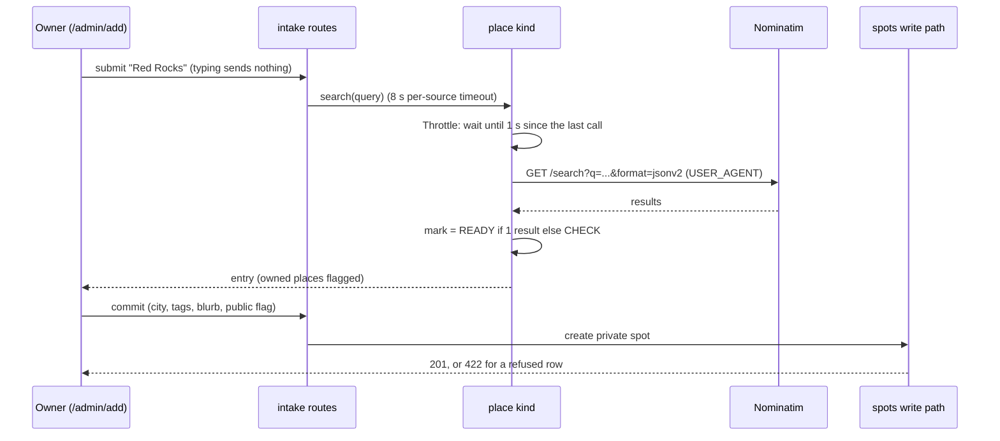

# Place kind in intake, with search by name (#340)

Story 1 of epic #339 (places and outings). Brief:
`docs/planning/2026-11-15-places-outings-brief.md`, section 1. Where the brief and an older
spec disagree, the brief wins.

## Problem

Adding a place the owner already knows needs a pasted lat/lng. Spots do not go through intake
at all, and nothing in the repo geocodes. The owner wants to type a name, get a place, check it,
and save it as a private spot. This is the first of three ways places enter (search here, the
add bar #341, paste #342), and every later place story builds on the kind this adds.

## Scope

In:

- A new intake area `places` (an additive enum migration), and a `place` kind registered under
  it, ways in `search` and `type` only, with a small `Kind.search` hook so a kind with no
  metadata source can search (added after task 3 of the first plan found the story's premise
  wrong: the kind does not appear on `/admin/add` with no new page).
- A Nominatim client (`backend/spot_sources/nominatim.py`): on submit only, at most one request
  a second, its own client name with no email address, a 7 s total deadline inside intake's 8 s
  per-source limit. Built and reviewed (tasks 1 and 2).
- The page `/admin/places/add` (the chosen mockup, direction C), reached from the Denver area.
- Ready / Check mark computed from the result count.
- Commit creates a private spot through the existing spot write path.
- Owned-place detection (same OSM id, else same name within a short distance).
- The usage policy, the verified id question and the recorded fixture, written into
  `backend/spot_sources/README.md`.

Out (as in the story): the add bar on `/admin/spots` (#341), paste (#342), a photo way, model
calls, outings (#344+), city-aware `/denver` (#343).

## Solution

### Architecture decision

Options:

- **A.** Nominatim, the public OpenStreetMap instance, called on submit through a per-process
  throttle.
- **B.** Overpass name search, reusing the finder's existing source.
- **C.** A paid geocoder (Mapbox, Google, or Foursquare search, which `spots.source` already names).

Chosen: **A**, because it is free, needs no key or account, returns OSM ids that match what the
finder stores, and the policy allows one request a second for a single-user admin tool.

Gives up: a result quality guarantee (OSM coverage of small places varies, which is why more than
one result goes to Check), and the free instance's availability (no SLA; a failure shows a message
and the owner falls back to lat/lng, which still works).

Why not B: Overpass is built for area queries, not name lookup; a name search is a heavy query on
a shared server, with the 90 s timeout the finder uses, which cannot fit inside an 8 s intake
timeout. Why not C: a new paid account and a secret is an always-stop, and Foursquare is not
wired for search.

Hard to undo: little. Spots stored from Nominatim carry `source=osm` and an OSM `source_id`, the
same shape the finder writes, so swapping the geocoder later changes one module.

Sources: the policy (https://operations.osmfoundation.org/policies/nominatim/), the Search API
(https://nominatim.org/release-docs/latest/api/Search/), `backend/spot_sources/overpass.py:128`
(`source_id` form), `backend/sources/base.py:132` (`Throttle`), `backend/intake/search.py`
(`SEARCH_TIMEOUT = 8.0`), `docs/learnings.md`.

### Decisions (my call, to approve with the plan)

1. **A new intake area `places`**, not reuse of `shelf`. `kinds_for(area)` and the area enum
   keep shelf tiles off a place and vice versa. Cost: `IntakeArea` is a Postgres enum
   (`intake_area`), so this is an **additive** migration (`ALTER TYPE ... ADD VALUE`), rehearsed by
   `test_migrations.py` and `neon-rehearsal`. Task 1 checks whether an area value is genuinely
   required; if the registry can carry a place without it, the migration drops out.
2. **No new `candidate_source` value.** A Nominatim hit is an OSM element, so it stores
   `source="osm"` and `source_id=f"{osm_type}/{osm_id}"` if task 1 verifies that equals the
   finder's form. If it does not, the row stores no source and dedupes by name and distance
   (`spot_sources/dedupe.py`, 75 m, ratio 0.85) only.
3. **Mark from the count, in the place kind:** 1 result is ready, 0 or several are Check. The
   existing reader maps model confidence and `commit.py` hard-codes READY, so this rule is new
   and no model is involved.
4. **Commit has a spot branch.** `commit_one` writes shelf `Item`s today. The place branch calls
   the same code `create_spot` uses (`spots_routes.py`: coords, tags, slug, `commit_spot`), pulled
   into a shared function so the two cannot drift. A refused row answers 422 like the other kinds.
5. **Throttle:** a module-level `sources.base.Throttle(1.1)` for Nominatim. Per process is
   enough: one API instance, one owner.
6. **Timeout 6 s on the HTTP call**, inside intake's 8 s, so a slow Nominatim reports "failed"
   rather than the per-source timeout cutting it off. Any error becomes an entry message, never a
   500.
7. **Search parameters:** `format=jsonv2`, `addressdetails=1`, `limit=5`, `countrycodes=us`, a
   Denver `viewbox` as a boost (not `bounded`), so a name outside Denver still resolves.
8. **Attribution:** the place entry shows "Search by OpenStreetMap contributors" (ODbL), since
   the policy asks for visible attribution. Spots stay private, so nothing public changes.
10. **Nominatim gets its own client name, with no email address** (Joey's call, 2026-11-17).
    The catalogue's `USER_AGENT` carries the owner's email, which Overpass and the store hosts
    already receive. For Nominatim, `spot_sources/limits.py` gains `NOMINATIM_USER_AGENT =
    "joey-haas.dev tracker (+https://joey-haas.dev)"`: it names the app and a contact page, which
    the policy accepts. This replaces the story's "carries the catalogue's `USER_AGENT`" with
    "carries the Nominatim client name"; the test asserts that constant and that no `@` appears in
    the header. The recorder script uses the same constant.
9. **No cache beyond the request.** The policy asks for caching on bulk use; a single submit by
   one owner is not bulk, and a cache would hide a changed OSM record. Recorded in the README.

11. **An optional `Kind.search` hook** (task 4). `intake/search.py` only searches kinds with a
    `source`, so a kind with its own search function never runs. `Kind` gains `search: Callable |
    None = None` (additive, default `None`); `search_area` runs kinds that have a source or a
    `search`, inside the same `SEARCH_TIMEOUT` and with the same states (ok, busy, failed). The
    search result rows gain optional place keys (address, coordinates, `source_id`, category, map
    link), `None` for shelf kinds, so shelf output is unchanged.
12. **Search-born entries.** Intake entries come from photos or typing today, and none is created
    from a search result with a state. Task 4 adds the route that creates a place entry from a
    chosen result in a `places` sitting, with its state from the count rule (decision 3). One
    sitting per visit to the page, so "Added this visit" in the mockup is the sitting's committed
    entries. Task 4 verifies this against `intake/routes.py` first and stops if it does not fit.
13. **Tags use the existing six** (Coffee, Park, Food, Kid-OK, Rainy day, Bike-friendly). The
    mockup also drew Outdoors and Music, which are not in `backend/spots.py`; growing the
    vocabulary is #351.
14. **City:** a select defaulting to Denver, listing the cities already on saved spots plus
    "Another city". It does not follow the address (Red Rocks is Morrison, stays Denver until the
    owner changes it); guessing a city from an address is wrong too often to be a default.
15. **The public toggle is off limits unless the city is Denver**, with a one-line hint, since the
    public page is Denver only until #343. The server enforces it: a public place in another city
    is a 422. This keeps the story's "spots never become public through this path" true for
    everything but a Denver place the owner chose to show.
16. **Navigation:** "Add a place" is a page in the Denver area beside Weekend and Spots
    (`/admin/places/add`), reached from the area's page list and the area tabs on a phone.

## Sources

Repo: `backend/intake/kinds.py`, `intake/routes.py` (import registration at 31-32, 422 at ~318 and
~750), `intake/search.py`, `intake/commit.py` (778, 802), `models.py` (`Spot` 861,
`IntakeArea` 1389), `spots_routes.py` (`create_spot`, `commit_spot`), `spot_sources/dedupe.py`,
`scripts/record_spot_fixtures.py`, `physical_sources/limits.py:13` (`USER_AGENT`).
External: the two Nominatim URLs above. The policy quotes in the researcher's report came from a
fetch summary; task 1 re-reads the page and quotes it verbatim.

## Design

Chosen: **C · Inline add**, `docs/planning/mockups/2026-11-17-places-add/c-inline.html` (out of
git; also published privately as an Artifact). Index: `index.html` in the same folder.

Rejected: **A · Stepper** (a full trip through four steps for every place; results out of sight
while the fields are filled, and a place added in a row needs the whole flow again). **B · Split
view** (a second pane that falls under the list on a phone; with one result the two columns repeat
each other).

Why C: the add bar (#341) and the paste way (#342) both produce a list of rows to check and add,
and C is already that list, so they arrive as more rows and not a new layout. It reuses the shape
of the existing `AddResults` row (an Add button, or a link when already owned).

Screens and states (all in `c-inline.html`): empty search; searching (a progress bar, the status
line says the wait); one result (its row open with the fields: city, tags, blurb, public toggle,
Save place); several results (up to five rows, each with Add, plus "None of these? Change the
words, or type it by hand"); no results (a message, Change the words, Type it by hand); already
saved (a row marked "Already saved" with a link to Spots, no Add); search failed (a message with
Try again and Type it by hand); saved (a "Saved <name>" panel, Add another, View on Spots, and the
place listed under "Added this visit"). Type it by hand is a collapsed panel with name, coordinates
and the same fields. "Paste a list" is room left for #342. The OpenStreetMap credit sits under every
list of results.

Interactions: typing sends nothing; Enter or the Search button submits; Search is disabled while a
request is in flight. Add opens the fields in the row and moves focus to that row's place name;
Save place closes it and adds the place to "Added this visit".

Responsive and theme: phone width (400) and desktop (1100), light and dark, as in the mockup;
controls are 44 px at phone width and 36 px on a desktop, as on `/admin/add`.

Accessibility: the line under the search box is `role="status"` (polite) and says the wait or the
count; the failure is `.admin-error` with `role="alert"`; focus moves to the heading or row of what
came back; every control has a label (no placeholder-only inputs); the map link carries the place
name in a visually hidden span; visible focus on every control.

Components: new `PlacesAdd` page and a place result row; reused: `.btn`, `.chip`, `.panel`,
`.intake-result`, `.intake-field`, `.empty-state`, `.admin-error`, the admin shell and nav.
Acceptance for the build: **matches `c-inline.html` at 1100 and 400, dark and light**; the finish
review compares screenshots at those widths.

## Open questions

- Does `ALTER TYPE ... ADD VALUE` need special handling here (the new value cannot be used in the
  same transaction)? Task 3 checks against the existing migration style and `test_migrations.py`.
- Does the search-born entry route (decision 12) fit the sitting model, or does it need more than
  one additive route? Task 4 reads `intake/routes.py` first and stops if it grows.
- Changelog: `frontend/changelog.md` is public and this is owner-only. Proposal: no entry.
- Decisions 13 to 15 are proposals for Joey; the mockup's open questions were not answered.

## Smoke check

After deploy: `GET /api/intake/kinds` lists `place` under area `places`; `GET /api/public/spots` is
byte-identical to before; Joey opens `/admin/places/add`, searches one real place by name, adds it
and sees it on `/admin/spots`, private.

## Plan

All tasks are Sonnet unless noted. One implementer at a time. Tasks 1 and 2 are done and reviewed.
Numbers below are the new order; in the ledger the old numbers are: old 3 (place kind) is now 4,
old 4 (commit) is now 5, old 5 (migration) is now 3.

1. **Policy, ids, fixture (done).** Commits 389314d..91de513.
2. **Nominatim client (done).** Commits 91de513..ffe3050: `spot_sources/nominatim.py`,
   `NOMINATIM_USER_AGENT`, a 7.0 s total deadline, a 1.1 s throttle, 23 tests.
3. **Migration: the `places` area.** Add `places` to the Postgres enum `intake_area` and to
   `IntakeArea` in `models.py`. *Accept:* additive; `test_migrations.py` upgrade, downgrade,
   upgrade passes; `neon-rehearsal` green; shelf and closet sittings behave as before (existing
   intake tests pass). Ship note: additive, applied by the Deploy API workflow on merge, never
   by hand. *Files:* `backend/models.py`, a new `backend/migrations/versions/` revision,
   `backend/tests/test_migrations.py`.
4. **Place kind, the search hook and search-born entries.** `Kind.search` (decision 11),
   `intake/place_kind.py` registered under area `places`, the result-count mark (decision 3), owned
   detection (same `source_id`, else name within 75 m), the route that creates an entry from a
   chosen result (decision 12). *Accept:* `GET /api/intake/kinds` lists `place` with ways `search`
   and `type` only; typing sends no request (test); 1 result is ready, 0 or several are check; a
   failure is a message on the entry and never a 500; the search runs inside `SEARCH_TIMEOUT`; an
   owned place is flagged and not created twice; shelf search output is unchanged (existing tests
   pass). *Tests:* `test_place_kind.py`, `test_intake_kinds.py`, the intake search tests.
5. **Commit to a spot.** Share the `create_spot` core, add the place branch to `commit_one`.
   *Accept:* a committed place is a private spot with city, tags, blurb and the public flag (decision
   15 enforced, 422 otherwise); a refused row is a 422; `/api/public/spots` is unchanged
   (`test_public_outputs.py` gains the case). *Tests:* `test_intake_commit.py`,
   `test_spots_routes.py`.
6. **Frontend: `/admin/places/add`.** Route, nav entry (decision 16), `areaOfPath` and `addPath`
   in `lib/intake.js`, the page and result row per the chosen mockup. Load the `frontend-design`
   skill. *Accept:* matches `c-inline.html` at 1100 and 400, dark and light; the states above;
   keyboard and screen-reader notes as in Design; `npm run lint`, format, build, test and
   `npm audit --omit=dev` pass; an e2e or component test per state. *Files:* `frontend/src/pages/`,
   `frontend/src/lib/intake.js`, the admin nav, their tests.
7. **Docs.** `backend/CLAUDE.md` (intake and Denver spots sections), `backend/intake/README.md`,
   `backend/spot_sources/README.md` (quote the policy's "very few users" sentence behind the
   no-cache decision; rephrase "dedupe can key on the shared id" as a decision), a `docs/learnings.md`
   decision entry (at ship), the epic's checklist (#339), and a comment on #340 that its premise
   ("appears on /admin/add with no new page") was wrong.

Ship notes: one additive migration (task 3); no new env var or secret; no change to `render.yaml`.
Each brief names its CI gates: ruff, pytest (targeted locally; the full suite is CI's), pip-audit,
and for the frontend lint, format, build and `npm audit --omit=dev`. The finish review includes
`/security-review` (a new external call, a new admin write path) and the screenshot comparison.
