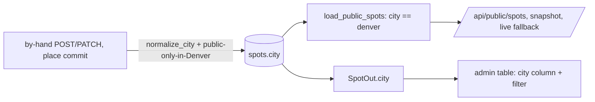

# City-aware spots, and /denver shows Denver only (#343)

Story 4 of epic #339 (places and outings). Brief: `docs/planning/2026-11-15-places-outings-brief.md`,
section 1 and the model section. Builds on #340 (places through intake) and #341 (the add bar).

## Problem

`spots.city` exists (`String(40) NOT NULL default 'denver'`, migration 0013) and intake already
writes it, but the public spots loader does not read it and `PublicSpot` has no city. Once a spot
in Boulder or Tokyo is published, the public `/denver` map and the build snapshot would show it.
The by-hand path has no city field at all (`SpotIn` and `SpotPatch` have none, the form has none),
and its Public toggle can publish a spot in any city. City spellings are not normalised on that
path, so "Denver" and "denver" could become two cities.

## Scope

In:

- The public spots loader returns only spots whose city is Denver (one filter in
  `load_public_spots`; the endpoint, the snapshot and the live fallback all read it).
- `PublicSpot`'s field set is unchanged: no city field is added (`SPOT_FIELDS` still passes).
- One city rule for every write path (by-hand create and PATCH, the place commit): trimmed, inner
  whitespace collapsed, lower-cased, non-empty when given, at most 40 characters after trimming, so
  two spellings of Denver are one city. A blank city is a 422, not a silent Denver.
- A public spot must be in Denver on EVERY write path (by-hand create, PATCH, the commit), not only
  at the intake commit: a 422 otherwise.
- The admin side: the spot form has a City field; the spots table shows the city and filters by it.

Out: per-city public pages, a city picker on the public site, a second city's map, making the
weekend planner or the finder city-aware (admin-only readers; the title covers the public page).

## Solution

### Decisions (my call, auto mode)

1. **One filter, case-insensitive:** `load_public_spots` adds `func.lower(func.trim(Spot.city)) == "denver"`
   (the constant is `DEFAULT_CITY`). Legacy rows written before normalisation, in any case, still
   match. `PublicSpot` is untouched; the test seeds a PUBLISHED Boulder spot and asserts it is
   absent from the endpoint and the snapshot read, and that `SPOT_FIELDS` is unchanged.
2. **`normalize_city(raw) -> str`** in `backend/spots.py` (pure, next to `parse_coords`): strip,
   collapse whitespace, lower-case; raises `ValueError` with a plain message when empty after
   trimming or over 40 characters. The place commit's `clean_fields` and the by-hand routes both use
   it (the commit keeps its current default of Denver for an OMITTED city). A provided blank city on the place commit stays Denver (the page's Another city field relies on it); by-hand routes 422 on blank or null.
   Case-insensitive matching against existing cities needs no query: every write path lower-cases,
   so two spellings of one city cannot be stored. Rows already stored in another case are read
   case-insensitively and a one-line read-only production check
   (`SELECT city, count(*) FROM spots GROUP BY city`) is run before deploy; no data rewrite, no
   migration.
3. **By-hand routes take a city:** `SpotIn.city` (optional, default Denver) and `SpotPatch.city`
   (optional), validated by `normalize_city`; `SpotOut.city` already exists.
4. **Public only in Denver, everywhere.** A new `check_public_city(city, is_public)` shared by
   `create_spot`, `update_spot` and the commit: `is_public` true with a non-Denver city is a 422 "A
   public place has to be in Denver." (decision 15 of #340, extended). PATCHing a public spot's city
   away from Denver is a 422 too (it must be made private first); making a spot private and moving
   it in one PATCH is allowed.
5. **UI:** the form's City field is a text input with a datalist of the cities already used (Denver
   first), default Denver; the Public checkbox is disabled with the #340 hint unless the city is
   Denver and clears when the city leaves Denver. The table gets a City filter (a select in the
   toolbar: "All cities" plus each city with a count) and shows the city as a muted second line
   under the spot name (so the table does not grow a column on a phone), shown only when it is not
   Denver or when the filter is "All cities" and the page holds more than one city. This extends
   existing table, filter and form patterns; no new screen or layout, so there is NO mockup (ruling:
   the design step is skipped for a change that adds one select, one input and one text line to
   existing components; the finish review compares screenshots against the design system and the
   existing page).
6. **The add bar and place fields share one city list** (a small shared helper
   `lib/cities.js`: the fallback list and the derivation from spots), replacing the copies in
   `AdminSpots.jsx` and `SpotsAddBar.jsx`.
7. **No migration, no env var, no `render.yaml`.** Changelog: none (owner-only), as #340 and #341.

## Sources

`backend/public_outputs.py` (`load_public_spots`, `PublicSpot`), `backend/public.py`,
`backend/spots_routes.py` (`SpotIn`, `SpotPatch`, `build_spot`, `update_spot`), `backend/spots.py`,
`backend/intake/place_kind.py` (`clean_fields`), `backend/intake/commit.py`,
`backend/tests/test_public_outputs.py` (`SPOT_FIELDS`), `frontend/src/pages/AdminSpots.jsx`,
`frontend/src/components/SpotForm.jsx`, `frontend/src/components/places/*`, `docs/learnings.md`.

## Open questions

- Production cities: run the read-only check before deploy; if unexpected spellings exist (other
  than lower-case `denver`), report them (no rewrite without Joey: a data rewrite is an always-stop).
- Stored city case: new writes are lower-case; the admin shows it capitalised (display only).

## Smoke check

After deploy: `GET /api/public/spots` is unchanged for the current data (all Denver); the admin
spots page shows the City filter and each row's city; set one spot's city to Boulder, publish it:
422; make it private: it is saved and absent from `/denver`.

## Plan

All tasks Sonnet, one implementer at a time. No migration.

1. **Backend.** `spots.normalize_city`, `check_public_city`, `SpotIn.city`/`SpotPatch.city`, the
   rules of decisions 2 to 4 in `create_spot`/`update_spot`/the commit, the public loader filter,
   tests, `backend/CLAUDE.md` and README lines that say "until #343". *Accept:* the criteria of
   decisions 1 to 4, each with a test that fails without it: a published Boulder spot is absent
   from the public loader and the endpoint; `SPOT_FIELDS` unchanged; "Denver ", "DENVER" and "denver"
   are one city; a blank or 41-character city is a 422; public + non-Denver is a 422 on create, PATCH
   and commit; a public Denver spot cannot be moved to Boulder; private + move is allowed;
   `test_public_outputs.py`, `test_spots_routes.py`, `test_place_kind.py`, `test_place_commit.py`
   pass; the loader filter is case-insensitive (a legacy "Denver" row still appears).
2. **Frontend.** `lib/cities.js`, the `SpotForm` City field and Public rule, the table's City filter
   and city line, `AdminSpots`/`SpotsAddBar`/`PlaceFields` using the shared helper, tests, docs
   (`frontend/CLAUDE.md`). *Accept:* component tests for the form (default Denver, datalist, public
   disabled off Denver, clears on leave), the filter (counts, filtering, with the New pill and the
   add bar), the city line rule; existing tests pass; the page has no horizontal scroll at 400 (by
   the finish review's screenshots); the admin e2e `spots add bar` cases still pass.

Ship notes: no migration. The read-only production city check precedes the deploy. CI gates in the
briefs: ruff, pytest (name `test_public_outputs.py`, `test_spots_routes.py`, `test_place_kind.py`,
`test_place_commit.py`, `test_schema_check.py`), pip-audit; frontend lint, format, build,
`npm audit --omit=dev`; `e2e-admin`. The finish review includes `/security-review` only if the
public output change needs it (it narrows public output: a light check).
