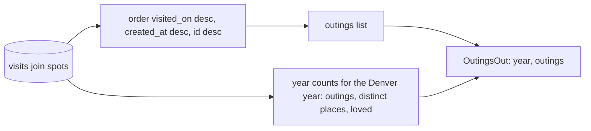

# History page (#347)

Story 8 of epic #339. Brief: `docs/planning/2026-11-15-places-outings-brief.md`, section 2.

## Problem

Nothing shows outings back. The first goal is a history of the fun things done.

## Scope

In: an admin History page in the Denver area listing outings newest first, grouped by month, with the
precision shown; a header line of the year's counts; `EmptyState`; a "Log an outing" button using the
existing sheet; a private read route. Out: filters (#348, leave room), links from the spots table,
any public page, editing or deleting an outing.

## Mockup

`docs/planning/mockups/2026-11-18-history/` (gitignored). **Chosen: `a-dated-list.html`** (designer's
pick, binding in auto mode). Rejected: `b-table.html` (needs a second layout on phone, notes squeezed
into a narrow column) and `c-year-and-months.html` (most build, its month index overlaps the next
story's filters, tiles are not the "header line" the brief asked for). B's count pills and C's verdict
edge can come later. Acceptance: the built page matches `a-dated-list.html` at 400px and 1280px.

## Solution

`GET /api/spots/outings` (admin, in `spots_routes.py`, response model `OutingsOut`):

Each outing: `id`, `spot_id`, `spot_name`, `neighbourhood`, `city`, `visited_on`, `precision`, `title`,
`verdict`, `kid_along`, `note`. The route is admin only; `note` never leaves the admin side (public
bodies unchanged; `test_public_outputs.py` gets a case that no public body carries an outing field).
Ordering inside one stored date: day before month before year, then `created_at desc`, then `id desc`.
Year counts use the owner's Denver day for "this year" and count every visit in it, a month or year
outing included (stored as period start).

Frontend `pages/AdminHistory.jsx` (lazy route `history`, in `ADMIN_AREAS` Denver after Spots, in
`ADMIN_ROUTES`, `App.jsx`), `lib/outingGroups.js` (pure: group by month, put a year outing in its own
year group after that year's months, label by precision), copy in `content/outings.js`.

- Row: date column (mono "Sat, Nov 14" for a day; plain words for loose dates: "Some time in
  September 2026", "Some time in 2024"), then title or the place's name, place line (neighbourhood
  and city; just that when the name is the heading), the note full width, then verdict (shape plus
  word, reuse `.status-text`; no verdict reads "No verdict") and a "Kid came along" pill only when true.
- Header: `AdminPageHeader` with the description line "2026 so far: 15 outings, 13 places, 7 loved."
  (hidden when empty, loading or failed) and the "Log an outing" button in its slot. A filter slot
  stays free below it for #348.
- States: `LoadState` loading and failed with retry (`withDeadline`, `READ_DEADLINE_MS`, the
  `AdminDiscover` pattern), `EmptyState` with Log an outing, the 401/403 ended branch like AdminWeekend.
- After the sheet saves, reread the list; a maybe-saved failure rereads too (`onMaybeSaved`).
- Add the Tool-page layout rule to `docs/design-system.md`.

## Decisions (my call, auto mode)

1. Year-precision label "Some time in 2024" (the designer flagged the bare "2024" as redundant under
   a "2024" heading); the heading stays.
2. A year group sorts after that year's months (it is stored as Jan 1; simplest and stable).
3. Counts are the current year only, computed server-side so they cannot disagree with a client cap.
4. No pagination: a single-user history; revisit if it ever passes a few thousand rows.
5. Verdict marks reuse `--ok` and `--warn`, shape plus word carry the meaning.

## Tasks

### Task 1: Read route (backend)
Files: `backend/spots_routes.py`, `backend/tests/test_spots_routes.py`, `backend/tests/test_public_outputs.py`,
`backend/tests/test_recs_response_models.py` (route-count pin 33 to 34), `backend/CLAUDE.md`.
Acceptance: route and ordering above; tests for ordering (same date mixed precision, same
`created_at`), year counts (distinct places, loved only, month and year outings counted, a prior-year
visit excluded, Denver-day year boundary with a frozen clock), empty database, 401 without admin,
no outing field in public outputs. A response model that is not a bare object. No migration.
Model: Sonnet.

### Task 2: The page (frontend)
Files: `frontend/src/pages/AdminHistory.jsx` (+ test), `frontend/src/lib/outingGroups.js` (+ test),
`frontend/src/content/outings.js`, `frontend/src/components/adminAreas.js` (+ test),
`frontend/scripts/prerender-lib.mjs` (+ test), `frontend/src/App.jsx`, `frontend/src/App.test.jsx`
(title row), `frontend/src/components/AdminShell.test.jsx` (Denver page list), `frontend/src/index.css`,
`docs/design-system.md`, `frontend/CLAUDE.md`, root `CLAUDE.md`.
Acceptance: matches `a-dated-list.html` at 400px and 1280px; every row and state above; grouping tests
for month, year, mixed precision and a year boundary with a frozen clock; no horizontal overflow at 400px
(`min-width:0; max-width:100%; overflow-wrap` on the long unbroken title and note); axe clean; the route
tests tie `ADMIN_ROUTES` to `App.jsx`; no `window.confirm`; the note renders as text. Run
`npm run format:check`, lint, targeted tests and the build before the commit.
Model: Sonnet.

## Ship notes

No migration, env var or outside call. Smoke unchanged; the route is admin only, verified by tests and
a logged-out 401 on the live API.
