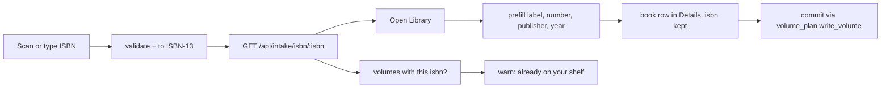

# ISBN and barcode lookup for comics (#336)

## Problem

Adding a book to a comic title means typing its label and, for the ISBN, nothing:
`comic_volumes.isbn` exists (models.py, `VolumeFieldsIn`) but no path fills it and
nothing looks an ISBN up. The add bar's "Scan a barcode" button is a disabled
placeholder (`AddBar.jsx`). An ISBN would be faster than a photo, and it gives the
ISBN field its data.

## Scope

In: an ISBN source adapter, an admin lookup route, an ISBN box with a Look up button
on each book row of the Details step, a camera scan button that fills that box, an
"already on your shelf" warning when a volume with that ISBN exists, the ISBN carried
through intake into the volume.

Out: GCD (#337); title-level ISBN; auto-creating a title from an ISBN alone (the owner
picks the title first, as today); storing covers; any LLM call (so no intake budget).

## Decisions (my call, auto mode)

- **Source: Open Library**, `GET https://openlibrary.org/api/books?bibkeys=ISBN:<isbn13>&jscmd=data&format=json`.
  Keyless, returned title, subtitle, authors, publisher, year, pages and cover for
  Saga Vol. 1 (researched 2026-11-18, https://openlibrary.org/dev/docs/api/books).
  Rate limit 1 req/s, 3 req/s with a identifying `User-Agent`
  (https://openlibrary.org/developers/api); we make a few a day. Licence: the
  Internet Archive "does not assert any new copyright or other proprietary rights"
  (https://openlibrary.org/developers/licensing, page last edited 2021), so we store
  only bibliographic facts and **link** the cover, never copy it.
- **Rejected:** Comic Vine (no ISBN field on any resource), Google Books (keyless
  quota 0, a key needed), ISBNdb (paid), WorldCat Classify (retired).
- **Series is not in the response.** The volume number is read from the subtitle
  ("Volume One", "Vol. 2") by a pure parser; when it cannot be read the field stays
  empty and the owner types it. Nothing is guessed.
- **Lookup is a convenience, never a gate.** A miss, a timeout or a bad ISBN leaves
  the form usable; the ISBN is still saved if the owner keeps it.
- **ISBN is validated** (10 or 13 digits, check digit, hyphens and spaces stripped,
  ISBN-10 converted to 13) before any call. A bad code never leaves the server.
- **Scanning:** a lazy-loaded decoder (`@zxing/library`, Apache-2.0, ~117 kB gzip) so
  it costs nothing until the button is used; iOS Safari has no native
  `BarcodeDetector`. A typed box is always the fallback. Camera permission failure
  shows a plain message and the box.
- **Reuse, no new writer:** the ISBN rides on the typed book (`payload.books[].isbn`)
  through `comic_books.edit_book`, `volume_plan.book_plan` and `write_volume`, so
  idempotence and the Check preview stay as they are.
- **No migration:** `comic_volumes.isbn` and the JSONB payload already exist.

## Tasks

1. **Source adapter.** `backend/sources/openlibrary.py` (own README section in
   `sources/README.md`): `normalize_isbn`, `parse_volume_number`, `_parse_book` (pure),
   `lookup(isbn)` with `httpx2`, TIMEOUT 10, `Throttle`, a User-Agent naming the site
   and a contact, typed errors from `sources/base.py`. Tests with a recorded fixture
   (Saga Vol. 1, one miss, one 429) in `tests/test_sources_openlibrary.py`.
   Acceptance: bad checksum rejected without a request; "Volume One", "Vol. 2",
   "Book Three", none, all parse as stated.
2. **Route.** `GET /api/intake/isbn/{isbn}` (admin, same auth as the other intake
   routes): returns `{isbn, found, title, volume_number, publisher, year, pages,
   cover_url, on_shelf: [{item_id, title, volume_slug}]}`. A source error returns
   `found: false` with a `reason`, never a 500. Acceptance: tests for hit, miss,
   source down, bad ISBN (422), and on-shelf match.
3. **Carry the ISBN.** `isbn` accepted on typed books (validated, normalised to 13),
   written to `comic_volumes.isbn` by `write_volume`, shown in the Check preview.
   Acceptance: a typed book with an ISBN commits a volume with it; a retry is
   idempotent; a bad ISBN is a 422 at the entry, not a 500 at commit.
4. **Frontend way in.** ISBN field and Look up button on each book row
   (`ComicBooks.jsx`, words in the intake content file); results prefill only empty
   fields; the on-shelf warning; the scan button in `AddBar.jsx` is replaced by a
   working one that opens a scanner sheet (lazy chunk) and fills the field, with the
   typed fallback. Tests for the row logic; one e2e that types an ISBN with the
   lookup route stubbed. Acceptance: no console errors, works at phone width, the
   decoder chunk is absent from the main bundle.
5. **Docs.** `backend/intake/README.md` and `sources/README.md`, `frontend/changelog.md`
   entry, the `backend/CLAUDE.md` note, `env.example` untouched (no key).

Model: Sonnet for all tasks. One implementer, one PR, one cold review.

## Ship notes

Migration: none. Smoke check: `GET /api/intake/isbn/9781607066019` signed in returns
Saga, and the public comics md5 is unchanged. Changelog entry is part of done.

## Open questions

None blocking. Series enrichment from Comic Vine by title is a later nicety.
