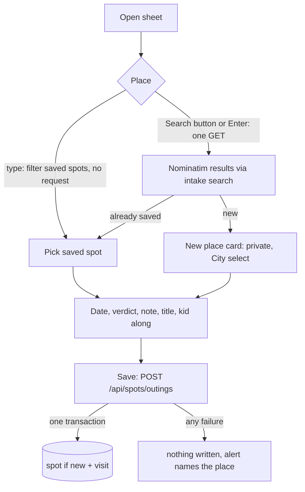

# Log an outing in one gesture (#346)

Story 7 of epic #339. Brief: `docs/planning/2026-11-15-places-outings-brief.md`, section 2.

## Problem

Log visit posts today's date with no verdict, and only on a place already saved. Logging a concert or a
hike should take one pass on a phone, including a place the site has never seen.

## Scope

In: one `Sheet` with place, date, verdict, one line, optional title and kid-along; a combined
create-and-log route; entry points on `/admin/spots` and the Denver area home (`/admin/weekend`).
Out: the history page, "Did you go?", backfill by paste, the planner's `recent_visits`.

## Mockup

`docs/planning/mockups/2026-11-18-log-outing/` (gitignored). **Chosen: `a-one-form.html`** (the designer's
pick, binding in auto mode). Rejected: `b-place-view.html` (an extra view and tabs for the place,
more build and a Back on every outing; its gain is browsing a long list, which a filter box covers) and
`c-taps-first.html` (needs a rule for which six spots to chip, hides title and kid-along, tallest sheet).
C's Today / Yesterday chips can be added later without changing A. Acceptance: the built sheet matches
`a-one-form.html` at 400px and 1280px.

## Solution

### Backend

`POST /api/spots/outings` (admin, in `spots_routes.py`). Body `OutingIn` = the `VisitIn` fields plus
exactly one of `spot_id` or `place` (`name`, `lat`, `lng`, optional `city` default Denver, optional
`source_id`). Response `OutingOut`: `visit` (`VisitOut`), `spot` (`SpotOut` as the list returns it) and
`created` (bool).

- The visit checks leave `log_visit` for a helper both routes call (title length, future date, row
  build), so the two cannot drift. The helper runs **before** anything is added.
- New place: `place_kind.clean_name` and `clean_position`, `source_id` checked as in `clean_chosen`;
  `lock_place_commits`; `owned_spot_id` (same source id, else same name within `SAME_PLACE_METRES`).
  When owned, no spot is created and the owned spot takes the visit (`created: false`). Otherwise
  `build_spot` (private, `source=OSM` when a `source_id` is sent), `session.add`, `flush`, add the visit,
  one `commit_spot`. Any error rolls the transaction back: nothing is created.
- A new place is always private (`is_public` False), so `check_public_city` cannot refuse it.
- No outbound call, no model, no new env var. Search stays the existing `GET /api/intake/search`.
- Public bodies carry nothing new; `test_public_outputs.py` gets a case that a spot created through the
  new route is private and absent from public outputs.

### Frontend

- `components/LogOutingSheet.jsx` (one `Sheet`; open state lives in the page), copy in
  `content/outings.js` (reuse `placesAdd` wording for search states and failure).
- Place box filters the saved spots (fetched once when the sheet opens via `GET /api/spots`) as you type,
  no request. A separate search `<form>` (Enter searches, never saves) calls the intake search on submit
  only; a result already saved is marked "Already saved" and picks the saved spot.
- New place card: "New, Private. Not on Spots yet. Save outing adds it as a private spot in <City>,
  in the same save", with a City select (Denver, Boulder, Golden, Another city) using `lib/cities.js`.
- Date: native input, default `localToday()`, `max` tomorrow; a message beside the field when over,
  `aria-invalid` and `aria-describedby`; the server check is the authority and its 422 shows too.
- Verdict: required radio group (Loved, Fine, Not again). Note: one line, 200 characters. Title (80) and
  Kid came along both start empty; the toggle is tri-state (unset, yes) so it never copies the planner.
- Saving: body `inert`, both buttons disabled, `canClose` false. Failure: an alert above the buttons says
  nothing was saved and names the place; the form keeps its values. A failed search reuses
  `placesAdd.failed`.
- Entry points: a "Log an outing" button in the `/admin/spots` header and in the Weekend Visits panel
  (replacing the plain link). `onSaved` rereads spots on `/admin/spots` and the visits on Weekend.
- Existing per-row "Log visit" stays (today, no verdict) for one-tap speed.

## Decisions (my call, auto mode)

1. Two tasks: backend route first, then the sheet.
2. A new route rather than two client calls: two calls cannot be atomic.
3. Already-saved search results reuse the saved spot instead of failing with 409.
4. Verdict is required in the sheet, optional in the API (the column is nullable and the row buttons log none).
5. A failed or empty search is shown beside the box; saved-spot picking still works without the network.

## Tasks

### Task 1: Combined create-and-log route (backend)
Files: `backend/spots_routes.py`, `backend/tests/test_spots_routes.py`, `backend/tests/test_public_outputs.py`,
`backend/CLAUDE.md`.
Acceptance: the route above; existing `log_visit` tests unchanged and green; tests for: saved spot
path, new place creates private spot plus visit and returns `created` true, owned place reuses
(`created` false, no second spot), future date and over-long title and bad coordinates return 422 with
zero spots and zero visits created (assert counts), a visit-insert failure after the spot flush leaves no
spot (monkeypatch the commit), city normalised, public output unchanged. Show the atomicity test failing
without the single-transaction code. No migration.
Model: Sonnet.

### Task 2: The sheet (frontend)
Files: `frontend/src/components/LogOutingSheet.jsx` (+ test), `frontend/src/content/outings.js`,
`frontend/src/pages/AdminSpots.jsx`, `frontend/src/pages/AdminWeekend.jsx` (+ tests), `frontend/src/index.css`,
`frontend/CLAUDE.md`, root `CLAUDE.md` epic note.
Acceptance: matches `a-one-form.html` at 400px and 1280px; every behaviour in Solution; no
`window.confirm`; axe clean; no horizontal overflow at 400px (`min-width:0; max-width:100%;
overflow-wrap`); a test fake mirrors the server's 422 messages; search only on submit (test: typing
sends no request); Sheet tests polyfill `showModal`/`close`.
Model: Sonnet.

## Ship notes

No migration (head stays 0025). No new env var, key or service. Smoke: `./scripts/smoke.sh`; the route is
admin-only, so verify it by tests and by a logged-out 401 on the live API.
