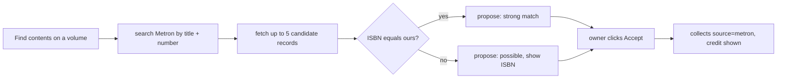

# Metron as a contents source (#337, reopened)

## Problem

A trade's contents (which issues it collects) are typed, photographed or parsed from a
Comic Vine description (#327). When the rules cannot read the description and the owner
has no photo, the collects list stays empty. GCD cannot help (its API has no collects
field; #337 was closed on that basis, then reopened here).

## What the research found (2026-11-18, real requests)

- **Metron** (https://metron.cloud) is a community comics database with a REST API,
  token auth (`Authorization: Bearer <token>`), a free account.
- Its issue record for the Saga trade, `GET /api/issue/52773/` ("Saga TPB (2012) #1"):
  `isbn` "9781607066019" (matches the volume's ISBN from #457), `title` "Volume One",
  `page` 160, `cv_id` 360829, `gcd_id` 1015888, `resource_url`
  `https://metron.cloud/issue/saga-2012-1/`, and a structured
  `reprints: [{id: 7997, issue: "Saga (2012) #1"}, ... #6]`. This is the first source
  that returns a trade's issues as data.
- Issue list filters (from the published OpenAPI spec): `series_name`, `number`,
  `series_volume`, `series_year_began`, `publisher_name`, `upc`, `sku`, `cv_id`,
  `gcd_id`. **There is no `isbn` filter**, so the ISBN is a match check, not a key.
- Reported limits (secondary sources, unverified): 20 requests per minute, 5,000 per day.
- Licence: the API spec declares **CC BY-SA 4.0** (credit, link back, share-alike).
  The Metron site's Terms page could not be read (bot block): not verified.
  Server code is GPL-3.0; we copy none.

## Scope

In: a Metron adapter, a "Find contents" action on a volume (owner confirms what it
proposes), `source = 'metron'` on the collects it writes, a credit line wherever such
contents show, the token as an optional config value.

Out: GCD; any automatic fill (always a proposal the owner accepts); reading Metron for
anything but contents; covers; the nightly jobs; a Render env var (the owner sets
`METRON_TOKEN`; that is a production setting and an always-stop for me).

## Decisions (my call)

- **Propose, never auto-write.** A match can be the wrong edition. The owner sees the
  Metron title, ISBN, page count, the list, and a link to the Metron page, and clicks
  Accept. Nothing is recorded until then.
- **Matching** (no ISBN filter): search issues with `series_name` = the title and the
  volume's `line_number` as `number` where it has one; for each of at most 5 candidates
  fetch the detail (cheap: a few calls per click) and rank: ISBN equal to the volume's
  (normalised, ISBN-13) is a strong match and is marked so; no ISBN match returns the
  candidates as "possible" with the ISBN shown. Zero candidates is a plain "not found".
  Only candidates whose series type is a collected type (Trade Paperback, Hardcover,
  Omnibus, etc.) are proposed.
- **Parse reprints** (`"Saga (2012) #1"`) into `{series_name, year, number}` with a pure
  parser, group by series, merge consecutive numbers into ranges; an unparseable entry is
  kept as raw `issue_text`, never dropped. The result becomes collects rows in the same
  shape as the other sources.
- **Provenance:** a new `comic_volume_collects.source` value `metron`. The CHECK
  constraint currently allows migrated/typed/parsed/photo, so this needs migration `0027`
  (additive: widen the constraint; downgrade narrows it after mapping `metron` rows to
  `parsed`). Reconcile rule like `_apply_parsed`: a Metron re-run only replaces rows whose
  source is `metron`; typed, photo, migrated and parsed rows are never touched.
- **Credit:** CC BY-SA needs attribution. A volume page whose collects include a `metron`
  row shows "Contents from Metron" linking `resource_url`, with the licence named. The
  public `source` stays unpublished; the page gets a boolean plus the link.
- **Token:** `METRON_TOKEN` optional in `config.py` (never `_REQUIRED`, per the lazy
  config rule in `sources/README.md`). Absent: the button explains it is not configured
  and nothing else changes. Never logged; the HTTP loggers stay at WARNING.
- **Budget:** no LLM. Throttle 1 call/s, TIMEOUT 15, typed errors from `sources/base.py`.
  A 429/401/timeout is a plain message, never a 500.
- **Rejected:** GCD (no collects), Wikidata (empty for Saga), Open Library (no contents),
  a curated ISBN file (nothing to curate from at this size).

## Tasks (one Sonnet implementer, one PR, after the known-limits PR merges)

1. **Adapter** `backend/sources/metron.py` + README section: `search_issues`,
   `fetch_issue`, pure `parse_reprint` and `ranges_from_reprints`, ISBN match helper.
   Fixtures from real responses (the implementer records them with the token read from
   the environment by `zsh -ic`, never printed; the Saga TPB record is the main one, plus a
   miss and a candidates list). Acceptance: parser cases (`#1`, `#1-6` as six entries,
   gap `#1,#2,#4`, annual/special entries kept raw, other series mixed in).
2. **Migration 0027** widening the source CHECK (additive; one test_migrations cycle test
   that also proves downgrade maps `metron` to `parsed`).
3. **Route** `POST /api/comics/volumes/{id}/contents/metron` (admin; returns the proposal)
   and Accept through the existing volume save with `source='metron'` on those rows,
   plus the reconcile rule. Acceptance: tests for strong match, possible match, not found,
   token missing, 401/429, reconcile never touching other sources.
4. **UI**: "Find contents" beside "Read from text" in `AdminComicVolume.jsx`; proposal
   panel with the Metron link and Accept; the public credit on `ComicVolume.jsx`.
5. **Docs**: sources README, `backend/CLAUDE.md`, `.env`/`env.example` entry for
   `METRON_TOKEN` (empty), `frontend/changelog.md` entry.

## Ship notes

Migration `0027` is additive (a CHECK widened), rehearsed by `neon-rehearsal`. Setting
`METRON_TOKEN` on Render is the owner's production-setting step; until then the feature
is inert in production. Smoke: public comics md5 unchanged; after the token is set,
"Find contents" on a Saga volume proposes Saga (2012) #1-6.

## Open questions

- Metron's Terms of Service page was unreadable (bot block). Joey should read
  https://metron.cloud's terms once before the token goes on Render.
