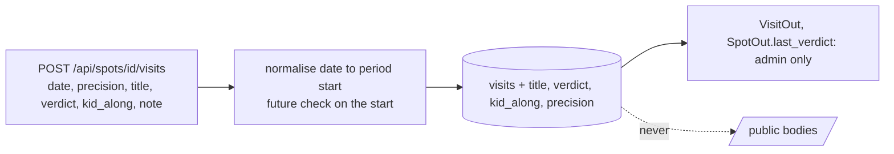

# Grow `visits` into outings (#344)

Story 5 of epic #339 (places and outings), first of phase 2. Brief:
`docs/planning/2026-11-15-places-outings-brief.md`, section 2 and "The model".

## Problem

A visit stores only a date and a private note, so there is no history to show and nothing for the
finder to learn from. An outing needs a title, a verdict, whether the kid came, and a date that may
be only a month or a year.

## Scope

In: four new columns on `visits`; `POST /api/spots/{id}/visits` accepts them; `VisitOut` and the
spots list expose them to the admin; public-output tests prove nothing leaks.

Out: any new page, the Log an outing sheet, history, the finder's use of verdicts (later stories).
The table name stays `visits` and `visits.spot_id` stays NOT NULL.

## Solution

### Decisions (my call, auto mode)

1. **Columns (migration 0025, additive only):** `title` varchar(80) null; `verdict` Postgres enum
   `outing_verdict` (`loved`, `fine`, `not_again`) null; `kid_along` boolean null (old rows stay
   null = unknown); `precision` Postgres enum `outing_precision` (`day`, `month`, `year`) NOT NULL
   with `server_default 'day'` (existing rows become `day`, which is true: they are dates). Follow the
   repo's enum pattern (0013 `candidate_source`, `create_type=False`, created and dropped
   explicitly). No existing column is touched; the code before this revision boots against it.
   Downgrade drops the four columns and the two types (it loses only the new data).
2. **Date stored as the start of its period.** `visited_on` stays the one date column: a month
   outing stores the 1st of that month, a year outing Jan 1. The server normalises whatever day the
   client sent (so `2026-03-17` with `month` is stored `2026-03-01`). Sorting and "last visit" keep
   working on `visited_on`. The future-date refusal (more than a day ahead of the owner's Denver
   day) applies to the period's start, so the current month and year are allowed and next month is
   not.
3. **Everything new is optional.** A request with none of the new fields behaves exactly as today
   (`precision` day, no title, verdict or kid flag). Verdict is optional everywhere; an outing with
   no verdict is valid. `title` is trimmed, blank means none, at most 80 characters (422 over).
   An unknown verdict or precision is a 422 (pydantic enum).
4. **Reads.** `VisitOut` gains `title`, `verdict`, `kid_along`, `precision`. `SpotOut` gains
   `last_verdict` (the verdict of the spot's latest outing: greatest `visited_on`, then newest
   `created_at`; null when none or none set) and nothing else; the table's `last_visit` and
   `visit_count` are unchanged. `note` stays private to the admin.
5. **Public stays clean.** `PublicSpot` is unchanged; `test_public_outputs.py` seeds an outing with
   every new field and a note, and asserts none of title, verdict, kid_along, precision or note
   appears in `/api/public/spots` or in the snapshot read.
6. **Other readers of visits** (the finder's taste weights, Undo's refusal, the planner's Been) read
   `spot_id` and `visited_on` only and are unchanged; the implementer greps `Visit` and says so.
7. **No frontend, no env var, no `render.yaml`, no changelog entry** (owner-only data model). The
   frontend `SpotOut` consumers ignore the extra field.

## Sources

`backend/models.py` (`Visit`), `backend/spots_routes.py` (`VisitIn`, `VisitOut`, `log_visit`,
`_visit_summary`), `backend/migrations/versions/0013_add_spots.py` (enum pattern),
`backend/tests/test_migrations.py`, `backend/tests/test_schema_check.py` (head pin),
`backend/tests/test_public_outputs.py`, `docs/learnings.md`.

## Open questions

None blocking. The history page and Log an outing sheet (#345 to #347) will read these fields.

## Smoke check

After deploy: `GET /api/version` is the merge commit; smoke 130/0; `POST` a visit with only a date
still returns 201 (an existing admin flow, covered by tests); the public spots body is unchanged.
No production data is touched.

## Plan

One backend task, Sonnet, no migration risk beyond additive columns.

1. **Backend.** Model columns and enums, migration 0025 (up and down), `VisitIn`/`VisitOut`/
   `SpotOut.last_verdict`, `log_visit` normalisation and future check, tests, docs
   (`backend/CLAUDE.md` visits paragraph). *Accept:* the issue's criteria, each with a test that
   fails without it: new fields round-trip; none sent works as today; month and year are stored
   as their period start and sort by it; current month/year allowed, next month/year refused with
   the existing message; verdict optional; title trimmed, 81 characters refused; unknown verdict
   or precision 422; `last_verdict` picks the latest outing; no public body carries any new field
   or the note; `tests/test_schema_check.py` head pin bumped to `0025`; `test_migrations.py`
   covers 0025 up, down and up again, with an old-shaped row surviving the upgrade as
   `precision day`, null verdict and null kid flag.

Ship notes: migration 0025 is **additive** (new nullable columns, one NOT NULL column with a
server default, two new types): no rewrite of existing rows' values. Classified non-destructive.
The rehearsal job runs in CI (`neon-rehearsal`, `backend-migrations`); the deploy workflow applies
it before the new code serves.
