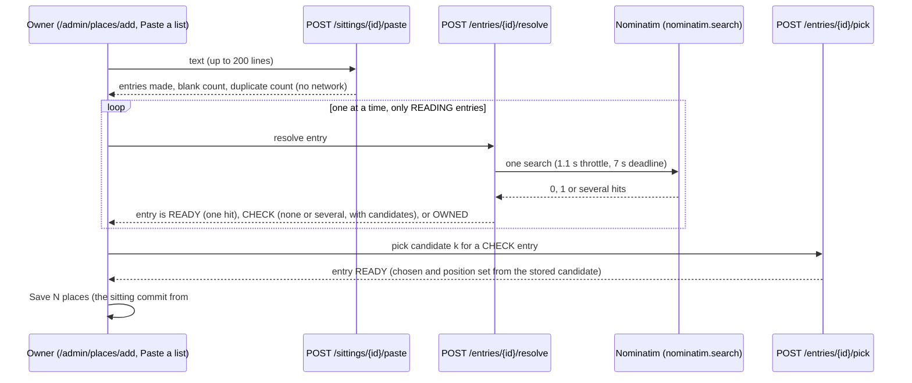

# Paste way: a list of places or map links (#342)

Story 3 of epic #339 (places and outings). Brief: `docs/planning/2026-11-15-places-outings-brief.md`,
section 1. Builds on #340 (`docs/planning/2026-11-17-place-kind-intake-design.md`) and #341.

## Problem

Adding ten places means ten searches. The owner wants to paste a list, one place per line (names
or map links), review it once, and save. 100 lines at Nominatim's one request a second take about
110 s, and intake caps a request at 8 s, so the work has to be chunked, and the sitting has to show
progress.

## Scope

In:

- A `paste` way on the `place` kind: a text blob, one place per line, every non-blank,
  non-duplicate line yields exactly one entry.
- A map-link reader (pure): a full Google Maps or OpenStreetMap URL that carries coordinates is
  used as is, with no Nominatim call; a link with a place name but no coordinates is searched by
  that name; a short link (`maps.app.goo.gl`, `goo.gl/maps`, `g.co/...`) becomes a Check entry
  saying it could not be read, and the server never fetches it.
- Chunked resolve: the page resolves one entry per request, so no request holds past intake's
  limit and the sitting shows "N of M".
- Review and save through the existing place commit (#340).

Out: importing a Google Takeout export, photo ways, backfill dates (#350), any model call.

## Solution

### Architecture decision

Options:

- **A.** Photo-reader pattern: a fast paste request creates all entries with no network; the page
  drives a resolve route one entry per request; a reload resumes from the entries' states.
- **B.** One long request (as pasted links do, 45 s total): breaks intake's 8 s rule and a free-tier
  cold start; no progress.
- **C.** A background task or job route that works through the sitting: no existing pattern for
  user-driven work, a new `JOB_ROUTES` entry pinned by `test_job_token.py`, and a worker that
  dies with the free-tier sleep.

Chosen: **A**, because it is how photos already work (one reading per request, `READING` state,
retry resumes), it needs no job route and no new state, and every request stays well under 8 s.
Gives up: total time (about 1.1 s per name line, so 100 name lines take about two minutes with
the tab open); the sitting does not resolve while the page is closed (a reload resumes).
Hard to undo: little; three admin routes and entry payload keys (JSONB, no migration).
Sources: `backend/intake/routes.py` (`read-next` pattern, `fetch_pending`),
`backend/intake/seed_import.py`, `backend/intake/link_import.py`, `backend/spot_sources/nominatim.py`,
`backend/sources/base.py` (`Throttle`), `backend/CLAUDE.md` (one photo per request),
`docs/learnings.md`.

### Decisions (my call, auto mode)

1. **Three new admin routes**, all under the intake router's `require_admin`, none in `JOB_ROUTES`
   (`test_job_token.py` stays as is): `POST /sittings/{id}/paste`, `POST /entries/{id}/resolve`,
   `POST /entries/{id}/pick`.
2. **Paste creates every entry without a network call.** Per line: blank lines are ignored and
   counted; a duplicate line (case- and whitespace-insensitive) is ignored and counted; a map link
   with coordinates becomes a READY entry; a map link with a name but no coordinates, or a plain
   name, becomes READING; a short link becomes CHECK with a message; a plain `lat, lng` pair
   becomes a CHECK entry named "Place at lat, lng" (a name is required; the owner edits it).
   Caps: 200 lines a paste, 300 characters a line (an over-long line becomes CHECK with a message,
   not an error), so one paste can never hang.
3. **Resolve takes one READING (or CHECK) entry**, runs one `nominatim.search` through the existing
   client (throttle and deadline unchanged), and decides from the SERVER's count: one hit READY,
   several or none CHECK (the several candidates, at most 5, are stored on the entry so Check does
   not search again), a failed search leaves the entry READING with an attempt count and a message,
   and after 2 failures it becomes CHECK ("search did not answer"); an owned place (same
   `source_id`, else name within 75 m) becomes OWNED; a hit whose `source_id` is already in another
   entry of the sitting makes this entry IGNORED with a duplicate note. The entry is locked while it
   resolves (as `fetch_pending` does), so two tabs cannot resolve it twice. Resolving a CHECK entry
   whose name the owner edited searches again.
4. **Pick takes a candidate index, not data.** The server copies `chosen` and the position from the
   candidates it stored; the client never sends coordinates, a `source_id` or a map link (the
   hardening rule from #340). The commit re-validates everything again as before.
5. **A map-link reader, pure and tested without a network** (`spot_sources/map_links.py`): Google
   Maps `@lat,lng`, `!3d<lat>!4d<lng>` data, `?q=lat,lng` and `/place/<Name>/` (plus `?q=<Name>`);
   OpenStreetMap `#map=<z>/<lat>/<lng>` and `?mlat=&mlon=`; a name from `/place/<Name>/` is
   percent- and plus-decoded. `spots.parse_coords` keeps its job for the single field; the reader
   reuses its range checks. It never fetches anything. A short-link host list is data.
6. **The line is untrusted text.** Names and links are length-capped and validated with the same
   `clean_name` / `clean_position` as the commit; a link's host must be one of the known map hosts
   to be read as a map link, otherwise it is treated as plain text (searched by its text) or
   Check.
7. **No model call, no `intake/budget` use.** No new env var, no secret, no migration, no `render.yaml`.
8. **UI:** the paste way lives on `/admin/places/add` (the "Paste a list" room left in #340's
   page); the add bar on `/admin/spots` is unchanged (out of scope). A designer pass decides the
   layout (auto: the designer picks).

## Sources

Repo: `backend/intake/routes.py`, `place_kind.py`, `commit.py`, `models.py` (`IntakeEntryState`),
`backend/spots.py` (`parse_coords`), `backend/spot_sources/nominatim.py`,
`frontend/src/pages/PlacesAdd.jsx`, `frontend/src/components/places/*`. The research report that
fixed the pattern is `/private/tmp` scratch (not kept); its findings are in this plan.

## Open questions

- Does the `OWNED` state commit and clear correctly for a places sitting (the #340 commit deletes
  OWNED and WRITTEN entries)? Task 2 tests it.
- A re-resolve of a CHECK entry the owner renamed: does the existing PATCH let the name change on a
  CHECK entry (it does for owner fields)? Task 2 confirms.
- Changelog: none (owner-only), as #340 and #341.

## Smoke check

After deploy: `/admin/places/add` deep-links with a 200; Joey pastes three lines (two names and a
Google Maps link with coordinates) and sees two resolve and one read at once, saves them, and sees
them on `/admin/spots`, private.

## Plan

All tasks Sonnet, one implementer at a time. No migration.

1. **Map-link reader.** `backend/spot_sources/map_links.py` (+ test): the shapes in decision 5, a
   short-link detector, hosts as data. *Accept:* each URL shape gives its coordinates and name;
   `maps.app.goo.gl` and `goo.gl/maps` are short links and are never fetched; an unknown host is
   not a map link; out-of-range coordinates are refused; no network in the module's import graph
   (add it to the purity list in `test_physical_imports.py` if that is where pure modules are held).
2. **Paste, resolve and pick routes.** In `backend/intake/place_paste.py` (new) wired in
   `routes.py`: the three routes of decisions 1 to 4. *Accept:* one entry per non-blank
   non-duplicate line with the counts returned; 100 lines make zero Nominatim calls; each resolve
   makes at most one `search`; state rules of decision 3 (including OWNED, IGNORED, the failure
   count); pick copies from stored candidates only (a client-sent coordinate is ignored); a short
   link is CHECK and never fetched; `JOB_ROUTES` and `test_job_token.py` unchanged; shelf and
   closet behaviour unchanged; a test with the faithful fake clock shows 100 sequential resolves
   are at least 1 s apart. *Tests:* `test_place_paste.py`, `test_intake_routes.py`.
3. **Commit and sitting checks.** Tests that a pasted sitting commits only READY entries, deletes
   OWNED and IGNORED, keeps CHECK and READING, is idempotent, and that `GET /sittings/{id}` carries
   what the page needs for progress (entries per state). Backend only unless a gap shows.
4. **Frontend: Paste a list on `/admin/places/add`.** Per the chosen mockup
   (`docs/planning/mockups/2026-11-18-places-paste/`): textarea and "Add lines", counts for blank
   and duplicate lines, progress "N of M" while resolving (one request at a time, a Stop and a
   resume on reload), the review list grouped by state (ready, check with candidates to pick or a
   rename, already saved, ignored duplicates), and Save N places. *Accept:* matches the mockup at
   1100 and 400, dark and light; component tests with a faithful fake of the three routes; the
   fake mirrors the real shapes (read the routes).
5. **Admin browser test and docs.** An `admin.spec.js` case pasting coordinate links only (no
   Nominatim needed) and a stubbed `resolve` for one name line; `backend/intake/README.md`,
   `backend/CLAUDE.md`, `frontend/CLAUDE.md`, root `CLAUDE.md` open-item line.

Ship notes: no migration, env var or secret. CI gates in each brief: ruff, pytest (targeted
locally, the full suite is CI's; name `test_physical_imports.py` and `test_job_token.py` in the
brief), pip-audit; frontend lint, format, build, `npm audit --omit=dev`; `e2e-admin`. The finish
review includes `/security-review` (a new admin write path taking untrusted text and URLs).
