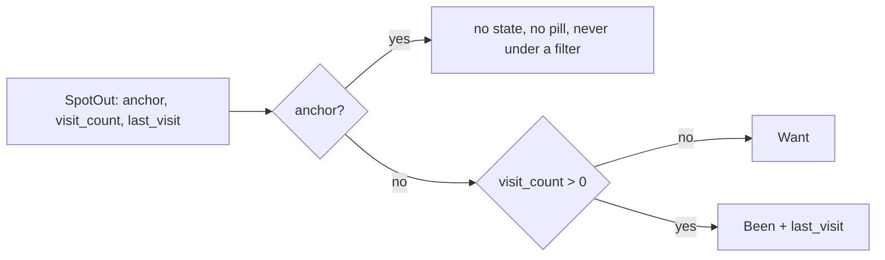

# Want and been states on the spots list (#345)

Story 6 of epic #339. Brief: `docs/planning/2026-11-15-places-outings-brief.md` (the model: "want" and
"been" are derived, not stored).

## Problem

A place with no outing is a want, and one with an outing is been, but the spots table shows neither,
and an anchor (Home) would count as a want.

## Scope

In: a state on every non-anchor row, a Want / Been filter in the toolbar, counts that agree with the
rows. Out: a separate wants page, the planner change, trips, any backend change.

## Solution

State is derived on read from `SpotOut.visit_count` and `last_visit` (both exist; #344 did not change
them). No column, no route, no migration: the page already holds every spot.

### Decisions (my call, auto mode)

1. **`lib/spotState.js`** (pure, tested): `spotState(spot)` returns `'want'`, `'been'` or `null` for an
   anchor; `stateCounts(spots)` returns `{want, been}` over the rows it is given (anchors skipped).
2. **Filter:** a labelled `<select>` "Show" in the existing `.spots-toolbar`, beside the City filter and
   built like it: "All places", "Want (n)", "Been (n)". Always shown once the catalogue has at least one
   non-anchor spot. The counts are taken over the rows that pass the text and City filters, so the
   numbers always agree with the rows under any combination. A state filter hides anchors; "All places"
   shows them. The pick is page state, not stored.
3. **Row marker:** a small pill in the name cell, on its own line like the city line (so it also shows on
   phone where the Last visit column is hidden): "Want", or "Been" plus the latest date ("Been, 3 Mar
   2026" via `formatDate`). Anchors get none; the existing Home pill stays.
4. **Live updates:** the Been button already bumps `visit_count`/`last_visit` optimistically, so the pill
   and counts move at once; under a "Want" filter that row leaves the list (it is no longer a want),
   which is the filter working, not a bug. "Show in table" and the New/marked-row rules clear ALL
   filters (text, City, state) when the target row is hidden by any of them.
5. **A dismissed finder candidate is not a spot**, so it never appears here (candidates live in their own
   table; a test asserts the page lists only `/api/spots` rows).
6. **No mockup (ruling):** it adds one select (a copy of the City filter's look), one pill (the city
   line's look) and no layout; the finish review compares screenshots to the existing page and design
   system. No new copy outside `content/denver.js`. No changelog (owner-only), no migration, no env var.

## Sources

`frontend/src/pages/AdminSpots.jsx`, `frontend/src/lib/cities.js` (the pattern), `index.css`
(`spots-city*`), `frontend/CLAUDE.md`, `docs/design-system.md`, `docs/learnings.md`.

## Smoke check

After deploy: smoke 130/0; the admin spots page shows the Show filter and a state pill per row
(checked by e2e `Spots` and the review's screenshots); no API change.

## Plan

One task, Sonnet, frontend only.

1. **Frontend.** `lib/spotState.js` (+ test), AdminSpots toolbar select, state pill, counts, "Show in
   table" clears all three, `index.css` (`spots-state-*`, tokens only; select 44 px on phone; long
   text wraps, no 400 px overflow), copy in `content/denver.js`, `frontend/CLAUDE.md` paragraph.
   *Accept:* an anchor has no state and never appears under Want or Been; a spot with no visit is Want,
   one with a visit is Been with the latest date; filter counts agree with the rows with and without the
   text and City filters; marking a spot Been moves it out of Want live; Show in table clears all
   filters; no inline strings (copy scan green); existing tests pass; 400 px no horizontal scroll.
