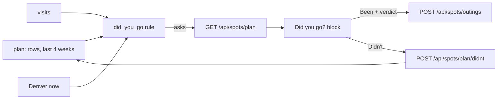

# Did you go? (#349)

Story 10 of epic #339. Brief: `docs/planning/2026-11-15-places-outings-brief.md`, section 2. Builds on #344/#346 (outings) and #347/#348 (history).

## Problem

A plan saved in the weekend planner is never followed up, so a weekend's plan never becomes history. The page should ask how it went.

## Scope

In: a pure rule that finds saved plan slots whose day has passed and that were neither logged nor answered "Didn't"; the asks returned with the existing plan read; a route that records "Didn't" in the week's plan row; a prompt block on `/admin/weekend` (the admin Denver home) with Been (verdict required) and Didn't, dismissible without answering.
Out: notifications, email, calendar, changing how a plan is saved or rerolled, the public `/denver` page (it makes no plan or outing call and must stay that way), Undo, changing the existing per-card Been.

## Mockup

Folder `docs/planning/mockups/2026-11-19-did-you-go/` (gitignored). **Chosen: `a-cards.html`** (rows in one panel under the page header, at 400px and desktop, light and dark). Rejected: `b-sheet.html` (a banner that opens a sheet one slot at a time: small footprint, but a modal and a third tap in front of a two-tap job, three ways out, and the other slots hidden). Pick made by the designer; reason: the job is two taps (Been, then a verdict) and A does it in place using patterns the site already has. Cost: phone height when three or four are due, cleared by answering or "Not now".

Acceptance: the built UI matches `a-cards.html` at 400px and desktop in both themes.

## Solution

- **The rule** is a pure function in `backend/planner.py` (beside `plan`): `did_you_go(weeks, visited, now)` where `weeks` is the saved week rows (`{week_key, saved, days, didnt}`), `visited` is the set of `(spot_id, visited_on)` day-visits, and `now` is a Denver-aware datetime. It returns the asks, oldest first.
- **When a slot is due.** Its day is before today (Denver); or its day is today, today is a Sunday and the time is 18:00 or later. A slot whose day has not passed is never asked, whatever the weekday.
- **A slot with no day** (a saved "while" slot has `days[slot]` null when both days apply) takes that weekend's Sunday as its day; the visit is logged for Sunday.
- **Already logged:** a visit for that spot with `visited_on` equal to the slot's day and day precision. **Already answered:** the slot is in that week's `didnt` list.
- **Looking back.** After Sunday the plan key points at the next weekend, so the rule reads the last four plan rows (the coming weekend and three before it). Older unanswered slots stop asking; known limit, on purpose.
- **Data.** The week row gains `didnt: [slot]`. `_week` in `spots_weekend_routes.py` copies only known keys and `_put` writes the whole dict, so `_week` and `_empty_week` must carry `didnt` or the next save, unsave or skip drops it; test that.
- **API.** `GET /api/spots/plan` gains `asks: [{week, slot, spot_id, spot_name, neighbourhood, day (ISO date), slot_label}]` in `PlanOut` (no new read route). New `POST /api/spots/plan/didnt` with `{week, slot}`: validates the week key format and that the slot is saved in that row, adds it to `didnt`, idempotent; returns the remaining asks. This is one new `/api/spots*` route, so the pin in `backend/tests/test_recs_response_models.py` goes from 34 to 35, with a typed response model. Admin only like the rest of the weekend router. The clock is injected (a `now` callable beside the existing `today`), so tests freeze it.
- **Been** posts `POST /api/spots/outings` with `spot_id`, `visited_on = day`, `precision: "day"`, the verdict (required), optional note (140 characters) and kid-along tri-state. After success the page reloads the plan so the ask is gone (the logged visit satisfies the rule).
- **Public outputs.** Nothing public carries an outing or an ask. `test_public_outputs.py` gains a case that the public spots and plan paths do not contain `asks` or `didnt`.
- **UI (direction A).** A block directly under `AdminPageHeader` and the page error, above the constraint pills: "Did you go? N to answer" with a "Not now" button, a row per slot (spot name, neighbourhood, the day and the planner's slot label, Been and Didn't buttons). Been opens the verdict row inside that row (Loved, Fine, Not again as `.vmark-*` shape plus word); picking a verdict saves. A "Add a note or who came" disclosure holds the note and the Came along / Stayed home chips and never blocks the save. Confirmation is one status line in the `.wk-toast` pattern outside the block ("Logged: Loved at Ball Arena", "Marked as not gone: Denver Botanic Gardens"); an error keeps the row open with a `lo-alert` ("Not saved. That didn't go through. Check your connection. Nothing was written."). "Not now" hides the block for this visit only (component state; the status line says it asks again next visit). Last answer removes the block.
- **Slot labels** are the planner's real ones (`planner.py` `SLOT_LABELS`: Best fit, Try somewhere new, Haven't been in a while), not the brief's placeholder copy.

## Decisions (my call, auto mode)

1. The rule lives on the backend, because the frontend cannot read the raw week row or the visits and the clock is server-side; asks ride on the existing plan read.
2. "Sunday evening" is 18:00 Denver; one constant, tested at 17:59 and 18:00.
3. A no-day slot is asked for Sunday. Known gap: if the trip was on Saturday the outing is dated Sunday and cannot be edited yet.
4. Four weeks of look-back.
5. No Undo. `docs/design-system.md` asks for Undo beside an instant write; here Been is a deliberate two-step (verdict) and Didn't only stops the asking, and an Undo needs a delete route. Record the exception in the design system's section on this.
6. "Marked as not gone" replaces the designer's "Marked as skipped", since Skip already means skipping a suggestion on this page.
7. The existing card-level Been (posts to the visits route with no verdict) stays as it is; it writes a day visit on the slot's day, so the rule already treats that slot as logged.
8. "Denver home" in the issue is read as `/admin/weekend` (the admin Denver home). The public `/denver` page is untouched.

## Tasks

### Task 1: The rule, the asks and the Didn't route (backend)

Files: `backend/planner.py` (`did_you_go`), `backend/spots_weekend_routes.py` (`_week`/`_empty_week`/`_put` carry `didnt`, `get_plan` returns `asks`, `POST /plan/didnt`, an injectable `now`), `backend/spots_schemas.py` (`AskOut`, `PlanOut.asks`, a `DidntIn` and its response), `backend/tests/test_planner.py` (rule), `backend/tests/test_spots_weekend.py` (routes), `backend/tests/test_public_outputs.py`, `backend/tests/test_recs_response_models.py` (34 to 35), `backend/CLAUDE.md`.

- Rule tests, with the clock passed in: a Saturday slot on Saturday 10:00 (not due) and on Sunday 09:00 (due); a Sunday slot on Sunday 17:59 (not due) and 18:00 (due); Monday and later due; a slot already logged is not asked; a slot in `didnt` is not asked; a no-day slot is due as Sunday; a slot four-plus weeks back is not asked; a week with no saved slot is not asked. Freeze clocks; no time bombs.
- Route tests: `GET /plan` returns `asks` for last weekend's plan after Sunday evening; `POST /plan/didnt` records it, is idempotent, rejects a malformed week and a slot not saved in that row (4xx), requires the admin session; the next save, unsave and skip keep `didnt`; a visit logged through the outing route removes the ask.
- Guard tests must be shown failing without the guard (especially `didnt` surviving `_put`).
- No migration (JSON in `spot_settings`).

### Task 2: The Did you go? block (frontend)

Files: `frontend/src/pages/AdminWeekend.jsx` (+ test), `frontend/src/components/DidYouGo.jsx` (+ test), `frontend/src/content/` (copy, with the other weekend copy), `frontend/src/index.css` (`.dyg-*`), `docs/design-system.md` (the Undo exception), `frontend/CLAUDE.md`.

- Build what the Solution section describes, matching `a-cards.html` at 400px and desktop, light and dark.
- States and tests: one due, several due, verdict chooser open, answered (status line and the row leaves), error keeps the row and says nothing was written, "Not now" hides it and the status line says so, the last answer removes the block, no asks means nothing renders. Been calls `POST /api/spots/outings` with the slot's day, precision `day` and the verdict; Didn't calls `POST /api/spots/plan/didnt`; both followed by a plan reload. Use `withDeadline` and an in-flight guard like `LogOutingSheet`; a timeout says it "may or may not have been saved".
- Spacing only through `--space-*` tokens (a literal px needs a `space-exception` comment); 44px targets; no overflow at 400px; verdict is a shape plus a word.
- Before the commit run the FULL frontend suite (`npm test`), `npm run format:check`, `npm run lint` and the build.

## Ship notes

No migration, no new env var, no new outbound call. One new admin-only route (pin 34 to 35). Smoke: the existing 130-check smoke; after deploy confirm a logged-out `POST /api/spots/plan/didnt` is refused (401) and a logged-out `GET /api/spots/plan` still 401.
