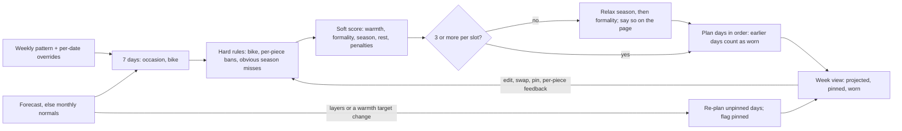

# Closet: a picker that can't starve, per-piece feedback, and a week view (brief)

Date: 2026-11-20 · Repo: joey-haas.dev · Reviewed against `main` at `78c40c94`
and the live closet (read through the signed-in admin, read-only).
Brainstormed in Cowork. This is a brief, not a spec: the design happens in
the planning session.

## Problem

Joey used Today for a week and followed none of its suggestions. Twice, on
cold office days, it led with a loud graphic tee, offered no real
alternative, and gave him no way to say no to the shirt.

He also wants to plan the week ahead: see each day's outfit before it
arrives, to plan laundry and bags, and to spot bad picks early.

## What was found (2026-11-20)

Today's stored plan, office, forecast 37°F to 61°F:

- 49 active pieces, 11 "fit". Of 19 tops, one passes the filter: a
  graphic tee.
- The lead and both alternatives all use that tee. They differ only in
  jacket and trousers. One alternative pairs it with a linen trouser.
- `GET /api/closet/candidates?slot=top&occasion=office` returns one piece,
  so Swap a piece has nothing to offer.
- `ranked_by` is `model` with no note. The model can only choose from the
  numbered shortlist, so it wrote a reason for the tee.

Causes, in `backend/closet.py` unless noted:

1. **A missing tag passes every rule.** The tee has no warmth, no formality
   and an empty `seasons`. `in_season` and `fits_occasion` pass a missing
   value, and `score` counts it as one step off. Ten active pieces are
   in this state: 5 bottoms, 2 outers, 1 mid, 1 top, 1 pair of shoes. They were saved by hand, which sets `tag_source = manual` and
   removes them from the tag queue for good (`closet_routes.py`).
2. **Season is a hard cut on months the tagger guessed.** 13 of 19 tops are
   tagged for summer months only. Both oxford shirts are tagged spring and
   autumn without November. Three tops are in season in November.
3. **Office needs formality 3 to 5** (`OCCASION_FORMALITY`), and the tagging
   prompt defines the scale only as "1 (lounge) to 5 (business)"
   (`closet_tag.py`). 13 of 19 tops were tagged 2, including both flannels,
   which are in season and warm.
4. **Nothing checks the pool size.** Causes 2 and 3 together leave one top,
   the untagged one. `template` then reuses it for every outfit
   (`min(k, len - 1)`).
5. **Feedback is per outfit.** Not this stores the outfit and blocks that
   top + bottom + shoes key for the day (`declined_today`). The prompt gets
   a label such as "too casual" with no garment named. The same top returns
   with different trousers.
6. **The profile is empty where it matters.** `style_words` and `dislikes`
   are empty lists, and `weekly_occasions` is still the default (office
   Monday to Friday), which is why a Friday was planned as an office day.

For the week view:

- `outfit_plans` is already one row per day × occasion × bike, and
  `make_plan` takes any day.
- The repeat rules read `wears` only. A week projected today would choose
  the same top every day.
- `POST /jobs/plan` plans tomorrow only.
- There is no per-date occasion; only the weekly pattern.
- **Planning has no queue.** Tagging is one (`untagged`, `tag_source IS
  NULL`, a daily budget, three strikes, retried nightly) and so is intake's
  photo reading (waiting photos read while the free tier has calls above a
  reserve; a stale `reading` photo is requeued). `make_plan` is neither: it
  calls the model inside the request, and a failed call stores the template
  plan with a note. Nothing marks that plan for another try. The nightly
  plan step has 300 seconds in the workflow and stops calling the model
  after 200.
- **Ranking runs on the lite models first, at the lowest thinking level.**
  `llm.py` has two orders. `TEXT_ORDER` leads with `gemini-3.5-flash-lite`
  and `gemini-3.1-flash-lite`, and its comment lists Today among the
  text-only calls; `VISION_ORDER` leads with the full Flash models.
  `THINKING_LEVELS` sets every model to `MINIMAL` or `LOW`. Ranking sends
  photos only when `closet_settings["rank.images"]` is enabled, which is
  off unless set; whether it is on in production was not checked. So the
  picks Joey saw were most likely made by a lite model, from text, with
  minimal thinking. The same comment records why the lite models lead:
  on 2026-11-11 the 3.8 and 3.7 Flash models hung for a minute and 3.6
  answered 503.
- **Photos in ranking are built and measured, but off.** #401 added them
  behind `closet_settings["rank.images"]` (default off, no admin control;
  4 photos per slot, `IMAGES_PER_SLOT`). A call with images walks
  `VISION_ORDER` (`llm.py`, `images` decides the order), so it also leads
  with the full Flash models. The #400 probe was run on 2026-11-16 against
  a local copy (`~/Developer/closet-seed/rank-images-report-2.json`, eight
  runs over four occasions): text only answered in 1.3 to 9 seconds; with
  10 to 16 thumbnails (86 to 134 KB in total) every call succeeded and
  took 24 to 40 seconds. Size is not the limit; latency is. The design
  doc still lists #400 as open.
- Not checked: how many days of hourly forecast the weather job caches.
  `closet.read_weather` falls back to `NORMALS` when a day has none.

## Decisions (Joey, 2026-11-20)

- Flannels and casual button-ups are fine at his office. Office becomes
  formality 2 to 4.
- Graphic tees are allowed at the office but he tends not to wear them
  there. Treat it as a strong penalty for office, not a ban.
- His style is casual, on the nicer side. This belongs in the profile's
  style words and should be seeded.
- His week: office Tuesday to Thursday, WFH Monday and Friday, weekends
  open (not working).
- Week view wanted, with a manager-style view to edit it, re-planning when
  the weather changes a lot or when he changes a day by hand (a different
  setting, a special meeting).
- The model ranks the whole week. He expects to plan on a Sunday, on his
  phone, in one sitting: one burst a week, not a nightly drain. Work that
  cannot run at once should be queued, as tagging and intake reading are.
- **One model call for the week**, unless Code finds a reason against it.
- **The week call names its model tier.** He does not think a lite model
  can do this well. It should not be left to the default order.
- **Send the garment photos with the ranking call** where possible.
- **A scheduled run builds the week's baseline before he reviews it.** In
  the review he can tweak single pieces or days on a lighter, faster
  path, or ask for a full redo and wait. He accepts the added complexity
  for speed and for correctness.
- **Build order as set out below**: picker and feedback first, measure the
  week call, then the week view with two speeds. The quick model path for
  tweaks waits until the two-speed version has been used.

## Proposed shape

### Picker

- **Unknown is not a pass.** A piece missing warmth or formality stays out
  of a slot while that slot has tagged candidates. The Closet page shows a
  count of pieces needing details.
- **Fill blanks on hand-saved pieces.** Let the tagger fill fields that are
  still empty on a `manual` piece without touching fields the owner set.
  Today a hand save is final for the whole row.
- **Season becomes a score.** Warmth against the day's temperature already
  carries most of this. Keep a hard exclusion only for clear cases (shorts,
  linen in winter). Trade-off: an occasional short-sleeve suggestion on a
  warm November day.
- **Minimum pool.** When a slot has fewer than three candidates, relax
  season, then formality, and show which rule was relaxed.
- **Alternatives differ in the top.** Three outfits with one shirt are not
  alternatives.
- **Formality scale with anchors** in the tagging prompt (for example
  graphic tee 1, flannel or casual button-up 2 to 3, oxford 3 to 4), then
  re-tag the model-tagged pieces.
- **Occasion penalties.** A graphic or logo top scores well below a plain
  one for office.
- **Show the funnel.** Per slot: how many pieces, how many after each rule
  ("19 tops → 3 in season → 1 fits office"). This is the debugging view.

### Feedback

- Per tile: **Not today**, **Never for this occasion**, **Too cold / Too
  warm**. Stored per garment (and occasion where it applies) and applied as
  hard exclusions.
- A re-plan after feedback on a piece must change that piece.
- The prompt names the garment that was turned down, not only the reason.

### Week

- **Day states**: projected (the app may change it), pinned (confirmed or
  edited by Joey; never changed silently), worn.
- **Per-date override** of occasion and bike on top of the weekly pattern,
  for a one-off such as a special meeting.
- **Sequential planning**: a planned day counts as worn for the days after
  it, so the week does not repeat tops and a change ripples forward only.
- **Re-plan triggers**: the forecast changes which layers a day needs or
  moves a slot's warmth target; Joey changes a day's occasion or bike; Joey
  presses re-plan. A pinned day gets a note instead ("12° colder than when
  you pinned this").
- **Three speeds.** The rule: when nobody is waiting, use the full model;
  when Joey is waiting, answer fast and offer the full model.
  1. *Baseline (scheduled, slow).* The nightly run before the planning day
     makes the week's plan in one call: full model order, photos. Nobody
     waits on it, so it can take minutes and be retried the next night. It
     is stored as the projected week. The planning day is a profile setting
     (default Sunday, so the run is Saturday's).
  2. *Tweak (in the review, fast; the model call here is deferred, see
     Build order).* Swap a piece calls no model. Feedback
     on a piece, or a changed occasion or bike, re-plans that one day:
     the rule pick shows at once, then a quick call ranks that day's
     shortlist with the rest of the week given as fixed. Other days do not
     move unless the change breaks a repeat rule for them.
  3. *Full redo (asked for, slow).* Per day or for the week. It goes on
     the queue; the current plan stays on screen, marked as being
     re-planned, until the new one lands. Pinned days are kept.
- **Midweek changes** (a weather trigger, a late forecast for a day first
  planned from normals) are picked up by the nightly run on the full
  model, for the affected unpinned days only.
- **Every day says how it was picked**: rules, quick, or full, with the
  model that answered and when. A redo shows what changed from the plan it
  replaced.
- **If the baseline has not run or failed**, the review opens on rule
  picks with a **Plan my week** button that queues it.
- **This week's pieces**: every garment the week uses and the first day it
  is needed, for laundry and bags. No laundry state.
- **What-if**: choose a date, occasion and temperature and see the picks and
  the funnel, without storing a plan.

## Build order (agreed by Joey, 2026-11-20)

The week of bad picks came from the data and the filter, not the model: a
better model given one eligible top still picks it. So:

1. **Picker and feedback first.** Unknown is not a pass, soft season,
   minimum pool, office 2 to 4, per-piece feedback, the funnel, the
   profile seeded, photos switched on. Use it for a week.
2. **Measure before building the week call.** One week's call on a full
   Flash model with photos: does it answer inside the timeout, does it fit
   the output limit, are the picks better than the lite model's. The
   queue, the model order and the baseline all rest on this.
3. **Week view with two speeds**: the scheduled baseline and the queued
   full redo. Tweaks in the review are Swap a piece and a rule re-pick
   after per-piece feedback, both instant and with no model call.
4. **The quick model path for tweaks only if step 3 feels too blunt.** It
   adds a third prompt, a third model order and its own quota questions,
   and it sends the picks Joey just rejected to the weakest model.

## Open questions for Code

- **Forecast horizon.** How many days the weather job caches; whether the
  week view needs the job to fetch further, and how a day planned from
  normals is marked.
- **Where planned days live.** Whether "counts as worn" reads `outfit_plans`
  directly or a lighter projection; what a re-plan of day 2 does to days 3
  to 7 that are pinned.
- **Weather change threshold.** Proposed: re-plan when `layer_slots` or any
  value in `targets` changes for the day. Check it does not fire nightly.
- **One call for the week (decided), and what could overturn it.** The
  model sees all seven days, so it can spread pieces across the week, and
  a change to Tuesday costs one call for the days after it, not five.
  Risks to check: a larger answer fails validation more often, so validate
  and keep it per day; the answer may not fit the output limit
  (`MAX_TOKENS` is 8000 in `llm.py`; confirm which providers it applies
  to); the call may exceed `TIMEOUT` (120 s). One call per day, run in
  order through the queue, is the fallback.
- **Model tier for the week call.** Proposed: a third order in `llm.py`
  for calls that need judgement, leading with the full Flash models, with
  a higher thinking level than `THINKING_LEVELS` gives them, and without
  the lite models. If no model in that order answers, the week stays on
  the rule picks and waits in the queue; it does not fall through to a
  lite model. Trade-offs: the full Flash models were the unreliable ones
  on 2026-11-11, so the call will be slower and will fail more often, which
  is what the queue is for. The paid last link is Claude Haiku, also a
  small model; decide whether it counts for this call. Whether a free
  Flash model plans a week well is unmeasured: record a fixture (the same
  week on a lite and a full model) before settling the order. Decide
  whether Today's single-day re-plans use the same order.
- **Photos in the week call.** Turn `rank.images` on and close #400 with
  the probe's numbers. For the week, send each shortlisted piece's photo
  once, not once per day; at about 8 KB a thumbnail the whole active
  closet is well under the 20 MB ceiling, so the 4-per-slot cap can go if
  latency allows. A single day with 16 photos took up to 40 seconds, so
  measure a week's call against `TIMEOUT` (120 s) before fixing the count,
  and run it through the queue, not inside the page's request. Keep the
  text-only retry that `rank()` already has, but on the same model order.
  Pieces without a photo are ranked from text; say how many on the page.
- **Baseline schedule.** `nightly.yml` runs once a day (`17 0 * * *` UTC,
  early evening in Denver). Decide whether the baseline is a step in it
  that acts only on the night before the planning day, and which seven
  days it covers. A run on Saturday evening is eight days from the
  following Sunday, so the last days will probably have no forecast yet
  and start from normals; confirm against the forecast horizon above.
- **The quick path's model.** Joey suggested a lighter model for tweaks.
  A single day's shortlist, after the picker fixes and per-piece bans, is
  a much smaller ask than a week. Measure a lite model on it, with and
  without that day's photos (text answered in 1.3 to 9 seconds, photos in
  24 to 40), and choose the fastest that picks acceptably.
- **Quota across the three speeds.** The free tier counts requests per
  model per day. Check that a review with several tweaks and a redo fits
  alongside the nightly jobs' other calls, and what the page says when it
  does not.
- **Queue shape.** A status on the plan row (`ranked`, `waiting`, attempts)
  drained by the nightly job and a button, following the tag queue.
- **Garment-level feedback storage.** A new table keyed by garment and
  occasion, or columns on `garments`.
- **Re-tagging.** How to re-run tagging with the anchored scale without
  overwriting hand edits or vendor colours (`color_source`).
- **Graphic detection.** `pattern` is free text ("print", "graphic",
  "floral"); the tee has no pattern at all. Decide what marks a top as
  graphic: the tagger, the name, or a field the owner sets.
- **The week page.** The 2026-11-09 spec parked the week view (direction C)
  for v2; its mockup may be a starting point.

## Pointers

- `backend/closet.py`: `OCCASION_FORMALITY`, `in_season`, `fits_occasion`,
  `score`, `candidates`, `template`, `recent_keys`.
- `backend/closet_rank.py`: `build_prompt`, `summarise_not_this`, `validate`.
- `backend/closet_today_routes.py`: `make_plan`, `declined_today`,
  `replan`, `_plan_tomorrow`, `defaults_for`.
- `backend/closet_routes.py`: `DEFAULT_WEEK`, the hand-save rule, the tag
  queue. `backend/closet_tag.py`: `INSTRUCTIONS`.
- `backend/weather.py`: `hours_for_day`.
- `frontend/src/pages/AdminClosetToday.jsx`, `components/SwapSheet.jsx`.
- Specs: `2026-11-09-outfit-design.md`,
  `2026-11-16-closet-products-brief.md`.
