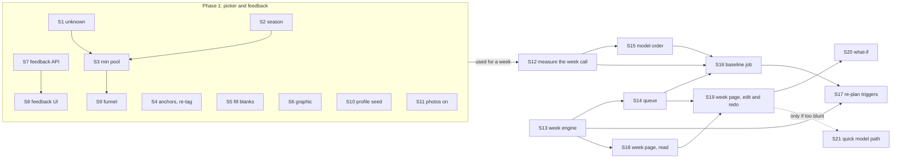

# Closet picker, per-piece feedback and week view: design and story plan

Spike #540 for epic #539. Input: `2026-11-20-closet-picker-week-brief.md` (committed
with this doc, unchanged). Output: this doc, the answers to the brief's open
questions, and the stories filed as sub-issues of #539. No code changes.

The repo is public: this doc names no garments and no purchase details.

## Problem

Today's picks were not followed for a week. The cause is the data and the filter
(an untagged piece passes every rule, season and formality cuts leave one eligible
top, nothing checks the pool, feedback is per outfit), not the model. The owner also
wants the week planned ahead on a phone in one sitting. The brief has the findings
and the decisions of 2026-11-20; this doc turns them into stories.

## Scope

In: the picker rules, per-piece feedback, the funnel, photo ranking on, the
week-call measurement, the week plan engine, queue, baseline job, re-plan triggers
and the week page.

Out (as the epic says): laundry state, calendar, packing lists, public pages, paying
for a model, the site redesign (#519), any code in this branch.

## Build order

S13 (the engine) has no model dependency and can start once phase 1 lands, in
parallel with S12 (see Decisions: one story at a time, so in sequence).

## Answers to the brief's open questions (my call, auto mode)

| Question | Answer |
|---|---|
| **Forecast horizon** | Measured 2026-11-20 against the NWS hourly endpoint for Denver: **156 hourly periods** (about 6.5 days; the last one started 2026-11-27 03:00 local when fetched at 16:00 on the 20th). The weather job stores whatever NWS returns (`weather.py` `parse_periods`; `POST /api/spots/weather/refresh`, `nightly.yml:179`), so the horizon is NWS's, not ours. Not fetching further: the hourly endpoint stops there, and the coarser daily forecast has no per-hour data the warmth targets need. |
| **What that means for the baseline** | The nightly run is 00:17 UTC, early evening Denver. A Saturday-evening run for a Sunday planning day sees forecast through about Friday 04:00. So Sunday to Thursday have a full forecast; Friday has the first hours only; Saturday has none. Both the owner's WFH day and the open weekend sit there, so the cost is small. |
| **A bug the horizon exposes** | `closet.read_weather` treats a day with any cached hour as a forecast day (`closet.py:143-156`). Friday would be "forecast" from four overnight hours. A day counts as forecast only when its hours cover the waking day (rule in S17). Days from normals say so on the page (`WeatherRead.forecast` already exists and is stored in the plan body). |
| **Where planned days live** | In `outfit_plans`. "Counts as worn" for day N is the plans of days before N in the same planning run (projected or pinned), held in memory while planning, plus `wears`. No projection table. A re-plan of day N re-plans only later unpinned days. A later pinned day is kept, counts as worn for the days after it, and gets a note if it now breaks a repeat rule. |
| **Weather change threshold** | As proposed: re-plan an unpinned day when its `layer_slots` change or any warmth target moves by a full step from what the stored plan was made with. S17 must replay a real week of forecasts and prove it does not fire on a normal night. A pinned day gets a note, never a change. |
| **One call for the week** | Stays the plan. Per-day validation of the answer, so one bad day does not discard six. Fallback: one call per day in order through the queue (S16 builds it behind the same interface). The measurement (S12) can overturn it. `MAX_TOKENS = 8000` is sent only to Anthropic (`llm.py:782`); the Gemini request sets no output limit (`_build_body`, `llm.py:452-475`), so the limit that matters is the model's own. |
| **Model tier** | A third order in `llm.py` for judgement calls: full Flash models first, higher thinking level than `THINKING_LEVELS`, no lite models, and **no fall through to a lite model**. Claude Haiku does **not** count for the week call (it is a small model; if no Flash answers, the week stays on rule picks and waits in the queue). Today's single-day plans keep the current orders in phase 1 (with photos on they already lead with the full models via `VISION_ORDER`); revisit after S12. |
| **Photos in the week call** | `rank.images` goes on in phase 1 (S11). For the week, each shortlisted piece's photo is sent once, not once per day. The 4-per-slot cap stays until S12 shows what a week with photos costs against `TIMEOUT` (120 s). Pieces without a photo are ranked from text, and the page says how many. Keep `rank()`'s text-only retry, on the same model order. |
| **Baseline schedule** | A step in `nightly.yml` that acts only on the night before the profile's planning day (new setting `plan_day`, default Sunday, so the run is Saturday's), covering seven days from the planning day. It also drains the planning queue. |
| **Quick path's model** | Deferred (S21), as the epic's build order says. When built it starts from a measured shortlist. |
| **Quota across the speeds** | Counted in S12 (requests per model per day against the nightly jobs' other calls). S19 decides the message when a redo cannot run: the plan stays on screen, marked waiting, and the page says when the queue next runs. |
| **Queue shape** | Columns on `outfit_plans` (`ranked_by`, a queue state, attempts, last note), a budget on `closet_profile`, drained by the nightly job and a button, following the tag queue (`garments.tag_source`, `tag_attempts`, `closet_profile.tag_budget`, `closet_routes._run`). Three strikes, as tagging. |
| **Garment-level feedback storage** | A new table `garment_feedback` (garment, occasion nullable, kind, day nullable), not columns on `garments`: one piece can be turned down for several occasions and for a single day. "Too cold / Too warm" excludes the piece for the day and raises a suggestion on the Closet page; it never edits tags by itself. |
| **Re-tagging** | S4 re-runs the tagger with the anchored scale on `tag_source = model` pieces only. Owner-set fields and vendor colours (`color_source`) are never overwritten. S5 lets the tagger fill fields that are still empty on `manual` pieces. |
| **Graphic detection** | A nullable `graphic` flag on `garments`, set by the tagger from the photo and editable by the owner. Name matching is brittle and `pattern` is free text, so neither is the source. Additive migration. |
| **The week page** | Starting point: `docs/planning/mockups/2026-11-09-outfit/c-week-ledger.html` (the parked direction C; mockups are not in git, so it is in the main checkout only). New design step with mockups before the plan, per `sdlc-design`. |

## Decisions and tradeoffs

- **Picker first, model second.** A better model given one eligible top still picks
  it. Phase 1 fixes the pool and the feedback, then is used for a week.
- **Season as a score loses a guarantee.** An occasional short-sleeve suggestion on
  a warm November day is the accepted cost of never starving a slot.
- **Relaxation is visible.** When a slot has fewer than three candidates the picker
  relaxes season, then formality, and the page names the rule. A silent relaxation
  would hide the very cause found on 2026-11-20.
- **Architecture decision for S13, S14, S7, S6:** four additive migrations (plan
  state and overrides, queue columns, `garment_feedback`, `graphic`) plus a
  `plan_day` profile column. All additive; none drops or rewrites data. Each story
  that adds one runs the architecture step (`sdlc-architecture`) in its own plan.
- **Free tier.** Every model call goes through the existing chain and budgets. No
  story adds a paid dependency.
- **One story in progress at a time**, in dependency order. Phase 1 stories touch
  `closet.py`, `closet_rank.py` and `closet_today_routes.py` together, so they
  serialise anyway.

## Stories

Parent: #539, prefix `Closet picker:`. Issue numbers are in the Key column.

| Key | Story | Depends on | Notes |
|---|---|---|---|
| S1 (#545) | Unknown is not a pass; count of pieces needing details | none | |
| S2 (#546) | Season becomes a score; hard cut only for clear cases | none | |
| S3 (#547) | Minimum pool of three with a visible relaxation; alternatives differ in the top | S1, S2 | |
| S4 (#548) | Formality scale with anchors; office is 2 to 4; re-tag model-tagged pieces | none | tag job |
| S5 (#549) | The tagger fills blanks on hand-saved pieces | none | |
| S6 (#550) | Graphic tops: a flag and an office penalty | none | additive migration |
| S7 (#551) | Per-piece feedback: storage, hard exclusions, re-plan changes the piece, prompt names it | none | additive migration |
| S8 (#552) | Per-piece feedback on the Today tiles | S7 | **design step first** |
| S9 (#553) | Show the funnel per slot | S1 to S3 | **design step first** |
| S10 (#554) | Seed the profile: style words and the weekly pattern | none | production data: Joey runs it |
| S11 (#555) | Photo ranking on: admin control, switch on, record the result | none | production setting: Joey flips it |
| S12 (#556) | Measure one week's ranking call on a full model with photos | S1 to S11, a week of use | spike label |
| S13 (#557) | Week plan engine: day states, per-date overrides, sequential planning | phase 1 | additive migration; architecture step |
| S14 (#558) | Planning queue | S13 | additive migration |
| S15 (#559) | Judgement model order in `llm.py` | S12 | |
| S16 (#560) | Weekly baseline job | S12, S13, S14, S15 | |
| S17 (#561) | Re-plan on weather change; pinned days get a note; honest forecast coverage | S13, S16 | |
| S18 (#562) | Week page, read only | S13 | **design step first** |
| S19 (#563) | Week page, editing and full redo | S14, S18 | **design step first** |
| S20 (#564) | What-if: a date, occasion and temperature, nothing stored | S19 | **design step first** |
| S21 (#565) | Quick model path for tweaks | S19 used for a while | `deferred` |

Existing children of #539: #422 (link import colour) is unrelated to this work and
stays where it is. #425 (preview tomorrow) has no parent and overlaps S18/S19; it
is left alone and flagged for Joey to close or fold in.

## Spike acceptance, honestly

| Criterion | Status |
|---|---|
| Brief committed as written | Done (this branch, byte for byte) |
| Design doc answers the open questions in build order | Done (above) |
| Forecast horizon checked | Done: 156 hourly periods |
| `rank.images` checked in production | **Not done.** Production data is the owner's to read. Read-only check: `SELECT key, value->'enabled', updated_at FROM closet_settings WHERE key = 'rank.images';` (no row means off). Code shows no default and no admin control, so it is off unless someone set it by hand (`closet_today_routes.py:447-452`). S11 records the answer. |
| Week-call measurement specified as its own story | Done (S12) |
| Stories filed in dependency order | Done |
| UI goes through the design step with mockups Joey reacts to | **Carried forward.** Joey's reaction is the gate and cannot happen inside a docs-only branch. S8, S9, S18, S19, S20 each start with the design step. |
| #400 closed or updated | #400 was already closed; a comment with the probe numbers is added |

## Sources

- Brief: `docs/planning/2026-11-20-closet-picker-week-brief.md`.
- Code: `backend/closet.py` (`read_weather`, `NORMALS`), `backend/weather.py`,
  `backend/llm.py` (`TIMEOUT`, `MAX_TOKENS`, `TEXT_ORDER`, `VISION_ORDER`,
  `THINKING_LEVELS`), `backend/closet_today_routes.py` (`rank_images_on`,
  `plan_job`, `JOB_MODEL_BUDGET_S`), `backend/closet_routes.py` (tag queue),
  `.github/workflows/nightly.yml`.
- NWS: `GET https://api.weather.gov/points/<lat>,<lon>` then its `forecastHourly`
  URL, measured 2026-11-20.
- Prior specs: `2026-11-09-outfit-design.md`, `2026-11-16-closet-products-design.md`.

## Open questions

- Whether `rank.images` is on in production (Joey; see above).
- Whether `GeminiProvider` applies its own timeout below `llm.TIMEOUT`: the nightly
  plan step's 200 s call cutoff is checked before a call, not during one, so a call
  starting at 199 s could outrun the workflow's 300 s. S14 checks it.

## Smoke check

None: no code or output changes. The checks are `gh issue view` on each filed story
(parent #539, labels, acceptance criteria present).

## Plan

1. Commit the brief and this doc (this PR). Acceptance: both files on the branch,
   brief byte-identical.
2. File S1 to S21 as sub-issues of #539 in dependency order, theme label
   `closet-picker`. Acceptance: each has Problem, Acceptance criteria, Out of
   scope, Notes; each dependency is named.
3. Comment on #400 with the probe numbers; comment on #540 with what is unmet.
4. Fill the issue numbers into the table above (done).

Ship notes: no migration. Docs only.
