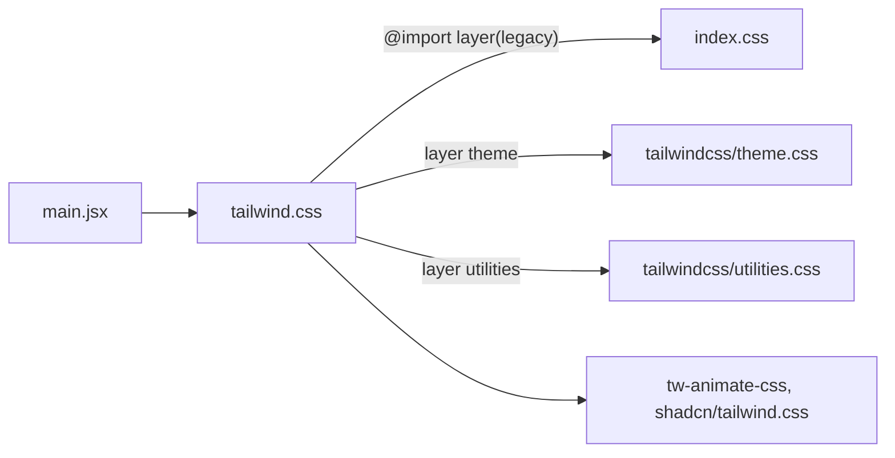

# Design system foundation: Tailwind v4 and shadcn/ui on main

## Problem

Every later story in epic #519 needs Tailwind v4, shadcn/ui and a way to run the new styles beside the hand-written `index.css`. The spike (#520, PR #524) proved the setup on a throwaway branch. This story lands only that setup on `main`, with no visible change, so later stories start from a clean base.

## Scope

In: dependencies, Vite plugin and `@` alias, `jsconfig.json`, `components.json`, `src/tailwind.css` with the layered legacy sheet, a guard test, lint handling for generated components, docs.

Out: tokens, fonts, palette, any component, any page change (stories #527 onward). No `/ds-spike` route. No changelog entry, because nothing ships that a visitor can see.

## Solution

Layer order: `@layer legacy, theme, base, components, utilities;`. Unlayered CSS always beats layered CSS, so putting `index.css` in the lowest layer lets every Tailwind utility win over its `* { padding: 0 }` reset. Preflight is never imported, so unmigrated pages do not shift. This is finding 1 of the spike doc; findings 2 to 4 are handled below.

Source of truth for every step: `docs/planning/2026-11-20-design-system-spike-design.md` ("Build setup") and the proven branch `520-design-system-spike` (read-only reference; none of its code is merged).

## Decisions and tradeoffs

| Decision | Choice | Why |
|---|---|---|
| Class-name helper | shadcn's own `cn` package, pinned, re-exported from `src/lib/utils.js` | First planned `clsx` + `tailwind-merge`. Execution found the CLI generates `import { cn } from "cn"` and the registry shows `cn` is shadcn's (maintainer shadcn, repo shadcn-ui/cn), so one source is simpler than two. **My call; matches the spike doc.** |
| Generated base layer | Not added | Finding 2. The preset's `@layer base { * {border-color}, body, html }` would restyle every old page. `tailwind.css` has no `base` layer content. |
| shadcn tokens | Not added here | They collide with the site's `--accent` and `--radius`. They arrive in #527 on a scope class. |
| Unused `React` import in generated files | `eslint.config.js` override for `src/components/ui/**`: `no-unused-vars` with `varsIgnorePattern: '^React$'` | Finding 4. Narrower than ignoring the folder: everything else in it is still linted. Prettier still formats it. |
| `shadcn` and `tw-animate-css` | Dev dependencies | Both are read at build time only (their CSS is imported). As runtime dependencies the CLI tree (217 packages) counted toward the production audit gate. Found in the cold review. |
| Finding 3 (links as buttons) | Documented only | It needs a component to apply to; #528 builds them. |

## Tasks

Model: Sonnet for all tasks (default). Each task is one commit. Work in `/Users/joey-haas/Developer/joey-haas.dev-worktrees/526-design-system-foundation`; push with `git push origin HEAD:526-design-system-foundation`. Run `npm ci` in `frontend/` first.

1. **Guard test (written first, shown failing).** `frontend/src/tailwindSetup.test.js` reads `src/tailwind.css` and asserts: the layer order line is exactly `@layer legacy, theme, base, components, utilities;`; `index.css` is imported with `layer(legacy)`; Preflight (`tailwindcss/preflight.css`) is not imported; there is no unlayered `@import 'tailwindcss'` outside a comment; no `@layer base` block exists. *Done when:* it fails on `main` (no file) and passes after task 3. Files: that test.
2. **Dependencies.** Install `tailwindcss`, `@tailwindcss/vite` (dev), `@base-ui/react`, `class-variance-authority`, `cn`, `lucide-react`, `tw-animate-css`, `shadcn`, at the versions the spike resolved (see its `package.json`). *Done when:* `npm ci` is clean and `npm audit --omit=dev --audit-level=high` passes. Files: `package.json`, `package-lock.json`.
3. **Config and entry.** Add `tailwindcss()` to the Vite plugins and the `@` alias; add `jsconfig.json`, `components.json` (`tsx: false`, `css: src/tailwind.css`, `style` base-luma as proven), `src/tailwind.css` (header comment carries the plain `@import "tailwindcss";` text so the CLI's check passes, real imports stay layered), `src/lib/utils.js`; `main.jsx` imports `./tailwind.css` instead of `./index.css`; eslint override from the table. Check whether any other file imports `index.css` or other unlayered CSS (a stray unlayered sheet would now beat legacy rules) and list what is found in the PR. *Done when:* the guard test passes, `npm run build`, `npm run lint`, `npm run format:check` and `npm test` are clean. Files: `vite.config.js`, `jsconfig.json`, `components.json`, `src/tailwind.css`, `src/lib/utils.js`, `src/main.jsx`, `eslint.config.js`.
4. **Prove nothing moved.** Build `main` and the branch; compare the built CSS (the legacy rules must be identical apart from the layer wrapper; report the size delta). Run `npx shadcn add button` in a scratch clone, confirm it works with no prompt about a missing CSS file, that its generated file lints after format, then discard it (no component is committed). Run `e2e` and `e2e:visual` locally and say plainly what ran; the visual baselines differ on this Mac for the same pixels as on clean `main`, so CI is the real check. *Done when:* the evidence is in the PR body. No files.
5. **Docs.** `frontend/CLAUDE.md`: a "Design system setup" section (layers, why Preflight is off, the four findings, how to add a component, the `cn` decision). `frontend/README.md`: the same in short, if it has a structure section. `docs/design-system.md`: one line pointing to the setup. *Done when:* each describes the setup and the four findings. Files: those three.

## Ship notes

- No migration. No `render.yaml` change. No secrets or production settings.
- Squash merge after `backend`, `frontend`, `e2e` and `e2e-admin` are read green on the PR (read `gh pr checks`, never an agent's "green").
- The static site deploys on push; the API deploy runs as usual and is unaffected.
- Not tracked: the `.superpowers/` folder and mockups stay out of git.

## Smoke check

After the deploy: `./scripts/smoke.sh https://joey-haas.dev https://api.joey-haas.dev` passes; `/` and `/shelf/games` look as before in both themes; `https://joey-haas.dev/ds-spike` is a 404 page.

## Open questions

- Does `shadcn` pass the production audit as a runtime dependency? Task 2 answers it, and the table has the fallback.
- Is `cn` shadcn's own package? Yes, checked on the registry (maintainer shadcn, repo shadcn-ui/cn).

## Sources

- Spike design doc: `docs/planning/2026-11-20-design-system-spike-design.md`
- Tailwind install and Preflight: https://tailwindcss.com/docs/installation , https://tailwindcss.com/docs/preflight
- shadcn on Vite: https://ui.shadcn.com/docs/installation/vite
- Repo rules: `CLAUDE.md` (changelog, planning docs), `frontend/CLAUDE.md`, `docs/learnings.md` (audit gate, stale installs, whole-repo pins)

## Found in review (cold Opus review, before the PR)

- **Blocker, fixed:** Tailwind's theme layer replaced the site's `--font-sans`, `--font-mono` and `--radius`, so every page lost Inter and JetBrains Mono. The plan's task 4 compared only the legacy rules and missed it. Fixed with an `@theme` redeclaration and a guard test for any new collision; computed styles of 8 routes in both themes now match `main`.
- Guard regex widened; docs corrected; `shadcn` and `tw-animate-css` moved to dev dependencies.
- Accepted: Tailwind v4's browser floor, `min-height:100vh` fallback no longer emitted, stray utility names (`.hidden`, `.block`...) emitted from source scanning (no collision today; documented).
- Open for the PR: Render's Node version must be 22 or newer for `cn` (checked in ship).
