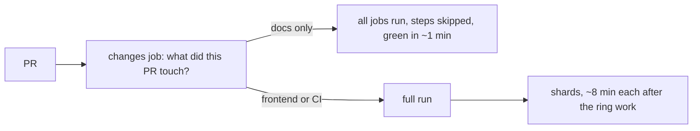

# CI speed

## Problem

Every PR waits on `e2e` and `e2e-admin`. Measured on ten green runs (five PR, five `main`, 2026-11-21 to 2026-11-23), before sharding: `e2e` 20.5 to 22.4 min (one 25.3), `e2e-admin` 20.8 to 21.7 min. The next slowest job, `backend-tests`, is 4.9 to 6.4 min. A docs-only PR runs every job and waits the same 21 minutes. A re-run after a one-line fix pays it again.

Goal: browser checks about 10 minutes or less per PR, a docs-only PR green in under 5, no loss of the pins that caught real bugs.

## What was measured

Source: `gh run view --json jobs` for 16 runs (10 pre-shard, 5 on PR #599's branch, 1 in progress) and the full job logs of one pre-shard `e2e` and `e2e-admin` pair (run 45156640453, parsed per test from Playwright's list reporter). Step times are from three pre-shard runs and one sharded run.

| Finding | Number |
|---|---|
| Queue before a job starts (pre-shard) | 2 to 4 s (one run 21 s). The 300 to 390 s "queue" on the `backend` aggregate is it waiting on `backend-tests`, not a queue |
| Per-job overhead, browser jobs | checkout + `npm ci` 8 to 10 s, Postgres container 19 to 22 s, Chromium install 15 to 29 s (outliers 49 s, 60 s and **217 s** on sharded runs), `npm run build` 8 to 11 s, visual step 20 to 23 s (36 snapshots). Roughly 60 to 90 s of a 1,200 s job |
| Tests, `e2e` | 880 tests, 1,890 test-seconds in 1,225 s wall (so about 1.5 workers busy: Playwright's CI default, not set in `main`'s config). **`admin-add.spec.js` alone is 1,218 s of it** (193 tests), so one file set the wall time |
| Tests, `e2e-admin` | 308 tests, 2,175 test-seconds. `admin-closet` 851 s, `admin-denver-site` 744 s, `admin-data` 437 s, `admin` 143 s |
| **Where the test time goes** | Tests titled `focus rings paint…`: **76 tests = 1,268 s of 1,890 s in `e2e` (67%), 108 tests = 1,759 s of 2,175 s in `e2e-admin` (81%). 3,027 of 4,065 test-seconds (74%).** Single tests take 25 to 78 s (`discover` at 390 and 1280 px, light and dark: 72 to 78 s each). They press Tab through every control and measure pixels (`tabRings`, copied in three files: `denver-site-ring.js`, `admin-data-ring.js`, `closet-ring.js`) |
| Other repeated checks | `sideways scroll` 448 tests, 314 s (8%); axe 188 tests, 251 s (6%); tap targets 25 tests, 18 s |
| Retries | 0 in the two logs read (no `flaky` line). I did not scan the other eight runs' logs, so "retries cost nothing" is established for one pair only |
| Failures in the window | 4 non-green PR runs (2 failed, 2 cancelled by a newer push). One failure is `e2e-admin` "Run admin browser tests"; I did not open the other failed run's log |
| `frontend` job | 2.7 to 4.4 min; vitest is 150 to 204 s of it |
| `backend-tests` / `backend-migrations` | pytest 217 to 303 s / 82 to 117 s |
| Deploy API (3 runs) | 7.1 to 8.3 min: `wait-for-ci` 4.7 to 5.3 min (it is `backend-tests` plus a 15 s poll), then migrate + hook + wait for `/api/version` 77 to 91 s + smoke 22 to 24 s. The 180 s smoke retry never fired. **Browser jobs are not on the deploy path** |
| Build sharing | `npm run build` is 8 to 11 s. Sharing one build artifact across shards saves under 10 s per shard and adds an upload and download. Not worth doing |
| PR #599 (merged as a638b206 after this was measured) | Sharded runs: 22.1, 16.1, 11.2, 10.1, 11.7 min for `e2e`; 16.0, 12.2, 8.5, 8.1, 7.9 min for `e2e-admin` (end of run, from run creation). Shards spend 172 to 446 s in tests. Total runner minutes went up (8 shard jobs instead of 2) |

Could not measure at first: per-test time inside the sharded runs (only step totals), whether `workers` is really 2 in CI (inferred from 1,890 s of tests in 1,225 s; the brief said `--workers=1`, but `playwright.config.js` on `main` sets none), per-control cost inside `tabRings`, and Playwright browser cache hit rates (no cache step exists).

## Scope

In: `.github/workflows/ci.yml` (change detection, gating), the focus-ring test helpers and the specs that use them, Playwright worker settings, shard balance, backend pytest parallelism, docs of all of it (`.github/workflows/README.md`, root `CLAUDE.md` Ship and CI jobs).

Out: PR #599's sharding itself (merged; this plan builds on it), `deploy.yml`, `scripts/wait-for-ci.sh`, any repository setting, secret, variable or branch-protection change (always-stops: a story that needs one is `needs-joey` and nothing here makes it), larger paid runners.

## Options

| Option | Saves | Tradeoff | Decision |
|---|---|---|---|
| **Sharding (#599)** | 21 to about 7 to 13 min | More runner minutes (about +20%), more concurrent jobs per run (13 instead of 5) | **Merged.** Tune after the other cuts |
| **Speed up `tabRings` without dropping a case** (one shared helper, less work per control) | Up to ~20 to 40% of 3,027 test-seconds if per-control cost allows; **unverified**, hence a measuring step first | No coverage change. Needs a profile of one 72 s test | **Do first** |
| **Run a smaller focus-ring matrix on PRs, the full one nightly** | Up to half of 3,027 test-seconds | **Demotes coverage.** See "Coverage changes" below. Nightly catches it a day late | Only if the helper work is not enough. `needs-joey` |
| **Docs-only / backend-only gating** | docs-only 21 min to about 1 min | Needs a `changes` job. `deploy.yml`'s wait counts only `success` for `backend` and `frontend` (`scripts/wait-for-ci.sh`), so those two jobs must still end `success`, not `skipped`, or a docs-only merge would stall the deploy for 30 min. So keep both jobs and gate their **steps**. Do not use workflow `paths-ignore`: required checks would stay pending forever | **Do** |
| More workers (3 to 4 on the 4-vCPU public runner) | maybe 20% of shard time | CPU contention can flake the pixel-measuring ring tests. Admin specs share one database per job, so per-file only there | Measure after the ring work, three reruns |
| Re-balance shards from real per-file times | 1 to 2 min | Splits go stale as specs grow | Do after the cuts, so the numbers are final |
| Browser install: cache `~/.cache/ms-playwright` or the Playwright container image | 20 to 60 s typical, up to 200 s on the bad runs | The cache does not skip the apt step in `--with-deps`. The container image changes fonts, so the visual baselines (rendered on the runner) would need regenerating | Measure first; cache only if it saves over 30 s; container is out unless baselines are regenerated on purpose |
| Share one build across shards | under 10 s per shard | Upload and download cost about the same | **No** |
| Vite or npm cache | npm cache already on (`setup-node cache: npm`), build is 10 s | none | **No** |
| Visual step as its own job | 20 to 23 s | One more job and runner start | **No** (a shard-local 23 s) |
| `pytest-xdist` for `backend-tests` | `wait-for-ci`, so Deploy API, by about 2 min | `tests/testdb.py` drops and recreates one schema per checkout: needs one database per worker. Medium risk | **Do, lower priority**, not on the PR critical path |
| Trim Deploy API waits | seconds | `wait-for-ci` poll is 15 s; the Render build wait is external | **No**. The lever is `backend-tests` |
| Larger runners | unknown | Paid | **No** |
| Cancel superseded runs | already on for PRs (`concurrency` in `ci.yml`) | none | Nothing to do |
| Collapse the width × theme sideways and axe cases | about 8% and 6% of test time | Per-case reports lost | **No**: cheap per test, and it is the pin that caught real bugs |

## Coverage changes

Nothing is dropped or demoted by any chosen story except the one marked `needs-joey`.

That story would run, on a PR, only two of the four width × theme combinations of every `focus rings paint…` test (proposed: 390 px light and 1280 px dark) and move the other two to a nightly job. Exactly the tests affected: the 76 in `e2e` (`admin-add`, `admin-home`, `admin-shelf`) and the 108 in `e2e-admin` (`admin-closet`, `admin-denver-site`, `admin-data`, `admin`), 92 of the 184 would move to nightly. The reason is time (74% of test time); the cost is that a ring regression visible only at 390 px dark or 1280 px light reaches `main` and shows up the next morning. I recommend not doing it unless the helper work leaves the browser checks over 10 minutes.

## Decisions

1. Order: the ring-helper profile first, then docs gating (independent, can run at once), then workers and shard balance last, because balance depends on final test times.
2. Gating keeps the job names and keeps `backend` and `frontend` concluding `success`. `e2e` and `e2e-admin` aggregates also conclude `success` when gated off.
3. Change detection uses `git diff --name-only` in a first job, not a third-party action (the repo pins actions that hold secrets by SHA, and this needs none). A failed or ambiguous detection runs everything.
4. "Docs only" means every changed file is outside `frontend/`, `backend/`, `scripts/`, `.github/` and `render.yaml`, or is a `docs/**` or root `*.md` file. `frontend/changelog.md` counts as frontend: the build parses it.
5. `deploy.yml` and `wait-for-ci.sh` do not change.

## Risks

1. ~~Concurrent job cap.~~ **Disproved (#605).** The "26-minute queue" was a measurement mistake: that run was attempt 3 (re-run at 16:07), and `created_at` stays the original time. Attempt 1's jobs started 1 to 3 s after creation, no other run existed in the window, and GitHub listed no incident. Queue time must be measured per attempt: job `started_at` minus that attempt's own job `created_at`.
2. Ring tests flake under more workers (CPU-bound pixel work).
3. A gating bug that skips a needed suite on a frontend PR. Mitigation: fail open, and a test of the detection script against sample file lists.
4. Chromium install outliers (217 s) keep a run slow regardless of everything above.

## Estimated outcome

Pre-shard 21.5 min. With #599 about 11 min. With the ring helper work and tuned workers and balance, an estimated 7 to 9 min (not measured). Docs-only: about 1 min. Deploy API: about 8 min now, about 6 with xdist.

## Addendum: facts from the migration session (2026-11-23, after the first draft)

These correct or extend the measurements above.

- #599 merged. Measured by that session over 4 runs: `e2e` 21.6 to 6.8 to 12.9 min, `e2e-admin` 20.9 to 7.5 to 8.6 min, runner minutes 42.5 to 51. Plain `--shard=i/N` failed (Playwright cuts equal test counts and the slow focus-ring tests sat together), so the matrices are named shards fed by `E2E_SKIP_FILES`, with `--fully-parallel`; the visual step runs in the `e2e` `rest` shard only. **The split keys on the test title text `focus rings paint`**: stories that touch those tests must keep the title, or a shard slows (nothing is skipped).
- A live measure of a docs-only PR today: #600 (this doc, based on pre-shard `main`) took 24 min for `e2e-admin` and 22 min for `e2e`. Rebased on the sharded `main` it would be about 8 to 13 min. Gating (#604) is still the whole saving for it.
- Shared build artifact stays rejected: build is 8 to 11 s, against about 2 to 3 min of fixed setup per shard in which Chromium install and the Postgres container are the larger parts.
- New friction, not CI minutes: full local verification is slow (style dump about 15 to 25 min quiet, 1 h 45 min under load; load average peaked at 150 with overlapping Playwright runs; local `e2e:admin` timed out 8 tests under load that passed 24 of 24 on a filtered rerun). Stories: a documented fast local check, and a stale-`node_modules` check (the admin config listed 0 tests when `class-variance-authority` was missing).
- A baseline regeneration (`update-visual-baselines.yml`) makes a bot commit that does not start CI, so each PR needs an empty commit. A fix that dispatches CI from the workflow works without a token; one that uses a PAT or app is a secret change and `needs-joey`.
- One focus-ring test flaked once (admin-add, 1280 px dark, passed on rerun); `retries: 1` hides how often. Measuring retry counts moves into the tuning story.

## Outcome (2026-11-23)

Measured on real runs; "before" is the pre-shard runs in the table at the top.

| Change | Result |
|---|---|
| #599 sharding (the migration session) | `e2e` 21.6 to 6.8 to 12.9 min, `e2e-admin` 20.9 to 7.5 to 8.6 min; about +20% runner minutes |
| #604 docs-only gating (#614) | a docs-only PR's CI: 21 s (was 22 to 24 min); a docs-only push to `main` passes Deploy API's `wait-for-ci` in 7 s (was about 5 min). Check names and `wait-for-ci.sh` unchanged; skipped parts pass only when `changes` succeeded and said `heavy=false` |
| #603 one focus-ring helper, settle instead of sleeps (#615) | one `unringed` test 87 to 63 s locally; shard test steps 5 to 35 s shorter (add-1 207 to 173 s, add-3 199 to 158 s, cd-3 388 to 352 s). Smaller than the sleeps alone suggested: the ring colour transition is a real 150 ms, so `settle` mostly waits it out |
| #606 four workers (#617) | the runner defaulted to 2 workers. With `E2E_WORKERS=4` test steps fell 35 to 50%: rest 377 to 234 to 273 s, cd-3 352 to 175 s, cd-1 295 to 142 s, add-3 158 to 90 s. Three runs green, no flaky lines. Shard balance left alone: setup variance now dominates a shard's wall time |
| #607 Chromium install retry (#618) | the apt step, not the download (4 s), was the slow part: `Fetched 21.9 MB in 2min 25s (151 kB/s)`, 158 to 226 s on one or two shards of every run. Cap 75 s and retry (up to three). The first CI run exposed a bug: the root `apt-get` survives the kill and holds the dpkg lock (`Could not get lock`, exit 100); fixed by killing it before the retry and proven on the runner with a forced 10 s cap. Final runs: max install 43 to 58 s |
| #611, #612 (#619) | fast local check in the README; `npm run doctor` (it flags the stale main checkout today) |
| #613 CI after baseline regeneration | **Not done, `needs-joey`.** `workflow_dispatch` starts CI on the bot's commit but the PR does not count it (BLOCKED, null rollup); the bot's own `pull_request` run waits at `action_required` |

Now: browser checks run about 5 to 6 minutes per code PR (slowest job 4.7 to 5.7 min on the last runs), and `backend-tests` (4.6 to 6.2 min) is the critical path with them. #608 (parallel pytest) therefore also shortens a PR's wait, not just the deploy. #609 (half the focus-ring matrix on PRs) is no longer needed for the 10-minute goal; recommend closing it as not planned.

## Smoke check

On the PR for each story: read the real run, report per-job times against the table above, confirm the test counts match (`e2e` 844 passed / 690 skipped, `e2e-admin` 308 passed / 52 skipped, visual 36), and for gating confirm a docs-only PR shows `backend` and `frontend` as `success`, and a push to `main` of one runs `deploy.yml` through its wait. A deliberately red test turns the matching aggregate red.

## Sources

`.github/workflows/ci.yml`, `deploy.yml`, `README.md`; `scripts/wait-for-ci.sh`; `frontend/playwright*.config.js`; run logs by id: 45156640453 (per-test), 45118882144, 45205716929 (steps); PR #599 and `docs/planning/2026-11-23-ci-shard-design.md`.
