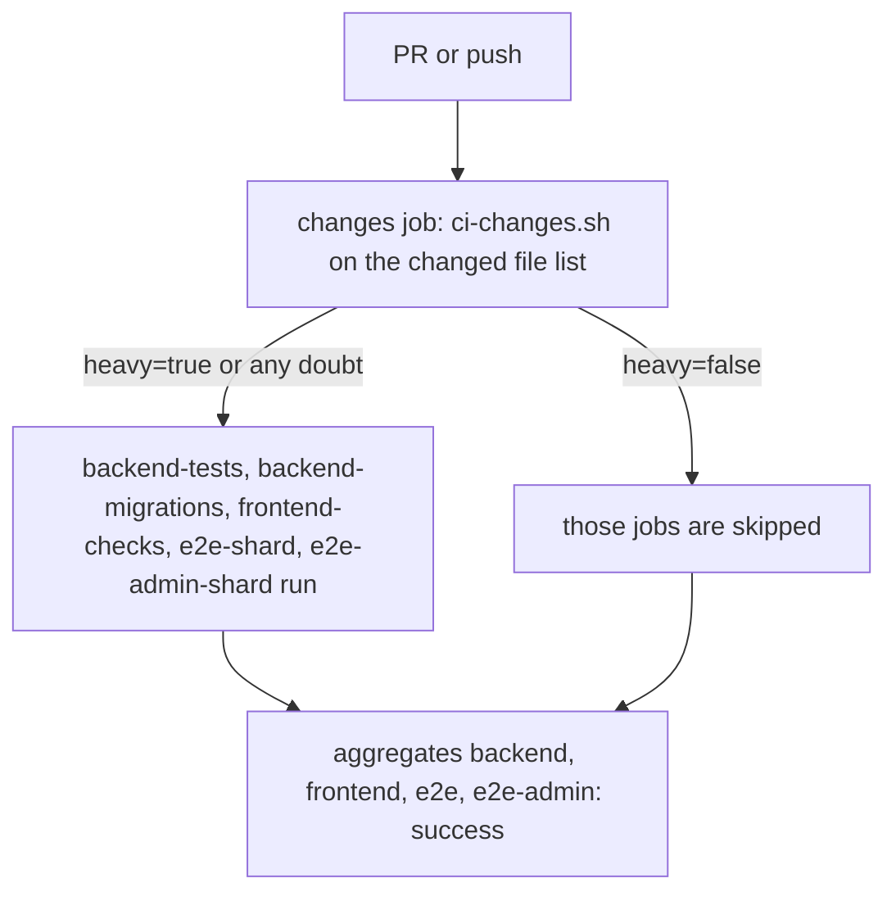

# Skip the heavy CI steps on docs-only PRs

Spec for the epic: `docs/planning/2026-11-23-ci-speed-design.md` (PR #600).

## Problem

A docs-only PR runs every job. PR #600 (one markdown file, based on pre-shard `main`) took 22 min for `e2e` and 24 min for `e2e-admin`; on the sharded `main` it would still be about 8 to 13 min. Two constraints shape the fix:

- `scripts/wait-for-ci.sh` counts only a `success` conclusion for `backend` and `frontend`. A job that ends `skipped` would make a docs-only merge to `main` wait the full 30 minutes and then refuse to deploy.
- Workflow-level `paths-ignore` leaves required checks pending forever.

## Scope

In: `ci.yml`, a new `scripts/ci-changes.sh` and its test, `scripts/README.md`, `.github/workflows/README.md`, root `CLAUDE.md` (CI jobs).
Out: `deploy.yml`, `wait-for-ci.sh`, branch protection, `e2e-admin` for backend-only PRs (it runs the backend; it keeps running).

## Solution

- New `changes` job (checkout with full history, as `neon-rehearsal` already does): lists changed files (PR: `origin/$BASE...HEAD`; push: `github.event.before..sha`) and pipes them to `scripts/ci-changes.sh`, which prints `heavy=true|false`. Anything unexpected (empty list, no `before` sha, a git error) prints `heavy=true`.
- Docs-only means every changed file is under `docs/`, is a root `*.md`, or is under `.github/ISSUE_TEMPLATE/`. Everything else is heavy, including `frontend/**.md` (`prettier --check .` and the changelog parser read them), `.github/workflows/**` and `render.yaml`.
- The heavy jobs take `needs: changes` and `if: needs.changes.outputs.heavy == 'true'`.
- `frontend` today is a plain job, not an aggregate. Its current steps move to `frontend-checks` and `frontend` becomes an aggregate in the same style as `backend`. The name `frontend` stays on the aggregate alone.
- Each aggregate (`backend`, `frontend`, `e2e`, `e2e-admin`) passes when its parts are `success`, **or** when its parts are `skipped` **and** `changes` succeeded **and** `heavy` is `false`. A skipped part with a failed or cancelled `changes` fails the aggregate, so the gate cannot silently open.
- `scripts` and `neon-rehearsal` are unchanged.

## Decisions (my calls)

1. `git diff` in a job, a script with a test; no third-party path-filter action.
2. Skip at the job level (cheap, no `if:` on every step) and keep the names with aggregates.
3. The detection script is the one place the "docs-only" definition lives.

## Tasks

Model: Sonnet for all; one implementer at a time.

1. **`scripts/ci-changes.sh` and `scripts/ci-changes.test.sh`.** Reads file names on stdin, prints `heavy=true|false`.
   Acceptance: the test covers docs only (`docs/x.md`, `README.md`) → false; `frontend/changelog.md`, `frontend/README.md`, `backend/x.py`, `.github/workflows/ci.yml`, `render.yaml`, `scripts/smoke.sh`, `CLAUDE.md` plus a frontend file → true; empty input → true; a name with spaces; `docs/` plus ISSUE_TEMPLATE → false. Added to the `scripts` job. `scripts/README.md` gets a section (what, why, usage, gotcha).
2. **`changes` job and gating in `ci.yml`.** Acceptance: `actionlint` (or `yq`) clean; `backend-tests`, `backend-migrations`, `frontend-checks`, `e2e-shard`, `e2e-admin-shard` gated; four aggregates as above; `frontend-checks` has exactly the old `frontend` steps.
3. **Docs.** `.github/workflows/README.md` (the gating, the skipped-aggregate rule, why not `paths-ignore`); root `CLAUDE.md` CI jobs; a `frontend/changelog.md` entry is **not** needed (no user-facing change).
4. **Proof, in order.**
   a. This PR touches `.github/`, so it is heavy: read the real run, all four aggregates `success`, test counts as before (`e2e` 844 passed / 690 skipped, `e2e-admin` 308 passed / 52 skipped, visual 36).
   b. After it merges, push #600 (docs-only) up to date with `main`: expect `backend`, `frontend`, `e2e`, `e2e-admin` all `success` in about a minute.
   c. Merging #600 is a docs-only push to `main`: `Deploy API` must pass its `wait-for-ci` step. Read the run.
   d. One throwaway PR touching a single `frontend/` file shows the full suite still runs; close it unmerged.

## Risks

- A mistake in the aggregate condition passing a red skipped part: covered by the failed-`changes` rule and proof 4a/4d; also try one throwaway commit where `changes` is forced to fail.
- A docs-only definition that is too wide: it is deliberately narrow; widening is a later one-line change in the script.
- Branch protection reads check names only; names are unchanged. No setting, secret or variable changes.

## Ship notes

CI-only. No migration. Not user-visible. Rollback: revert the PR.

## Smoke check

Proof 4a to 4d above.
